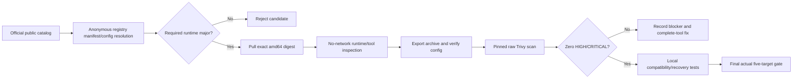

# Phase 06: Strict image gate alternatives — bounded research

**Researched:** 2026-11-07. **Confidence:** HIGH for identities and measured scans; MEDIUM for migration/build feasibility. **Scope:** public image assessment only; no implementation, source builds, production access or gate completion. [VERIFIED: task authorization; local probe evidence below]

## User Constraints

No Phase06 CONTEXT exists according to the current Plan08 context. The current task explicitly authorizes alternative images and supersedes the earlier same-base restriction. Preserve Python3.14, PostgreSQL18, Node24 and Redis8; preserve existing application locks while identifying any unavoidable tool dependency obstacle. Keep raw HIGH/CRITICAL, including unfixed findings, without VEX, ignores, waivers or severity changes. Local only: no push, provider/live operation, credential access, login, accounts, `.env` or `.aws` inspection. [VERIFIED: parent task; 06-08-PLAN.md]

This report owns only this research document and public-image probes under `/tmp`. No plan, source, STATE or existing image evidence was changed. No commit is authorized for this research. [VERIFIED: task authorization; working-tree inspection]

## Summary

The public Chainguard PostgreSQL starter is a viable **scan candidate**: actual PostgreSQL18.6, glibc2.44, raw Trivy0.76.1 HIGH0/CRITICAL0. Its postgres UID/GID70 and default PGDATA differ from the current Debian UID999/versioned layout. This is not evidence that an existing production volume can be attached safely. Chainguard explicitly warns about collation changes and recommends reindexing before production use. [VERIFIED: `postgres-cgr-runtime.txt`, `postgres-cgr-scan-status.json`; CITED: https://images.chainguard.dev/directory/image/postgres/overview]

The public Python starter is3.15.2 and the Node starter catalog targets26, so neither satisfies the fixed3.14/24 requirement. Anonymous Python3.14 and3.14-dev tag requests returned404. Official Python3.14.10 and Node24.22.2 Alpine3.24 images have zero OS HIGH/CRITICAL rows, but retain five Python and six npm rows respectively before complete tool replacement/removal. Public Chainguard Redis8.10.3 passes the same raw gate; it changes the current8.8 minor series. [VERIFIED: registry resolution/config files and measured runtime/scans below; CITED: https://images.chainguard.dev/directory/image/node/specifications]

**Primary recommendation:** plan a small, reviewed glibc-preserving implementation spike using the pinned public Wolfi base plus officially published Python3.14/Node24 APK packages, the passing pinned PostgreSQL18.6 and Redis8.10.3 candidates, and existing complete npm replacement. Treat the required test-builder pip bundle as a separate blocking dependency problem: even official latest pip26.3 still vendors setuptools70.3.0, below the scanner's78.1.1 fix. Do not promise five-target success from a base change or pip update. [VERIFIED: official Wolfi index; `pip-latest-inspection.json`; existing image reports; recommendation derived from those observations]

**Narrow audit-scope option for the planner:** repository CI invokes `uv run pip-audit` on its host; `pip-audit` currently belongs to the combined dev group and pulls pip-api/pip into test-builder. A dedicated locked audit group, retained in default host/CI sync but excluded as a whole from the test-only image, may remove an unnecessary image capability while preserving the mandatory audit. This is a proposed dependency-boundary change, not a file deletion or accepted vulnerability. It needs explicit plan/review, verified uv group semantics, unchanged application dependency versions, successful host audit and actual in-image tests proving pytest/migrations still work and the complete unused audit chain is absent. [VERIFIED: backend/pyproject.toml; backend/uv.lock; .github/workflows/ci.yml:50; ASSUMED: proposed grouping feasibility, pending implementation proof]

## Project Constraints (from AGENTS.md)

- Read full CLAUDE and PROJECT/REQUIREMENTS/ROADMAP/STATE before planning; continue the existing project, preserving completed history and progress established from code/artifacts. [VERIFIED: AGENTS.md]
- Use GSD skill/adapter and maintain research, plan checks, dependencies, checkpoints, reviews, verification and summaries; delegation follows the session's rules. [VERIFIED: AGENTS.md]
- Preserve `.planning/`, Claude configuration and others' work; do not reset or stage unrelated changes. [VERIFIED: AGENTS.md; CLAUDE.md; task ownership]
- Keep MVP scope, money precision, architecture, migration and security/testing requirements in CLAUDE; never pip-install directly into the project. [VERIFIED: AGENTS.md; CLAUDE.md]
- Keep pinned/scanned images, nonroot service execution, internal datastore ports, locked dependencies, full CI gates and push/merge approval requirements. [VERIFIED: CLAUDE.md]
- UI skill/design-system instructions apply if UI work is introduced; this research has no UI work. Setup-maintenance sync validation applies to setup changes, which are outside this task. [VERIFIED: AGENTS.md; task scope]

<phase_requirements>
## Phase Requirements

| ID | Description | Research Support |
|---|---|---|
| DEPL-01 | Friends can open the app at a public domain over HTTPS, sign up and trade. | Alternative image feasibility for blocked08 gate; no live acceptance implied. |
| DEPL-02 | Production data is backed up nightly off the server, and a restore has been tested once. | UID/path/collation and recovery/rollback adaptations identified before any PostgreSQL replacement. |

Requirement descriptions are from REQUIREMENTS.md; research support describes this document's scope. [VERIFIED: .planning/REQUIREMENTS.md; 06-IMAGE-GATES.md]
</phase_requirements>

## Architectural Responsibility Map

| Capability | Primary tier | Secondary tier | Rationale |
|---|---|---|---|
| Image identity and raw vulnerability gate | Local build/CI | Public registries | Resolve index→amd64 manifest→config and scan exact exported bytes. |
| Python/Node toolchains | Build containers | API/runtime | Keep runtime majors and locked app dependencies; scan actual built stages. |
| PostgreSQL ownership/layout/collation | Database/storage | Recovery/operations | Data state, TLS permissions and offline recovery require coordinated validation. |
| Redis replacement | Cache service | API/session clients | Preserve password, TTL/noeviction, healthcheck and persistent-data compatibility. |

These ownership recommendations follow the existing Dockerfiles, Compose and operations boundaries. [VERIFIED: backend/Dockerfile; frontend/Dockerfile; docker-compose.prod.yml; deploy/verify-restore.py]

## Standard Stack and Candidate Assessment

The following public image names were discovered in official catalogs before registry probing. Every recorded digest was computed from returned manifest/config bytes; tokens were anonymous registry-issued pull tokens only. Docker pulls used a new empty `/tmp/birja-alt-empty-docker/config.json`; stored credential configuration/helpers were never read. [VERIFIED: `/tmp/birja-alt-image-probe.py`; `/tmp/birja-alt-official-probe.py`; `/tmp/birja-alt-scan.py`]

| Candidate | Actual version / libc / user | Raw outcome | Disposition |
|---|---|---|---|
| Chainguard postgres latest |18.6 / glibc2.44 / default0, postgres70:70 |0 HIGH,0 CRITICAL; exit0 |Preferred PG candidate; requires data/UID/collation work. |
| Chainguard python latest |3.15.2 / glibc2.44 /65532 |0/0; exit0 |Reject for Python3.14 scope. |
| Chainguard python latest-dev |Config65532; exact manifest resolved, not pulled |Not scanned |Same catalog3.15 family; no3.14 evidence. |
| Chainguard node latest/latest-dev |Official current catalog nodejs26; exact configs resolved |Not pulled/scanned |Reject for Node24 scope. |
| Chainguard redis latest |8.10.3 / Wolfi / config65532, `/data` |0/0; exit0 |Viable same-major candidate;8.8→8.10 compatibility needs proof. |
| Official Python3.14.10 Alpine3.24 |3.14.10 / musl / default0 |OS0/0; bundled Python5 HIGH; exit1 |Backup only; global pip removal needs actual build proof; builder venv remains separate blocker. |
| Official Node24.22.2 Alpine3.24 |24.22.2 / Alpine3.24.4 / default root config |OS0/0; npm6 HIGH; exit1 |Backup only; retain complete verified npm11.21.2 replacement. |
| Official PG18.6 Alpine3.24 |Config18.6, versioned PGDATA |Resolved only |Backup only; musl/collation risk, no scan pass asserted. |
| Official Redis8.8.4 Alpine3.23 |Config8.8.4, `/data` |Resolved only |Backup if preserving8.8 is required; no scan pass asserted. |
| Chainguard wolfi-base latest |Config user0, shell; runtime package installation supported by vendor |Base scan recorded separately below |Preferred glibc package-based feasibility spike; assembled Python/Node images have not been built/scanned. |

Sources for this table: local `*-resolution.json`, `*-runtime.txt`, `*-scan-status.json`; official Python/Node/Postgres/Redis image catalogs and Chainguard specification pages in Sources. [VERIFIED: those local probe files; CITED: official sources below]

### Immutable identities

All values in the following table are verified public registry bytes, not inferred Docker IDs. [VERIFIED: `/tmp/birja-alt-image-evidence/*-resolution.json`, `*-index.json`, `*-manifest.json`, `*-config.json`]

| Candidate | Index SHA256 | linux/amd64 manifest SHA256 | Config SHA256 |
|---|---|---|---|
| cgr postgres latest |`f131db66371391e404c80cef7dd40f31b1b54eb264a6cb032925d9a3859f93f4`|`4401cf2919e749cd77b634a72e4a677c1a1afc12baddb21faf28df326162472e`|`91c89cf7f1f18cc4d96fcb5b9e2438108569c1dfcd5aa7286f9cad7d75742ed4`|
| cgr postgres latest-dev |`6b51e6c86e609b052e40a3689249b58c45b816be7524d6b8f0546a49ad19dd4f`|`3f12033ccd330632fccfc85435fa7a3f5498132c40127bec07a612322605077f`|`b30c9dd70f5c902739d9ea835bbeba136d4eb20b7f83b4963ccec844f7e019d5`|
| cgr python latest |`1a00964779bf570a8cb2ea4fa086614af19c35069029785c08fcec0c50b66ac0`|`b69a2c40e636e0aaef49b5e73da1a08a0c89e46ce706547bd7ddd0591ed2b902`|`c660da5ffaf6e60fb168b878fa7d902daab20b0b6ed43c144707c294161036ee`|
| cgr python latest-dev |`898360ca56a2a65c3facdd36a4e6151133a580aa367195261554e82948921ff1`|`bb16be8b36c2a339bc8567fdcbba83a88b899430acd6252214cb5a5df0cd5b2a`|`5c231cfd6b5800926fbd14c43005517f6f28046b3caf8ec79687b8d6fa1d313a`|
| cgr redis latest |`26bb2dd4412f902f3decd44fba5dfaef4360d97004d44f6cff7f28d6aba19c48`|`14703223e9dcc17ede60e0ad9075bb93d4911eaccc92255892cc31d56a8f4ec1`|`20fd1c1d7997a7bd67b6f607c79b056a7143c5472910b7e586ebcf9a736486e6`|
| cgr node latest |`6a066f8decea77c67ef2772a78fad81df7a78a346d0b22a05fc9dac14537f2b0`|`1654a3dd6cfef27143fa519a0284aa0092e0f89f716d1a1ec056ef6b1b8ac4b6`|`c1b2fac5a49243a469f77578a7402f91321720a4ee7504aec3f168500f400d65`|
| cgr wolfi-base latest |`24f549a7fcace88e69b9557941168c74645688ecc4acf7fb6d734a6b74e9019d`|`d833404331d631805e1536ec3633393504232549c1347a4b7fd008535d4874bf`|`1d3f98433a041e64392abef917252610b9cb99d638187cbd78beb11cf6559d5a`|
| python3.14.10-alpine3.24 |`a18b20ad69e74df6cf6d2e1b1a260d7a1ecf5380fd83b310f83ba88c461cf894`|`76c65fc8c52c4d375e958298d9f66198b8fb6b06416c0e5500bf710c19cbaa77`|`05318f6e99ea9af0049ac2c0de060fe663cd81ddcea9148ba9d5bbf87f2939ea`|
| node24.22.2-alpine3.24 |`a34ab6d7f6f4813f4d0c5469d74685604b962fbdbf5793a7bc7b4998ecb867c8`|`ec318aabf188af4e5488847eea4b24452650b9917140563e140762526a37f1df`|`e01e5017b0626d55cba2c8958213824928fae489499a7b421c00d98f2dd8bc36`|
| postgres18.6-alpine3.24 |`123b17998ccaf47e53b502e8c6a1e79afd8f579c6f3eec83c563da026f957395`|`300ebd02c6d4de9ee27ad7f6855d5d21b4d3a4a5117767c1197d284c635d9736`|`38b9ffe2d4c13d7c445b66306be6763dfa6f503689ea0c5b9f84544ccf3ca8e4`|
| redis8.8.4-alpine3.23 |`c027ae0f677dcf73d74038256f5b88c9ba7b11ccbfae97e96a9f091208d36125`|`b85e284e14f616937c8e94a5d0374a6cfa6eb4bc5d6ab4ce59e38eca2fcec476`|`7b6c9d63c738417045484e8ee00d8927f767ca5fbf7e05837749ea69e7c01a79`|

### Authentication and licensing boundary

The public cgr starter references above resolved anonymously. Their catalogs advertise free starters and direct requests for specific-tag access to Chainguard. Anonymous `python:3.14` and`:3.14-dev` returned MANIFEST_UNKNOWN404; this proves those precise public tags were unavailable, not that no private/versioned offering exists. No account/private registry/paid image was used. [VERIFIED: public request evidence; CITED: https://images.chainguard.dev/directory/image/python/overview]

Docker's official DHI guide requires `docker login dhi.io` for Community pulls. DHI was not probed/pulled and no credential config was inspected. DHI versioned candidates remain an access-dependent option for a separately authorized parent workflow. This research makes no claim that DHI would pass the raw scanner. [CITED: https://docs.docker.com/dhi/how-to/use/; VERIFIED: executed probe scope]

Wolfi package index license metadata reports Python PSF-2.0, nodejs24 MIT and glibc LGPL-2.1-or-later. This is component metadata, not a complete image redistribution/legal audit. Chainguard starter access is distinct from a commercial support or remediation entitlement; none is assumed here. [VERIFIED: `wolfi-latest-packages.json`; CITED: official catalog free-starter text]

## Raw Scan Evidence

Scanner: existing `aquasec/trivy@sha256:2e6c00d711ab4ae41d8a30c2c1fd3bd3b62704c177bb120f95012e939edfb3df`, actual version0.76.1. All scans used exported immutable image archives, read-only root, bounded512MiB `/tmp` tmpfs, cap-drop ALL/no-new-privileges, and only private generated archive/cache bind mounts. No source/private files or Docker socket were mounted. Scan command retained `--scanners vuln --severity HIGH,CRITICAL --exit-code 1 --timeout 5m --format json`; no unfixed exclusion/VEX/ignore. Scanner user matched the private archive/cache owner. [VERIFIED: `/tmp/birja-alt-scan.py`; `scanner-version.json`; deploy/scan-images.py]

| Image | HIGH / CRITICAL | Raw exit | Report SHA256 | Pull/inspect/export/scan seconds |
|---|---:|---:|---|---:|
| cgr postgres18.6 |0/0 |0 |`2b8e4cced0df68703b19590b36d3cb1707ae8eea12fa4b6fc48fa1b2d6fff76d`|16.431 |
| cgr python3.15.2 |0/0 |0 |`3e15176ac856340695f441152b67f33933405b9e65d284fb74d9e116b29660f7`|14.497 |
| Python3.14.10 Alpine |5/0, all Python |1 |`a49ea5ee906faec1be055a397232b7781abfd3c8e4462ac95564a7cc05139de1`|12.562 |
| Node24.22.2 Alpine |6/0, all Node |1 |`fcd39f9d2d9c0edbaa7bf3f4511447cea419a2e4d5ce1ae25d748661d55e26dc`|14.288 |
| cgr Redis8.10.3 |0/0 |0 |`933399efeb288665b89d5c5cdeec15b1e8fc3ea1bdc73dff1c171e6aaaba7c66`|11.661 |
| cgr Wolfi base |0/0 |0 |`0771d4873740470d4070fbc50e82038b9cc6597929cbae106d5304bef880b1a6`|11.731 |

Counts are package-CVE rows, not unique CVEs or derived runtime reachability judgments. Report Metadata.ImageID was required to equal SHA256 of exported config bytes. DB UpdatedAt `2026-11-07T12:52:01.765289267Z`, NextUpdate `2026-11-08T12:52:01.765289037Z`; each target downloaded a fresh DB into its own private cache. Exact download times and archive hashes remain in `*-scan-status.json`. No unchanged old image was rescanned. [VERIFIED: local scan-status/report files]

Evidence root: `/tmp/birja-alt-image-evidence/`. Archives were deleted after recording config/archive hashes; reports, registry bytes, logs and public DB caches remain private local evidence. These are feasibility scans, not final five-target producer evidence. [VERIFIED: `/tmp/birja-alt-scan.py`; evidence directory]

## Architecture Patterns



This recommended flow preserves the existing producer identity/scan/recovery boundaries. A zero-count base scan does not bypass the actual assembled runtime, builder, PostgreSQL, Redis and Node checks. [VERIFIED: deploy/scan-images.py; 06-IMAGE-GATES.md]

### Minimum implementation adaptations

1. **PostgreSQL:** retain explicit PG18 layout or define a reviewed migration; map UID/GID70 throughout TLS key/group ownership and populated-volume handling. `deploy/provision-db-tls.sh` and rollback fixture explicitly use999. Verify entrypoint semantics: cgr config already includes `postgres` in Entrypoint while Compose command also begins `postgres`; do not carry the command list blindly. Actual cgr tools include shell/bash, gosu, pg_dump/pg_restore/psql/pg_isready/initdb at `/usr/bin`. [VERIFIED: config/runtime inspection; docker-compose.prod.yml; deploy/provision-db-tls.sh; deploy/tests/test-rollback-db-security.sh]
2. **Recovery:** update the exact trusted registry origin/index/manifest/config/optional-attestation graph and all package/recovery expectations together. `deploy/verify-restore.py` currently hardcodes Docker Hub PG18.6-trixie provenance. Keep strict unknown-graph rejection and import-only/no-pull recovery behavior; repackage/replay one exact final archive. [VERIFIED: deploy/verify-restore.py; 06-IMAGE-GATES.md]
3. **Python/Node:** use existing uv0.13.5 and app locks, explicitly align executable paths/entrypoints and UID1001/1000 contracts, preserve complete npm11.21.2 integrity verification. Do not copy a Debian interpreter/native library tree into Wolfi. The native wheel ABI/TLS compatibility is a required test rather than an asserted fact. [VERIFIED: existing Dockerfiles; Wolfi index dependency metadata; recommended acceptance boundary]
4. **Redis:** current Compose command starts `redis-server`; cgr entrypoint is already `/usr/bin/redis-server`. Adjust argv duplication, prove required shell/healthcheck tools, nonroot `/data` permissions, password/noeviction/AOF and existing client behavior. [VERIFIED: docker-compose.prod.yml; cgr Redis registry config; recommended acceptance boundary]

### Public Wolfi package fallback

Official Chainguard docs explicitly support assembling an image from wolfi-base with `apk add`. The public x86_64 APKINDEX snapshot SHA256 is `ac7b6d8b1c3eb588af379ce8f9251daf665d540193ac05c11fd77b958b8d0fc1`; it was downloaded/read only, not installed, and signature validation has not been performed in this research. [CITED: https://images.chainguard.dev/directory/image/wolfi-base/overview; VERIFIED: `/tmp/birja-alt-wolfi-packages.py`; local APKINDEX]

| Official package | Observed newest indexed version | Key dependency / consequence |
|---|---|---|
| `python-3.14`, `python-3.14-runtime`, `python-3.14-base` |`3.14.10_git20261104-r0` |Python base depends on `py3-pip-wheel` and OpenSSL4 libraries; global ensurepip/wheel removal requires complete-package justification and actual scan. |
| `nodejs-24` |`24.22.2-r2` |OpenSSL4 and ICU79 dependencies; npm installed/replaced independently using existing verified complete tarball. |
| `py3.14-pip`, `py3.14-pip-base`, `py3-pip-wheel` |`26.2.2-r2` |Distro packaging differs from official PyPI wheel; not proven to satisfy the lock's pip provenance or eliminate vendored findings. |

These exact package names/versions were discovered in official metadata and checked against that same ecosystem's index; no npm/PyPI existence claim is substituted for APK availability. No runtime Redis server package matched the investigated public APKINDEX names; the passing cgr Redis image remains the concrete candidate. The base alone and index do not prove resulting Python/Node image cleanliness or native wheel interoperability. [VERIFIED: `wolfi-latest-packages.json`, full index parse; cited official Wolfi source repository]

## Don't Hand-Roll

| Problem | Use | Avoid |
|---|---|---|
| Runtime implementation |Official package/image bytes and pinned provenance |Custom Python/Postgres/Node/framework source builds in this change. |
| Tool vulnerabilities |Complete verified supported tool update/distribution |Deleting scanner metadata, individual vendored modules or required audit tooling. |
| Image verdict |Existing pinned raw Trivy contract on real built stages |Marketing zero-CVE claim, filtered SBOM/VEX, waivers or base-only acceptance. |
| PostgreSQL migration |Reviewed restore/reindex/ownership/rollback procedure and existing isolated fixtures |Direct attachment of a live volume based only on matching major version. |

These are prescriptive recommendations constrained by the existing gate and requested bounded scope. [VERIFIED: task constraints; CLAUDE.md; 06-IMAGE-GATES.md]

## Common Pitfalls

- **Latest drifts major:** public Python starter already3.15.2 and Node catalog26. Resolve exact versions before adoption; immutable digest protects bytes after selection, not suitability. [VERIFIED: actual Python runtime; official Node specifications]
- **Base swap misses application tool payload:** existing builder legitimately needs pip-audit→pip-api→pip26.2.2. A clean OS does not remove locked pip's bundled vulnerabilities. [VERIFIED: backend/uv.lock; 06-IMAGE-GATES.md; Python Alpine raw report]
- **Latest pip is not a complete fix:** PyPI pip26.3, uploaded2026-11-02, wheel SHA256 `f3b60b20ffaadd4415ed7957212a38ac63fa4c5fa375bd0f4a797777940fad13`, was hash-checked and inspected without install/execute. It vendors msgpack1.2.4/urllib3 2.8.0 but still setuptools70.3.0. Existing scanner identifies setuptools CVE-2025-47273 fix78.1.1. A narrow pip update alone cannot be claimed to clear that row. [VERIFIED: `pip-latest-inspection.json`; Python Alpine report; CITED: https://pypi.org/pypi/pip/json]
- **Libc change affects database indexes:** even glibc→glibc with a version/locale change can alter collation. Reindex/refresh verification and an explicit rollback route are required planning items; no production data inspection/migration happened here. [CITED: https://images.chainguard.dev/directory/image/postgres/overview; VERIFIED: current/candidate libc/layout differences]
- **Alpine wheels need proof:** locked cp314 x86_64 musllinux wheel entries exist for asyncpg0.32.0, httptools0.9.0, pydantic-core2.50.1, uvloop0.23.0 and watchfiles1.3.0. This supports a bounded build trial, not a whole-lock compatibility guarantee. [VERIFIED: backend/uv.lock inspection]
- **Anonymous blob redirect handling:** registry bearer Authorization must not be forwarded to cross-host signed public blob URLs; it caused a400 in the first resolver attempt. The corrected resolver strips that header and hashes returned bytes. No private credentials were involved. [VERIFIED: `/tmp/birja-alt-image-probe.py`; probe responses]

## Runtime State Inventory

| Category | Items found / audit boundary | Required action |
|---|---|---|
| Stored data |Current named PG volume uses `/var/lib/postgresql` with versioned PGDATA; actual production records were intentionally not accessed. |Plan explicit populated synthetic migration/restore and collation/index checks before any live action; do not infer live data compatibility. |
| Live service config |Committed Compose/TLS/recovery contracts bind the current image and UID; external/live configuration was not accessed. |Update reviewed source and prove local operations first; live transition stays separately authorized. |
| OS-registered state |No OS task/unit registration was changed or enumerated for this local image research. Existing retained units are tracked operational artifacts. |Revalidate installed retained bundle assumptions when the final image changes; no service/timer action here. |
| Secrets/env vars |Secret values and files were not accessed. Current public Compose contracts use POSTGRES/REDIS variables and fixed TLS paths. |Keep names/secret custody unchanged; adapt protected key ownership by reviewed code. |
| Build artifacts |New exact public images pulled locally; report/config hashes recorded. Existing built app images and final recovery archive still contain old image assumptions. |Rebuild affected actual stages, recreate final recovery artifact, rerun affected compatibility and five-target gate. |

All five categories are explicitly bounded by source inspection and permitted local image probes; unknown live state remains unknown. [VERIFIED: task access limits; docker-compose.prod.yml; 06-IMAGE-GATES.md; executed probes]

## Code Examples

Use a digest selected from verified registry bytes, then scan its exported bytes. This is the same pattern used by the actual probes; full runnable public-only script is `/tmp/birja-alt-scan.py`. [VERIFIED: that script; deploy/scan-images.py]

```bash
docker --config /tmp/birja-alt-empty-docker pull --platform linux/amd64 \
  cgr.dev/chainguard/postgres@sha256:4401cf2919e749cd77b634a72e4a677c1a1afc12baddb21faf28df326162472e
# Export exact selected image; mount only archive and private cache into pinned
# Trivy. Retain --severity HIGH,CRITICAL --exit-code 1 without suppressions.
```

## Environment Availability

| Dependency | Observed availability | Fallback / boundary |
|---|---|---|
| Docker client/server |29.2.1/29.2.1; socket requires approved sandbox escalation |Local public-image task escalation succeeded; no remote engine/provider. |
| Trivy |Existing pinned0.76.1 image, executed successfully |No new scanner installation/upgrade. |
| Public registries/DB/PyPI |Anonymous HTTPS succeeded under task-scoped escalation |No stored credentials/helpers/private auth. |
| Context7 / ctx7 |No matching MCP tools; CLI not found |Official docs/catalogs used. No CLI installed. |
| DHI private auth |Not accessed; official login requirement |Separately authorized login/access would be required; no inferred pass. |

Availability is verified from actual command/tool discovery and the cited DHI guide. [VERIFIED: executed version/registry probes; CITED: https://docs.docker.com/dhi/how-to/use/]

## Validation Architecture

Nyquist validation remains enabled in project config. Existing stdlib image contract tests and scanner must retain final artifact/identity/fail-closed coverage. Commands below are proposed affected validation; they were not rerun by this research. [VERIFIED: .planning/config.json; deploy/tests; current Plan08]

| Requirement / boundary | Required evidence | Command / artifact |
|---|---|---|
| DEPL-01 / image gate |Actual rebuilt runtime, builder, Node and selected PG/Redis raw0H0C |Existing `deploy/scan-images.py` five-target producer with immutable refs. |
| Provenance/recovery |Classic/containerd import-only, graph tamper rejection |`python3 deploy/tests/test-image-contracts.py` |
| DEPL-02 / data state |One exact new recovery archive; recovery/roles/TLS and actual-old rollback serially |`bash deploy/tests/test-db-operations.sh --backup-restore --recovery-bundle <exact>`; `--roles`; `--tls`; `bash deploy/tests/test-rollback-db-security.sh --recovery-bundle <same>` |
| Native runtime/tool consumers |Locked offline sync/imports, actual in-image smoke/migration, required pip-audit and current/old frontend builds |Existing CI/Plan15 real consumer contracts; not base-only inspection. |

**Wave0 gaps:** no new test framework needed. Extend existing ownership/path/entrypoint/provenance assertions for chosen images before implementation; preserve final scanner failure evidence. The unresolved pip vendor obstacle must be resolved or explicitly remain blocking before declaring the phase gate green. [VERIFIED: existing tests/CI; task constraints; measured pip evidence]

## Security Domain

ASVS5.0.0 Level1 is the phase's existing standard. Image integrity/configuration, package execution, database transport/key ownership and rollback boundaries are relevant here; app authentication/session/access-control behavior remains covered by existing unchanged application gates. Use existing transport/ownership tests, strict registry graph verification and required complete tool inventories; never hand-roll cryptography or weaken authentication to validate images. [VERIFIED: 06-08-PLAN.md threat model; CLAUDE.md; deploy/verify-restore.py]

| Threat | STRIDE | Required mitigation |
|---|---|---|
| Moving latest / substituted image bytes |Tampering |Catalog discovery, exact index/platform/config hashes, final immutable target evidence. |
| Root/default UID or key group mismatch |Elevation / denial |Explicit nonroot service UID, reviewed volume/TLS ownership and denied-access tests. |
| Collation/index incompatibility |Tampering / denial |Populated reindex/restore verification and reviewed rollback route before live rollout. |
| Suppression disguises gate failure |Tampering |Unchanged raw scanner contract; retain failure JSON/exit status. |
| Research accesses private registry credentials |Disclosure |Empty Docker config and anonymous HTTP; no login/config/helpers/private mounts. |

These mappings are phase-specific controls, not a whole-application ASVS certification. [VERIFIED: existing phase threat model; actual probe design]

## Assumptions Log

| # | Assumption / unresolved prediction | Risk if wrong |
|---|---|---|
| A1 |Wolfi Python3.14/Node24 assemblies may clear OS findings while preserving glibc compatibility. [ASSUMED] |Actual assembled image may retain package vulnerabilities or fail locked wheels/TLS; bounded build+raw scan must decide. |
| A2 |Existing complete global pip removal and npm replacement may clear the corresponding Alpine base rows. [ASSUMED] |Actual final images may still retain vulnerable copies; no pass until raw stage scans. |
| A3 |A dedicated default-enabled host audit group can be excluded completely from test-builder while preserving required CI audits and image tests. [ASSUMED] |If actual image consumers need the audit tool, exclusion is unjustified; dependency grouping and behavior must be proven before adoption. |

No package/runtime compatibility prediction is locked by this research. [VERIFIED: research scope]

## Open Questions and Planning Stop Conditions

1. **Builder audit-tool boundary:** first verify the narrow complete audit-group separation described above. If actual image consumers require pip-audit, identify a supported complete distribution that fixes all raw rows while preserving pip-audit/pip-api behavior. Latest official pip26.3 is insufficient because setuptools remains70.3.0. Do not remove required CI audits or patch/delete individual bundled modules. [VERIFIED: current lock, CI and inspected official wheel; ASSUMED: proposed grouping feasibility]
2. **Wolfi package image feasibility:** authenticate APK signatures during real package installation, pin packages, validate no system Python dependency bleed, run native/TLS/import tests and scan actual assembled runtime/builder/Node. Public package metadata alone does not establish this. [VERIFIED: read-only index/probe scope; recommended implementation gate]
3. **PG migration/rollback:** decide the precise safe UID/layout/collation transition and prove it only on isolated populated synthetic fixtures first. No production migration approval is implied by alternative-image research. [VERIFIED: task constraints; official migration warnings]
4. **Access option:** DHI or versioned Chainguard access could offer another complete supported image, but neither private access nor raw cleanliness has been established. Continue useful public work without inventing that access. [CITED: official DHI/Chainguard catalogs; VERIFIED: research boundary]

## Sources

Primary official sources checked2026-11-07; fetched current catalogs, not training versions. Context7 MCP/CLI was unavailable. [VERIFIED: tool discovery and actual fetches]

- https://images.chainguard.dev/directory/image/postgres/overview — free starter, entrypoint/environment and explicit migration/collation/data-path guidance.
- https://images.chainguard.dev/directory/image/postgres/specifications — catalog configuration, checked against actual registry/runtime.
- https://images.chainguard.dev/directory/image/python/overview — runtime/dev variants, entrypoint, supported multistage pattern.
- https://images.chainguard.dev/directory/image/python/specifications — current3.15 catalog.
- https://images.chainguard.dev/directory/image/node/specifications — current26 catalog.
- https://images.chainguard.dev/directory/image/redis/specifications — current8.10 catalog and UID/entrypoint.
- https://images.chainguard.dev/directory/image/wolfi-base/overview — public base and supported APK assembly pattern.
- https://packages.wolfi.dev/os/x86_64/APKINDEX.tar.gz and https://github.com/wolfi-dev/os — same-ecosystem package metadata/source; no install or signature validation claimed.
- https://raw.githubusercontent.com/docker-library/official-images/master/library/python and corresponding `/postgres`, `/node`, `/redis` — official same-major Alpine tag discovery.
- https://hub.docker.com/_/postgres — official PG18 Alpine tags and image documentation.
- https://docs.docker.com/dhi/how-to/use/ — explicit Community registry authentication requirement.
- https://pypi.org/pypi/pip/json and the hash-verified official wheel URL retained in `pip-latest-inspection.json` — current pip26.3 and exact vendored inventory.
- https://raw.githubusercontent.com/pypa/pip/main/src/pip/_vendor/vendor.txt — independently corroborates msgpack/urllib3 updates and retained setuptools70.3.0.
- Repository sources: CLAUDE/AGENTS, project planning artifacts, Dockerfiles/Compose, `backend/uv.lock`, `deploy/scan-images.py`, `deploy/verify-restore.py`, `deploy/provision-db-tls.sh`, existing Phase06 image gates.

## Metadata

**Stack confidence:** HIGH for observed versions/hashes/raw rows; MEDIUM for recommended assemblies. **Architecture confidence:** HIGH for affected existing contracts; MEDIUM for migration feasibility pending synthetic rehearsal. **Pitfalls confidence:** HIGH for observed pip/UID/path/major obstacles and official collation warning. **Validity:** immutable identity observations remain reproducible for those bytes; vulnerability verdicts expire with the next DB update, so repeat only final selected/changed images at implementation acceptance. [VERIFIED: measured evidence; existing gate requires current DB]

## DHI Follow-up — Existing Login Verified, Strict Gate Still Fails

**2026-11-07, subsequent owner authorization:** the owner stated they had already authenticated to `dhi.io`, authorizing ordinary Docker CLI authenticated metadata/pulls for this task. This supersedes only the earlier DHI access limitation. All five requested Debian13 tags resolved and pulled successfully using the existing login; no credential configuration/content/helper output was inspected, extracted, printed or mounted. The empty Docker configuration used for anonymous probes was not used for these authorized DHI pulls. [VERIFIED: parent task authorization; `/tmp/birja-dhi-probe.py`; `/tmp/birja-dhi-scan.py`]

Official Docker catalogs confirm the `dhi.io/python`, `/node`, `/postgres` and `/redis` repositories; Docker's guide prescribes development variants when build shells/tools are needed. Exact requested tags were confirmed against the authenticated official registry itself, then index/amd64/config descriptors were resolved before pulling the immutable selected digest. Exported config bytes were hashed and required to match the report ImageID. [CITED: https://docs.docker.com/dhi/how-to/use/; https://docs.docker.com/dhi/how-to/search-evaluate/; https://hub.docker.com/hardened-images/catalog/dhi/python; https://hub.docker.com/hardened-images/catalog/dhi/postgres; https://hub.docker.com/hardened-images/catalog/dhi/redis; VERIFIED: resolution/inspection files below]

| Requested official tag | Index SHA256 | Selected linux/amd64 SHA256 | Config SHA256 |
|---|---|---|---|
| `dhi.io/postgres:18-debian13` |`76d0081a2d938bff0b16af17136929549be9257f00c006f1b65af68b11e2c0e1`|`26a7571aea4aed7d639224d6523e76ce5945018f7e1cf5c4f0a90911ebafeaeb`|`a8d36960abf987adf38273b742287dfcaf1461bd0beaa67c3b9b1e832c33e664`|
| `dhi.io/python:3.14-debian13-dev` |`9ac7d2837dbd5739f0657be0b4af1cf9c6d0cc582a5d5886da9d4b321a03b8c3`|`7f262fdf8fed8dc85926239af95689d3ae8a08eee6178b7a9a4813604459f320`|`5fdd571e9843269ab34b6d6c8a573e947fbda395ce49d4d7f09961ee7b134809`|
| `dhi.io/python:3.14-debian13` |`46ab6a5ef9a6f48bf959dbd20bf3b56fad04cb32ed597481142ec61d42d816b1`|`18a3be81f340d2856941104c08cfa49c572b82c8165ea8b26d217ad4eb5da056`|`db53483d8b2842395b6032967b616f562e4b979409ce026ee9b51018a493b1e6`|
| `dhi.io/node:24-debian13-dev` |`27627ab7fa0c4a30a120cf8dbfcc3791c35d2b68faa6ce7e05551e6e59fa274e`|`67c317bf49ce19753f98d9857adbfe79f8d09d2dc5329bed77a40a22fded01fd`|`c493dffd91ca563b70f1aeff0caa375f70403d53dfeff2b4bbab7b5b7327ff01`|
| `dhi.io/redis:8-debian13` |`08b3b42936246f5374c98e781077b113775eccb1c66361bf497ac2902ae7376f`|`4c6ae882b416499f1cd151e6052c763d40c16a9d7dfd4c872c5c8ea84638503f`|`9a071f97a28057829f5933b8b320944d811c3cbc3a346bee37d214b543b9a9b5`|

All table identities are actual official registry observations, retained as raw index/platform JSON and resolution records in `/tmp/birja-dhi-image-evidence/`. [VERIFIED: `*-resolution.json`, `*-index.json`, `*-manifest.json`, `*-inspect.json`]

### Actual Raw Trivy0.76.1 Results

The same existing pinned scanner, archive/config identity verification, private archive/cache-only mounts, read-only root, bounded512MiB tmpfs, cap-drop ALL/no-new-privileges and unsuppressed HIGH/CRITICAL exit1 policy were retained. No Docker socket, source, private config or registry credentials entered the scanner. DB UpdatedAt `2026-11-07T12:52:01.765289267Z`, NextUpdate `2026-11-08T12:52:01.765289037Z`; fresh per-target downloads occurred17:23–17:24UTC. [VERIFIED: `/tmp/birja-dhi-scan.py`; `*-scan-status.json`; scanner-version.json]

| Target / report filename prefix | Actual HIGH / CRITICAL | Exit | Report SHA256 | Pull/inspect/export/scan seconds |
|---|---:|---:|---|---:|
| `postgres-dhi` |18/1 |1 |`96597c4636990381352c231ed7c08a5e74dc6723e3c55827447e59898910d42e`|21.881 |
| `python-dev-dhi` |64/0 |1 |`38334d9e26d039a0f7b730fb58629233510cd9dba425f9b171ef47faf7fa0fb0`|17.744 |
| `python-runtime-dhi` |15/0 |1 |`49cd06bf6b3bd1b10b81092ff0808d57e8d69834fd1bf657e167fecee2cbf32d`|13.813 |
| `node-dev-dhi` |43/0 |1 |`7053b250de2f5dac3f5cda4c19b2f7ae45ae9ba387d2495acf74be5f72c4d8d0`|18.509 |
| `redis-dhi` |2/0 |1 |`d53169ab68c49800f7a69dcc2986492b1cc8dd0866186842a9c860dc2795ad5a`|12.799 |

All five reports are valid raw JSON at `<prefix>-scan.json`, alongside stderr logs, inspection and status JSON. All qualifying rows are in Debian13.7 OS targets; these selected DHI images yielded no additional language-specific finding target. Counts describe scanner findings, not a separate exploitability conclusion. PG's CRITICAL row is libxml2 CVE-2026-6653 at `2.12.7+dfsg+really2.9.14-2.1+deb13u3+dhi3`, Status affected, no scanner-listed FixedVersion. PG has two listed-fix rows among19 qualifying rows; Python dev has zero among64. VEX or vendor not-affected assessments were neither requested nor applied. [VERIFIED: `*-scan.json`; extracted actual rows]

### Actual Runtime and Compatibility Facts

- **PostgreSQL:**18.6, Debian13/trixie, glibc `2.41-12+deb13u4+dhi1`, nonroot UID/GID70, PGDATA `/var/lib/postgresql/18/data`; entrypoint `/usr/local/bin/docker-entrypoint.sh`. Shell/bash and pg_dump/pg_restore/psql/pg_isready/initdb exist, with PG tools under `/opt/postgresql/18/bin`. It still differs from the existing UID999 and `/18/docker` layout, so the earlier data/TLS/recovery adaptation and collation/rollback requirements would remain even if a future raw scan passed. [VERIFIED: `postgres-dhi-inspect.json`, `postgres-dhi-runtime.txt`; existing source contracts]
- **Python development/runtime:** both actual3.14.10, glibc2.41, `/usr/bin/python`; development config user0 with apt/bash, runtime config user65532 without shell/package manager. Runtime no-network Python inspection confirms `/bin/sh`, `/bin/bash`, `/usr/bin/apt` absent, `/usr/bin/pip` and `/usr/lib/python3.14/ensurepip` present. Existing `/usr/local` pip cleanup paths therefore cannot be transplanted blindly. [VERIFIED: `python-{dev,runtime}-dhi-inspect.json`, corresponding runtime files; supplementary read-only no-network probe]
- **Node development:** actual24.22.2 and npm11.21.2; root dev UID0, glibc `2.41-12+deb13u4+dhi1`; sh/bash/apt/npm/tar available, npm path `/usr/bin/npm`. Same requested runtime major and current complete npm version, but43 raw OS HIGH rows remain. [VERIFIED: `node-dev-dhi-inspect.json`, `node-dev-dhi-runtime.txt`; supplementary read-only no-network shell probe]
- **Redis:** actual8.10.3, config nonroot65532 and `/data`, tini entrypoint with default `redis-server /etc/redis/redis.conf`; config shell/package-manager labels empty. Existing password/noeviction/AOF/healthcheck/ownership contracts would require validation. Its two raw HIGH rows keep the current gate failed. [VERIFIED: `redis-dhi-inspect.json`, `redis-dhi-runtime.txt`, raw scan]

### Updated Recommendation

Existing DHI login/access is proven; **these exact DHI Debian13 candidates do not satisfy the unchanged raw gate**. Do not plan a DHI migration as a gate fix based on catalog CVE marketing or VEX. Proceed with the earlier measured clean public Wolfi/Chainguard candidate path and the narrow complete audit-group feasibility review, while retaining actual final-built image scans and populated PostgreSQL recovery/TLS/rollback proof. No new candidate expansion, image assembly, source modification or live action was performed during this follow-up. [VERIFIED: actual DHI raw results; task boundaries; recommendation derived from measured alternatives]
