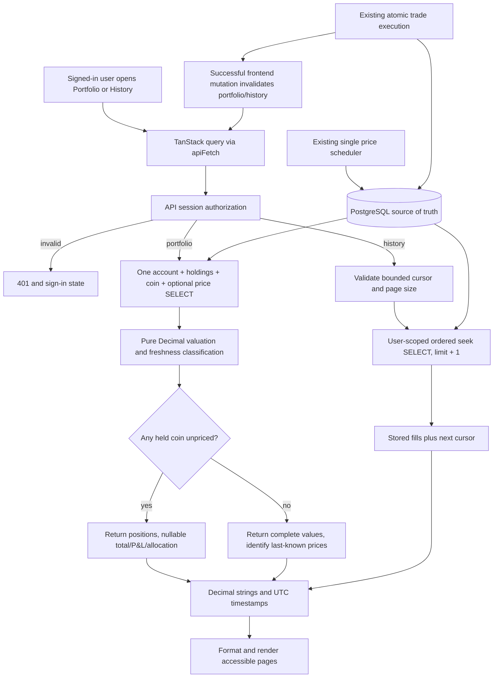

# Phase 5: Portfolio and History — Research

**Researched:** 2026-10-29
**Domain:** Consistent portfolio valuation, fee-inclusive average cost, and private paginated trade history
**Confidence:** HIGH for existing contracts and implementation mechanisms; product defaults below are recommendations, not new locked decisions.

## User Constraints

There is no Phase 5 CONTEXT.md. The user explicitly chose: **continue with existing requirements**, **research first**, and **create a UI contract from the existing design system, then continue planning**. Do not repeat those questions. Phase 4's decision to skip its UI-SPEC does not apply to Phase 5. [VERIFIED: session replies; `gsd-sdk query init.phase-op 5`]

Locked project scope: PORT-01..05 and HIST-01..02; holdings valued at **mid**, $10,000 initial cash granted once, weighted average cost including fees, and each user sees only their own account. Charts, snapshots, realized P/L per sell, tax lots, filters/export, other asset classes, and account reset are outside this phase. [VERIFIED: `.planning/PROJECT.md`; `.planning/REQUIREMENTS.md`; `.planning/ROADMAP.md`]

**Agent discretion:** exact response fields, missing/stale-price presentation, percentage precision, page size/cursor format, implementation decomposition, and navigation details may be resolved from existing patterns. Every paragraph marked **Recommendation** below is a proposed planning default, not a statement that the user explicitly selected it. No unresolved scope decision requires another questionnaire.

## Summary

Phase 4 already supplies the authoritative cash, positive/zero holdings, fee-inclusive cost basis, latest good mid prices, and persisted fills. Build two read endpoints and two signed-in pages; no new dependency, scheduler, valuation table, or trade reconstruction is needed. The sole required schema addition is the real history-query index. [VERIFIED: `backend/app/models/{user,price,trade}.py`; `backend/app/services/{trading,trade_math}.py`; migration `0006_holdings_and_trades.py`]

**Recommendation:** make the portfolio one SQL statement selecting cash, starting cash, holdings, coins and optional prices, then calculate derived values in a pure Decimal function. This gives one database snapshot without holding write locks. Keep unpriced positions visible and totals unavailable rather than understating value. Show stale prices as explicitly last-known valuations. History should use `(created_at, id)` keyset pagination and return the stored signed cash change as Total.

**Primary recommendation:** deliver portfolio as one complete UI→API→database slice, then history as another, followed by regression/CI and a human dev checkpoint. Create `05-UI-SPEC.md` from MASTER before planning UI tasks. Keep push/release/deployment choices as explicit later gates.

## Architectural Responsibility Map

The ownership below follows the repository's router→service→database architecture; proposed new components are recommendations. [VERIFIED: `CLAUDE.md` API/Project structure; existing `api/v1/trades.py`]

| Capability | Primary tier | Secondary tier | Rationale |
|---|---|---|---|
| User identity and authorization | API | PostgreSQL sessions | Reuse CurrentUserDep; browser and cursor never choose whose records are read |
| Consistent cash/holdings/prices | PostgreSQL | API service | One projected SELECT provides an internally consistent valuation input |
| Value, average cost, P/L, allocation | API pure Decimal logic | — | Server owns financial definitions and explicit rounding |
| History ordering and bounded seek | PostgreSQL | API cursor validation | Composite index and user predicate execute the actual growing-list query |
| JSON representation | API schemas | Browser runtime guards | Decimal strings, nullable unavailable values, UTC timestamps |
| Refresh/cache lifecycle | Browser TanStack Query | API no-store | Portfolio refetch, history pagination, invalidation after a fill |
| Presentation/accessibility | Browser | Existing design system | Formatting and interaction only; no financial arithmetic |

<phase_requirements>
## Phase Requirements

Descriptions are copied from REQUIREMENTS.md. [VERIFIED: `.planning/REQUIREMENTS.md`]

| ID | Description | Research support |
|---|---|---|
| PORT-01 | User can see cash, each holding and total portfolio value at current mid prices | One snapshot query, positive holdings, Decimal valuation, explicit missing-price state |
| PORT-02 | User can see total profit/loss against the $10,000 start, in $ and % | Use Account.starting_cash, not sum of unrealized position P/L |
| PORT-03 | User can see, per holding: quantity, average cost (fees included), current value and unrealized P/L in $ and % | Existing cost_basis; pure formulas; zero-basis and dust tests |
| PORT-04 | User can see each holding's share of the portfolio (allocation %) | Full portfolio denominator including cash, calculated by server |
| PORT-05 | The portfolio shows the "as of" time of the prices used | Per-row price timestamp/age/status and oldest available price summary |
| HIST-01 | User can see their past trades, newest first: date/time, coin, side, quantity, execution price, fee and total | Stored fills joined to all coins, UTC→local display, signed cash delta |
| HIST-02 | Long trade histories load page by page | Composite keyset, limit+1, opaque typed cursor, useInfiniteQuery/Load more |

The four roadmap success criteria are exactly the portfolio value/time view, total P/L, full per-holding metrics/allocation, and newest-first paginated history; every criterion maps to the rows above. [VERIFIED: `.planning/ROADMAP.md`, Phase 5]
</phase_requirements>

## Project Constraints (from AGENTS.md)

These are enforceable project directives, not research suggestions. [VERIFIED: `AGENTS.md`; `.codex/GSD-ADAPTER.md`; `CLAUDE.md`]

- Read CLAUDE.md in full and PROJECT/REQUIREMENTS/ROADMAP/STATE plus relevant completed phase records before planning/building/review. Continue the existing project; do not reset shared `.planning/` history or initialize another project.
- Use GSD research, dependency ordering, plan checking, checkpoints, review, verification and summaries. Read the adapter and applicable skill; keep Codex adaptations separate from shared rules and preserve Claude configuration. Perform roles sequentially if delegation is unavailable.
- Use `.agents/skills/ui-ux-pro-max/SKILL.md`, its local searches and `design-system/birja/MASTER.md` for UI work. Preserve established tokens/fonts/components and make the Phase 5 UI contract before UI planning.
- MVP first, runnable phase slices, no speculative infrastructure or v2 features. Backend/frontend remain independent; thin versioned routes, service logic, lifespan-managed resources and reusable dependency aliases.
- All monetary arithmetic uses Decimal; database amounts use NUMERIC; JSON amounts are strings; explicit HALF_EVEN at defined boundaries; timezone-aware UTC storage and local UI timestamps. No float or JS Number arithmetic on money.
- PostgreSQL is authoritative; monetary writes remain atomic with existing locks/constraints. Read-only Phase 5 must not modify fills, holdings, account funding, trade execution semantics or scheduler behavior.
- User-scoped server authorization on every endpoint; existing session/CSRF/CORS model remains. No secrets/PII in logs, backdoors, auth bypasses or raw SQL interpolation. GET endpoints remain read-only and need no added CSRF handshake.
- Every schema change gets a new reviewed Alembic migration and working downgrade; existing migrations are immutable. Existing-table indexes use CONCURRENTLY in an autocommit block. Histories use deterministic ordering ending in a unique key and keyset pagination.
- Dependencies use uv/npm with committed locks; no direct pip installation, extra JSON serializer or unneeded package. TanStack Query handles API requests/cache/loading/errors; do not implement fetching in useEffect.
- Ship tests with features: overall coverage ≥80%, money/auth/execution critical paths 100%, API coverage for every endpoint, real isolated PostgreSQL/Redis for significant DB behavior, external providers mocked. Never test against dev/prod data.
- Follow git-flow from refreshed develop on feature/*; imperative commit subject plus why-body. Push/PR/merge/deploy require applicable explicit authorization, green CI and merge commits. GSD yolo/autonomous/commit_docs does not bypass these gates.
- Validate Codex setup with `python3 scripts/sync-codex-skills.py --check` when modifying setup; this phase needs no setup edits. Leave unrelated `.claude/` work alone.

Research execution also respected the assigned prohibition on reading `.env`/production data, starting services, authenticating, placing trades, running tests, committing or releasing. These are not needed to discover the implementation.

## Standard Stack

**Reuse locked versions; do not upgrade dependencies in this phase.** These versions are verified from repository manifests/locks, not presented as registry-latest package recommendations. There is no installation step, so registry/latest-release and slopcheck installation gates are not applicable. SQLAlchemy's matching official 2.0 documentation identifies 2.0.55 (2026-10-16); use the locked 2.0 APIs despite current documentation also advertising 2.1. [VERIFIED: `backend/uv.lock`; `frontend/package-lock.json`; `backend/pyproject.toml`; `frontend/package.json`] [CITED: https://docs.sqlalchemy.org/en/20/core/engines_connections.html]

| Existing library/runtime | Locked/configured version | Phase use |
|---|---|---|
| Python | 3.14 project; local venv 3.14.9 | Decimal valuation, base64/JSON cursor; standard library only |
| FastAPI / Pydantic | 0.162.0 / 2.14.1 | Authenticated GET routes and typed string/nullable schemas |
| SQLAlchemy / asyncpg | 2.0.55 / 0.32.0 | Projected async SELECTs, joins, bound tuple seek |
| Alembic | 1.20.1 | New concurrent history index migration |
| PostgreSQL | Image 18.6-trixie | MVCC snapshot and indexed history |
| React / react-router | 19.3.1 / 8.5.1 | Existing signed-in routing and new pages |
| TanStack React Query | 5.105.0 | useQuery, useInfiniteQuery, mutation invalidations |
| Tailwind / existing shadcn source | 4.3.3 / source components | MASTER tokens, cards/buttons/badges |
| Vitest / Playwright | 5.0.5 / 1.64.1 | Component/API guard tests; CI happy path |
| pytest / pytest-asyncio | 9.1.1 / 1.4.1 | Pure math plus real-Postgres API/consistency/pagination |

### Package Legitimacy Audit

No new external package is recommended. Existing locked dependencies above are source-verified reuse, not fresh registry legitimacy claims. Do not install slopcheck, ctx7, a decimal library, pagination package, chart library, table framework or cursor-signing package for this phase. [VERIFIED: manifests; requested phase scope] **Recommendation:** if planning introduces a package anyway, justify it and run the normal legitimacy gate before install.

## Architecture Patterns

### System architecture diagram

The existing boundaries are source-verified; new endpoints/calculators/pages in this diagram are recommended additions. [VERIFIED: `App.tsx`; `core/deps.py`; `api/v1/router.py`; models]



### Component responsibilities

Suggested file boundaries below are planning recommendations, not existing artifacts.

| Files | Responsibility / closest existing analogue |
|---|---|
| `backend/app/services/portfolio_math.py` | Pure frozen inputs/results and valuation formulas; analogue trade_math.py |
| `backend/app/services/portfolio.py` | One snapshot query then calculator; analogue prices.list_prices |
| `backend/app/services/history.py` | Cursor parsing/encoding and user-scoped keyset query |
| `backend/app/schemas/portfolio.py`, `history.py` | Decimal plain-string output, optional value fields, timestamps |
| `backend/app/api/v1/portfolio.py`, `history.py` | Thin GET routes with CurrentUserDep, explicit response_model, summaries and no-store |
| `backend/app/models/trade.py`, new `0008_*` migration | Declare and concurrently create history index; no historical migration edits |
| `frontend/src/api/portfolio.ts`, `history.ts` | apiFetch wrappers, types and runtime guards |
| `frontend/src/hooks/usePortfolio.ts`, `useHistory.ts` | Query/refetch and infinite-query lifecycle |
| `frontend/src/pages/PortfolioPage.tsx`, `HistoryPage.tsx` | MASTER layouts and states; no financial calculations |
| Existing `App.tsx`, `useTrade.ts`, `useAuthMutations.ts`, money formatters | Route/nav, cache invalidation/isolation, display helpers |

### Pattern 1: One portfolio input statement

PostgreSQL READ COMMITTED gives a plain SELECT one committed snapshot; separate SELECTs can see different commits. CurrentUserDep already uses the shared request session for authentication, so changing transaction isolation after auth has queried is the wrong default. **Recommendation:** use one projected query for *all* financial inputs; this remains correct even after the earlier auth query. No FOR UPDATE is required for valuation. [CITED: https://www.postgresql.org/docs/18/transaction-iso.html] [VERIFIED: `backend/app/core/deps.py`; `backend/app/main.py`]

```python
# Recommended query shape using the existing SQLAlchemy 2.0 API.
# Sources: app/services/prices.py; PostgreSQL transaction isolation docs above.
stmt = (
    select(
        Account.cash, Account.starting_cash,
        Holding.quantity, Holding.cost_basis,
        Coin.id, Coin.symbol, Coin.name, Coin.is_active,
        Price.mid, Price.as_of,
    )
    .select_from(Account)
    .outerjoin(Holding, and_(
        Holding.user_id == Account.user_id, Holding.quantity > Decimal("0")
    ))
    .outerjoin(Coin, Coin.id == Holding.coin_id)
    .outerjoin(Price, Price.coin_id == Coin.id)
    .where(Account.user_id == user_id)
    .order_by(Coin.sort_order, Coin.id)
)
rows = (await db.execute(stmt)).all()
# Convert scalar rows to immutable inputs. Sample now AFTER this awaited read.
```

**Recommendation:** exclude zero quantities in the JOIN condition, not the final WHERE: accounts with no positive holdings still produce their cash row. Select scalar columns rather than stale ORM identity-map objects. Return cash-only total equal to actual cash, zero holdings and no price timestamp; after selling everything total P/L still reflects the completed round trip. A missing account is an invariant failure, never a reason to create/fund one on a GET.

Verified schema facts: zero quantity rows persist after full sells; checks require zero basis when quantity is zero, but allow positive quantity with zero basis; Coin.is_active affects trade/markets lookup, not ownership; Price has one latest good mid/as_of per coin. [VERIFIED: `models/trade.py`; `models/price.py`; `trading.execute`; `cost_basis_after`; `04-06-PLAN.md`]

**Recommendation:** include inactive held coins and historical trades. Keep any last good price with its true age and an inactive label; do not route an inactive position to a usable Trade action. An active-coin inner join would silently erase owned value. Price refresh must remain the existing scheduler's responsibility.

### Pattern 2: Explicit valuation and rounding contract

The locked rules are Decimal, explicit HALF_EVEN and no rounded intermediate calculations. Python Decimal has configurable precision and local contexts; the existing trade math already uses precision 50. [VERIFIED: `CLAUDE.md`; `trade_math.py`] [CITED: https://docs.python.org/3.14/library/decimal.html]

**Recommended contract (planner should make this binding in the plans):**

| Quantity | Unrounded definition | Output boundary |
|---|---|---|
| Holding market value `v` | `quantity * mid` | HALF_EVEN cents |
| Average cost | `cost_basis / quantity` | HALF_EVEN 8 decimal places; UI uses unit-price formatting |
| Unrealized P/L | `v - cost_basis` | HALF_EVEN cents |
| Unrealized P/L % | `(v - cost_basis) / cost_basis * 100` | HALF_EVEN 2 decimal percentage points; null if basis is zero |
| Raw total `t` | `cash + sum(unrounded v)` | HALF_EVEN cents only for response |
| Total P/L | `t - starting_cash` | HALF_EVEN cents |
| Total P/L % | `(t - starting_cash) / starting_cash * 100` | HALF_EVEN 2 decimal percentage points; null if start is zero |
| Holding allocation % | `v / t * 100` | HALF_EVEN 2 decimal percentage points; null if t is zero/incomplete |
| Cash allocation % | `cash / t * 100` | Same denominator/rounding as holdings |

**Recommendation:** compute all formulas inside localcontext(prec=50), using Decimal literals and no float conversion; normalize quantized negative zero to zero. Use Account.starting_cash (currently provisioned to 10000) as the baseline, not a fresh hard-coded grant. Total P/L includes completed-trade effects and fees; it is **not** sum of open positions' unrealized P/L. Allocation includes cash, explicitly labelled so a cash-heavy account is understandable. Independently rounded percentages need not total exactly 100.00%; do not fabricate a balancing residual.

**Recommendation:** use raw values for aggregate/percentage intermediates. Independently rounded row values can differ from the displayed aggregate by a cent; test and document that boundary rather than secretly summing rounded intermediates. No DB writes or NUMERIC(20,8) bound is appropriate for derived totals or average prices: two valid NUMERIC(20,8) inputs can produce a product/ratio wider than a single stored column. Keep response Decimal fields wide enough and serialize with `format(value, "f")`.

**Zero basis:** positive quantity with zero basis is schema-valid, and proportional cent rounding can produce it. Show average cost `0`, dollar P/L equal to market value, and percentage P/L `null`/“Not applicable”, never Infinity or an invented 0% return. Exclude zero-quantity rows altogether. [VERIFIED: holding checks; `cost_basis_after` partial-sale formula] **Recommendation:** include a test with basis .01, held quantity 2, partial sale 1.5: removed basis rounds .0075→.01, leaving .5 coins and zero basis.

### Pattern 3: Missing and old prices are different states

Existing freshness is **fresh age <120**, **aging 120..300**, **stale >300**, configurable in settings; future clock skew clamps age to zero. MASTER's illustrative ≤120 wording conflicts at the boundary: use the implemented shared rule, including age 120 as Delayed, and make the UI contract precise. [VERIFIED: `services/prices.py`; `core/config.py`; `frontend/src/lib/age.ts`; MASTER freshness example]

**Recommended behavior:**

| State | Position | Aggregate |
|---|---|---|
| Fresh | Value normally; actual as_of and Live badge | Complete current valuation |
| Aging/stale | Value at latest known mid, visibly Delayed/Stale | Complete **last-known** valuation with warning; never claim all prices are live |
| No Price row | Quantity/basis/average cost remain visible; mid/value/unrealized P/L null | `valuation_complete=false`; total value, total P/L and **all** allocation percentages null |
| Inactive coin with price | Include it; inactive + true freshness labels | Same valuation rules; no trade action |
| Cash-only | No holding rows; no price as_of | Complete value=cash, actual P/L, cash share100% when cash>0 |

**Recommendation:** return `valued_at` as calculation time separately from `prices_as_of` as oldest available held-coin price time. Keep each row's exact `as_of`, server `age_seconds` and status. When incomplete, oldest available timestamp is not a guarantee of complete pricing—label it accordingly and expose the missing position. Reuse fresh/stale thresholds in the response so frontend ticking does not invent thresholds. Use server age plus local elapsed since dataUpdatedAt, as MarketsPage already does, rather than trusting the browser clock against provider timestamps. A failed refetch retains the last response, ages visibly, and shows a refresh warning. [VERIFIED: `MarketsPage.tsx`; `usePrices.ts`; `useNow.ts`]

### Proposed response fields for planner/UI-SPEC alignment

These field names are recommendations; settle them once in the plans and mirror exactly in backend schemas, browser guards and UI tests. Decimal and percentage values are plain strings, timestamps are UTC strings, and IDs in the new history response are decimal strings. JSON null means unavailable, never zero.

| Response | Fields |
|---|---|
| `GET /api/v1/portfolio` | `cash`, `starting_cash`, `total_value: Money|null`, `total_pl: Money|null`, `total_pl_percent: Money|null`, `cash_allocation_percent: Money|null`, `valuation_complete: bool`, `valued_at`, `prices_as_of: datetime|null`, `fresh_seconds: int`, `stale_seconds: int`, `holdings: Holding[]` |
| Holding | `symbol`, `name`, `is_active: bool`, `quantity`, `cost_basis`, `average_cost`, `mid: Money|null`, `current_value: Money|null`, `unrealized_pl: Money|null`, `unrealized_pl_percent: Money|null`, `allocation_percent: Money|null`, `as_of: datetime|null`, `age_seconds: int|null`, `status: fresh|aging|stale|unpriced` |
| `GET /api/v1/trades` | `items: HistoryItem[]`, `next_cursor: string|null` |
| HistoryItem | `id: string`, `created_at`, `symbol`, `name`, `side: buy|sell`, `quantity`, `exec_price`, `fee`, `total` (stored signed cash_delta) |

**Recommendation:** row average_cost remains defined for every included positive quantity, including zero basis; row percent can be null with a known current_value solely because basis is zero. Missing any price nulls aggregate totals/allocation, while other priced rows retain their known value/unrealized P/L. Derive an aggregate last-known warning from the worst available row freshness plus the separate valuation_complete flag, rather than overloading a single “fresh” boolean.

### Pattern 4: Bounded newest-first history

Trade records store exact executed quantity/price/fee/cash_delta, server-created UTC created_at, bigint id and coin_id. Execution appends rows; it does not rewrite fills. The existing UNIQUE(user_id,idempotency_key) is for replay, not the requested time ordering. [VERIFIED: `models/trade.py`; `trading.py`; migration0006]

**Recommendation:** `GET /api/v1/trades?limit=25&cursor=...` returns `{items, next_cursor}`. It is an additive GET beside the existing POST /trades, not a replacement. Default limit25, accepted range1..100, fetch limit+1, return at most limit, and emit the next cursor from the final returned row only if the extra row exists. No total-count query, offset, filtering, arbitrary sort or reverse pagination.

```python
# Recommended SQLAlchemy seek shape; tuple_ uses bound values.
# Sources: app/services/trading.py query style; official operators docs.
stmt = (
    select(Trade.id, Trade.created_at, Coin.symbol, Coin.name,
           Trade.side, Trade.quantity, Trade.exec_price, Trade.fee, Trade.cash_delta)
    .join(Coin, Coin.id == Trade.coin_id)
    .where(Trade.user_id == user_id)
    .order_by(Trade.created_at.desc(), Trade.id.desc())
    .limit(limit + 1)
)
if cursor is not None:
    stmt = stmt.where(tuple_(Trade.created_at, Trade.id) < tuple_(cursor.created_at, cursor.id))
```

PostgreSQL compares row constructors left-to-right; the unique id breaks equal timestamps. A B-tree `(user_id, created_at, id)` supports the equality prefix and reverse time/id order. [CITED: https://www.postgresql.org/docs/18/functions-comparisons.html] [CITED: https://www.postgresql.org/docs/18/indexes-ordering.html] [CITED: https://docs.sqlalchemy.org/en/20/core/operators.html]

**Recommendation:** encode version1, exact UTC timestamp including microseconds, and positive decimal-string bigint id as bounded base64url JSON. Decode strictly: length≤512, valid alphabet/UTF-8/JSON object, exact fields/version/types, timezone-aware timestamp normalized UTC, integer id within signed-bigint range, no bool coercion. Reject malformed/oversized cursors as structured422 `invalid_cursor`, never500. The cursor is a seek boundary, **not authorization**: always apply session user_id and never accept a user_id parameter. An unsigned cursor needs no cryptographic secret because changing the boundary grants no access; test foreign-user/tampered boundaries cannot reveal other records. Signing is unnecessary unless later requirements grant cursor-specific authority. Keep next_cursor opaque in the UI and history IDs as strings to avoid JS bigint precision loss; do not change existing FillOut in this phase.

**Recommendation:** use stored cash_delta as signed `total` (buy negative including fee, sell positive net of fee); label the column “Total cash change” and show fee separately. Do not recompute quantity×price as the total: quantity paths and fee-inclusive dollar buys already have explicit execution rounding. Zero-proceeds dust sells must display $0.00. Join all coins, including inactive ones. Format created_at in the browser's local timezone with a `<time datetime>` and full timestamp detail.

**Pagination guarantee:** deterministic order and no duplicates/skips among the committed rows traversed by the seek. Newer trades appear on refresh. created_at uses PostgreSQL transaction time, and id is an identity—not a commit-order clock—so do not claim a frozen multi-request snapshot or strict commit order under long in-flight transactions. This MVP does not need snapshot exports or long database transactions across HTTP pages. [VERIFIED: `Trade.created_at` server_default=func.now(); schema identity] [CITED: https://www.postgresql.org/docs/18/transaction-iso.html]

### Pattern 5: Index migration is operational work

**Recommendation:** declare `Index("ix_trades_user_created_id", "user_id", "created_at", "id")` in model metadata and create it in a **new0008** index-only migration, generated then reviewed. Use `postgresql_concurrently=True` inside `op.get_context().autocommit_block()` in upgrade and drop concurrently in downgrade. Update migration head expectations and metadata parity tests. Do not amend0006. [VERIFIED: migration head0007; `test_migrations.py`; `CLAUDE.md`]

CONCURRENTLY must run outside a transaction; failed builds can leave an invalid index and IF NOT EXISTS does not prove a matching usable index. Autocommit blocks commit preceding migration work; Alembic recommends `transaction_per_migration=True` when they are used. [CITED: https://www.postgresql.org/docs/18/sql-createindex.html] [CITED: https://alembic.sqlalchemy.org/en/latest/api/runtime.html#alembic.runtime.migration.MigrationContext.autocommit_block] [CITED: https://docs.sqlalchemy.org/en/20/dialects/postgresql.html#indexes-with-concurrently]

**Recommendation:** set transaction_per_migration in online/offline Alembic configuration deliberately and test existing full round trips. Keep0008 isolated. Document failure recovery in RUNBOOK: inspect the named index's definition/validity, remove only the failed new index through a reviewed recovery path, rerun migration; never silently stamp head or hide invalid state with IF NOT EXISTS. No production execution is part of planning.

### Pattern 6: Frontend cache and authentication lifecycle

Existing trade success invalidates me/holding/prices only; logout removes every query except me, then sets me null. New endpoints must participate in that lifecycle. [VERIFIED: `useTrade.ts`; `useAuthMutations.ts`; `useMe.ts`; `api/client.ts`]

**Recommendation:** `usePortfolio` mirrors usePrices (30s interval, focus refetch, 10s stale time, final401 invalidates me). `useHistory` uses useInfiniteQuery with initialPageParam undefined, getNextPageParam=next_cursor??undefined and an explicit Load more button disabled during fetching. No polling every loaded history page; refetch on focus/re-entry and successful trades. TanStack refetches stale infinite pages in sequence, avoiding reuse of obsolete cursor chains. [CITED: https://tanstack.com/query/v5/docs/framework/react/guides/infinite-queries]

**Recommendation:** after any successful trade response, including replay, await invalidation of portfolio and history in addition to existing me/holding/prices. Do not optimistically calculate portfolio results or prepend a second fill into cached history. Test buy and sell refresh all views and replay does not duplicate a row. Promise-returning onSuccess can await multiple invalidations. [CITED: https://tanstack.com/query/v5/docs/framework/react/guides/invalidations-from-mutations]

**Recommendation:** prevent prior-user response reuse after passive session expiry followed by another sign-in. Reuse logout cleanup, add private-query cleanup on successful sign-in **before** publishing new me, cancel outstanding private requests, and pass AbortSignal through API wrappers. Global keys are then safe for this existing app without expanding Me's contract just to add an id. Test A→expired session→B sign-in with A's portfolio/history already cached and a pending A response; no A data may flash on B's pages. A reusable cache helper is justified only if these two real lifecycle callers need it. Do not clear/detach the observed me query wholesale—the existing logout comment explains why.

## UI Research for the Contract

MASTER already specifies Portfolio's8+4summary/cash-allocation row plus full-width holdings, History's full-width table and Load more, top/bottom three-item primary navigation, light tokens, Inter/tabular figures, signs/arrows for P/L, progress bars, responsive stacked rows and no charts. There are no existing page overrides. [VERIFIED: `design-system/birja/MASTER.md`; `rg --files design-system`]

The local UX search `responsive table --domain ux` returned Table Handling (scroll wrapper or cards) and Horizontal Scroll (no page overflow). `live status screen reader --domain ux` returned Contextual Live Badge Updates: one meaningful atomic status, not competing per-badge live announcements. The first React search had no match; the narrowed `list key --stack react` returned stable-key guidance, applicable to trade-id/coin-symbol rows. No new palette or design direction was generated. [VERIFIED: `.codex/skills/ui-ux-pro-max/scripts/search.py`, session outputs]

**Recommendations for UI-SPEC:**

- Routes `/portfolio` and `/history`; preserve existing `/`, `/trade/:symbol` and `/account`. Main nav uses Markets/Portfolio/History; make Account/sign-out reachable through the shell without removing existing account/health behavior. Use the MASTER mobile bottom tabs with safe-area padding and ≥44px targets; keep Account separate from those three primary tabs.
- Portfolio total value and total P/L highlight, cash/allocation card, holdings table; text says “Compared with your $10,000 start” and explains average cost includes fees. Allocate cash and each positive position; unavailable aggregate shows “Value unavailable” with specific missing-price explanation.
- Include all required columns on desktop and labelled stacked holding/history rows on mobile. Do not hide fee, average cost or percentage fields without another accessible way to read them. Avoid page scroll at375px; wide table overflow stays within the card.
- Plain signed dollar/percentage formatters use existing string-safe Intl support. Server percentages are already percentage points (`"1.25"` means1.25%), so do not feed them to Intl percent formatting that multiplies by100. Use validated percent strings directly for CSS bar width; no financial Number conversion. [VERIFIED: `frontend/src/lib/money.ts`] [CITED: https://developer.mozilla.org/en-US/docs/Web/JavaScript/Reference/Global_Objects/Intl/NumberFormat/format]
- Preserve loading skeleton space; explicit empty holdings/history with Markets action; initial failure retry; background failure retains data and warning; next-page failure preserves prior rows and offers retry. Load more has a name, loading state, end-of-list state and one contextual “25 more trades loaded” status; never move focus unexpectedly.
- Freshness ages tick silently; announce state transitions only. Include exact per-row time in visible detail/title, not tooltip-only access. P/L uses signed text and icons with neutral zero; null percentage is “Not applicable”, null value “Unavailable”. Respect reduced motion and MASTER tokens.

## Don't Hand-Roll

The project already contains the mechanisms in this table; proposed uses are recommendations. [VERIFIED: dependencies and source files cited above]

| Problem | Do not build | Use instead |
|---|---|---|
| Financial calculations | Browser arithmetic or a new financial SDK | Python Decimal pure calculator and explicit boundaries |
| Consistent valuation | Separate client calls summed together; read locks on trade rows | One server snapshot SELECT |
| Average cost | History replay/FIFO/tax lots | Existing atomic Holding.cost_basis |
| Private auth refresh | New token flow or localStorage tokens | CurrentUserDep/apiFetch/session cookies |
| Page accumulation | useEffect fetch and manual cursor arrays | TanStack useInfiniteQuery |
| Freshness | Another120s constant | Existing settings/freshness helper and server age |
| Visual language | New dashboard kit/charts/palette | MASTER and existing source components |
| Cursor signing | New crypto/package/secret for a read boundary | Strict stdlib decoding plus mandatory user predicate |

## Common Pitfalls

These pitfalls are derived from the verified code and recommended contracts above; they are concrete test targets, not claims of current defects.

1. **Mixed trade state:** cash SELECT before a commit plus holdings SELECT after it creates a fictitious portfolio. Require a single projected valuation read; real-Postgres tests coordinate an uncommitted multi-row trade and verify only complete before/after states.
2. **Invisible assets:** filtering Coin.is_active or inner joining Price removes owned positions. Include inactive coins and nullable prices; verify missing price does not produce a zero/partial total.
3. **Zero denominators and dust:** positive quantity can have zero basis, total can be zero, displayed value can round to zero while raw value is positive. Test each separately; no division error, NaN, Infinity or invented percentage.
4. **Double-counted fees/wrong total return:** cost_basis already includes buy fees; history cash_delta already includes fees. Do not add them again. Sum of unrealized positions omits realized effects; use total minus starting cash.
5. **Precision narrowing:** values/ratios can exceed stored-column precision; percentage strings and bigint cursors must not become JS money numbers. Test very large and 1e-8 input quantities in plain JSON.
6. **Cursor gaps:** timestamp-only ordering loses equal-timestamp rows; cursor taken from the lookahead skips it. Use exact microseconds plus unique id, last returned row cursor, and limit+1.
7. **Unsafe index rollout:** a normal CREATE INDEX blocks writes and a concurrent failure can leave invalid state. Exercise real upgrade/downgrade and verify actual index keys/validity; document recovery.
8. **Leaking cache across sign-ins:** server predicates do not prevent old browser cache being displayed to the next user. Exercise passive expiry and outstanding request cancellation, not just explicit logout.
9. **Fresh-looking cached values:** failed refetch must keep aging cached prices; request completion time is not market as_of. Exact120/300/301 boundaries and future skew need assertions.
10. **Lost old behavior:** new endpoints change the exact route allow-list; new nav affects existing account/auth/markets/trade tests. Preserve these flows and update expected routes explicitly.

## Code Examples

The query examples above are implementation sketches, not executed production code. This pure worked fixture is a proposed regression target using the existing Phase4 fill values. [VERIFIED: `04-06-SUMMARY.md`; `test_trading_service.py`]

```text
Initial cash = 10000.00
Buy100.00 at mid100000, existing trade rules:
  quantity = .00099501, basis =100.00, cash =9900.00
At the same mid:
  raw holding value =99.50100000 →99.50
  raw total =9999.50100000 →9999.50
  total P/L =-.49900000 →-.50; percent →-.00 normalized0.00
  holding unrealized P/L →-.50; percent →-.50%
After existing full-sell fixture: cash9999.00, zero holdings
  total9999.00, total P/L-1.00, total P/L percent-.01%
```

**Correction for planner tests:** `-.499 /10000 *100 =-.00499%`, which rounds0.00%; a neutral displayed percentage can accompany a negative-cent dollar P/L. Sign/arrow/color should follow the displayed value's sign without inventing a nonzero percentage. Average cost uses100/.00099501, not the execution price alone. This fixture proves spread/fees are observable at unchanged mid.

## State of the Art / Alternatives

The stack is already selected. No technology migration is justified by this phase. [VERIFIED: PROJECT constraints and locked manifests]

| Alternative with strongest case | Why use the recommended approach here |
|---|---|
| Separate queries in REPEATABLE READ: convenient when many related read queries grow | One bounded holdings query is simpler and avoids changing isolation after CurrentUserDep has begun a transaction; use RR only if the query actually grows beyond one statement |
| Account row lock before several reads: shares the trade serialization protocol | Portfolio is read-only; blocking trades for valuation is unnecessary with one MVCC statement |
| Signed cursor: prevents client editing of cursor metadata | Cursor grants no authority; strict parser, bounded page and user predicate provide required guarantees without crypto expansion |
| Offset page numbers: simple UI/jump to a numbered page | Growing history explicitly requires keyset; Load more matches MASTER and does not promise total count |
| New Redis valuation cache/materialized totals: lower repeated read CPU at scale | Tens of users and bounded curated holdings do not justify new invalidation/freshness state |
| Drop old history pages with maxPages: bounds browser memory for huge usage | Forward-only Load more should not unexpectedly discard visible rows; no automatic infinite scroll or virtualization dependency is needed for MVP |

The trade-off against infinite-query reuse is that a focus refetch may reload all accumulated pages. Keep history unpolled, disable repeated Load more during any fetch, and test retained rows on fetch errors; revisit limited bidirectional pages only after measured need. [CITED: https://tanstack.com/query/v5/docs/framework/react/guides/infinite-queries]

## Environment Availability

The following were probed without starting services or reading env files. [VERIFIED: command outputs in this research session]

| Dependency | Available/version | Planning consequence |
|---|---|---|
| Node/npm |24.22.1 /11.19.1 | Meets frontend Node≥24; existing npm lock |
| Project Python | backend/.venv Python3.14.9 | Use uv/project runtime, not host Python3.12.3 for backend |
| uv |0.13.5 | Existing locked environment tooling |
| Docker CLI/Compose |29.2.1 /v5.0.0 | Installed; daemon probe produced no version in current sandbox, so daemon reachability is unverified |
| PostgreSQL/Redis test services | Configured18.6 /8.8.3; not started/probed live | Executor starts only docker-compose.test.yml under runtime permissions, checks health, then runs tests |
| Context7 MCP/ctx7 CLI | Not available | Used primary official web docs; no install/download |
| Graph context | `.planning/graphs/graph.json` absent | Source/code/phase records used directly |

**Missing blocking dependency:** none identified at planning time; Docker daemon permission/health remains an execution preflight, not evidence that tests have run. No new market-data/email service or production credential is needed.

## Validation Architecture

Nyquist validation is enabled in config. Existing frameworks and test guards are present. No research-time tests/services were run. [VERIFIED: `.planning/config.json`; `backend/pyproject.toml`; `backend/tests/{conftest,guard}.py`; `frontend/vite.config.ts`; `frontend/playwright.config.ts`]

### Test framework and commands

| Property | Value |
|---|---|
| Backend | pytest9.1.1 + pytest-asyncio1.4.1 + pytest-cov7.1.0; configuration backend/pyproject.toml |
| DB infrastructure | docker-compose.test.yml, birja-test only; localhost55432/56379, tmpfs, guards before app imports |
| Backend focused | `cd backend && uv run pytest tests/test_portfolio_math.py tests/test_portfolio_service.py tests/test_history_service.py -x -q` (new files; target <30s after stack is ready, measure at execution) |
| Backend full | `cd backend && uv run pytest --cov=app --cov-fail-under=80` |
| Frontend | Vitest5.0.5/RTL; frontend/vite.config.ts; `cd frontend && npm run test -- --coverage` |
| Frontend focused | `cd frontend && npm run test -- src/api/portfolio.test.ts src/api/history.test.ts src/pages/PortfolioPage.test.tsx src/pages/HistoryPage.test.tsx` |
| CI e2e | `cd frontend && npm run e2e` on ephemeral CI Compose with fake prices and console email only |

Run the existing100% critical coverage command from CLAUDE.md/CI, **adding portfolio_math.py, portfolio.py and history.py**, including cursor/auth data-selection branches. Include new route/schema modules where they contain authorization/validation behavior; do not use exclusions to satisfy the gate. Keep both documented and CI lists identical. [VERIFIED: `.github/workflows/ci.yml`; CLAUDE Test culture]

### Requirement → test map

These are proposed files/selectors to create; current phase tests do not yet exist. Commands run from backend unless prefixed frontend.

| Requirement | Behavioral assertions | Type / proposed command | Exists? |
|---|---|---|---|
| PORT-01 | Cash-only, buy/partial/full sell, raw mid valuation, zero rows excluded, user isolation, atomic before/after snapshot | `uv run pytest tests/test_portfolio_math.py tests/test_portfolio_service.py tests/test_portfolio_api.py -k 'value or cash or snapshot or isolation' -q` | Wave0 |
| PORT-02 | Total return vs starting_cash, realized effects, negative/zero/positive, full liquidation, zero-start defensive branch | `uv run pytest tests/test_portfolio_math.py -k 'total or return' -q` | Wave0 |
| PORT-03 | Fee-inclusive weighted basis after repeated buys/partial sell, average cost, zero basis, dust, half-even ties, huge/small values | `uv run pytest tests/test_portfolio_math.py -k 'basis or average or unrealized or rounding' -q` | Wave0 |
| PORT-04 | Denominator includes cash; zero/incomplete total nulls; percent rounding and no residual fabrication | `uv run pytest tests/test_portfolio_math.py -k allocation -q` | Wave0 |
| PORT-05 | Multiple as_of values/oldest,120/300/301, missing price, inactive holding, future skew, late clock sampling | `uv run pytest tests/test_portfolio_service.py tests/test_portfolio_api.py -k 'price or freshness or as_of' -q` | Wave0 |
| HIST-01 | Stored signed net total, fee, exact execution price/quantity/time, inactive coin, dust sale,401, foreign-user isolation | `uv run pytest tests/test_history_service.py tests/test_history_api.py -k 'fields or isolation or auth' -q` | Wave0 |
| HIST-02 | Empty/one/exact-limit/limit+1, same microsecond ids, insert-between-pages, last cursor row, bounds, malformed/foreign cursor, bigint | `uv run pytest tests/test_history_service.py tests/test_history_api.py -k 'page or cursor or limit' -q` | Wave0 |
| All | Runtime guards reject numbers/exponents/invalid optional fields; loading/error/empty/stale/incomplete states; formatted values; Load more/error/end; query invalidation; cache A→B; accessible nav | Frontend focused command above plus App/TradePage/auth tests | Wave0 |
| All4 roadmap criteria | Buy→portfolio values/fees/as_of→history fill, sell→updated holdings/history; main routes usable on narrow viewport | CI new `frontend/e2e/portfolio-history.spec.ts`, reuse signInNewUser only in console/fake stack | Wave0 |

### Meaningful concurrency and migration proofs

**Recommendation:** PostgreSQL integration tests hold a trade transaction's account/holding changes uncommitted, issue a portfolio request, then commit and request again. Assert the first response is wholly old and second wholly new (cash, quantity, basis and computed total), never a mixed pair; assert the service issues one financial projection SELECT and reads no per-position lazy relationship. Coordinate with events/independent sessions instead of timing guesses. A transaction holding an uncommitted trade must not block a plain read. Complement this with forced regression construction that inserts a commit between split input reads if the implementation is later split.

**Recommendation:** migration tests upgrade0007→0008 with existing trades, inspect `pg_index.indisvalid` and `pg_get_indexdef`, downgrade0007, re-upgradehead, and run metadata parity/full round trip; assert rows/constraints remain. Update existing literal head0007 assertions to0008 while preserving the targeted0007 cents guard test. Do not run these destructive migration tests concurrently with other database tests. Inspect EXPLAIN on isolated seeded history if needed; do not require PostgreSQL to choose an index on a tiny table.

### Sampling and human checks

- **Per task commit:** focused behavioral tests for the changed slice, lint/types/format; TDD for valuation/cursor behavior.
- **Per completed slice/wave:** relevant backend/API and frontend suites; use the existing isolated stack and tear it down with `down -v` after the run.
- **Phase gate:** full backend/frontend checks with100% new critical paths; all existing auth/markets/trade and new happy-path e2e green in CI before merge.
- **Human dev checkpoint:** user checks real-price portfolio/history, visible as_of/fees/P&L and mobile layout after explicitly authorized dev rebuild. User signs in/receives any real email and places any desired trade themselves. Never automate the real-email dev app, read real OTPs, or run Playwright against it. Existing browser approval for Phase4 does not verify these new screens.
- **Push/release:** retain the project push gate; a release/deployment is conditional on the user's choice, not implied by planning or by a Phase4 release authorization.

### Wave0 gaps

- New pure math/service/API tests listed above, with new-user and existing put_price/put_holding helpers reused.
- Fixtures for same-timestamp history, missing/inactive prices, zero basis and multi-session portfolio reads; bound seeded rows, no production data.
- Frontend API/page/hook and cache-isolation assertions; App routes and exact API route allow-list update in test_accounts.py.
- Index migration tests/head expectations and CI/CLAUDE100% list updates.
- New CI e2e slice using existing test helper; no new framework install.

## Security Domain

Security enforcement is not disabled. Use **ASVS5.0 category names**, rather than the research template's obsolete4.x numbering: current ASVS maps authenticationV6, sessionsV7, authorizationV8, cryptographyV11. This is a relevant control mapping, not a claim of full ASVS certification. [VERIFIED: `.planning/config.json`] [CITED: https://github.com/OWASP/ASVS/tree/v5.0.0/5.0/en]

| Applicable category | Phase control / verification |
|---|---|
| V1 Encoding and Sanitization; V2 Validation and Business Logic | Bound ORM values, strict cursor/limit parsing, finite Decimal outputs, correct financial rules, React escaping |
| V4 API and Web Service | Authenticated versioned read routes, response models, no-store, bounded response size, no added writes |
| V6 Authentication; V7 Session Management | Existing CurrentUserDep/session revocation/refresh;401 tests; no JS token storage; cancel/clear private caches across identity changes |
| V8 Authorization | Session user_id in every account/holding/trade query, including seek requests; cross-user and tampered-cursor tests |
| V11 Cryptography | No new cryptography; existing tokens/secrets untouched; cursor is not a capability |
| V14 Data Protection | Private portfolio/history no-store; no new PII/balance logging; no persistent browser financial cache |

V8 explicitly requires data-specific access control and enforcement in the trusted service tier. Existing session handling remains the mechanism; client filtering or cursor opacity is insufficient. [CITED: https://github.com/OWASP/ASVS/blob/v5.0.0/5.0/en/0x17-V8-Authorization.md] [CITED: https://github.com/OWASP/ASVS/blob/v5.0.0/5.0/en/0x16-V7-Session-Management.md]

| Threat | STRIDE | Mitigation to plan |
|---|---|---|
| Another user's records via query/cursor | Information disclosure | CurrentUserDep-derived identity and fixed user predicate; no public user selector |
| Stale private data after identity switch | Information disclosure | Cancel requests, clear private cache before new identity publishes; expiry/sign-in regression |
| Malformed/huge cursor or huge pages | Denial of service / tampering | Bounded strict decoding,1..100 page limit, index, structured422 |
| Interpolated cursor SQL | Tampering | Typed values through SQLAlchemy bound comparisons |
| Wrong P/L from mixed snapshots/float/zero basis | Tampering / integrity | One statement, Decimal local context, null semantics, asserted worked cases |
| Cached personalized response outside session | Information disclosure | API Cache-Control:no-store; no persistence plugin; existing logout cleanup |

## Assumptions Log

No unverified factual package/library/compliance claims are used as locked decisions. Product defaults are explicitly marked Recommendations and rest on the user's permission to use existing requirements/design. Current local Docker daemon/test-service availability is deliberately unverified, not assumed available. Latest registry release dates are not claimed for reused lockfile dependencies.

| # | Claim tagged ASSUMED | Risk |
|---|---|---|
| — | None | — |

## Open Questions

No blocking product question remains for planning. The following are execution checks, not reasons to reopen the user's answered design/research questions:

1. **Docker runtime access:** CLI installed, daemon reachability unverified in this sandbox. Verify isolated test services under current permissions when executing.
2. **UI contract details:** create05-UI-SPEC.md from MASTER and the recommended states above, then let plan-checker verify all required metrics remain reachable on mobile. Do not invent charts or remove `/account` regressions.
3. **Release choice:** leave conditional at the phase push gate; Phase6 still owns backup/restore and the production role/SSL decision. No release number is locked by this research.

## Sources

### Primary — repository (HIGH confidence)

- `AGENTS.md`, `CLAUDE.md`, `.codex/GSD-ADAPTER.md`, `.planning/{PROJECT,REQUIREMENTS,ROADMAP,STATE}.md`, config: enforceable project scope/workflow.
- Phase4 CONTEXT, plans03/04/06 and summaries02/03/06/08, VERIFICATION: prior decisions and completion evidence, checked against actual source.
- Models user/price/trade, services trading/trade_math/prices, core/deps, schemas/trades, API trades/me, Alembic env/versions and migration tests: actual numeric/state/auth contracts.
- App, MarketsPage, api/client/trades, useTrade/usePrices/useMe/useAuthMutations, money/age/FreshnessBadge, tests/e2e helpers, CI workflow, frontend/uv locks: actual frontend/testing/invalidation patterns.
- MASTER and local ui-ux-pro-max searches: existing page layout and responsive/accessibility guidance.

### Primary — official documentation (HIGH confidence)

All URLs were opened2026-10-29. Version-specific PostgreSQL18/Python3.14/SQLAlchemy2.0 docs match this project; mutable TanStack/Pydantic links redirect to current docs, so confirm exact installed APIs with types/tests during execution. No third-party technical blog was relied on.

- [PostgreSQL18 transaction isolation](https://www.postgresql.org/docs/18/transaction-iso.html): statement snapshots vs multi-query reads, sequence behavior.
- [PostgreSQL18 row comparisons](https://www.postgresql.org/docs/18/functions-comparisons.html): lexicographic tuple seek.
- [PostgreSQL18 index ordering](https://www.postgresql.org/docs/18/indexes-ordering.html): B-tree reverse scan and LIMIT.
- [PostgreSQL18 CREATE INDEX](https://www.postgresql.org/docs/18/sql-createindex.html): concurrent build, invalid-index recovery and transaction restrictions.
- [SQLAlchemy2.0 operators](https://docs.sqlalchemy.org/en/20/core/operators.html) and [PostgreSQL concurrent indexes](https://docs.sqlalchemy.org/en/20/dialects/postgresql.html#indexes-with-concurrently): expression/DDL mechanisms,2.0.55 release banner2026-10-16.
- [Alembic autocommit_block](https://alembic.sqlalchemy.org/en/latest/api/runtime.html#alembic.runtime.migration.MigrationContext.autocommit_block): preceding commit and per-migration transaction guidance; docs banner1.20.1.
- [Python3.14 Decimal](https://docs.python.org/3.14/library/decimal.html): exact decimal representation, local precision, quantize.
- [Pydantic Decimal serialization](https://pydantic.dev/docs/validation/latest/api/pydantic/standard_library_types/#decimals): JSON Decimal strings; existing PlainSerializer supplies plain notation.
- [TanStack infinite queries](https://tanstack.com/query/v5/docs/framework/react/guides/infinite-queries): initial/next page params, stale chain refetch and shared fetching constraints.
- [TanStack mutation invalidation](https://tanstack.com/query/v5/docs/framework/react/guides/invalidations-from-mutations): awaited invalidation on successful mutation.
- [MDN Intl.format](https://developer.mozilla.org/en-US/docs/Web/JavaScript/Reference/Global_Objects/Intl/NumberFormat/format): exact string formatting; page modified2026-07-20.
- [OWASP ASVS5.0 source](https://github.com/OWASP/ASVS/tree/v5.0.0/5.0/en), [V8 authorization](https://github.com/OWASP/ASVS/blob/v5.0.0/5.0/en/0x17-V8-Authorization.md), [V7 sessions](https://github.com/OWASP/ASVS/blob/v5.0.0/5.0/en/0x16-V7-Session-Management.md): relevant current category/control mapping.

### Secondary / tertiary

None relied on. Context7 was unavailable; official documentation and repository sources supplied the findings.

## Metadata

| Area | Confidence | Reason |
|---|---|---|
| Existing stack/contracts | HIGH | Direct manifests, locks and substantive source reads |
| Snapshot/pagination/migration mechanisms | HIGH | Matching PostgreSQL/SQLAlchemy/Alembic official docs and existing query/migration patterns |
| Financial formulas and edge cases | HIGH for derivation | Explicit requirements, fee-inclusive basis code, derived worked examples; still require implementation behavioral tests |
| Proposed UI/policy defaults | Recommendations | Derived from scope/MASTER under granted discretion, not user-locked choices |
| Live runtime | Not verified | No service start, auth request, trade, secrets or production-data access during research |

**Validity:** Recheck if trade/schema/design contracts change; otherwise implementation research is suitable for the next30days. New package/runtime upgrades require fresh verification. No research commit was created; orchestrator owns commits and planning handoff.
