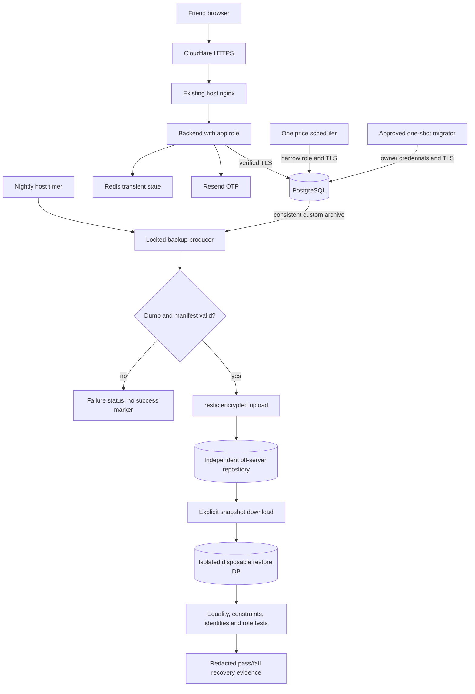

# Phase 6: Deploy — Research

**Researched:** 2026-10-30  
**Domain:** Existing Compose deployment, PostgreSQL privilege/TLS transition, off-server backup and recovery  
**Confidence:** HIGH for repository findings and documented APIs; MEDIUM for the proposed operational design until isolated integration tests and owner decisions are complete.

## User Constraints

No Phase 6 CONTEXT.md exists. The user selected continuation without CONTEXT and research first; do not create fictional locked decisions. This is planning only. Provider selection, spending, credentials, production operations and real identity flows remain future scoped checkpoints. [VERIFIED: orchestrator task / user selection]

Preserve the existing few-friends MVP, server, public domain, manual deployment model and completed product functionality. Phase 6 covers DEPL-01/02 and the four current roadmap success criteria. Existing production is reported as v0.3.1; Phase 5 merged through PR #25 into develop at 8a76a68, but has not been released. This merge status is newer orchestrator evidence than PROJECT/STATE's stale “PR open” text; research did not independently contact production or GitHub. [VERIFIED: .planning/ROADMAP.md; .planning/PROJECT.md; orchestrator handoff]

Historical Phase 2.1 decisions remain relevant: birja.nist.one; manual deploy script, no CI auto-deploy or GitHub SSH credentials; Cloudflare Full (strict); manual DNS/certificate renewal without Cloudflare API token; no automated Cloudflare, real-IP or firewall changes; preserve the separate nist.one site. These are historical deployment constraints, not newly selected Phase 6 decisions. [VERIFIED: .planning/phases/02.1-deploy-to-nist-one/02.1-CONTEXT.md D-01..08]

## Project Constraints (from AGENTS.md)

- Read full CLAUDE.md, PROJECT, REQUIREMENTS, ROADMAP, STATE and relevant phase artifacts before planning/building/reviewing; establish progress from code and completed evidence, accounting for stale STATE pointers. [VERIFIED: AGENTS.md]
- Use the relevant GSD skill and adapter; preserve shared .planning history, research, dependency order, checkpoints, plan checks, reviews, verification and summaries. Do not initialize a new project or advance completed phases for assistant setup. [VERIFIED: AGENTS.md]
- Maintained skills live in .codex/skills and are discoverable through .agents/skills; follow session delegation rules, or perform roles sequentially when delegation is unavailable/unauthorized. [VERIFIED: AGENTS.md]
- Follow CLAUDE.md's MVP scope, architecture, commands, precision, security, migrations and test rules. Use feature branches from updated develop for implementation; release/hotfix PRs alone reach main. Pushes and merges need explicit authorization and green required CI; yolo/commit_docs do not override those gates. No branch switch or commit belongs to this research assignment. [VERIFIED: AGENTS.md; CLAUDE.md; orchestrator assignment]
- If UI work becomes necessary, read ui-ux-pro-max and use its local search and existing design-system documents. No UI redesign is needed for this operational slice. [VERIFIED: AGENTS.md; .planning/ROADMAP.md]
- Setup maintenance must preserve Claude configuration, follow docs/CODEX.md and validate discovery with `python3 scripts/sync-codex-skills.py --check`; this phase does not require setup maintenance. [VERIFIED: AGENTS.md]
- Preserve Decimal/NUMERIC money, UTC timestamps, database invariants and atomic trades. Use immutable reviewed Alembic migrations for application schema; never ad-hoc production table/data edits. Privilege/bootstrap administration needs its own reviewed, repeatable operational script. Tests use isolated synthetic datastores; no production env, OTP/email/log/balance or database inspection was performed for this research. [VERIFIED: CLAUDE.md; orchestrator restrictions]

<phase_requirements>
## Phase Requirements

| ID | Description | Research Support |
|---|---|---|
| DEPL-01 | Friends can open the app at a public domain over HTTPS, sign up and trade | Preserve deployed edge; release Phase 5 through existing git-flow; verify role/TLS migration; friend-owned Gmail and Outlook browser checks. [VERIFIED: .planning/REQUIREMENTS.md; .planning/ROADMAP.md] |
| DEPL-02 | Production data is backed up nightly off the server, and a restore has been tested once | Custom-format PG18 dump, encrypted external repository, nightly timer, failure/freshness reporting and retrieval into an isolated disposable restore stack. [VERIFIED: .planning/REQUIREMENTS.md; recommendation informed by Sources P1–P9] |
</phase_requirements>

## Summary

Keep the established host deployment. Public HTTPS, Resend sign-in, market trades and CI already exist; Phase 5 adds portfolio/history and migration 0008, a concurrent history index. Existing evidence includes 573 backend tests, 264 frontend tests and actual CI with ten passed browser tests. Those are historical results, not fresh execution or permission to deploy. [VERIFIED: deploy/RUNBOOK.md; .planning/phases/04-trading/04-10-SUMMARY.md; .planning/phases/05-portfolio-and-history/05-08-SUMMARY.md; backend/alembic/versions/0008_trade_history_index.py]

The missing work is operational. Production Compose feeds the same POSTGRES_USER/PASSWORD to PostgreSQL bootstrap, backend and scheduler; deploy.sh runs Alembic using the backend service. The source defines no database TLS settings, remote backup or nightly backup timer. Docker's POSTGRES_USER initializes a superuser on an empty data directory; existing live role attributes have not been inspected here. [VERIFIED: docker-compose.prod.yml; deploy/deploy.sh; deploy/init-prod-env.sh; backend/app/main.py; backend/app/tasks/scheduler.py; CITED: https://hub.docker.com/_/postgres]

**Primary recommendation:** implement and verify backup/recovery first, then separate migration ownership from runtime credentials and enable verified database TLS, then release/deploy the integrated app and collect owner-performed Gmail/Outlook trade evidence. Treat all recommendations below as planning guidance, not user-selected provider/policy or execution authority.

## Architectural Responsibility Map

| Capability | Primary Tier | Secondary Tier | Rationale |
|---|---|---|---|
| Public HTTPS, static frontend | Existing host nginx / Cloudflare | Browser | Preserve established routing and certificate procedure. [VERIFIED: deploy/RUNBOOK.md] |
| OTP, session, trade and portfolio | API / backend | PostgreSQL, Redis, Resend | Existing domain implementation; do not recreate auth or trading. [VERIFIED: backend/app/main.py; backend/app/services/] |
| Price refresh | One scheduler container | PostgreSQL / Redis / Kraken | Existing dedicated loop; migration/backup tasks are not scheduler responsibilities. [VERIFIED: docker-compose.prod.yml; backend/app/tasks/scheduler.py] |
| Schema ownership / migrations | One-shot migrator | PostgreSQL owner role | Keep DDL credentials out of continuously running services. [RECOMMENDATION: current deploy.sh + PostgreSQL privilege docs P10–P13] |
| Backup schedule / status | Host systemd oneshot + timer | Docker PG client, restic, external store | Independent of web worker count; no new app queue. [RECOMMENDATION: P1–P9] |
| Recovery verification | Isolated restore project | Downloaded archive + validation script | Never attach production volumes, expose restored accounts or start production email/market jobs. [RECOMMENDATION: P2, CLAUDE.md] |

## Standard Stack

### Core

| Component | Version / provenance | Use |
|---|---|---|
| PostgreSQL tools | Existing `postgres:18.6-trixie` pin | Run matching `pg_dump`, `pg_restore`, `psql` from the image; retain PG18 `/var/lib/postgresql` volume mount. Not a major upgrade task. [VERIFIED: docker-compose.prod.yml; docker-compose.test.yml; CITED: https://hub.docker.com/_/postgres] |
| SQLAlchemy / asyncpg / Alembic | 2.0.55 / 0.32.0 / 1.20.1 in committed lock | Reuse existing stack; shared TLS connect-argument helper for backend, scheduler and Alembic. [VERIFIED: backend/uv.lock; backend/alembic/env.py; CITED: https://docs.sqlalchemy.org/en/20/dialects/postgresql.html#asyncpg] |
| Docker Compose | Existing production CLI; actual version not probed | Preserve standalone birja-prod, private data network, loopback API binding and health checks. [VERIFIED: docker-compose.prod.yml; deploy/deploy.sh] |
| systemd | Host version unprobed | Native oneshot + persistent nightly calendar timer; use only directives confirmed by installed systemd during execution. [CITED: https://www.freedesktop.org/software/systemd/man/latest/systemd.timer.html] |

### Supporting

| Component | Version / provenance | Use |
|---|---|---|
| restic | Official docs currently identify 0.19.1; package/install legitimacy remains [ASSUMED], see audit | Encrypt a staged database archive and private manifest into an independent external repository; retrieval/check supported by standard CLI. [CITED: https://restic.readthedocs.io/en/stable/020_installation.html; https://restic.readthedocs.io/en/stable/030_preparing_a_new_repo.html] |
| Existing bash, Python stdlib, OpenSSL, flock | Existing deploy scripts; host versions not probed | Orchestration, atomic state files, certificates, permissions and mutual exclusion. Do not add Python/npm application packages. [VERIFIED: deploy/deploy.sh; deploy/init-prod-env.sh] |

Existing versions are repository pins, not a claim of newest registry releases. Package registries were not queried because the assignment forbids installs and recommends no new project dependencies. No installation was performed. [VERIFIED: orchestrator restrictions; backend/uv.lock]

### Alternatives and concrete destination recommendation

Recommend **restic with an owner-provisioned S3-compatible repository outside this VDS**. Restic also documents SFTP; use it if the owner already has an independent storage host. Do not run a storage server/MinIO on this same VDS as the “off-server” copy. No existing account, bucket, budget, endpoint, region or IAM capability has been verified. Provider and costs must be chosen at an execution checkpoint before provisioning. [CITED: https://restic.readthedocs.io/en/stable/030_preparing_a_new_repo.html; recommendation based on DEPL-02]

Direct encrypted file uploads have fewer binaries but leave retention, encryption/recovery-key handling and repository checking to custom scripts. WAL/PITR offers finer recovery points but adds continuous archiving and recovery administration. PostgreSQL itself warns that pg_dump is not generally the preferred regular production backup outside simple cases. The small current application plus nightly requirement supports this bounded logical-dump recommendation **only if the owner accepts its recovery window**; an owner requirement for substantially less loss must reopen the backup design before execution. [CITED: https://www.postgresql.org/docs/18/app-pgdump.html; https://www.postgresql.org/docs/18/backup.html; recommendation]

## Package Legitimacy Audit

| Package / executable | Registry / origin | Age / downloads | Source | slopcheck | Disposition |
|---|---|---|---|---|---|
| restic [ASSUMED] | Official Go binary or OS package, not PyPI/npm | Not verified | https://github.com/restic/restic | Not run: assignment forbids installs | Mandatory `checkpoint:human-verify` before installation; verify official versioned release, signed checksum and platform artifact; pin selected version. [CITED: https://restic.readthedocs.io/en/stable/020_installation.html] |

No new application dependencies recommended; none removed/flagged by a tool because slopcheck was not executed. Do not install a similarly named npm/PyPI package. The [ASSUMED] tag concerns install provenance/availability, not an unverified claim that the documented official project exists. Installation permission and artifact verification remain execution work. [VERIFIED: research restrictions; official restic installation docs]

## Architecture Patterns

### System architecture diagram

Recommended additions, over the existing deployment; arrows show data flow. [RECOMMENDATION: sources P1–P16]



### Recommended file inventory and ownership

Proposed filenames are plan targets, not existing artifacts. Keep the change concentrated in deployment and shared DB connection configuration. [RECOMMENDATION: existing project layout]

| Files | Responsibility |
|---|---|
| `deploy/backup.sh`, `deploy/backup-status.sh` | Dump/upload/cleanup, locking, machine-readable success/failure/freshness; no raw data/log/secret output. |
| `deploy/restore-check.sh`, `deploy/verify-restore.py` | Download exact snapshot; fail-closed target validation; private manifest/equality and invariant checking; bounded cleanup. |
| `deploy/backup-manifest.sql` or equivalent reviewed helper | Deterministic row counts/fingerprints from the dump's exported snapshot; values never printed in evidence. |
| `deploy/systemd/birja-backup.service`, `.timer` | Root-owned host schedule and oneshot invocation; no secret literals. |
| `deploy/db/bootstrap-roles.sql`, `deploy/configure-db.sh` | Idempotent, scoped role/ownership administration for an already-populated DB; quote identifiers and secrets safely. |
| `deploy/db/pg_hba.conf`, TLS provisioning helper | Private CA/server cert SAN `postgres`, restrictive key ownership, hostssl policy, renewal/expiry procedure. |
| `backend/app/db/connection.py`, `core/config.py`, `main.py`, `tasks/scheduler.py`, `alembic/env.py` | One verified SSLContext pattern at all engine factories; settings validation and tests. |
| `docker-compose.prod.yml`, `deploy/deploy.sh`, `deploy/smoke-prod.sh`, `deploy/RUNBOOK.md`, `deploy/init-prod-env.sh` | Runtime credential separation; explicit migrator; backup gate; TLS/role/status smoke; hardened rollback; correct stale “no backups” instructions only after delivery. |
| `docker-compose.ops-test.yml`, `deploy/tests/test-{backup,restore-safety,db-operations,rollback-db-security}.sh` | Standalone throwaway operations fixtures, negative tests and compatibility proof. |
| `.github/workflows/ci.yml` | Run operational shell tests and isolated integration; preserve existing browser/trading/coverage gates. |

### Pattern 1: Backup first; success means remote recoverability

1. Require owner destination/policy/key-custody decisions and scoped operational approval. Prepare code and synthetic tests before that checkpoint.
2. Under `umask 077` and a lock shared with deploy/DB administration, create a bounded private staging directory. Use PG18 `pg_dump -Fc`; never copy a live PGDATA directory as the logical backup. Record release SHA, Alembic revision, PG/tool version, UTC backup start/end and dump SHA-256 in a private manifest. Single-database dumps omit global roles; recreate fixed roles through reviewed bootstrap and keep recovery credentials separately. [CITED: https://www.postgresql.org/docs/18/app-pgdump.html; https://www.postgresql.org/docs/18/backup-dump.html]
3. For source/restore equality, export one repeatable-read snapshot, keep its exporting transaction alive, obtain the private row-count/content-fingerprint manifest in that transaction, and give the snapshot ID to `pg_dump --snapshot`. Hold the lock to avoid concurrent migrations. Source reads and a later unrelated dump are not an equality proof on a writable server. Sequence counters are not an ordinary MVCC row snapshot: validate their safe post-restore progression separately, not concurrent source-counter equality. [CITED: https://www.postgresql.org/docs/18/functions-info.html; https://www.postgresql.org/docs/18/app-pgdump.html; recommendation]
4. Validate nonempty archive and successful `pg_restore --list`, upload archive + manifest with restic, and require exit 0 plus a retrievable exact snapshot ID before atomically publishing last-success status. A listable archive alone is not recovery proof. Remove local staging on success/failure; never delete the existing good remote snapshot after a failed run. [CITED: https://www.postgresql.org/docs/18/app-pgrestore.html; https://restic.readthedocs.io/en/stable/040_backup.html; recommendation]
5. Retrieve that snapshot **from off-server storage** and complete the isolated restore before enabling database-role/TLS rollout. Enable the nightly timer, then observe an actual timer-produced successful remote snapshot (record UTC time and ID). Report last success age/failed service with a bounded status command; schedule a documented owner check and explicit escalation for missed nights. [RECOMMENDATION: DEPL-02; P5–P9]

Use a stable staging path/explicit snapshot grouping so retention does not split into one group per timestamped temporary path. Retention and pruning are separate operations: approve keep policy and deletion credentials first; use `forget --dry-run`, then an approved maintenance run. Prune locks repositories and can interfere with backups. Do not claim append-only protection if the same credential can delete backups. [CITED: https://restic.readthedocs.io/en/stable/060_forget.html; https://restic.readthedocs.io/en/stable/045_working_with_repos.html; recommendation]

### Pattern 2: Restores always use a new isolated target

Use a fixed distinct Compose project (`birja-ops-test` for synthetic tests, a separately named `birja-restore-check` for approved real-data recovery), internal network, tmpfs PG18 storage and **no published ports, app, scheduler, Resend credentials or prod env/volume mounts**. A real-data restore is still sensitive production-data processing and requires scoped approval, even when isolated. Guards reject birja-prod/dev/test projects, known production paths/volumes and arbitrary unvalidated URLs; test rejection before any Docker or SQL call. [RECOMMENDATION: CLAUDE.md isolation/security; P2]

Create an empty target DB, precreate the approved owner role, then restore with `--no-owner --no-acl --role=birja_migrator --exit-on-error --single-transaction`. Do not run `alembic upgrade` before importing a complete schema dump. Do not use `--create` (it can choose the archive's original database name), `--clean` or in-place prod restore. Reapply the reviewed role/grant bootstrap **inside this isolated database**, and validate current Alembic revision, table/row equality, FK/CHECK/unique constraints, index validity, Decimal precision and generated-identity inserts. [CITED: https://www.postgresql.org/docs/18/app-pgrestore.html; https://www.postgresql.org/docs/18/ddl-identity-columns.html; recommendation]

The private manifest should cover users/accounts/auth_sessions/refresh_tokens/coins/prices/holdings/trades and alembic_version, using fixed table/column ordering, full microsecond UTC times, exact NUMERIC text and canonical ordered values. Print only comparison booleans and violation counts; keep even row fingerprints private. Test deliberate row tampering, truncation, missing FK/index, wrong sequence state and partial upload failures. On the restored clone, create synthetic user/account/refresh/trade rows to exercise IDs and exact money invariants; never reset sequence values or alter real accounts in the source. [VERIFIED: backend/app/models/*.py; recommendation based on CLAUDE.md and P2/P13]

### Pattern 3: Explicit owner/migrator/runtime separation

Use the existing bootstrap superuser only for reviewed local administrative operations; keep its existing POSTGRES_USER values for the actual PostgreSQL container. Create `birja_migrator` as a non-superuser login owning the application schema/objects and used only by a one-shot `migrate` service/profile. Create `birja_app` for backend domain operations and `birja_scheduler` for coin SELECT and price SELECT/INSERT/UPDATE only. Neither runtime role owns objects, inherits migrator membership, creates roles/databases/schema objects, bypasses RLS or performs DDL. A separate NOLOGIN owner is unnecessary for this MVP if the restricted migrator owns the schema and tables. [RECOMMENDATION: P10–P13; current deploy.sh privilege coupling]

Transfer only an explicit reviewed allowlist of application tables (including alembic_version), application schema as appropriate and their owned sequences; verify old/new owners in catalog assertions. Avoid `REASSIGN OWNED BY <bootstrap-superuser>`: it also affects shared objects and all that role's objects in the database. Transfer table ownership before checking its generated identity sequence ownership; do not independently alter identity-owned sequences blindly. PostgreSQL's table-ownership implementation and dependency behavior need a PG18 regression asserting parent/identity-sequence owners and a generated insert; do not treat generic ALTER SEQUENCE syntax as proof that every identity sequence can be separately reassigned. [CITED: https://www.postgresql.org/docs/18/sql-reassign-owned.html; https://www.postgresql.org/docs/18/sql-altertable.html; https://www.postgresql.org/docs/18/sql-altersequence.html; recommendation]

Grant CONNECT and schema USAGE, explicit existing-table privileges needed by actual service queries (auth tables; accounts; holdings; trades; read-only coins/prices). Grant only required sequence permissions; identity-generated INSERT must be tested as each runtime user, because table GRANTs do not generally grant sequence rights. Do not grant blanket ALL, TRUNCATE, schema CREATE or runtime access to alembic_version writes. Apply creator-specific `ALTER DEFAULT PRIVILEGES FOR ROLE birja_migrator`, then explicit grants for existing objects; defaults do not retroactively fix old objects and do not inherit from membership at creation time. Prefer conservative read defaults and explicit per-migration write grants over giving scheduler new unrelated tables automatically. [VERIFIED: backend/app/services/accounts.py; auth.py; trading.py; prices.py; CITED: https://www.postgresql.org/docs/18/sql-grant.html; https://www.postgresql.org/docs/18/sql-alterdefaultprivileges.html]

Route migration credentials only into `migrate`, runtime credentials only into their service environments. Existing Alembic loads full Settings and therefore still requires dummy-or-existing auth settings; keep the migrator's environment deliberate rather than inadvertently copying its DB secret into backend. Add role-level statement/idle transaction timeouts; use a bounded migration-specific timeout sufficient for 0008's concurrent index, with separate lock timeout. Treat failure/invalid concurrent index as a recovery checkpoint, not an automatic schema downgrade. [VERIFIED: backend/alembic/env.py; core/config.py; backend/alembic/versions/0008_trade_history_index.py; deploy/RUNBOOK.md; CLAUDE.md]

Do not rely on docker-entrypoint-initdb.d for the existing populated production volume: image initialization scripts apply only to empty storage. Provision roles through the reviewed repeatable script; application schema changes still use Alembic. [CITED: https://hub.docker.com/_/postgres; VERIFIED: CLAUDE.md]

### Pattern 4: Record and implement a secure DB TLS decision

Recommend enabling PostgreSQL TLS now, consistent with CLAUDE.md; “Docker's private network is enough” cannot silently replace that hard rule. Use a private CA and server certificate with SAN `postgres` (the Compose DNS name), separate from the public nginx certificate. Mount the CA read-only into backend/scheduler/migrator, server certificate/key only into PostgreSQL; restrict key permissions per PostgreSQL docs. Keep CA signing key offline/root-only and document certificate expiry/rotation. Owner approval of certificate custody/rotation is an execution input. [VERIFIED: CLAUDE.md; docker-compose.prod.yml; CITED: https://www.postgresql.org/docs/18/ssl-tcp.html; recommendation]

Enable `ssl=on` and a reviewed HBA policy that permits intended `hostssl` SCRAM connections and explicitly rejects non-TLS TCP before broader matching entries. Preserve intentional local socket administration/backup behavior without trust-network expansion. Validate the configured data-network subnet during execution; current data network has no fixed subnet, so do not invent one in HBA. Runtime connections must verify CA + hostname; bad CA, wrong hostname and ssl-disabled clients must fail. Check actual app/scheduler/migrator sessions with `pg_stat_ssl`, not only `SHOW ssl`. [CITED: https://www.postgresql.org/docs/18/auth-pg-hba-conf.html; https://www.postgresql.org/docs/18/monitoring-stats.html; recommendation]

Use an explicit SSLContext via `connect_args['ssl']` at all three async engine factories. asyncpg documents this API and modes that may fall back to plaintext. Avoid adding libpq-style `?sslmode=` blindly to a SQLAlchemy asyncpg URL; libpq tooling and asyncpg keyword handling differ. Preserve existing timeout/server_settings arguments. Development/test remain explicit nonproduction settings. Do not use `CERT_NONE`/disabled hostname checks or `ssl='prefer'` as the production solution. [VERIFIED: backend/app/main.py; backend/app/tasks/scheduler.py; backend/alembic/env.py; CITED: https://magicstack.github.io/asyncpg/current/api/index.html; https://docs.sqlalchemy.org/en/20/dialects/postgresql.html#asyncpg]

### Pattern 5: Rollback must preserve database security

Existing rollback checks out an older ref and reads that ref's Compose, with no schema downgrade. v0.3.1 uses POSTGRES_USER for runtime and has no explicit verified-TLS helper. Therefore simply leaving new role variables in prod.env does not make old Compose use them. Do not “fix” rollback by weakening HBA or restoring superuser credentials to runtime. [VERIFIED: deploy/deploy.sh; docker-compose.prod.yml; .planning/phases/04-trading/04-10-SUMMARY.md]

Implement a tested compatibility route **before** production role rollout: retain a root-owned versioned hardening overlay/configuration outside the checked-out app ref and have rollback use it for backend/scheduler URLs and CA mounts. For old asyncpg code, a vetted `PGSSLROOTCERT` plus asyncpg-supported URL `ssl=verify-full` can be the compatibility path, but only after a real old-image synthetic regression proves it. Fail closed for refs without a proven adapter. Keep the orchestration entrypoint/adapter stable across checkout; the current script self-reexec and subsequent invocations otherwise reintroduce old behavior. The planner must explicitly choose and test this small compatibility implementation, not merely document “rollback works.” [CITED: https://magicstack.github.io/asyncpg/current/api/index.html; VERIFIED: deploy/deploy.sh; recommendation]

Do not automate a production database restore for app rollback. 0008 is an additive index and is retained; confirm current v0.3.1 code still signs in/trades under the hardened roles with the newer schema using isolated synthetic data. Future destructive migrations require separate compatibility/restore decisions. [VERIFIED: backend/alembic/versions/0008_trade_history_index.py; deploy/RUNBOOK.md; recommendation]

## Don't Hand-Roll

| Problem | Use instead | Reason / provenance |
|---|---|---|
| Database consistency | PG18 pg_dump + pg_restore | Database-supported logical snapshot/archive. [CITED: P1/P2] |
| Backup encryption/repository/retention | Verified official restic binary | Existing remote backends and repository checks; avoid bespoke encryption and cloud signing. [CITED: P5–P9] |
| Repeated schedule | systemd timer + oneshot | Persistent missed-run handling and service status; no APScheduler/Celery addition. [CITED: P4] |
| TLS trust | Python ssl SSLContext + PostgreSQL SSL/HBA | CA/hostname checking through documented libraries. [CITED: P14–P16] |
| Authentication/trading verification | Existing CI browser stories and owner-performed live flow | Avoid a production OTP bypass or automated extraction of codes. [VERIFIED: frontend/e2e/trade.spec.ts; portfolio-history.spec.ts; CLAUDE.md] |

## Runtime State Inventory

This is a production privilege/config migration, so code changes alone are insufficient. Items are source-evidenced or explicitly uninspected, not fresh live inventory. [VERIFIED: research restrictions]

| Category | Items / evidence | Required execution action |
|---|---|---|
| Stored data | PG users/accounts/auth sessions/refresh tokens/prices/holdings/trades; app ownership and role attributes uninspected. [VERIFIED: models; prod Compose] | Preserve records and identity sequence state; scoped role/ownership/grant administration after backup; no balance/user data rewrite. |
| Live service config | Existing production Compose state, nginx/Cloudflare, current HBA/certificates; external backup account unverified. [VERIFIED: RUNBOOK; 02.1 context] | Approved host config preflight; persist TLS/HBA/role routes; owner provisions external destination; preserve edge policy. |
| OS-registered state | Host nginx and manual cert procedure documented; no repository backup timer found. Actual unit/cron registration not inspected. [VERIFIED: deploy/RUNBOOK.md; deploy file inventory] | Install scoped backup unit/timer; verify next/last trigger and disable/undo procedure; no unrelated cron/firewall edits. |
| Secrets / env vars | Root-only `/etc/birja/prod.env` path; POSTGRES_* routing in source; existing secret values untouched/unread. [VERIFIED: deploy/init-prod-env.sh; Compose] | Add separate app/scheduler/migrator secrets and backup credentials without printing; preserve auth/JWT/OTP secrets; offline restic-password custody. Changing env alone does not change existing DB passwords. |
| Build / installed artifacts | Checkout `/srv/birja`, old release/static history, runtime images, PG18 volume, proposed host restic binary. [VERIFIED: RUNBOOK; deploy.sh] | Install verified CLI only after gate; rebuild image, deploy approved ref, retain hardened rollback overlay and known-good frontend; never `down -v` production. |

## Common Pitfalls

| Failure | Prevention / detection |
|---|---|
| “Backup successful” after pg_dump/upload failure | `set -Eeuo pipefail`, explicit producer status, partial-file rejection, remote ID verification; inject producer/network failures and assert no success marker. Restic raw stdin cannot infer a failed upstream process; staged validated files avoid that trap. [CITED: https://restic.readthedocs.io/en/stable/040_backup.html] |
| Source and restored counts differ under ongoing writes | Shared exported snapshot for manifest + dump; compare exact canonical content privately; test deliberate concurrent writes. [CITED: P1/P3] |
| New role works for reads but sign-up/trade fails | Test identity insert, auth/refresh, buy/sell/replay, scheduler upsert; explicit existing grants plus owner-specific defaults. [CITED: P10/P11/P13; VERIFIED: service source] |
| Migration cannot alter/create history index | Scoped transfer of existing table/identity ownership; one-shot DDL role; populated 0007→0008 test. [VERIFIED: migration 0008; CITED: P12/P13] |
| Backup checker destroys production | Target guards before commands; separate project/network/tmpfs; negative control asserts no DB/Docker call; no general production URL flag. [RECOMMENDATION: CLAUDE.md] |
| TLS only advertised, or HTTP TLS mistaken for DB TLS | Negative connection tests and per-role pg_stat_ssl assertions; CA hostname verify; no fallback modes. [CITED: P14–P16] |
| Backup key lost with server | Owner stores repository password and recovery instructions independently; perform retrieval using that recovery material. [CITED: P5] |
| Native B2 backend or lifecycle surprises | Prefer documented S3-compatible interface; provider lifecycle/versioning/deletion policy must be checked after selection. No blanket promise of immutable backups. [CITED: P5] |
| Timer installed but no nightly evidence | Persistent calendar timer, actual timer-run remote snapshot, freshness status and owner escalation; do not label a manual run a scheduled success. [CITED: P4; recommendation] |
| Operational tests trigger existing destructive app fixtures | Separate ops runner/project; do not override TEST_DATABASE_URL to point at the restored clone. tests/conftest.py automatically migrates and cleans Redis keys. [VERIFIED: backend/tests/conftest.py; tests/guard.py] |
| Old rollback restores insecure runtime privileges | Stable retained hardening adapter, old-ref integration regression, fail-closed unsupported targets. [VERIFIED: deploy.sh; recommendation] |

## Code Examples

These are bounded planning patterns, not commands executed during research. Variables are populated by future reviewed scripts; no credential belongs in arguments/output.

### Verified SSL context across async engines

```python
# Sources: asyncpg API; SQLAlchemy asyncpg docs (P14/P16).
import ssl

ssl_context = ssl.create_default_context(cafile=settings.database_ssl_ca_file)
# Defaults preserve CA validation and hostname verification.
connect_args = {
    "ssl": ssl_context,
    "timeout": 5,
    "server_settings": {
        "statement_timeout": "30000",
        "idle_in_transaction_session_timeout": "30000",
    },
}
```

Use this through a small shared helper, preserving nonproduction behavior and testing settings validation. Alembic must receive equivalent connect_args, not merely the two long-running services. [VERIFIED: engine call sites; recommendation]

### Archive / retrieve / restore primitives

```bash
# Source: PostgreSQL pg_dump / pg_restore docs; restic restore docs (P1/P2/P9).
# Run only inside the future guarded wrapper with private staging and credentials.
pg_dump --format=custom --snapshot="$exported_snapshot" --file="$private_dump"
pg_restore --list "$private_dump" > /dev/null
restic backup --tag birja-postgres "$private_staging"
# Capture/validate the created snapshot ID; do not assume a global "latest".
restic restore "$snapshot_id" --target "$private_download"
pg_restore --dbname="$isolated_db" --no-owner --no-acl \
  --role=birja_migrator --exit-on-error --single-transaction "$downloaded_dump"
```

The snapshot-exporting transaction must remain open until dump/manifest finish; shell wrappers must inspect every status and keep raw diagnostics private. Dump connections use the PG container's matching client and a credential path never echoed; restore connections can only reach the guarded isolated project. [CITED: P1/P2/P3; recommendation]

### Nightly timer

```ini
# Source: systemd.timer documentation (P4).
[Timer]
OnCalendar=*-*-* 02:30:00 UTC
Persistent=true
RandomizedDelaySec=5m

[Install]
WantedBy=timers.target
```

The time above is a recommended placeholder, **not an owner-approved schedule**. Match it to an ordinary oneshot service without RemainAfterExit=yes; approved staleness thresholds must include runtime/jitter. Use host-version validation at execution. [CITED: P4; recommendation]

## State of the Art

| Existing / misleading approach | Use for this phase | Evidence |
|---|---|---|
| Runtime bootstrap superuser plus backend migration command | Explicit owner/migrator and runtime roles | Source coupling plus PostgreSQL grants. [VERIFIED: Compose/deploy.sh; CITED: P10–P12] |
| Raw PG volume tar or same-host second copy | Consistent PG18 archive in encrypted independent repository | Logical backup and off-server requirement. [CITED: P1/P2; VERIFIED: DEPL-02] |
| Template ASVS V2/V3/V4 numbering | Versioned ASVS 5.0 categories below | ASVS 5.0.0 published 2025-05-30; chapter numbers differ. [CITED: https://asvs.owasp.org/; https://github.com/OWASP/ASVS/tree/v5.0.0/5.0/en] |

Do not upgrade Python/SQLAlchemy/PostgreSQL majors to complete deployment. PG18 tools and existing pinned dependencies are sufficient for this plan; restic acquisition is the only proposed new executable. [VERIFIED: current stack; recommendation]

## Assumptions Log

| # | Claim needing confirmation | Section | Risk / resolution |
|---|---|---|---|
| A1 | restic install artifact/package legitimacy and availability [ASSUMED] | Standard Stack / audit | Wrong executable/platform or untrusted binary; mandatory installation verification checkpoint. |

Unverified infrastructure and owner preferences below are **open inputs**, not assumed selected providers, retention rules, credentials or production state. No policy/security exception may be promoted to a locked decision from this research.

## Open Questions / Mandatory Execution Inputs

| Input | Known | Required before execution |
|---|---|---|
| Destination/provider | Off-server copy required; restic S3-compatible recommended | Owner chooses existing/new external account, endpoint/region/bucket or SFTP path, budget/cost, credential provisioning and least-privilege scope. No account existence inferred from .aws or installed tools. |
| Recovery window / retention | Nightly required; logical dumps do not provide continuous PITR | Owner accepts maximum data loss window and desired recovery time, nightly UTC time, retention and pruning policy. A successful daily job suggests roughly one day between points; failures can make loss older. No SLA is invented. |
| Secrets / key recovery | Production auth secrets must remain private; dump omits roles | Owner supplies separate encrypted-repository password custody/recovery route, chooses encrypted config recovery scope, approves DB role credentials and CA/key custody. Never require values in chat. |
| Missed backup response | No backup monitor exists in repo | Choose owner-facing failure/freshness inspection and escalation procedure. Minimal default: status command + documented regular operator check; external notification only if explicitly authorized. |
| Production operation authority | Planning only; previous release approvals are historical | Separate scoped approval for first backup, private source manifest, off-server upload, real-data isolated restore, role/TLS config and service restart. All prerequisites/test artifacts must be concrete first. |
| Release target | Phase 5 merged; production reported v0.3.1 | Select release version/ref through git-flow, green current CI, fresh push/merge/tag/deployment authorization. Stage recovery/rollback proof before go-live. |
| Friend checks | Real Resend sign-in was previously owner-verified | Owner recruits Gmail and Outlook recipients; approve requested real email/trade flows. Friends type their own codes, confirm live fills/portfolio/history; record provider class and pass/fail only. |

### Planning dispositions — RESOLVED; execution choices pending

RESOLVED below means the plan identifies a blocking decision, evidence gate and fallback. It does not select an owner policy, authorize an operation, verify an account or resolve a live result. All seven mandatory execution inputs above remain pending until their exact checkpoints pass.

| Input | Planning disposition | Blocking execution checkpoint / fallback |
|---|---|---|
| Destination/provider | RESOLVED (planning); owner choice pending | 06-01-02 chooses destination, budget and private credential route; 06-09-01 approves the exact endpoint/host/install/read/upload/retrieve scope. Missing account/access or cost disagreement pauses live work; changed backend/credential capabilities require revised research and affected backup/bundle plans before approval. |
| Recovery window / retention | RESOLVED (planning); owner choice pending | 06-01-02 accepts data-loss/recovery targets, time/jitter/freshness, retention and deletion scope; 06-09-01 approves concrete operation, 06-09-02 must observe an actual calendar snapshot. PITR/shorter-window requirements reopen research and planning; unsupported schedule/retention pauses for policy revision. No deletion without separate authorization. |
| Secrets / key recovery | RESOLVED (planning); owner choice pending | 06-01-02 selects independent repository-password/config and role/CA custody; 06-01-03 gates executable acquisition; 06-09-01 approves private recovery handling; 06-12-01 separately approves role/TLS custody and rollout. Missing independent recovery material or unavailable safe custody blocks the dependent operation and returns to policy/research, never asks for secrets in chat. |
| Missed backup response | RESOLVED (planning); owner choice pending | 06-01-02 selects status/check frequency/escalation; 06-08-01 implements the chosen contract; 06-09-01 approves timer activation and 06-09-02 proves freshness/failure handling. If status plus owner checks do not meet the chosen response, stop for revised monitoring research/plans and explicit notification authority before adding services. |
| Production operation authority | RESOLVED (planning); live authority pending | 06-09-01 gates concrete recovery-bundle transfer/install, first source read/backup, isolated restore and timer; 06-12-01 separately gates role/TLS/restart/deploy. Target/hash/scope mismatch or denied approval pauses affected action; present corrected concrete scope and obtain approval again. Infeasible isolation or changed host baseline requires replan and synthetic proof first. |
| Release target | RESOLVED (planning); version/ref and publication authority pending | 06-10-01 authorizes exact feature publication; 06-10-03 gates green feature merge and selected-version preparation; 06-11-02 gates release push/PR; 06-12-01 gates current green release merge/tag/backmerge/deploy separately. Changed head, failed CI or unsupported rollback ref returns to corrective local/release planning and fresh scoped approval, never inherits old approval. |
| Friend checks | RESOLVED (planning); recipients/acceptance pending | 06-13-01 is the owner/consenting Gmail and Outlook recipient checkpoint after authorized rollout. Missing recipients or failed delivery/trade leaves SC1 pending; diagnose only approved nonprivate evidence, plan fixes with tests and repeat applicable release/approval gates before rechecking. No automated OTP/message substitute. |

## Environment Availability

This research intentionally did not start services, run tests, inspect remote/host production state, read env/credentials or create backups. Context7 tools were absent and `command -v ctx7` found no CLI; official documentation was used instead. No package install attempted. [VERIFIED: tool discovery; command result; orchestrator restrictions]

| Dependency | Evidence / availability | Execution preflight / fallback |
|---|---|---|
| Docker / Compose / PG18 image | Source and prior deployment evidence; current runtime/version unprobed | Confirm scoped binary/image versions, matching pg tools and isolated resource limits after authorization. No database major change. |
| systemd / OpenSSL / flock / Python | Used/referenced by deployment pattern; current versions unprobed | Read binary versions/unit support during execution. If no systemd timer support, return to checkpoint rather than silently use application scheduler. |
| restic | Official 0.19.1 docs/release inspected; installed state unprobed | Verify official artifact and chosen version at install checkpoint; never auto-download via npm/PyPI. |
| External repository / account | Not verified / not selected | Blocking for live DEPL-02. A local synthetic repository suffices for tests only. |
| Gmail / Outlook friend inbox | Not exercised | Owner/friends perform live verification after approved release; fixture email is not delivery proof. |
| Existing PostgreSQL role/HBA/TLS state | Only source known | Scoped redacted catalog/config boolean checks after approval; no secret or row dump. |

## Validation Architecture

Nyquist is enabled; security enforcement is enabled by absence of an explicit false setting. No test was run during this planning-only research. [VERIFIED: .planning/config.json; assignment]

### Framework and isolation

| Property | Value |
|---|---|
| Existing backend | pytest 9.1.1, pytest-asyncio 1.4.1; guarded `docker-compose.test.yml` birja-test tmpfs PG/Redis. [VERIFIED: backend/uv.lock; tests/conftest.py; tests/guard.py] |
| Existing frontend/browser | Vitest and Playwright, actual buy/sell plus portfolio/history CI stories. [VERIFIED: frontend/package.json; frontend/e2e/trade.spec.ts; portfolio-history.spec.ts; .github/workflows/ci.yml] |
| Existing ops tests | Five `deploy/tests/test-*.sh` source functions with stubs; no operational test CI job currently. [VERIFIED: deploy/tests/; .github/workflows/ci.yml] |
| New ops fixture | `docker-compose.ops-test.yml`: unique birja-ops-test project, no production env/mounts, tmpfs PG18, internal network, synthetic credentials/data, no outbound email/market calls. Proposed producer: `deploy/tests/test-db-operations.sh`. |
| Quick command | `bash deploy/tests/test-backup.sh && bash deploy/tests/test-restore-safety.sh` — proposed, Docker-stubbed; target <30s, verify actual timing when implemented. |
| Integration command | `bash deploy/tests/test-db-operations.sh` — proposed runner owns setup/readiness/fixtures/assertions/teardown for ops-only project. May exceed 30s on image/cache miss; do not disguise provisioning as a quick check. |
| Compatibility command | `bash deploy/tests/test-rollback-db-security.sh` — proposed old-ref image with synthetic DB, latest schema and retained adapter; never old-ref production checkout. |

### Requirements → test map

| Req / SC | Assertion | Command / producer | Exists? |
|---|---|---|---|
| DEPL-02 | Dump failure, upload failure, repository unavailable, partial archive, overlapping deploy, stale/missing success never report success | `bash deploy/tests/test-backup.sh`; stub subprocesses, fixed clock/tempdirs | Wave 0 |
| DEPL-02 | Restore target guard rejects prod/dev URLs, volume names and project names before any command; corrupt checksum fails | `bash deploy/tests/test-restore-safety.sh`; fake Docker records zero calls on rejected inputs | Wave 0 |
| DEPL-02 | Seeded PG18 archive → encrypted repository → retrieved snapshot → empty restored DB; content/constraint/identity tests; deliberate tampering fails | `bash deploy/tests/test-db-operations.sh`; ops Compose and manifest verifier producer | Wave 0 |
| SC4 / DEPL-01 | app/scheduler not superuser/owner; correct positive queries; DDL, role creation and forbidden-table writes refused | Same ops integration runner; create roles on populated synthetic 0007 schema, migrate as new owner to 0008, assert catalog + permission errors | Wave 0 |
| SC4 | TLS app/scheduler/migrator connect; missing/wrong CA, wrong hostname and plaintext fail | Same runner with ephemeral test CA/cert; assert pg_stat_ssl and negative connection errors | Wave 0 |
| SC4 / DEPL-01 | v0.3.1 sign-in/account/trade works through compatibility adapter without superuser/plaintext | `bash deploy/tests/test-rollback-db-security.sh`; local synthetic image/DB only | Wave 0 |
| SC3 / DEPL-01 | Existing full happy path remains in actual browser CI | `cd frontend && npx playwright test e2e/trade.spec.ts e2e/portfolio-history.spec.ts`; CI owns fake-price/console stack | Yes |
| DEPL-01 | Full regression money/auth/history/portfolio remains green | Existing CI backend/frontend/image/e2e/ci-pass jobs; CLAUDE commands unchanged | Yes |
| DEPL-02 | Real off-server retrieval/isolated restore and an actual nightly timer-run remote snapshot | Approved operator run, exact snapshot IDs/UTC/pass-fail evidence, no rows/secrets | Manual: external account and real data cannot be proved by fixtures |
| DEPL-01 / SC1 | Gmail and Outlook receive code; friend signs up, trade fills, correct account-only portfolio/history persists | Owner/friend browser checklist after authorized release | Manual: real inbox/delivery and consent |

### Wave 0 gaps and sampling

Create the four named operational test runners, their isolated Compose/TLS fixture and manifest validator; add meaningful operational CI before any production rollout. Preserve existing shell tests (`test-app-services`, `test-reexec`, `test-rollback-target`, `test-smoke-ports`, `test-smoke-trading`) and their regression assertions. Do not claim new commands exist before producer tasks create them. [VERIFIED: current file inventory; recommendation]

Per task: relevant quick shell tests or focused DB-config tests. Per operational wave: the isolated ops integration and rollback compatibility run serially; do not run fixture-destructive migration suites concurrently. Phase gate: full existing CI, clean review, scoped execution approvals, successful remote recovery, scheduled snapshot and both inbox/trade checks. Test script cleanup must address only its fixed isolated project; production down/restore is never a teardown fallback. [VERIFIED: CLAUDE.md; existing fixture behavior; recommendation]

## Security Domain

Use **ASVS 5.0.0** labels, not the older template's V2 Authentication / V3 Sessions numbering. The chapter list below was checked against the tagged official source; this is a phase-specific threat map, not a claim of whole-application ASVS compliance. [CITED: https://github.com/OWASP/ASVS/tree/v5.0.0/5.0/en; https://asvs.owasp.org/]

| ASVS 5 category | Applies | Phase control |
|---|---|---|
| V2 Validation and Business Logic | Yes | Settings/target allowlists; fixed quoted SQL identifiers; preserve Decimal and trade invariants. |
| V6 Authentication | Yes | Existing OTP/rate-limit/Resend; no prod console or synthetic auth bypass. |
| V7 Session Management; V9 Self-contained Tokens | Yes | Preserve secure cookie, rotation and token secrets through release/recovery; restored sessions remain private. |
| V8 Authorization | Yes | Non-owner runtime roles, narrow scheduler grants, migration separation; per-user auth regressions retained. |
| V11 Cryptography | Yes | Standard restic encryption and SSLContext/OpenSSL; independent key custody, no custom cipher. |
| V12 Secure Communication | Yes | Existing HTTPS plus verified PostgreSQL TLS and rejection of plaintext TCP. |
| V13 Configuration | Yes | Root-only secret/config files; stable hardened rollback; no datastore ports or CI deployment keys. |
| V14 Data Protection | Yes | Encrypted off-server backups, private restore/manifests, approved deletion/retention and bounded cleanup. |
| V16 Security Logging and Error Handling | Yes | Sanitized exit/status/time/snapshot evidence; no env, OTP, addresses, rows, balances or token logs. |
| V10 OAuth/OIDC; V17 WebRTC | No | Neither capability is introduced or used for this phase. [VERIFIED: current email OTP architecture] |

Category names: [CITED: https://github.com/OWASP/ASVS/tree/v5.0.0/5.0/en]. Controls are recommendations grounded in CLAUDE.md/current source and official PostgreSQL/restic docs, not newly asserted regulatory obligations.

| Threat | STRIDE | Mitigation / test |
|---|---|---|
| Compromised backend executes DDL or steals admin credential | Elevation / tampering | No admin/migrator credentials in runtime services; negative role tests. |
| Restore accidentally targets prod | Tampering / denial of service | Early target guards, new project, no prod volume/env mounting; reject-path tests. |
| Stolen bucket or host loses backup confidentiality/recovery | Disclosure / denial of service | Encrypted repository; independent password custody; narrow provider credentials; restore with recovery material. |
| Network downgrade / spoofed database | Spoofing / disclosure | CA+hostname TLS, hostnossl rejection, bad-trust/hostname/plaintext tests. |
| False backup success or silent missed nights | Repudiation / denial of service | Atomic remote-success state; exact snapshot ID, timer evidence, freshness/failure status and owner response. |
| SQL/command injection through env or restore identifiers | Tampering / elevation | Fixed allowlists, psql variable/identifier quoting and argument arrays; never eval, xtrace, URL echo or untrusted shell interpolation. |
| Old deployment silently reinstates privileged/plaintext DB access | Elevation / disclosure | Stable hardening adapter, supported-ref gate, synthetic old-version proof before rollout. |

## Sources

All web sources accessed **2026-10-30**; use versioned PostgreSQL 18 and SQLAlchemy 2.0 docs to match repository pins. Stable restic documentation currently displays 0.19.1; recheck release/artifact at installation. No community source was used for a technical claim. [VERIFIED: documentation lookups]

### Primary (HIGH confidence)

- **P1** https://www.postgresql.org/docs/18/app-pgdump.html — consistent archive, custom format, shared snapshot, globals caveat, production backup warning.
- **P2** https://www.postgresql.org/docs/18/app-pgrestore.html — no-owner/no-acl/role, error handling, transaction, list and create-target behavior.
- **P3** https://www.postgresql.org/docs/18/functions-info.html — exported snapshot lifetime; https://www.postgresql.org/docs/18/backup-dump.html and https://www.postgresql.org/docs/18/backup.html — recovery alternatives.
- **P4** https://www.freedesktop.org/software/systemd/man/latest/systemd.timer.html — persistent calendar schedules, jitter and active-service behavior.
- **P5** https://restic.readthedocs.io/en/stable/030_preparing_a_new_repo.html — password/repository, S3-compatible and SFTP destinations; native B2 caveat.
- **P6** https://restic.readthedocs.io/en/stable/040_backup.html — file snapshots, producer-failure handling and raw-stdin caveat.
- **P7** https://restic.readthedocs.io/en/stable/045_working_with_repos.html — repository checking and snapshot filtering.
- **P8** https://restic.readthedocs.io/en/stable/060_forget.html — grouping, retention, prune locking and dry-run.
- **P9** https://restic.readthedocs.io/en/stable/050_restore.html — snapshot-target retrieval; https://restic.readthedocs.io/en/stable/075_scripting.html — environment/password-file configuration; https://restic.readthedocs.io/en/stable/020_installation.html and https://github.com/restic/restic/releases/tag/v0.19.1 — official acquisition provenance, not completed artifact verification.
- **P10** https://www.postgresql.org/docs/18/sql-grant.html — privileges and sequence rights.
- **P11** https://www.postgresql.org/docs/18/sql-alterdefaultprivileges.html — existing versus future objects and creator scope.
- **P12** https://www.postgresql.org/docs/18/sql-reassign-owned.html — reassignment scope and default-grant caveat.
- **P13** https://www.postgresql.org/docs/18/sql-altertable.html; https://www.postgresql.org/docs/18/sql-altersequence.html; https://www.postgresql.org/docs/18/ddl-identity-columns.html — ownership/identity rules. Exact ownership-transition behavior remains a required PG18 integration assertion.
- **P14** https://magicstack.github.io/asyncpg/current/api/index.html — SSLContext and SSL modes, DSN/environment options, 0.32.0 TLS notes.
- **P15** https://www.postgresql.org/docs/18/ssl-tcp.html; https://www.postgresql.org/docs/18/auth-pg-hba-conf.html; https://www.postgresql.org/docs/18/monitoring-stats.html — cert/key permissions, HBA matching, pg_stat_ssl.
- **P16** https://docs.sqlalchemy.org/en/20/dialects/postgresql.html#asyncpg — supported dialect and connect arguments; page reports 2.0.55, released 2026-10-16.
- https://docs.docker.com/compose/how-tos/startup-order/ — health/one-shot dependencies; https://hub.docker.com/_/postgres — bootstrap superuser, initialization and PG18 mount guidance.
- https://resend.com/docs/dashboard/domains/introduction — verified sending domains; no inference that verification guarantees Gmail/Outlook inbox arrival.
- https://asvs.owasp.org/; https://github.com/OWASP/ASVS/tree/v5.0.0/5.0/en — current stable release and category names.

### Repository evidence (HIGH for code; historical for live-state reports)

AGENTS.md; full CLAUDE.md; .codex/GSD-ADAPTER.md; GSD phase-researcher/plan-phase instructions and required research references; PROJECT/REQUIREMENTS/ROADMAP/STATE/config; Phase 2.1 context/summaries/verification; Phase 4 context, release summary/verification; Phase 5 summaries/verification; docker-compose.prod.yml/test.yml; deploy scripts/runbook/tests; backend config/engine factories/Alembic/migrations/models/services/test fixtures/uv.lock; frontend package/browser stories; .github/workflows/ci.yml. No knowledge graph file was present in the inspected .planning/graphs path. [VERIFIED: repository reads/search]

### Secondary / tertiary

None. Context7 unavailable; official web documentation used. Provider pricing/account capabilities, installed-tool availability and fresh production state remain deliberately unverified.

## Metadata

| Area | Confidence | Practical limit |
|---|---|---|
| Existing stack / gaps | HIGH | Source and prior evidence; current production not inspected. |
| Backup / privilege / TLS APIs | HIGH | Primary versioned docs; no operational execution. |
| Recommended orchestration / rollback adapter | MEDIUM | Must pass the proposed isolated PG18 and old-ref integration tests. |
| External repository / policies / friend delivery | Unresolved | Owner decisions and scoped live verification required. |

**Valid until:** Recheck after 2026-11-06 or any release/provider/config change; stable PostgreSQL concepts remain useful but live state, release selection and tool artifacts must be revalidated at execution. No commit was made: orchestrator retains shared tracking/branch ownership, and direct commits on develop are forbidden by this assignment.
