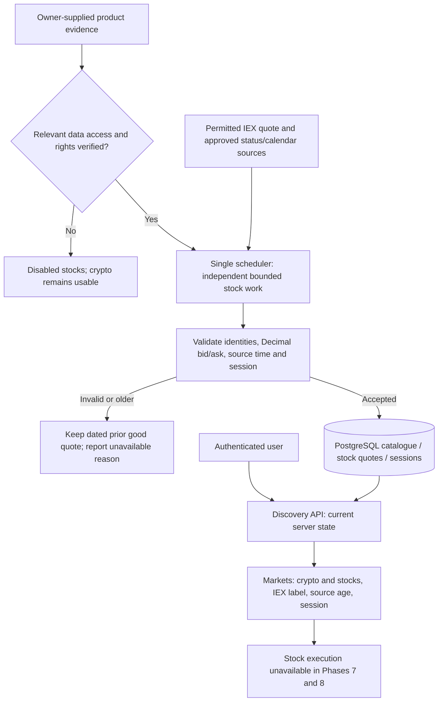

# Phase 7: Permitted Stock Discovery — Research

**Researched:** 2026-11-10
**Domain:** Permitted IEX discovery, source-time quotes, session calendars and compatible schema expansion
**Confidence:** HIGH for inspected code and published contracts; MEDIUM for the proposed implementation; UNRESOLVED for Birja-specific product entitlements

## User Constraints

No phase `CONTEXT.md` exists. The owner explicitly chose planning from approved requirements and the existing design system, phase-specific research first, and creation of a UI contract. The decisions below come from approved `.planning/REQUIREMENTS.md`, `.planning/PROJECT.md` and `.planning/ROADMAP.md`; they are not an invented discussion record. [VERIFIED: those files and owner replies supplied to this role]

- Exactly 20 curated NYSE/Nasdaq USD common stocks alongside the existing 15 crypto instruments; stable identities, company names, symbols and listing exchange. [VERIFIED: STOCK-01]
- Conditional Alpaca IEX, with visible “IEX prices” labels and a single-venue/simulated-execution explanation. Shared attribution must also serve later stock previews and valuations. [VERIFIED: STOCK-02; PROJECT.md approved follow-up decisions]
- About 60-second collection, source-event age strictly below 120 seconds for execution, and no invalid or previous-session quotes admitted on reopening. Receipt time cannot make an old source event fresh. [VERIFIED: STOCK-03]
- Quote, action and status product access, display/derived-data rights, retention, attribution, quotas, coverage and observed freshness are activation evidence, not already-established permission. No provider contact, signup, agreement acceptance, payment, private API probing or production change is authorized by this research. [VERIFIED: DATA-01; ROADMAP.md activation boundaries; parent scope]
- Server-owned regular sessions, holidays, early closes and America/New_York DST; crypto remains independently usable. Stock execution remains disabled throughout Phases 7–8. [VERIFIED: MKT-01; ROADMAP.md]
- Existing account IDs, original starting cash, cash, crypto quantities, basis and immutable fills survive reviewed migrations and restricted verified-TLS operation. Schema, grants and recovery contracts evolve in the phase that changes them. [VERIFIED: SAFE-01; ROADMAP.md]
- Approved later-phase boundaries remain settled: whole-share orders, shared USD, buy at ask/sell at bid, no stock commission or added spread/regulatory fees; gross ordinary cash dividends and correction safeguards; verified ordinary forward splits; suspend uncertain events; immediately reusable virtual proceeds. Do not reopen formerly undecided choices from milestone research. [VERIFIED: REQUIREMENTS.md]
- Deferred here: stock fills/previews, combined stock holdings valuation, dividend/event processing and event History. Establish only the interfaces actually needed by discovery; do not implement Phases 8–11 early. [VERIFIED: ROADMAP.md phase ownership]

<phase_requirements>

## Phase Requirements

| ID | Approved requirement | Research support |
|---|---|---|
| STOCK-01 | Browse exactly 20 curated NYSE/Nasdaq USD common stocks with stable identities, company names, symbols and exchanges alongside crypto. | Catalogue migration, explicit asset-class boundaries, candidate list and provider mapping verification. |
| STOCK-02 | Show “IEX prices” on listings, previews and valuations, explaining single-venue coverage and simulated execution. | Shared attribution component now, exercised independently for future consumers; listing integration in this phase. |
| STOCK-03 | Bid/ask and source-event time; about 60-second refresh; refuse invalid, >=120-second and prior-session quotes. | Decimal-safe adapter, monotonic source-time persistence and pure eligibility predicate reusable by Phase 9. |
| DATA-01 | Verify access/usage/quota/attribution before exposing relevant stock quote/action information; otherwise remain disabled without affecting crypto. | Product-specific evidence checklist, negative gate tests and explicit human activation checkpoint. |
| MKT-01 | Regular sessions with holidays, early closes and DST server-side. | Calendar adapter, bounded persisted sessions, exceptional-closure policy and exact boundary fixtures. |
| SAFE-01 | Preserve existing financial state and crypto history; restricted-role verified-TLS operation. | Populated 0008 upgrade proof, explicit grants, old-API regressions and schema-aware exact restore tests. |

All descriptions and primary phase assignments are verified in `.planning/REQUIREMENTS.md`; this table is a research mapping, not completion evidence. [VERIFIED: REQUIREMENTS.md traceability]

</phase_requirements>

## Summary

Use the deployed FastAPI/httpx/SQLAlchemy/PostgreSQL stack and existing single scheduler. Add a bounded stock catalogue, a separate stock quote representation, date-specific regular sessions and an authenticated discovery read model. Preserve the legacy crypto endpoints and financial rows. No provider SDK, queue, second account or generic provider registry is justified for twenty symbols. [Recommendation derived from VERIFIED: backend/app/models/price.py, services/prices.py, tasks/scheduler.py; CLAUDE.md]

The external gate remains real: Alpaca documents IEX and batch quote access, but public documentation does not establish Birja's application-specific display, retention, action and status rights. Build/test the disabled state and deterministic local fixtures without private credentials; place a human evidence checkpoint before live activation. A working disabled implementation is useful but does not prove all live-data success criteria. If evidence remains unavailable, retain that checkpoint as outstanding rather than declaring every Phase 7 requirement verified. [CITED: https://docs.alpaca.markets/us/docs/about-market-data-api; https://s3.amazonaws.com/files.alpaca.markets/disclosures/library/TermsAndConditions.pdf] [Recommendation: DATA-01 acceptance interpretation]

**Primary recommendation:** preserve existing IDs and crypto behavior, implement discovery with source-time and calendar truth, and attach schema/grant/recovery tests to its migrations; keep every stock order path disabled. [Recommendation derived from VERIFIED: ROADMAP.md]

## Architectural Responsibility Map

| Capability | Primary tier | Secondary tier | Rationale |
|---|---|---|---|
| Provider authentication, batching, validation | Backend scheduler | External provider | One bounded upstream workload; keys never reach browser. |
| Identity, quotes, sessions and admission state | PostgreSQL | Scheduler | Durable state remains useful without Redis; no monetary authority in cache. |
| Current session/quote eligibility | Backend pure service | PostgreSQL | Server clock and persisted evidence determine truth; browser cannot authorize trading. |
| Twenty-stock discovery response | API service/router | PostgreSQL | Left joins retain instruments with unavailable quotes. |
| Labels, filters, dated/missing states | React client | API | Render source facts and reasons; age from server age plus elapsed client time. |
| Migration/grants/recovery compatibility | Migrator/retained operations tools | Isolated test infrastructure | App/scheduler must not acquire administrative authority. |

This responsibility map is a design recommendation grounded in existing service/lifespan and operational boundaries. [VERIFIED: CLAUDE.md; backend/app/main.py; deploy/db/bootstrap-roles.sql]

## Project Constraints (from AGENTS.md)

- Read shared `CLAUDE.md` fully and planning PROJECT/REQUIREMENTS/ROADMAP/STATE; continue existing history rather than reinitialize it. [VERIFIED: AGENTS.md]
- Use GSD with `.codex/GSD-ADAPTER.md`, phase research/plans/checks/checkpoints/reviews/verification; preserve `.planning/` across assistants. [VERIFIED: AGENTS.md]
- Preserve explicit push/merge approval rules regardless of GSD yolo, autonomous or commit_docs settings; no force push or unrelated staging. This research owns only this file and makes no commit. [VERIFIED: AGENTS.md; CLAUDE.md; parent scope]
- UI work uses `.agents/skills/ui-ux-pro-max/SKILL.md`, its local search scripts and `design-system/birja/MASTER.md`; preserve existing tokens/components. The parallel UI contract is authoritative for visual details. [VERIFIED: AGENTS.md; UI skill and MASTER.md inspected]
- Keep Claude configuration intact; Codex setup changes are outside this phase. Setup discovery checks belong to `python3 scripts/sync-codex-skills.py --check` when setup changes occur. [VERIFIED: AGENTS.md]
- Retain Decimal/NUMERIC(20,8), monetary JSON strings, UTC timestamptz, thin routers, service-owned logic, constrained schema and reviewed immutable migrations. Use uv/committed locks rather than project pip installation. [VERIFIED: CLAUDE.md]
- External calls are mocked at HTTP boundaries; meaningful database tests use isolated PostgreSQL, never dev/live DB or mocked financial persistence. Preserve 80% overall/100% critical-path coverage, existing security gates and real browser acceptance. [VERIFIED: CLAUDE.md]

## Standard Stack

### Core — retain pinned project versions

| Component | Version/evidence | Use |
|---|---|---|
| Python | Project >=3.14,<3.15; image pinned Wolfi Python 3.14 family | Runtime and stdlib Decimal/datetime/zoneinfo |
| FastAPI / Pydantic | 0.162.0 / 2.14.1 | Authenticated discovery and validated string-money responses |
| httpx | 0.28.1 | Bounded REST transport and HTTP-boundary mocks |
| SQLAlchemy / asyncpg / Alembic | >=2.0.55,<2.1 / 0.32.0 / 1.20.1, resolved in uv.lock | Durable catalogue/quote/session state and migrations |
| redis-py | 8.1.0 | Existing lease mechanism, never only quote/session authority |
| React / TypeScript / TanStack Query | 19.3.1 / 6.0.3 / 5.105.0 | Existing Markets extension and independent server-state queries |
| pytest / respx / Vitest / Playwright | 9.1.1 / 0.23.1 / 5.0.5 / 1.64.1 | Existing test infrastructure |

These are verified repository versions, not claims that each is the latest registry release. No upgrade is recommended. [VERIFIED: backend/pyproject.toml, backend/uv.lock, frontend/package.json, backend/Dockerfile]

### Supporting — conditional calendar package

Use `exchange_calendars` **4.13.2** as the preferred candidate behind a dependency verification checkpoint. Its official tagged metadata declares Python 3.14, dependencies including NumPy/pandas, and a Python-3.14 test floor of NumPy >=2.3.2/pandas >=2.3.3. PyPI identifies the release as 2026-03-10. This is declared compatibility, not successful lock/build/scan evidence in Birja. [CITED: https://raw.githubusercontent.com/gerrymanoim/exchange_calendars/4.13.2/pyproject.toml; https://pypi.org/project/exchange_calendars/4.13.2/] [ASSUMED: candidate suitable for Birja until legitimacy/build/runtime validation]

Its tagged dispatcher aliases `NASDAQ` and `XNAS` to `XNYS`; do not invent a distinct `XNAS` calendar implementation or assume that alias alone verifies both exchanges' current official schedules. Validate session fixtures against NYSE and Nasdaq publications. Use only UTC datetime boundaries from the adapter; analytics types/floats never enter money math. [CITED: https://raw.githubusercontent.com/gerrymanoim/exchange_calendars/4.13.2/exchange_calendars/calendar_utils.py] [Recommendation]

### Alternatives considered

| Chosen approach | Alternative | Disposition |
|---|---|---|
| Existing httpx, explicit IEX REST | Brokerage SDK / stock WebSocket price streaming | Extra dependency/lifecycle surface without a need for minute collection; not required here. |
| Verified package-backed bounded calendar | Permitted provider calendar | Alpaca publishes a regular-session calendar with early-close times; a provider-only implementation is possible if its account access/rights and outage contract are established. Do not silently replace the selected calendar approach. |
| Calendar + separate eligibility evidence | Weekday + fixed UTC hours | Cannot satisfy holidays/early closes/DST and unknown closures. |

These are design tradeoffs, not new locked user choices. [VERIFIED: current stack and MKT-01] [CITED: https://docs.alpaca.markets/us/reference/legacycalendar]

## Package Legitimacy Audit

The existing `slopcheck` executable was found. `slopcheck install exchange_calendars --json` failed at argument parsing; its help says the supported `install` subcommand actually installs after checking and offers no `--json`. Therefore no adapted install was attempted. `python3 -m pip index versions exchange_calendars` could not reach the registry because shell DNS was restricted; its “No matching distribution” tail is not evidence that the package does not exist. No packages/global tools were installed. [VERIFIED: research tool output]

| Package | Registry/source | Age/downloads | Legitimacy result | Disposition |
|---|---|---|---|---|
| `exchange_calendars` 4.13.2 [ASSUMED] | PyPI + official tagged gerrymanoim/exchange_calendars source cross-checked | Release 2026-03-10; downloads not independently verified | Protocol unavailable in installed CLI; no clean slopcheck verdict | Human verification checkpoint before install; verify package/source/registry and transitive lock, then isolated image build/scan/calendar tests. |
| NumPy/pandas and other calendar transitives [ASSUMED] | Names from official candidate pyproject | Exact resolved versions/downloads not inspected | No transitive legitimacy or wheel proof | Audit the actual resolver output; no invented pins or claimed legitimacy. |

No package received a SLOP or SUS verdict; none was removed on that basis. Existing locked dependencies are reused without new installation recommendations. New calendar installation, if checkpoint passes, must use `uv add 'exchange-calendars==4.13.2'` in backend and review uv.lock; never `pip install` into the project. This package gate is independent from provider permission. [VERIFIED: CLAUDE.md; protocol attempt above] [Recommendation]

## Architecture Patterns

### System architecture



This is recommended data flow, not an implementation claim. No browser-provider connection or provider request inside a discovery handler is intended. [Recommendation derived from VERIFIED: existing scheduler and ROADMAP.md]

### Component responsibilities and closest analogues

| Component | Existing analogue | Required change / proposed files |
|---|---|---|
| Instrument base | `models/price.py:Coin`, migration 0004/0005 | Preserve physical coins and all IDs/FKs; add asset discriminator and stock metadata with constraints, no broad rename. |
| Stock bid/ask provenance | `services/prices.py:upsert_prices` | `models/stock.py`, `services/stock_quotes.py`: separate latest quote row keyed by existing stable instrument ID; monotonic source-event updates. |
| Provider boundary | `services/kraken.py` | `services/alpaca.py`: bounded batch adapter, explicit feed, strict raw Decimal decoding; no SDK/order API. |
| Calendar/session state | Pure `services/price_rules.py` testing style | `services/stock_sessions.py`: package adapter to bounded UTC session records and pure availability decision. |
| Collection | `tasks/scheduler.py` | Separate bounded stock cycle/lease in same process, independent crypto progress and cancellation. |
| Authenticated read model | `api/v1/prices.py`, `schemas/prices.py` | `api/v1/stocks.py`, `schemas/stocks.py`, service left join; no-store and CurrentUserDep. |
| Discovery UI | `pages/MarketsPage.tsx`, `hooks/usePrices.ts`, `api/prices.ts` | Independent stock query/validator, asset selection and shared attribution/status components per UI-SPEC. |
| Upgrade/recovery proof | `tests/test_migrations.py`, `deploy/tests/ops-fixtures.py` | Populated upgrade and exact restore fixtures extended for every new table/column/sequence. |

Existing paths and behavior are verified; proposed filenames are recommendations for the planner, not files already present. [VERIFIED: source inspection]

### Pattern 1: expand identity without changing financial history

`Coin.symbol` is globally unique, uppercase, length 1–10; name length 1–64; `kraken_pair` is non-null unique with length 1–32. Holdings and trades reference the bigint `coins.id`. Existing crypto lookup and loader functions filter only `is_active`. Adding stocks to that table without adjusting them leaks stocks into Kraken polling and symbol-only trade paths. [VERIFIED: models/price.py, models/trade.py, services/prices.py, services/trading.py]

Preserve coins/coin_id physical names. Add `asset_class` defaulting existing rows to crypto, USD denomination and a constrained stock metadata record or equivalent columns. Make Kraken mapping nullable only for stocks, with a crypto-required conditional CHECK. Prefer identity `(asset_class, symbol)` over global symbol uniqueness and use stable numeric IDs for stock routes/query keys/provider mapping. Current crypto endpoints must explicitly filter crypto so future ticker collisions cannot change their meaning. Keep symbol length unless a curated real symbol requires a reviewed extension; no selected candidate needs punctuation support. Do not widen crypto's request regex accidentally. [Recommendation derived from inspected constraints]

Use a schema migration after 0008 plus a separate seed/data migration for twenty stocks. Keep existing fifteen seed identities/order, financial values, starting cash and historical fills unchanged. Downgrade must refuse if it would orphan/drop stock financial state created by a later phase, or be explicitly irreversible; empty-discovery cleanup must not become a financial deletion tool. [Recommendation: CLAUDE.md immutable/expand-contract migration rules]

### Pattern 2: source time is different from collection time

Use a latest `stock_quotes` row with instrument FK, positive finite bid/ask and midpoint, provider/feed, source-event UTC timestamp, collected_at, and validated session identity/provenance. Retain only the bounded latest state needed here; no price-history warehouse. Provider symbol/asset identity must map to the curated instrument, not arbitrary client input. [Recommendation: STOCK-03 and existing latest-price model]

The latest-quotes endpoint accepts comma-separated symbols and explicit `feed=iex`; quote sides are the intended input, not trades or minute bars. Its default feed can depend on subscription, so specify IEX. No silent SIP/delayed/last-close substitution is acceptable. [CITED: https://docs.alpaca.markets/us/reference/stocklatestquotes-1]

Parse JSON numeric tokens with `json.loads(response.content, parse_float=Decimal, parse_constant=reject_nonfinite)`, not `Decimal(str(response.json()[...]))` after binary-float decoding. Validate zero/missing/crossed/overflowed sides, unexpected symbols, timezone/timestamp validity and allowed quote conditions; preserve the provider event timestamp. Require `0 <= now-event_time < 120 seconds` and `session_open <= event_time < session_close` for current-session eligibility. Do not clamp future stock timestamps to zero age using crypto's `age_seconds()` helper. If precision normalization is needed, use a documented conservative microsecond conversion, never a rounding rule that makes an old event newer. [Recommendation grounded in VERIFIED: existing price_rules.py limits, services/prices.py age clamping; STOCK-03]

Upsert only a strictly newer source event; equal timestamp/equal content is replay, not new freshness or spike confirmation. Equal timestamp/different content needs an explicit correction/invalid response outcome, not silent replacement. Invalid partial responses must not erase valid rows for other symbols. Existing crypto spike acceptance after repeated polls cannot be reused to authorize post-split marks; Phase 8 controls action uncertainty before trading is possible. [Recommendation derived from VERIFIED: upsert_prices monotonic predicate, evaluate_price; ROADMAP.md]

### Pattern 3: session truth is separate from execution capability

Represent a regular session by calendar/date, open/close UTC instants, provenance/version and bounded coverage/verification metadata. Evaluate `[open, close)` against current server time on every response; a persisted `is_open=true` must not survive the closing instant. Expose the next known session when coverage supports it, and unknown when it does not. Package updates do not guarantee knowledge of exceptional closures; define a maintained official schedule check/manual closure override and fail-closed freshness policy. This is an operational contract to specify/test, not a claimed provider SLA. [Recommendation: MKT-01]

NYSE and Nasdaq publish annual holidays and early closes. Use representative verified 2026 fixtures: Thanksgiving November 26 closed; November 27 and December 24 close at 13:00 America/New_York. Include winter/summer regular boundaries to prove different UTC offsets, exact opening/closing instants, weekends and out-of-range coverage. User-facing times convert from stored UTC; exchange scheduling never uses VDS or browser timezone. [CITED: https://www.nyse.com/trade/hours-calendars; https://www.nasdaqtrader.com/Trader.aspx?id=Calendar] [Recommendation]

An open calendar and asset `tradable` metadata do not prove a stock is not halted. Alpaca describes separate trading-status messages, subscription-dependent access and a production enablement handoff. No approved timely status source was established here. Keep status unknown until verified, expose its own observation/expiry, and do not fabricate a “normal” flag from a recent quote or successful HTTP response. A status integration needed for Phase 9 remains a product-admission dependency, not permission to add speculative streaming infrastructure in Phase 7. [CITED: https://docs.alpaca.markets/us/docs/real-time-stock-pricing-data; https://docs.alpaca.markets/us/docs/working-with-assets] [Recommendation]

Every stock discovery response must say execution unavailable in this phase even during a known open session with a fresh quote. Show “Market open” separately from “Stock trading coming later”; do not call the row tradable. Harden legacy stock-symbol direct requests to preview/execute/holding routes to refuse rather than accidentally invoke crypto math. Keep original crypto fractional/dollar routes unchanged. Phase 9 consumes these predicates and rechecks after blocking locks; actual stock execution belongs there. [Recommendation: ROADMAP.md staged execution and inspected trading.py]

### Pattern 4: isolate source failure inside the one scheduler

The existing crypto cycle has a 45-second Redis lease, 40-second whole-cycle budget and 35-second source budget. Its database read transaction closes before network I/O; a token-checked Lua release runs in finally. Its `as_of` is arrival time because Kraken's Ticker has no source timestamp. Preserve those crypto semantics and tests rather than retrofitting stock event time into crypto rows. [VERIFIED: tasks/scheduler.py]

Run independently scheduled bounded crypto and stock work in the same dedicated process, with distinct lease keys and explicit cancellation/DB/network budgets. A serial stock timeout must not move crypto's next refresh by an unbounded amount. Prove with fake clocks/hanging HTTP/429/401/403 fixtures that crypto still refreshes and scheduler shutdown releases both leases. No per-user polling upstream; no network calls while financial locks are held. Minimize stock quote requests outside regular sessions, with separately bounded schedule/status maintenance. [Recommendation derived from inspected scheduler and CLAUDE.md]

The documented Basic historical request allowance is 200/minute and real-time equity coverage is IEX. Budget one twenty-symbol quote batch per minute plus reserved retry/calendar/status/action costs against the actual authorized account's limits. At 390 minute intervals a normal session needs approximately 390 baseline quote requests; starting/closing samples can add one. Public quotas are not evidence of actual key entitlement. [CITED: https://docs.alpaca.markets/us/docs/about-market-data-api] [Recommendation/calculation]

### Pattern 5: read model and UI must not hide missing stocks

Current `list_prices()` inner-joins Price and drops unpriced coins; its route is authenticated and no-store. Build the stock listing from the twenty catalogue rows with left joins to quote/session state, preserving all twenty during permission failure, cold start, closed session or partial provider response. Disabled metadata may come from the separately verified curated catalogue; do not serve unpermitted provider quote/action payloads. [VERIFIED: services/prices.py; api/v1/prices.py] [Recommendation]

Return separate machine-readable availability reasons, session state, execution-disabled capability, quote event/fetch times, source/feed and nullable exact-string prices. Never use zero as missing. Separate crypto and stock TanStack query/error/age calculations so closed stocks or a denied provider do not produce a global “all markets closed/stale” state. Reuse `MarketsPage`'s server age plus elapsed-client-time pattern, stable ID row keys, accessible text labels and existing tokens. Share an attribution component now without inventing future preview/portfolio pages. [VERIFIED: frontend/src/pages/MarketsPage.tsx; REQUIREMENTS.md; design-system/birja/MASTER.md] [Recommendation]

### Pattern 6: schema safety includes real recovery now

`bootstrap-roles.sql` admits only 0007/0008, enumerates nine tables, gives app read-only catalogue/prices and scheduler writes only prices, and grants no automatic privileges on new objects. `backup-manifest.sql` explicitly hashes old coin/price columns and nine named tables. `backup-snapshot.py` validates that exact set. `verify-restore.py` checks revision-specific indexes, explicit identity sequences, constraints and equality. A successful pg_dump alone does not establish new-schema recovery compatibility. [VERIFIED: deploy/db/bootstrap-roles.sql; deploy/backup-manifest.sql; deploy/backup-snapshot.py:snapshot; deploy/verify-restore.py]

With each migration, add explicit new-table/column hashes, revision-aware producer/consumer validation, identities and invariant expectations; keep 0007/0008 restore support where existing retained artifacts rely on it. Do not make older snapshots run a new manifest SQL that references absent columns/tables. Use a bounded revision-to-contract dispatch or equivalent explicit versioned contract, rejecting unknown revisions rather than accepting any shape. Prepare updated retained recovery/deploy artifacts and tests; repository changes do not install them on production. [Recommendation derived from inspected operational contracts]

Grant only required app reads and scheduler quote/session writes, with migrator-owned catalogue seeds and admission configuration; deny scheduler access to cash/holdings/fills and runtime DDL. Test actual restricted roles over verified TLS, migrator upgrades on a populated 0008 fixture, and a real exact isolated backup/restore including stock catalogue/quotes/sessions plus unchanged crypto cash/basis/history/idempotency. Current `deploy/tests/ops-fixtures.py` deliberately seeds 0007; preserve that compatibility lane while adding a successor-schema fixture. Phase 11 adds later dividend/action state, not the first proof of this schema. [VERIFIED: deploy/tests/ops-fixtures.py SEED; app/db/connection.py] [Recommendation]

## Candidate Twenty-Stock Catalogue

The following is a recommended seed list, not the owner's approved investment selection. Current symbols, company identities and listing exchanges were cross-checked against the SEC's official ticker/exchange dataset. Security class, currency, exact provider ID/mapping and IEX availability still require the permitted account/asset checkpoint; the SEC file alone does not prove those capabilities. Use one Alphabet share class; no duplicate exposure merely to reach twenty. [CITED: https://www.sec.gov/files/company_tickers_exchange.json] [ASSUMED: complete provider eligibility of all candidates]

| Symbol | Display company | Listing |
|---|---|---|
| AAPL | Apple | Nasdaq |
| MSFT | Microsoft | Nasdaq |
| NVDA | NVIDIA | Nasdaq |
| AMZN | Amazon | Nasdaq |
| GOOGL | Alphabet Class A | Nasdaq |
| META | Meta Platforms | Nasdaq |
| TSLA | Tesla | Nasdaq |
| AVGO | Broadcom | Nasdaq |
| AMD | Advanced Micro Devices | Nasdaq |
| COST | Costco | Nasdaq |
| JPM | JPMorgan Chase | NYSE |
| V | Visa | NYSE |
| JNJ | Johnson & Johnson | NYSE |
| PG | Procter & Gamble | NYSE |
| KO | Coca-Cola | NYSE |
| XOM | ExxonMobil | NYSE |
| CVX | Chevron | NYSE |
| HD | Home Depot | NYSE |
| MCD | McDonald's | NYSE |
| DIS | Walt Disney | NYSE |

Before activation, verify exactly twenty active USD common-stock securities and their canonical IDs/listing/symbol aliases through approved reference access; collect bounded regular-session source-age observations for all twenty. A successful quote batch with missing symbols is not complete coverage. If a candidate fails, record an explicitly reviewed substitution and revalidate exact count/IDs rather than silently shrinking the list. Do not hardcode “liquid” as an unverified promise of continuous sub-120-second IEX activity. [Recommendation: STOCK-01/STOCK-03/DATA-01]

## Don't Hand-Roll

| Problem | Use | Avoid |
|---|---|---|
| DST and planned exchange sessions | Verified calendar adapter + stdlib zoneinfo, official fixtures | Fixed UTC offsets and a hand-maintained weekday/holiday algorithm |
| Provider transport | Existing shared httpx client and HTTP-boundary tests | SDK/order routing or per-browser upstream requests |
| Exact prices | Decimal from raw JSON + NUMERIC + Pydantic string serialization | Float/DataFrame calculations for bid/ask/mid or account values |
| Stable user/account state | Existing Coin IDs, account, holdings, immutable fills | New stock account/start grant or destructive global rename |
| Migration/integrity | Existing Alembic and revision-aware retained recovery contracts | Startup create_all or backup “proof” based only on archive existence |

These are prescriptive design recommendations following inspected code and shared project rules. Calendar package installation remains conditional as documented above. [VERIFIED: CLAUDE.md; inspected source]

## Runtime State Inventory

This phase is an additive schema/data migration, so the inventory covers all five categories. No private production state was inspected. [VERIFIED: research actions]

| Category | Repository evidence / inspection limit | Required action |
|---|---|---|
| Stored data | coins/prices plus account, holdings and trades use existing IDs; schema head 0008 in source tests. Live rows not queried. | Additive discriminator/metadata migration and separate stock seed; preserve populated fixture financial equality and IDs. Existing crypto source-time interpretation stays unchanged. |
| Live service config | Source defines one scheduler and restricted-role/TLS production stack. Actual dashboard/provider entitlements and running configs not inspected. | Later approved config rollout only; no claim that source changes update live services. Provider evidence checkpoint before access/display. |
| OS-registered state | Source deployment/recovery launchers and nightly timer remain v1 operational contracts; actual installed state not inspected. | No timer/unit/launcher rename required for discovery. Prepare compatible successor tooling; installation separately approved. |
| Secrets/env vars | Existing Settings/SchedulerSettings split; no stock credential names currently in inspected config. Private .env and /etc/birja files not read. | Add documented server-only stock variables/example placeholders and production-safe disabled defaults. No key required for mocks; no browser/VITE secret or secret-copy output. |
| Build artifacts / installed packages | backend image uses pinned Wolfi Python; committed uv/npm locks. Installed retained artifact contents not inspected. | Resolve/build/scan calendar candidate in actual image only after dependency checkpoint; prepare/test successor recovery payload. Do not alter host Python, Docker, images or installed recovery during planning. |

## Common Pitfalls

1. **Credential success becomes permission.** A key authenticates; it does not establish display/retention rights. Require product/audience/location/attribution evidence before relevant data exposure; keep disabled tests. [CITED: Alpaca terms in Sources; Recommendation]
2. **Fresh fetch disguises old IEX event.** Test HTTP 200 carrying yesterday's timestamp, equal timestamps, future events, missing/crossed sides and all boundary ages; persist collected_at separately. [VERIFIED: STOCK-03; current scheduler arrival-time comment]
3. **Calendar open is shown as trading enabled.** Phase 7 has no stock execution; show session state and execution capability separately. Unknown halt/action eligibility is not normal. [VERIFIED: ROADMAP.md; Recommendation]
4. **Stocks contaminate crypto.** All legacy catalogue lookups/loaders need explicit asset filters, including direct request paths. A separate stock query must not change old fifteen-coin responses. [VERIFIED: services/prices.py/trading.py; Recommendation]
5. **Partial outages hide instruments or starve crypto.** Use left joins, per-stock missing states and independent cycle budgets; do not drop a row just because its quote is absent. [VERIFIED: list_prices inner join; Recommendation]
6. **Migrations pass only as superuser.** New tables intentionally receive no default runtime grants; test actual allowed/forbidden operations and verified TLS. [VERIFIED: bootstrap-roles.sql; Recommendation]
7. **Recovery silently omits new state.** Update producer, validator, equality manifest, restore invariants and retained artifact together, and replay both old/new schemas. [VERIFIED: backup/restore source; Recommendation]
8. **Old research reopens accepted policy.** The milestone research predates approved no-fee/dividend/action decisions. REQUIREMENTS/ROADMAP/PROJECT supersede those options; only external evidence remains open. [VERIFIED: planning artifacts]

## Code Examples

These snippets illustrate recommended patterns, not copied provider implementation or already-present production functions. [Recommendation]

```python
# Source contract: STOCK-03; current prices.py monotonic upsert is the local analogue.
from datetime import datetime
from decimal import Decimal
import json

def reject_nonfinite(token: str) -> None:
    raise ValueError("nonfinite provider number")

def decode_quote_body(raw: bytes) -> object:
    return json.loads(raw, parse_float=Decimal, parse_constant=reject_nonfinite)

def quote_eligible(*, event_at: datetime, now: datetime,
                   opens_at: datetime, closes_at: datetime) -> bool:
    # Call only with validated timezone-aware UTC datetimes.
    return (opens_at <= now < closes_at
            and opens_at <= event_at < closes_at
            and 0 <= (now - event_at).total_seconds() < 120)
```

Do not use whole-second rounded age for the actual predicate: 119.999 seconds qualifies and 120.000 does not; UI age may be an integer. This pure predicate is necessary but insufficient for execution: provider admission, quote validity, status/action safety and the phase execution gate remain separate. [Recommendation based on STOCK-03 and staged roadmap]

```python
# Local analogue: services/prices.py upsert_prices, keeping stable foreign keys.
stmt = insert(StockQuote).values(validated_rows)
stmt = stmt.on_conflict_do_update(
    index_elements=[StockQuote.coin_id],
    set_={"bid": stmt.excluded.bid, "ask": stmt.excluded.ask,
          "event_at": stmt.excluded.event_at,
          "collected_at": stmt.excluded.collected_at},
    where=StockQuote.event_at < stmt.excluded.event_at,
)
# Caller owns commit; production model also includes feed/session/provenance.
```

Model/attribute names in this second snippet are proposed, not verified existing classes. [Recommendation]

## State of the Art

| Existing approach / mistaken shortcut | Phase 7 approach | Evidence / impact |
|---|---|---|
| Kraken arrival-time latest mid | Separate stock source-event bid/ask + collected_at | Current scheduler documents no ticker timestamp; preserve rather than relabel it. |
| Symbol-only crypto catalogue | Stable ID plus explicit asset class/provider mapping | Current global symbol/kraken constraints need reviewed expansion. |
| Old calendar API names | Use current tagged package APIs behind an adapter | Tagged README documents methods removed across 4.0/4.3; do not copy legacy sessions_opens/sessions_closes examples. |
| Single no-version backup schema assumption | Explicit supported schema contracts | Existing fixed-table manifest and verifier cannot validate unseen new state. |

Source provenance: repository rows are verified; calendar API history is cited to https://raw.githubusercontent.com/gerrymanoim/exchange_calendars/4.13.2/README.md. This section makes no general market-data licensing claim. [VERIFIED/CITED as identified]

## Assumptions Log

| ID | Assumed claim | Risk / disposition |
|---|---|---|
| A1 | `exchange_calendars` 4.13.2 and resolved transitives are suitable for Birja's Python 3.14 hardened image. | Explicit dependency verification checkpoint before installation; audit resolution, wheels, image scan and session behavior. |
| A2 | All twenty proposed securities are eligible USD common stocks with usable current IEX quotes under the permitted account. | Verify provider identities/type/currency and actual coverage/freshness before activation; no guarantee from SEC listing alone. |

Neither assumption becomes a locked decision through this research. Birja-specific rights/status/action coverage are unresolved evidence rather than assumed grants. [Research disposition]

## Open Questions and Executable Activation Checkpoint

### Evidence to request before any live provider integration — checkpoint assigned, UNSATISFIED

**RESOLVED-FOR-PLANNING:** 07-05 prepares the product-specific evidence contract and 07-14 owns explicit external authorization, bounded private verification and final acceptance checkpoints. Actual account access and quote/action/status display/derived-data/retention rights remain **UNSATISFIED** until those checkpoints produce real evidence; no fixture or planning choice grants permission.

Record sanitized references to actual applicable account/product terms or provider confirmation, review date/version, audience and server/account location, $0/no-card eligibility, display and derived-data permissions, stored quote/fill retention, attribution and quotas. Cover quotes, actions and status separately. Any expiry/revocation must switch the relevant stock input off; existing crypto remains usable. The linked terms include personal-use and User Application notice restrictions; they are not a completed permission grant. No provider contact is performed by this plan/research. [CITED: https://s3.amazonaws.com/files.alpaca.markets/disclosures/library/TermsAndConditions.pdf] [Recommendation: DATA-01]

After explicit owner authorization for a bounded private verification, verify all twenty mappings and real regular-session event ages using server-only keys, with sanitization and quota budgets. Do not request pasted secrets or print full HTTP headers/errors. If actual access/status/action permissions or freshness fail, keep stocks disabled and return to the owner for a scoped decision. Do not choose paid access, delayed SIP or a different feed automatically. [Recommendation: approved activation boundary]

### Remaining technical evidence

- **Timely halt/status source — RESOLVED-FOR-PLANNING, external evidence UNSATISFIED:** 07-05 defines the independent product gate; 07-09/10 expose unknown status; 07-14 retains the actual-access checkpoint. No status integration is assumed or added here;  documented trading-status channels are subscription-dependent; no working permitted bounded source was established. Phase 7 exposes unknown rather than asserting halt safety; Phase 9 execution cannot proceed until a valid status integration exists. [CITED: Alpaca real-time stock documentation; Recommendation]
- **Corporate-action coverage — RESOLVED-FOR-PLANNING, external evidence UNSATISFIED:** 07-05/14 own permission/coverage evidence; monitoring and accounting remain Phase 8.  Alpaca documents delays and `data_quality=all` for incomplete announcements. Phase 7 establishes product admission requirements only; Phase 8 designs monitoring/revision/freeze behavior. Do not promise complete immediate event discovery from an API that explicitly disclaims it. [CITED: https://docs.alpaca.markets/us/reference/corporateactions-1]
- **Calendar maintenance policy — RESOLVED-FOR-PLANNING:** 07-08 specifies 45 calendar days past/90 future coverage and review expiry no more than 24 hours after official review. 07-01/05 place authoritative review and bounded exceptional overrides in migrator-owned calendar admission evidence; scheduler sessions reference its generation. 07-04 tests runtime authority denial; 07-10 reads current evidence and fresh UTC at its final boundary. These are chosen implementation policies to test, not a provider SLA or evidence of actual current review. [Recommendation: MKT-01]
- **Package/runtime compatibility — RESOLVED-FOR-PLANNING, actual gate UNSATISFIED:** 07-07 requires explicit legitimacy review before any install; 07-08 proves the approved actual Python 3.14 resolution and hardened image; 07-13 retains strict scans. No package is promoted from ASSUMED by these plan assignments.
- **Rights still absent at phase end — RESOLVED-FOR-PLANNING, live acceptance UNSATISFIED:** 07-14 explicitly owns the unresolved outcome; tests of denied/default states can pass, but record the live acceptance checkpoint unresolved. “Disabled safely” proves the negative branch of DATA-01, not permitted live twenty-stock discovery. [Recommendation: honest requirement verification]

## Environment Availability

| Dependency | Research observation | Required execution handling |
|---|---|---|
| Host Python | Python 3.12.3 | Not project runtime; use existing Python 3.14 environment/image, do not modify host. |
| Node/npm | v24.22.1 / 11.19.1 | Meets project's Node >=24 declaration; no install performed. |
| uv | 0.13.5 | Reuse lock-managed project workflow. |
| Docker CLI | 29.2.1 | CLI metadata only; daemon/services/images not inspected. Isolated stack availability must be checked when execution is authorized. |
| gsd-sdk | init.phase-op 7 succeeded | phase directory exists; no context/plans/research at initial read. |
| Context7 | No matching available tools; no ctx7 executable | Official docs/tagged source used; no CLI auto-download. |
| slopcheck | Installed, incompatible with protocol --json; supported install mutates packages | No install; use explicit verification checkpoint. |
| Calendar candidate | No installation performed; source/PyPI metadata read | Checkpoint + lock/build/test proof required. |
| Alpaca private credentials/access/rights | Not inspected or requested | Default disabled/mocked implementation; live acceptance blocked until authorized evidence. |
| PostgreSQL/Redis/retained tools | Source fixtures inspected, live services intentionally uninspected | Use isolated birja-test/ops fixtures only; no inference of current production readiness. |

All tool availability observations are verified read-only command results. No shell registry connectivity was available in the attempted pip query. Missing external permission has no automatic free equivalent fallback; deterministic mocks prove implementation but cannot substitute for live rights/access. [VERIFIED: research tool output] [Recommendation]

## Validation Architecture

Nyquist validation is enabled. Existing pytest/respx/real PostgreSQL fixtures, Vitest/Testing Library and Playwright are present; no test framework install is needed. Tests were inspected, not run during research. [VERIFIED: .planning/config.json; backend/tests/conftest.py; frontend/package.json]

### Requirement-to-test map

Proposed test paths below are Wave 0 gaps unless identified as existing. Commands assume authorized execution with the isolated test stack ready and test-only configuration. No new test file is claimed to exist. Durations are estimates to measure, not test results. [Recommendation]

| Requirement / criterion | Proof | Proposed command | Existence / expected runtime |
|---|---|---|---|
| STOCK-01 / SC1 | Exactly twenty stocks plus original fifteen crypto; IDs/mappings and missing-price rows | `cd backend && uv run pytest tests/test_stock_catalog.py tests/test_stocks_api.py -q` | New; targeted integration likely tens of seconds, measure |
| STOCK-02 / SC1 | IEX label/explanation, shared component, crypto distinction | `cd frontend && npm run test -- src/components/StockAttribution.test.tsx src/pages/MarketsPage.test.tsx` | First new, Markets existing; target <30s excluding install |
| STOCK-03 / SC2 | Raw Decimal parser, invalid/partial/old/equal/future events, 119.999/120 age, previous-session rejection | `cd backend && uv run pytest tests/test_stock_quote_rules.py tests/test_alpaca.py -q` | New pure/HTTP tests; target <30s excluding environment setup |
| DATA-01 / SC3 | Denied/unverified/revoked input never fetched/exposed; crypto unaffected | `cd backend && uv run pytest tests/test_stock_admission.py tests/test_stock_scheduler.py -q` | New; pure/HTTP/clock fixtures target <30s |
| DATA-01 / SC3 live branch | Product rights/access, twenty-symbol metadata and observed source-age evidence | Explicit human evidence checkpoint; bounded permitted verification only after separate authorization | Manual/external, no automatic test can grant rights |
| MKT-01 / SC4 | Open/close exact boundaries, holidays/early close, DST, missing/expired coverage | `cd backend && uv run pytest tests/test_stock_sessions.py -q` | New; pure calendar tests target <30s |
| SAFE-01 / SC5 | Populated 0008 upgrade preserves cash/start/IDs/holdings/fills; no direct stock execution via old paths | `cd backend && uv run pytest tests/test_migrations.py tests/test_seed_coins.py tests/test_trades_api.py -q` plus new populated stock migration tests | Existing files extended; integration may exceed30s |
| SAFE-01 / SC5 + schema safety | Actual restricted app/scheduler allowed/denied operations, migrator upgrade and verified TLS | `bash deploy/tests/test-db-operations.sh --all` after adding new-schema lane | Existing fixture extended; minutes, not a <30s check |
| SAFE-01 cross-phase recovery | Exact new-state restore and old-contract compatibility, row/schema/sequence equality | New-schema fixture in previous command; `bash deploy/tests/test-backup.sh` for producer rejection/regression cases | Existing fixtures extended; restore minutes; offline contracts roughly minute-scale, measure |
| SC1–SC4 user journey | Crypto usable while stocks disabled/open/closed/stale/missing; all twenty rows, IEX attribution | `cd frontend && npx playwright test e2e/markets.spec.ts e2e/stocks.spec.ts` | markets existing, stocks new; full Compose/browser preparation minutes |

### Sampling and phase gate

- **Per task:** relevant pure/HTTP/Vitest slice above; meaningful exact state assertions, not implementation-mirroring tests. [Recommendation: CLAUDE.md]
- **After schema slice:** isolated populated migrations plus real restricted-role/TLS and exact restore before its summary can claim compatible state; do not defer all operations proof to Phase 11. [Recommendation: ROADMAP.md]
- **Per wave:** affected backend/frontend suites and lint/type checks; expand only when new scope/failure warrants it. [Recommendation: project test rules]
- **Phase gate:** existing full CI commands and critical coverage list, updated to cover new critical quote/admission/session behavior; full backend/frontend/browser checks and applicable operations/image/security gates. Use existing `.github/workflows/ci.yml`, not a parallel unprotected workflow. Local full commands remain `cd backend && uv run pytest --cov=app --cov-fail-under=80` and `cd frontend && npm run test -- --coverage`; existing critical report must retain 100% for its original paths. [VERIFIED: CLAUDE.md; Recommendation]

### Wave 0 gaps

- Stock source fixtures containing exact numeric tokens and provider event timestamps; respx cases for auth errors, rate limits, malformed/partial batches and deadline exhaustion. [Recommendation]
- Injected clock and bounded fake sessions/status/admission for stock rules; deterministic current-session and previous-session fixtures independent of wall clock. [Recommendation]
- Populated 0008 migration snapshot and new-schema downgrade guard fixtures; retain old 0007/0008 lanes and financial equality assertions. [Recommendation]
- Extended ops fixture with new-table hashes, sequence safety, schema compatibility, restricted permissions and verified-TLS negative controls; no production services or real B2 uploads. [Recommendation]
- New stock UI query/parser/component tests and browser fixture that cannot enable fake sources in production. No test data provider account needed. [Recommendation]

## Security Domain

Project baseline is OWASP ASVS Level 1. Current official stable ASVS is 5.0.0 (published 2025-05-30); use explicit edition/category names rather than the older template's V2 Authentication/V3 Sessions/V4 Access Control numbering. This research is a threat/control map, not certification. [VERIFIED: CLAUDE.md] [CITED: https://asvs.owasp.org/]

| Applicable area | Standard project control / Phase 7 implication |
|---|---|
| ASVS 5 V1 Encoding/Sanitization | React escapes company/provider strings; parameterized SQL/SQLAlchemy; no raw HTML or arbitrary URL/query construction. |
| ASVS 5 V2 Validation/Business Logic | Validate upstream bodies and monetary/time combinations; curated symbols only; reject invalid/unknown/expired evidence and stock execution. |
| ASVS 5 V7 Session Management | Preserve existing cookies/refresh/session privacy; authenticated no-store discovery; do not expose user/provider secrets in logs. |
| ASVS 5 V8 Authorization | Server-owned admission; no client flag enables stock data/orders; app cannot write catalogue/admission or DDL; scheduler cannot debit accounts. |
| Authentication/cryptography/communication/configuration concerns | Existing OTP/JWT/CSRF and verified TLS remain unchanged; provider TLS verification and server-only secret files; locked deps and strict image scanning. No custom crypto or new auth system. |

V1/V2/V7/V8 names and control themes were checked against official tagged ASVS 5 source; other concerns above identify project controls without claiming unverified category numbers. [CITED: https://raw.githubusercontent.com/OWASP/ASVS/v5.0.0/5.0/en/0x10-V1-Encoding-and-Sanitization.md; https://raw.githubusercontent.com/OWASP/ASVS/v5.0.0/5.0/en/0x11-V2-Validation-and-Business-Logic.md; https://raw.githubusercontent.com/OWASP/ASVS/v5.0.0/5.0/en/0x16-V7-Session-Management.md; https://raw.githubusercontent.com/OWASP/ASVS/v5.0.0/5.0/en/0x17-V8-Authorization.md]

| Threat | STRIDE | Required mitigation / proof |
|---|---|---|
| Browser or direct API bypasses execution-disabled state | Elevation/tampering | Server rejects stock use of legacy trade paths; no enabled stock order endpoint this phase. |
| Malicious/malformed provider value or future timestamp | Tampering | Raw Decimal/time/schema validation, positive bounded values, per-symbol isolation and HTTP-boundary tests. |
| Arbitrary-symbol proxy drains quota or reaches arbitrary hosts | Denial of service / information disclosure | Fixed configured provider origin, curated allowlist, bounded response/time/retries, no user-supplied upstream URLs. |
| Provider secrets/raw errors enter browser or public logs | Information disclosure | Headers only server-side, sanitize exceptions, no VITE keys, no logged request headers/body/config; test redaction. |
| Stock outage blocks crypto scheduler | Denial of service | Independent cycle/lease budgets, timeout/cancel tests and per-source failure state. |
| Migrated rows omitted or corrupted in recovery | Tampering/repudiation | Explicit revision-aware manifest, full-state equality and identities, real isolated restore, retained payload integrity. |

Threats and mitigations are recommendations derived from the inspected stack and project security rules. This phase adds no admin web endpoint merely to manage provider evidence. [VERIFIED: CLAUDE.md; source inspected]

## Sources

### Primary — checked 2026-11-10

- Repository: AGENTS.md, CLAUDE.md, .codex/GSD-ADAPTER.md; PROJECT/REQUIREMENTS/ROADMAP/STATE/config; milestone research files; the exact component/test/operations paths identified above. Source behavior is HIGH confidence; no runtime/private-service claim follows from source alone. [VERIFIED: local reads]
- [Alpaca latest quotes](https://docs.alpaca.markets/us/reference/stocklatestquotes-1) — batch/feed contract; page reports updated six months ago. [CITED]
- [Alpaca market-data plans](https://docs.alpaca.markets/us/docs/about-market-data-api) — Basic IEX, quota/account-model distinction; page reports updated about one month ago. [CITED]
- [Alpaca terms PDF](https://s3.amazonaws.com/files.alpaca.markets/disclosures/library/TermsAndConditions.pdf) — personal usage, User Application notice and restrictions; no Birja grant inferred. [CITED]
- [Working with assets](https://docs.alpaca.markets/us/docs/working-with-assets) — reference metadata and active/tradable distinction; page reports updated three months ago. [CITED]
- [Real-time stock documentation](https://docs.alpaca.markets/us/docs/real-time-stock-pricing-data) — bid/ask/event fields and separate subscription-dependent status channel; published schema is not confirmed account access. [CITED]
- [Corporate actions](https://docs.alpaca.markets/us/reference/corporateactions-1) — late/incomplete event warning and discovery interface. [CITED]
- [Alpaca regular calendar](https://docs.alpaca.markets/us/reference/legacycalendar) — date-specific regular open/close with early closes; not verified account entitlement. [CITED]
- [NYSE schedule](https://www.nyse.com/trade/hours-calendars), [Nasdaq schedule](https://www.nasdaqtrader.com/Trader.aspx?id=Calendar) — current 2026 holiday/early-close fixtures, not an emergency-closure SLA. [CITED]
- [SEC tickers/exchanges](https://www.sec.gov/files/company_tickers_exchange.json) — current candidate identities/listings, not provider security-type/quote coverage evidence. [CITED]
- [Calendar tagged metadata](https://raw.githubusercontent.com/gerrymanoim/exchange_calendars/4.13.2/pyproject.toml), [README](https://raw.githubusercontent.com/gerrymanoim/exchange_calendars/4.13.2/README.md), [dispatcher aliases](https://raw.githubusercontent.com/gerrymanoim/exchange_calendars/4.13.2/exchange_calendars/calendar_utils.py), [PyPI release](https://pypi.org/project/exchange_calendars/4.13.2/) — declared compatibility/API/release provenance, not local build or legitimacy verdict. [CITED]
- [ASVS official release](https://asvs.owasp.org/) and tagged category links in Security Domain — edition/current category checks. [CITED]

### Lookup limitations

No Context7 tool or ctx7 CLI was available. Several old Alpaca asset-documentation URLs returned 404/unreadable responses; the current Working with assets page was found and read instead. CLI package registry access failed; official PyPI web metadata succeeded. No secondary web commentary was used to override primary documentation. No graph.json existed at the checked path; no stale semantic graph was treated as current source evidence. [VERIFIED: tool results]

## Metadata

| Area | Confidence | Practical limit |
|---|---|---|
| Existing stack/schema/operational contracts | HIGH | Direct source and lock inspection; no live service inspection. |
| Proposed architecture and tests | MEDIUM | Recommendations fit known boundaries; implementation and tests have not run. |
| Calendar declared support and official schedule fixtures | HIGH published; MEDIUM integration | Dependency legitimacy/wheels/hardened image validation pending. |
| Permission, actual symbol age/status/action access | UNRESOLVED | Must be satisfied at explicit activation evidence checkpoint. |

**Valid until:** recheck provider rights/access/current listings before activation; review volatile provider/package evidence within seven days if planning is delayed. Calendar horizon and maintenance policy must be explicit in implementation. [Recommendation, not an external compliance requirement]

**Research disposition:** ready for executable planning with explicit dependency and live-data activation checkpoints. No code, tests, services, package installations, commits, provider accounts, external messages or production state were changed. [VERIFIED: this role's scoped actions]
