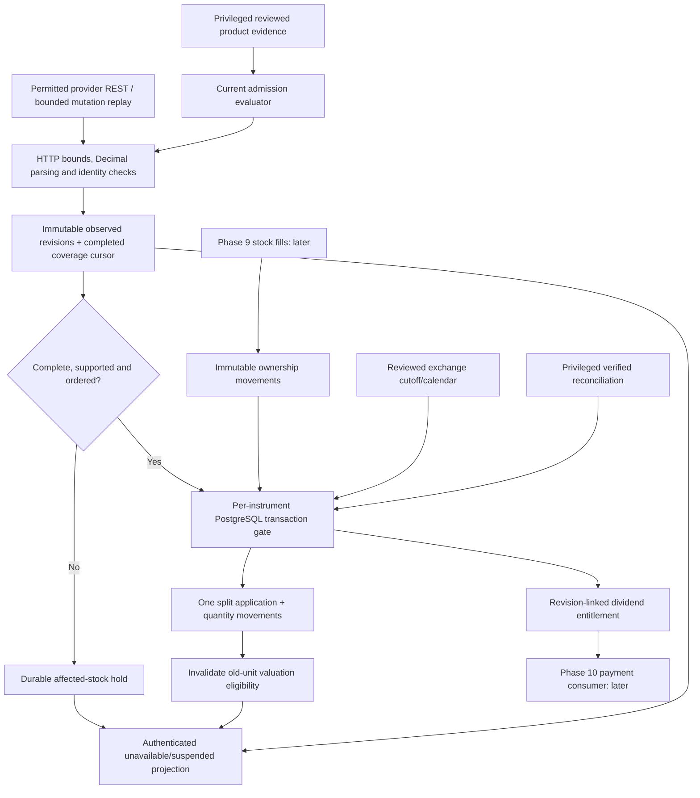

# Phase 8: Corporate-Action-Safe Ownership — Research

**Researched:** 2026-11-11  
**Domain:** Corporate-action revisions, historical stock ownership, dividend eligibility and safe forward splits  
**Confidence:** HIGH for existing code and exchange-date rules; MEDIUM for provider integration until actual product access and conditions are verified

## User Constraints

No `08-CONTEXT.md` exists. The following constraints come from the approved requirements, roadmap and owner replies; these are not invented discussion decisions or D-IDs. [VERIFIED: `.planning/REQUIREMENTS.md`, `.planning/ROADMAP.md`, owner conversation]

- Exactly twenty curated NYSE/Nasdaq USD common stocks, whole-share orders and one existing USD account. Ordinary gross USD dividends and straightforward forward splits are supported; uncertain/unsupported actions suspend the affected stock and make valuation unavailable. No guessed liquidation, fractional cash-in-lieu, withholding or reinvestment. [VERIFIED: `.planning/REQUIREMENTS.md`]
- Preserve announcement revisions, historical eligibility, immutable fills, total split basis and once-only processing. Hold uncertain or unaffordable negative payment corrections; payment, correction cash and public event History belong to Phase 10. Actual stock orders and combined portfolio integration belong to Phase 9. [VERIFIED: `.planning/REQUIREMENTS.md`, `.planning/ROADMAP.md`]
- Phase 8 must demonstrate the accounting foundation on isolated seeded ownership without enabling stock execution. Crypto remains independently usable. The owner authorized research, a UI contract using the existing design system and planning. [VERIFIED: `.planning/ROADMAP.md`, owner reply]
- Phase 7 local implementation and aggregate owner UI acceptance are recorded; actual live identity/freshness verification remains owner-deferred, not passed or waived. Plan isolated Phase 8 work without changing its scheduled campaign or treating fixtures as live acceptance. [VERIFIED: `07-LOCAL-READINESS.md`, `.planning/STATE.md`]
- Existing paper keys and owner-attested quote approval do not establish corporate-action or status product access, permitted display, derived use, historical retention or backup rights. Record those prerequisites as activation checkpoints; do not block local design or invent permission. [VERIFIED: `.planning/REQUIREMENTS.md`, `07-ACTIVATION.md`]

## Summary

Build a durable corporate-action pipeline and ownership journal using the existing HTTPX, SQLAlchemy, PostgreSQL and scheduler stack. Separate provider observations, immutable normalized revisions, review decisions, per-stock monitoring state, ownership movements, split applications and dividend entitlements. Keep these accounting records distinct from the future cash-payment ledger. These are proposed implementation responsibilities derived from the five requirements, not claims that the tables already exist. [VERIFIED: `.planning/REQUIREMENTS.md`, existing `backend/app/models/stock.py` and `trade.py`; DESIGN RECOMMENDATION]

The current provider contract differs materially from older research: use the current market-data corporate-actions API, not the deprecated paper announcement API. Verify dates and revisions instead of assuming record-date holdings determine eligibility. The current exchange rules reflect T+1; exceptional distributions and due bills require the actual designated ex-date. Public documentation does not prove this account's action entitlement or a delivery-latency guarantee. [CITED: https://docs.alpaca.markets/us/reference/get-v2-corporate_actions-announcements-1] [CITED: https://www.finra.org/rules-guidance/rulebooks/finra-rules/11140]

**Primary recommendation:** Make durable ordering and explicit unknown/suspended states the prerequisite for future stock fills; accept provider observations only through product-specific permission and bounded completeness checks. Preserve all activation gates while proving the pipeline locally. [DESIGN RECOMMENDATION derived from DIV-01/02 and ACT-01/02/03]

## Architectural Responsibility Map

The assignments below are design recommendations following the project's router/service/storage separation. [VERIFIED: `CLAUDE.md`; DESIGN RECOMMENDATION]

| Capability | Primary tier | Secondary tier | Rationale |
|---|---|---|---|
| Product permission and reconciliation approval | Privileged operator tooling | Migrator-owned PostgreSQL evidence | Runtime collection must not grant itself permission or clear an unresolved dispute |
| Bounded action observations and monitoring | Existing dedicated scheduler | HTTPX, PostgreSQL | External I/O stays outside web workers and financial transactions |
| Classification, cutoff and split calculations | Backend pure services | Reviewed calendar evaluator | One deterministic implementation, shared by collection and future execution |
| Revisions, ownership ordering, split applications and entitlements | PostgreSQL transactions | Backend services | Durable constraints and locks provide the actual idempotency boundary |
| Safe authenticated discovery projection | Backend API/service | PostgreSQL | Current permission, action state and deadlines are checked before disclosure |
| Suspension labels and local expiry | React/TanStack Query | Existing stock response validator | Client can reduce availability, never infer eligibility or repair state |
| Exact schema/rows/sequences and restricted TLS | Existing recovery tooling | Alembic/role bootstrap | New accounting state must survive restore without losing duplicate prevention |

<phase_requirements>
## Phase Requirements

| ID | Required behavior | Research support |
|---|---|---|
| DIV-01 | Structured ordinary USD dividend identities, dates, rates and retained revisions; recheck changes; uncertain/cancelled/incomplete events never produce guessed payments | Normalized revision model, strict currency/type classification, known-ID rechecks and explicit missing/tombstone distinction |
| DIV-02 | Entitlement uses verified historical cutoff, including fills and processed splits; later buys do not qualify and later sales do not remove eligibility | Immutable ownership journal, exclusive cutoff, revision-linked entitlement snapshots and same-time ordering rules |
| ACT-01 | Verified straightforward forward split changes whole-share holdings once while conserving total basis and immutable fills | Exact rational quantity calculation, atomic application record and basis invariant |
| ACT-02 | Reverse splits, mergers, fractional/disputed/unsupported events suspend stock trading and uncertain valuation until auditable resolution | Persistent hold reasons, separate monitoring/action/halt facts, privileged evidence-based resolution |
| ACT-03 | Retries/recovery cannot repeat splits; actions order with fills/eligibility; monitoring loss/recovery is explicit | Per-instrument transaction serialization, unique application keys, watermarks and fail-closed recovery state machine |
</phase_requirements>

## Project Constraints (from AGENTS.md)

The actionable repository rules are verified from `AGENTS.md`, `CLAUDE.md` and `.codex/GSD-ADAPTER.md`; preserve them in every execution plan. [VERIFIED: those files]

- Read shared rules and current PROJECT/REQUIREMENTS/ROADMAP/STATE, relevant plans and summaries; continue existing GSD state rather than resetting it.
- Use the selected GSD workflow, research, dependency ordering, checkpoints, independent checks and verification; use actual tool mappings and preserve `.planning/` history.
- Keep project monetary values Decimal/NUMERIC, JSON monetary strings, explicit half-even final rounding and aware UTC timestamps. Use identity bigint keys, FK/UNIQUE/CHECK constraints and deterministic list ordering.
- Services own business transactions; routes remain thin and authenticated. Lock rows before updating; financial invariants need real isolated PostgreSQL tests, not SQLite or mocked transactions.
- Use reviewed additive Alembic migrations; separate schema and data changes. Keep old migrations immutable, compatible recovery contracts and explicit grants. Test upgraded restricted roles without re-running grant-repair bootstrap after migration.
- Keep scheduler work in the one dedicated scheduler container. No new queue, service or package is required by this research. Never install directly into the project with pip.
- Keep secrets out of logs, source and responses. No external calls from tests; mock the HTTP boundary. Preserve TLS verification, nonroot images, locked dependencies, applicable coverage and strict security gates.
- UI changes use `.agents/skills/ui-ux-pro-max/SKILL.md`, its local search and `design-system/birja/MASTER.md`; preserve existing tokens, typography, accessible text labels and TanStack Query.
- No push or merge without explicit owner approval. This research authorizes no provider contact, signup, agreement, payment, production read/write, deployment, private API campaign or alteration of the Phase 7 delayed process.

## Standard Stack

Use the already locked versions below; no upgrade is recommended. These are repository lock observations, not fresh package-registry or legitimacy attestations. [VERIFIED: `backend/pyproject.toml`, `backend/uv.lock`, `frontend/package.json`, `frontend/package-lock.json`]

| Component | Existing version | Phase 8 purpose |
|---|---|---|
| Python | 3.14; local venv reports 3.14.9 | Decimal, fractions, datetime/zoneinfo, asyncio |
| SQLAlchemy | 2.0.55 | Async transactions, explicit locking and constrained inserts |
| Alembic / asyncpg | 1.20.1 / 0.32.0 | Additive migrations and real PostgreSQL |
| HTTPX | 0.28.1 | Bounded REST and, if admitted, bounded historical mutation replay |
| Pydantic | 2.14.1 | Strict internal/API schema validation |
| exchange-calendars | 4.13.2 | Existing genuine XNYS/XNAS session evaluator; do not derive ad hoc business days |
| React / TanStack Query | 19.3.1 / 5.105.0 | Existing authenticated Markets stock section and response-expiry projection |
| pytest / pytest-asyncio / respx | 9.1.1 / 1.4.1 / 0.23.1 | Pure rules, real DB races and mocked HTTP |
| Vitest / Playwright | Existing frontend locks; Vitest 5.0.5 | State validation, accessible stock labels and browser regressions |

**Installation:** none. Reuse the existing lockfiles and environment; ordinary execution uses the documented `uv ... --locked`/npm commands if synchronization is needed. No package was installed during research. [VERIFIED: research tool activity; DESIGN RECOMMENDATION]

### Package Legitimacy Audit

Not applicable to a new install: this research recommends **zero new external packages and zero version changes**. No slopcheck download or registry executable was run. Existing package provenance is unchanged; do not upgrade its approval status based on this research. If implementation introduces a package, perform the package review/legitimacy protocol and the applicable project checkpoint before installation. [VERIFIED: existing lockfiles and research scope]

### Alternatives considered

| Preferred | Alternative | Disposition |
|---|---|---|
| Existing HTTPX adapter | Add Alpaca SDK | Unnecessary dependency; current official SDK documentation also marks the old trading announcement method deprecated |
| Existing PostgreSQL + one scheduler | Add Celery/event broker | Existing scope is twenty stocks and a few users; durable SQL journal already supplies correctness boundaries |
| Immutable local observations/revisions | Mutable single announcement row | Cannot explain revised historical cutoff or applied action after recovery |

[CITED: https://alpaca.markets/sdks/python/api_reference/trading/corporate-actions.html] [VERIFIED: `CLAUDE.md`, `.planning/PROJECT.md`; DESIGN RECOMMENDATION]

## Current Provider Findings

### Current API versus legacy announcements

Current REST is `GET https://data.alpaca.markets/v1/corporate-actions`. Its date window is inclusive and keyed to `process_date`, not declaration, ex-date or modification time. Pagination uses `next_page_token`, with a response-wide limit of 1–1000. `ids` is mutually exclusive with the other filters. `data_quality=all` includes early incomplete observations; the default complete mode can hide them, while processed records may still lack needed fields. Alpaca explicitly does not guarantee creation timing. Consequently a successful empty page is not a guarantee of no action or complete present-day knowledge. [CITED: https://docs.alpaca.markets/us/reference/corporateactions-1]

The paper `/v2/corporate_actions/announcements` endpoint is explicitly deprecated. Do not build Phase 8 around its `date_type`, announcement revision or date-window assumptions. [CITED: https://docs.alpaca.markets/us/reference/get-v2-corporate_actions-announcements-1]

### Normalize provider facts without inventing fields

The official schema distinguishes cash-dividend `rate`, `currency`, `foreign`, `special`, optional subtype and relevant dates; split `new_rate`/`old_rate`; and distinct old/new security identifiers for identity-changing events. Currency may be empty with multiple meanings, including unknown. Treat blank currency as unresolved. Not every useful economic date is required in every payload, and the generic provider processing date is not a verified effective timestamp. The event UUID and a local observed revision are separate concepts. [CITED: https://raw.githubusercontent.com/alpacahq/cli/main/api/specs/market-data-api.json]

Recommended normalization: `provider_event_id`, stable Birja `coin_id`, event type, explicit currency, supplied dates, exact decimal rate/ratio, identity evidence, local revision ordinal/hash, observation time/source and decision status. Missing provider fields remain null/unknown; locally derived cutoff and local revision metadata must be labelled as such. Preserve only bounded permitted fields; don't retain entire arbitrary payloads. [DESIGN RECOMMENDATION]

### Revisions, deletion and source continuity

The current official corporate-action mutation stream documents insert/update/delete, an event identifier, and historical replay. Reconnect by ID is inclusive, so duplicate replay is expected. Time-bounded replay can close at a historical `until`; this supports a bounded catch-up cycle without adding a persistent streaming service. Its documented filters are event type and region, not a twenty-symbol filter. Retention duration for replay and actual account entitlement were not established. [CITED: https://docs.alpaca.markets/us/reference/subscribetocorporateactionseventssse]

**Recommended implementation:** start with paginated REST discovery plus explicit known-event ID rechecks, and support bounded historical mutation replay for verified cancellation/continuity when its product is admitted. If replay access/coverage cannot be verified, absence becomes `missing_or_uncertain`, never a fabricated cancellation or a renewed healthy watermark. Keep affected state held pending verified reconciliation. A REST-only implementation can remain safely disabled/held; it must not claim automatic detection of every deletion or completed live readiness. [DESIGN RECOMMENDATION]

For an admitted replay path, validate and discard unrelated symbols before persistence; its all-US transport scope must itself be allowed. Do not quietly contact a broader data product under a narrow twenty-symbol permission. Commit the cursor with every validated mutation batch, deduplicate inclusive event IDs and refuse incomplete framing, truncation, wrong content type, unexpected redirects, missing terminal bounds or exhausted budgets. An idle socket proves no current action fact. [DESIGN RECOMMENDATION]

### Rights, quotas and storage are separate gates

The public subscription page describes Basic/IEX and a historical request allowance; it does not verify this account's action endpoint, mutation replay allowance, status product, onward display or long-term retained accounting evidence. No private API request, account inspection or provider contact was made during research. Action access, rate/response limits, coverage, retention and backup permissions remain unverified activation inputs. [CITED: https://docs.alpaca.markets/us/docs/about-market-data-api] [VERIFIED: research tool activity]

The existing admission evaluator hard-requires `feed="iex"` for every product, limits `retention_seconds` to 86,400 and expects generic actions fields including `revision`/`effective_date`. That was a disabled Phase 7 placeholder, not a suitable long-term action-rights contract. [VERIFIED: `backend/app/services/stock_admission.py`]

Extend admission semantics **by product**: identify the actual action product/feed, endpoint and audience/account/server scope; required source fields versus local derivatives; REST versus replay capabilities; finite operational quotas; and permission to retain normalized source revisions and derived ownership/entitlement audit through DB backups/restores. Keep quotes/reference/calendar behavior and their existing limits unchanged. Do not overwrite an IEX-labelled scope to pretend actions are exchange quote data. Runtime cannot renew these permissions. If rights do not cover durable accounting, leave activation off rather than adding unapproved deletion or pretending display expiry deletes backups. [DESIGN RECOMMENDATION]

## Verified Eligibility and Economic Time

### Use actual ex-dates, not record-date holdings

Current FINRA Rule 11140 provides normal ex-dates at the record date when it is a business day, with a preceding-business-day rule for non-delivery dates; distributions/splits at least 25% can have an ex-date after payable date. Late information and foreign/ADR cases have special designation rules. The amendment effective May 28, 2024 implements the present settlement setting. [CITED: https://www.finra.org/rules-guidance/rulebooks/finra-rules/11140]

NYSE's current ex-date page explicitly highlights due-bill exceptions. Nasdaq's current operational page also uses T+1. Some generic Nasdaq glossary entries still contain older settlement descriptions; use current operational rules/alerts and verified event facts rather than that glossary. [CITED: https://www.nyse.com/trade/ex-date-dividends] [CITED: https://www.nasdaqtrader.com/Trader.aspx?id=nasdaq-ex-date] [CITED: https://www.nasdaqtrader.com/TraderNews.aspx?id=ETA2024-29] [CITED: https://www.nasdaq.com/glossary/e/ex-dividend-date]

For a supported ordinary event, derive Birja's exclusive cutoff from the verified ex-date's genuine regular-session opening in `America/New_York`; convert to aware UTC and retain the rule/calendar provenance. Include movements economically before cutoff, exclude movements at/after it. Since Birja allows regular-session fills only, the pre-ex closing ownership and pre-ex opening ownership agree when no intervening action exists. Do not invent a session for a holiday date: quarantine conflicting dates. Cash availability remains immediate under the approved simulator simplification; do not add a T+1 cash ledger. [VERIFIED: approved scope, existing `stock_sessions.py`; DESIGN RECOMMENDATION]

Ordinary cash-dividend automatic eligibility requires explicit USD, confirmed ordinary/nonforeign/nonspecial classification, positive finite rate, verified identity and ex/record/payable semantics. Hold capital-gains distributions, return of capital, interest, special/unclear due bills, blank currency, inconsistent dates and disputes. A due-bill field on a straightforward same-security forward split is not by itself proof of unsupported economics: a fully verified ex-distribution cutoff can account for ownership transfers before ex-date. If that entitlement mapping or effective units remain ambiguous, hold. Never use record-date ownership alone or process_date as the adjustment instant. [VERIFIED: requirements; DESIGN RECOMMENDATION from exchange/API findings]

### Actual post-lock effective time is essential

Existing `Trade.created_at` is `server_default=func.now()`, and existing execution serializes account then holding. PostgreSQL current transaction time is fixed at transaction start; `clock_timestamp()` is actual wall time. Therefore a future stock order begun before cutoff but waiting across it must not be recorded as pre-cutoff merely because of that legacy default. [VERIFIED: `backend/app/models/trade.py`, `backend/app/services/trading.py`] [CITED: https://www.postgresql.org/docs/18/functions-datetime.html]

Add an immutable ownership movement effective timestamp captured **after all blocking locks and final eligibility checks**, plus a per-instrument ordered sequence. Recheck time-dependent guards after the final awaited DB operation and use that actual checked instant for the new movement. Store observed/processed time separately from economic time. Never rewrite existing crypto fill timestamps to implement the journal. Phase 9 must append its fill/movement in one transaction from its first stock fill; replay returns the original fill before applying current eligibility to new execution. [DESIGN RECOMMENDATION]

## Architecture Patterns

### Data flow



This diagram is a proposed conceptual flow, not existing wiring. [DESIGN RECOMMENDATION]

### Component responsibilities and file mapping

Suggested new file names below are planner recommendations; read their existing analogues before implementation. [VERIFIED: existing paths inspected; DESIGN RECOMMENDATION]

| Responsibility | Proposed location | Existing analogue |
|---|---|---|
| Additive tables/constraints | Next Alembic revision after `0010` | `0009_stock_discovery_schema.py` |
| Models | `app/models/corporate_action.py` | `app/models/stock.py`, `trade.py` |
| Decimal event parser / classification | `services/corporate_action_rules.py` | `stock_quote_rules.py`, `alpaca.py` |
| Bounded provider adapter | `services/alpaca_actions.py` | `services/alpaca.py` |
| Transactional revisions and processing | `services/corporate_actions.py` | `stock_quotes.py`, `trading.py` |
| Ownership journal/cutoff service | `services/stock_ownership.py` | `trading.py`, `trade_math.py` |
| Pure action availability | `services/stock_action_rules.py` | `stock_admission.py`, `stock_sessions.py` |
| Independent admitted action cycle | `tasks/stock_actions.py` | `tasks/stock_scheduler.py` |
| Safe stock response | Existing stock schemas/API/service | `schemas/stocks.py`, `services/stocks.py` |
| Private inspect/reconcile CLI | Operator-only script, no HTTP admin route | Existing privileged admission/recovery operator patterns |
| Exact restore contract | Existing `deploy/backup-snapshot.py`, `verify-restore.py` | Existing revision dispatch and retained-bundle tests |

### Minimal durable model

Use a small set of explicit tables rather than a generic workflow engine. The entities below are a proposed model, with identity bigint PKs, bounded text/JSON, indexed FKs and constraints; exact naming belongs to the planner. [VERIFIED: `CLAUDE.md`; DESIGN RECOMMENDATION]

1. **Action identity:** provider/product/event ID, stable `coin_id`, first-observed time, current revision reference and state. Unique external identity is not the ticker alone. Preserve supersession links where a provider replaces an ID; suspected duplicate economic events stay disputed instead of crediting twice.
2. **Action revision:** append-only local ordinal/content fingerprint; normalized source terms, mutation identity/kind when available; source event time if supplied, observed time, admission generation and decision reason. Never manufacture a provider revision number. Distinct observation audit can link repeated identical terms without changing the economic revision.
3. **Action monitoring state:** coverage baseline, fully committed interval/cursor, last fully successful reconciliation time, valid-until, admission generation and explicit hold reasons. Separate runtime health from migrator-owned permission and operator-owned resolution.
4. **Ownership movement:** `(coin_id, sequence)`, user, signed quantity delta, economic effective time, recorded time, causal trade or split application, and optional before/after quantity/basis audit. Unique causal key prevents duplicate movement. Stocks only; no backfill of crypto is needed.
5. **Split application:** unique economic action application identity, accepted revision, factor, effective boundary, before/after fingerprint and processed time. Per-holder effects and movement insertion commit atomically with the application marker.
6. **Dividend entitlement:** event/user/revision/cutoff-rule identity, cutoff instant, eligible quantity and units basis, referenced ownership sequence and calculation state. A correction creates a replacement/corrective entitlement record; the old calculation remains inspectable. No Phase 8 cash or payment-history record.
7. **Reconciliation audit:** privileged decision, scoped instrument/events, evidence reference, prior/new state and reviewed generation; append-only. Runtime source success cannot forge this decision or clear unresolved manual holds.

Do not store a permanently growing copy of unrelated US action payloads. Keep exact financial evidence required for twenty stocks; bound ingress and inspect list pages, while preserving financially necessary revisions/application keys through recovery. [DESIGN RECOMMENDATION]

### Locking and transaction ownership

Use a transaction-level per-instrument gate, implemented with a dedicated row lock or native PostgreSQL transaction advisory lock, shared by action ingestion/state changes, split application, entitlement derivation, operator reconciliation and the future stock-fill service. An ingest of an effective blocking event must serialize with a fill; otherwise a fill can read healthy state while an unsupported event commits alongside it. Permission revocation retains Phase 7's final current-evidence checks. [CITED: https://www.postgresql.org/docs/current/explicit-locking.html] [DESIGN RECOMMENDATION]

Recommended global order is **one instrument gate → account row when cash/fills need it → holding rows in deterministic order → causal records**. Keep existing crypto's account→holding path: it never takes an instrument gate, so it need not be rewritten. Never hold an account then wait for a stock gate while a split worker holds that gate and waits for the account. Process one instrument per transaction; if multiple instruments are ever necessary, acquire sorted gates first. Do not hold SQL locks during provider requests. [VERIFIED: existing `trading.py`; DESIGN RECOMMENDATION]

In Phase 8 split processing only quantity and causal records change; no cash mutation or account-row grant is needed. Preserve `Holding.cost_basis` exactly. Extend the scheduler's grants only for the actual split/ownership operations needed; prove it still cannot change account cash, immutable fills, admission authority, privileged resolutions or arbitrary schema. A row-gate implementation needs the appropriate narrowly reviewed lock privilege; do not discover in production that SELECT-only roles cannot execute the intended `FOR UPDATE`. [VERIFIED: current grants in `deploy/db/bootstrap-roles.sql`; DESIGN RECOMMENDATION]

Use `UNIQUE` constraints and a single transaction as the once-only boundary. An application key based only on revision number is wrong: a revised split cannot be applied a second time merely because its revision changed. A revision after application triggers a disputed/corrective workflow; no automatic inverse split. [VERIFIED: ACT-01/03; DESIGN RECOMMENDATION]

### Historical quantity, splits and same-time actions

Reconstruct entitlement from the immutable movement sequence and verified cutoff, not current holdings. Retain pre/post-split unit context; dividends expressed per old share and per new share cannot be multiplied against the wrong quantity. If a split and dividend share a boundary, require verified economic ordering/unit denomination; if unknown, suspend/hold rather than sorting by arbitrary UUID or ingestion time. [VERIFIED: DIV-02 and ACT-03; DESIGN RECOMMENDATION]

For straightforward forward split `new_rate / old_rate > 1`, calculate exact rational entitlement, require a whole nonnegative result representable by the existing NUMERIC bounds for every affected owner, and keep total cost basis unchanged. Example: 3 shares with $100.01 total basis, 4-for-1 → 12 shares and exactly $100.01 total basis; displayed unit basis derives from total/quantity and is not written back as rounded total basis. A 3-for-2 split is supported only where the verified resulting entitlement is whole and all other conditions hold; an odd-lot fractional result holds the instrument, with no partial application across users. [VERIFIED: ACT-01, existing Holding schema; DESIGN RECOMMENDATION] [CITED: https://www.irs.gov/faqs/capital-gains-losses-and-sale-of-home/stocks-options-splits-traders]

Apply due actions before any future same-session fill, then require post-action-unit quotes with source time beyond the verified boundary and matching current action epoch. Do not multiply stale quotes by the split ratio or present an old-unit price as a fresh mark. Late discovery after affected fills, changed cutoff, cancelled already-applied split or incomplete historical coverage requires a hold and auditable reconciliation. Do not retroactively multiply today's holding as if nothing traded. [DESIGN RECOMMENDATION]

### Monitoring loss and recovery

Recommended state machine is `unknown → reconciling → current`, with independent persistent reasons such as unsupported event, disputed revision, fractional entitlement, identity change and monitor gap. Any permission expiry/revocation, incomplete page set, parser failure, exhausted budget, unavailable required product, stale coverage or missed startup catch-up prevents `current`. Affected valuations are unavailable. Global source loss affects all monitored stocks; an identified issuer event affects that issuer only. Crypto remains independent. [VERIFIED: ACT-02/03; DESIGN RECOMMENDATION]

Use a configurable bounded polling interval and explicit maximum healthy age, recorded as operator safety policy rather than a provider SLA. A practical planning default is a 60-second lightweight cycle and no later than 120 seconds for a current monitoring lease during potential trading; require quota review before activation, and use full startup/pre-open catch-up plus paginated overlapping discovery and known-ID rechecks. These proposed limits do not guarantee timely news delivery. No provider creation-time guarantee exists, so permission/coverage evidence must also acknowledge delivery limits; polling success is not omniscience. [DESIGN RECOMMENDATION] [CITED: https://docs.alpaca.markets/us/reference/corporateactions-1]

Keep a defined discovery coverage baseline from the first possible stock ownership, a future scan horizon and overdue/pending event recheck set. A rolling short date window alone cannot find an old known event revised after it leaves that window. Recheck retained event IDs independently, scan newly relevant periods by process_date, and prove all pages complete before advancing coverage. If late-event/deletion replay coverage is unverifiable, do not call it reconciled. Budgets can split work across cycles but cannot renew health before the required segment is complete. [DESIGN RECOMMENDATION]

Recovery requires successful committed catch-up for the gap, current product/calendar rights, no unresolved event dispute, holdings/journal consistency and post-action quote compatibility. Repeated healthy polls alone may clear an outage reason only after that evidence; they must never clear a separate unsupported-action hold. Operator resolution requires reviewed identity/units/basis/entitlement evidence and a scoped audit; it is not a `set healthy=true` switch. [DESIGN RECOMMENDATION]

### User projection without premature trading

Extend the authenticated stock discovery contract with **separate action availability facts**, timestamps/deadlines and safe reason enums. Keep `execution_enabled=false` and `phase_disabled` through Phase 8. Existing `StockStatus` denotes unknown halt/status; action health must not turn that field into normal/tradable. Preserve independent quote/session/status facts, IEX attribution and crypto controls. [VERIFIED: `backend/app/schemas/stocks.py`, `services/stocks.py`; DESIGN RECOMMENDATION]

For uncertain action state, suppress the stock's usable quote/valuation projection or explicitly label a retained historical observation as unavailable for valuation; never permit the old amount to enter totals. The Phase 8 Markets UI can show reasoned suspension/unavailable states; combined financial totals and actual order refusals integrate in Phase 9. Strict frontend response validation, authenticated query isolation and monotonic full-RTT expiry must accommodate additive action state without promoting it. [VERIFIED: existing `frontend/src/api/stocks.ts`, `hooks/useStocks.ts`; DESIGN RECOMMENDATION]

The existing design system requires honest timestamps and text in addition to color. The local UI skill search for `status text non color` returned Accessibility / Color Only and Color Contrast guidance, consistent with the master. Use the sibling UI contract for exact copy, states and browser expectations. [VERIFIED: `design-system/birja/MASTER.md`; local `ui-ux-pro-max` search, 2026-11-11]

## Don't Hand-Roll

| Problem | Avoid | Use |
|---|---|---|
| Exchange dates/DST | Weekday arithmetic or fixed UTC offsets | Existing reviewed calendar evaluator and official designated event dates |
| Once-only actions | Redis-only locks or a pre-check then update | Native PostgreSQL transactions, unique causal keys and row/advisory gates |
| Decimal split ratios | Binary floats or early rounding | Existing Decimal plus standard-library exact rational/integer checks |
| HTTP lifecycle | Per-symbol ad hoc clients / unbounded reads | Existing HTTPX client, transport boundaries and explicit total budgets |
| Entitlement ownership | Pay-date/current-holding lookup | Immutable movement journal and cutoff/unit provenance |
| User acceptance | Treat fixtures/disabled gates as live verification | Actual local proofs plus distinct live activation evidence/checkpoints |

These are implementation recommendations grounded in project requirements and existing patterns. [VERIFIED: `CLAUDE.md`, Phase 7 services; DESIGN RECOMMENDATION]

## Runtime State Inventory

Phase 8 requires an additive migration, not a rename. This inventory is source-based; no production inspection occurred. [VERIFIED: research tool activity]

| Category | Findings | Required action |
|---|---|---|
| Stored data | Current branch schema `0010`; financial rows/IDs and discovery tables already exist; no action/journal tables | Add successor schema and exact recovery dispatch; preserve crypto rows and old SQL contracts; isolated stock fixtures only |
| Live service config | Current published app is v0.4.0/schema0008 according to project state; live state not rechecked | No production change in Phase 8 execution; explicit later rollout prerequisites |
| OS-registered state | Phase 7 one-shot is documented separately; no Phase 8 OS registrations identified in source | Do not inspect/alter that process or create host timers; reuse app scheduler code only |
| Secrets/env | Existing selected Alpaca scheduler settings and disabled collection default; actual secret values not read | Actions-specific enable/capability settings default off; rights are privileged evidence, not keys |
| Build artifacts | Pinned hardened image family, lockfiles and retained recovery bundles exist | Run applicable compatibility/scans; package new recovery tool only in isolated proof; do not overwrite installed production bundles |

[VERIFIED: `.planning/STATE.md`, existing migrations, configuration, Docker/recovery source]

## Common Pitfalls

1. **Using deprecated announcement semantics:** wrong endpoint/filters hide revisions. Pin the actual current contract and negative-test old payload assumptions. [CITED: current/legacy Alpaca sources above]
2. **Equating absent with cancelled:** disappearance from one page or ID request is ambiguous. Preserve previous evidence and hold; accept deletion only with verified mutation/reconciliation evidence. [DESIGN RECOMMENDATION]
3. **Assuming blank currency is USD:** parse explicit USD or hold. [CITED: official Alpaca OpenAPI above]
4. **Using transaction-start fill time:** lock waits can move execution across cutoff; capture/check actual economic time after waits. [VERIFIED: existing trade model; CITED: PostgreSQL datetime above]
5. **Applying a revised split twice:** uniqueness must protect the economic action, not just the revision. [DESIGN RECOMMENDATION]
6. **Reopening on a green HTTP response:** source success cannot settle missing history, a merger, units ambiguity or an unresolved operator hold. [DESIGN RECOMMENDATION]
7. **Keeping a stale pre-split mark:** invalidate valuation eligibility until new-unit quote evidence exists. [DESIGN RECOMMENDATION]
8. **A working superuser test hiding missing grants:** test populated upgrade and fresh bootstrap with actual TLS app/scheduler roles and SQLSTATE denial assertions. [VERIFIED: `07-04-PLAN.md`, `deploy/db/bootstrap-roles.sql`]
9. **Deferring all restore work to Phase 11:** current revision dispatch explicitly rejects unknown revisions; each new schema must extend producer/consumer/grants/retained-tool compatibility now. Phase 11 remains the final mixed-asset proof owner. [VERIFIED: `deploy/tests/test-stock-recovery-contracts.py`, `deploy/verify-restore.py`]

## Code Examples

These are planning sketches, not existing or executed Phase 8 functions. SQLAlchemy supports context-managed commit/rollback, and PostgreSQL provides native transaction locks; adapt the actual services after behavioral tests establish the contracts. [CITED: https://docs.sqlalchemy.org/en/20/orm/session_transaction.html] [CITED: https://www.postgresql.org/docs/current/explicit-locking.html]

```python
# Proposed atomic split boundary; helper names are new, not existing APIs.
async with db.begin():
    await lock_instrument(db, coin_id)
    revision, state = await reload_action_and_monitoring(db, coin_id)
    # Recheck actual UTC after lock waits and source/authority reads.
    require_current_and_unambiguous(revision, state, now_utc())
    if await already_applied(db, revision.economic_action_id):
        return stored_application
    holdings = await lock_affected_holdings_in_order(db, coin_id)
    plan = exact_whole_share_split(holdings, revision)
    # All owners validate before any effect; basis is unchanged byte-for-byte.
    await persist_quantity_movements_and_application(db, plan)
    await invalidate_old_unit_valuation(db, coin_id, revision.cutoff)
```

```python
# Proposed historical cutoff behavior; no payable-date holding lookup.
eligible = replay_movements(
    movements=ordered_causal_movements,
    before=verified_cutoff_utc,  # strict < cutoff
    unit_context=verified_dividend_units,
)
# Persist the entitlement revision, cutoff provenance and causal boundary.
# Phase 10 later consumes it for cash; this computation never credits cash.
```

## State of the Art

| Former assumption | Current verified finding | Planning impact |
|---|---|---|
| Normal ex-date is always before record date | Current T+1 normal rule generally uses the record date | Use verified event ex-date, not a hardcoded settlement offset |
| Paper trading announcement endpoint is the integration target | Official endpoint is deprecated in favor of market-data corporate actions | Write current contract tests; do not revive old SDK calls |
| REST snapshot is enough to prove every revision/cancellation | Current product also documents mutation replay; coverage/access still must be established | Explicit observation completeness and unknown/deletion states |
| Existing action admission placeholder is production-ready | Current generic feed/retention assumptions were designed for Phase 7 disabled products | Product-specific long-lived accounting permission before activation |

[CITED: FINRA/Nasdaq/current Alpaca documentation above] [VERIFIED: `stock_admission.py`]

## Assumptions Log

No unverified account access, provider grant, free action subscription, replay retention duration, delivery SLA or completed Phase 7 live test is assumed. Design recommendations are proposals for the planner, not owner policy locks. Any proposed numerical monitoring/budget defaults must be explicit internal safety policy and validated against actual approved quotas before activation. [VERIFIED: scope and source limitations recorded above]

## Open Questions (RESOLVED)

The local design decisions below resolve planning uncertainty; they do not
establish external access, permissions or measured coverage. All external facts
remain pending in the separate activation register below. [DESIGN DECISION]

1. **How to proceed without proven action entitlement/retention:** use distinct
   product/purpose/capability/scope admissions, disabled defaults and explicit
   activation checkpoints. No quote grant is inherited and no local fixture
   establishes permission. Plans03-01,07-02,12-03 and13-02 implement this choice.
2. **How to handle unproven replay/deletion/late-event completeness:** persist
   bounded staged coverage/cursors and immutable observations; incomplete catch-up
   leaves unknown/reconciling state and a hold. Healthy polls alone cannot clear
   it. Plans04,06-01 and07-01 implement this choice.
3. **How action monitoring relates to halt/status:** keep independent unknown
   status and execution_enabled=false through Phase8; separately reviewed status
   is a Phase9 activation prerequisite. Plans09–11 preserve this separation.
4. **How to handle ambiguous economic events:** exact supported events only;
   same-boundary units, replaced identities, late revisions and unsupported
   events remain suspended pending narrowly scoped audited reconciliation.
   No inverse split or blanket healthy override. Plans03-02,06 and08 implement it.
5. **How to continue while Phase7 live evidence is deferred:** use isolated
   synthetic fixtures, preserve the existing one-shot process and record the
   unpassed live gates; no ongoing collection or milestone-complete claim.
   Every plan's execution rules and Plans12/13 retain this owner direction.

Schema rollout also requires immediate explicit quote-column compatibility when
StockQuote.unit_epoch is introduced: the current writer indexes all ORM column
names into asdict(ValidatedStockQuote), which has no unit_epoch. Plan01 owns the
same-change mapping and epoch-zero persistence/nonzero refusal regressions;
Plan09 owns authentic instrument-gated provenance and complete quote/split race
closure. No provider epoch is invented. [VERIFIED: `stock_quotes.py`; DESIGN DECISION]

## Pending Activation Gates

1. **Action product entitlement and long-term rights:** need evidence for REST/replay access, display/derived audit, retained normalized revisions, backup copies and required attribution. Keep product off until recorded; no further private call/contact is authorized by planning. Existing quote attestation is not reused as a new grant. [VERIFIED: DATA-01]
2. **Deletion and late-event coverage:** public docs establish replay mechanics, not this account's retained history duration/completeness. Demonstrate bounded catch-up and gaps with actual admitted access later; absent evidence remains a hold. [CITED: corporate mutation replay docs above]
3. **Timely status input before Phase 9:** halt/status eligibility remains separate and unknown; action monitoring cannot establish it. Integrate a separately reviewed status capability before executable stocks. [VERIFIED: MKT-02, current StockStatus]
4. **Event-specific conflicts:** same-boundary split/dividend denomination, replaced IDs, ticker/security changes, delayed already-effective revisions or due-bill uncertainty require verified reconciliation evidence. No blanket manual override or automatic inverse action. [VERIFIED: ACT-02; DESIGN RECOMMENDATION]
5. **Phase 7 remaining evidence:** live measurement and live-dependent acceptance remain pending by owner choice. Proceed with isolated fixtures but do not activate ongoing stock data or announce a completed stock milestone based on planning. [VERIFIED: `07-LOCAL-READINESS.md`]

None prevents writing executable local plans; all must be represented honestly in activation or reconciliation checkpoints. [DESIGN RECOMMENDATION]

## Environment Availability

Only harmless CLI/version/source probes were performed; no service connection, Docker daemon inspection, installation or secret read was performed. Context7 MCP tools and `ctx7` CLI were unavailable; authoritative web docs supplied library/domain lookups. No knowledge graph exists at `.planning/graphs/graph.json`. [VERIFIED: research probes]

| Dependency | Available observation | Required execution check/fallback |
|---|---|---|
| Python | `backend/.venv/bin/python`: 3.14.9 | Existing venv; no install needed for planning |
| uv | 0.13.5 | Existing locked environment |
| Node | v24.22.1 | Existing frontend tooling |
| Docker CLI | 29.2.1 | Actual daemon/images/isolated-stack availability must be checked at execution; not probed here |
| gsd-sdk | `/usr/local/bin/gsd-sdk`; init.phase-op 8 succeeds | Use installed adapter commands |
| PostgreSQL/Redis | Existing pinned test Compose configuration | Bring up only isolated fixture stack when execution is authorized; no live fallback |
| Host psql | Not on PATH | Existing container psql in isolated proof |
| Alpaca actions/status | Not verified; no private call | Mock HTTP for local tests; explicit activation gate for real access |

## Validation Architecture

Nyquist validation is enabled in `.planning/config.json`. Existing backend pytest uses session-scoped asyncio and test-only guarded database URLs; fixtures run real Alembic migrations before app tests. [VERIFIED: `.planning/config.json`, `backend/tests/conftest.py`, `backend/pyproject.toml`]

### Test framework and commands

| Property | Value |
|---|---|
| Backend | pytest 9.1.1 / pytest-asyncio 1.4.1 / respx 0.23.1 |
| Backend configuration | `backend/pyproject.toml`, `backend/tests/conftest.py`, `tests/guard.py` |
| Pure quick command after creation | `cd backend && uv run pytest tests/test_corporate_action_rules.py -q -x` |
| Targeted DB command after creation | `cd backend && uv run pytest tests/test_stock_ownership.py tests/test_corporate_actions.py -q -x` |
| Full backend | `cd backend && uv run pytest --cov=app --cov-fail-under=80` plus expanded critical-path 100% report |
| Frontend | `cd frontend && npm run test -- --coverage` plus existing lint/types/format |
| Browser after isolated fixture startup | `cd frontend && npx playwright test e2e/stock-actions.spec.ts` |
| Recovery quick / real | `python3 deploy/tests/test-stock-recovery-contracts.py`; `bash deploy/tests/test-db-operations.sh --all` |

New targeted commands are proposed file names, not runnable existing tests or measured sub-30-second performance claims. Planner should create focused cases and measure the quick lane; expensive real-role/recovery/image proofs remain separate serial gates. [VERIFIED: existing command patterns; DESIGN RECOMMENDATION]

### Phase requirements → tests

| Requirement | Behavior | Test level | Proposed focused command | Exists? |
|---|---|---|---|---|
| DIV-01 | Explicit USD/ordinary classification; changed/cancelled/incomplete revisions; duplicate IDs; known-ID and pagination handling | Pure parser + HTTP + real persistence | `uv run pytest tests/test_corporate_action_rules.py tests/test_alpaca_actions.py -q -x` | No; create before implementation |
| DIV-02 | Before/at/after cutoff; sale after cutoff; prior splits; revised cutoff; no current-holding substitution | Real PG plus pure calendar boundaries | `uv run pytest tests/test_stock_ownership.py -q -x` | No; create before implementation |
| ACT-01 | 2:1 / 3:2 integral cases; exact basis; zero holders; fractional/overflow all-or-nothing | Pure math + actual PG | `uv run pytest tests/test_corporate_actions.py -k split -q -x` | No; create before implementation |
| ACT-02 | Unsupported/reverse/merger/identity events unavailable; no quote-based recovery; private auditable reconciliation | PG/API + React + browser | `uv run pytest tests/test_stocks_api.py -k action -q -x` | File exists; action cases missing |
| ACT-03 | Concurrent replay; rollback/crash; revised applied split; cursor gap; lease expiry; complete catch-up | Real PG races + HTTP boundary | `uv run pytest tests/test_stock_action_monitoring.py tests/test_corporate_actions.py -q -x` | No; create before implementation |
| Cross-phase | Successor-schema exact retained recovery, restrictive upgrade/TLS, old revisions unchanged | Actual isolated operations | `bash deploy/tests/test-db-operations.sh --all` | Harness exists; new state cases missing |

### Required real PostgreSQL concurrency experiments

Use two or more real async sessions, observable barriers/locks and bounded waits; do not replace database contention with mocks or sleep-only assertions. Test both acquisition orders where relevant. [VERIFIED: project test rules; DESIGN RECOMMENDATION]

- Two concurrent processors apply one split once; one blocked transaction resumes after the first commits and returns the stored result. Inject failure between quantity mutation and marker insertion; rollback leaves neither effects nor journal fragments.
- A fill-like ownership operation waits on the same instrument gate as a split or freeze. Its actual post-lock instant lies across cutoff/monitor expiry and it refuses stale eligibility. The local fixture helper is not a stock trading endpoint; actual Phase 9 integration remains mandatory.
- A newly ingested unsupported action/freeze and a competing fill-like operation serialize, with no new movement on the unsafe side. A current source response cannot clear an unrelated persistent dispute.
- Split, entitlement calculation and before/after-cutoff buy/sell movements agree under both execution orders and retry; economic units, quantities and original fills remain exact.
- Concurrent operator resolution and a changed source revision conflict by expected generation/revision. A stale resolution cannot restore availability or alter account cash.
- Restore copied journal/markers/cursors then replay the same event: zero second split, unchanged totals and correct next identities. Redis loss cannot recreate a financial effect.

### Sampling and Wave 0 gaps

Per task: meaningful behavioral RED then GREEN, targeted tests and scoped static checks. Per wave: relevant service/API/front-end suites; final local phase gate includes full backend/frontend/browser, exact critical coverage, dependency/image scans and serialized restricted-TLS/recovery proofs. No production or provider calls belong to automated tests. [VERIFIED: `CLAUDE.md`; DESIGN RECOMMENDATION]

- Create pure event/cutoff/ratio fixtures, actual PG action/ownership fixtures and explicit cause/order helpers.
- Add HTTP cases for oversized/truncated/duplicate-key/exponent/invalid-Decimal payloads, pagination-token loops, non-200/rate limits, no endless replay, current permission checks before/after every awaited boundary and total-budget exhaustion.
- Add restricted-role grant denials and exact row/schema/identity hashes for every new table/field/revision.
- Extend strict frontend schema/expiry tests, Markets action-state components and focused isolated browser stories without new trade controls.
- Expand critical-module coverage lists in shared commands and CI for new money/authorization/action guards; do not lower existing thresholds.
- Prepare operator inspection/reconciliation acceptance on synthetic data; real product activation is a distinct human checkpoint with sanitized evidence.

## Security Domain

Use explicit threat models in the plans. The legacy category labels below use ASVS 4.0.3 taxonomy, as in the workflow template; they are not a claim that 4.0.3 is the latest standard or that certification has occurred. [CITED: https://github.com/OWASP/ASVS/tree/v4.0.3/4.0/en]

| ASVS category | Applies | Phase control |
|---|---|---|
| V2 Authentication / V3 Session Management | Yes | Existing cookie/CSRF/auth guards preserved; no public admin endpoints |
| V4 Access Control | Yes | Per-user ownership/entitlement inspection, privileged evidence/reconciliation, exact SQL grants |
| V5 Validation | Yes | Bounded strict event schemas, exact decimal parsing, ID/date/currency/classification checks |
| V6 Cryptography / V9 Communications | Yes | Existing verified HTTPS/DB TLS and encrypted recovery; no custom crypto |
| V7 Error Handling and Logging / V8 Data Protection | Yes | Safe fixed reason enums; no credentials, user holdings, raw evidence or arbitrary provider text in logs |
| V10 Malicious Code / V14 Configuration | Yes | Existing dependency locks/scans, no new package, nonroot pinned images, disabled activation defaults |

Controls in this table are proposed obligations, not newly verified mitigations. [DESIGN RECOMMENDATION]

| Threat | STRIDE | Required mitigation/test |
|---|---|---|
| Forged action rate, blank USD, ticker collision or stale revision | Tampering | Source/identity evidence, positive finite Decimal, revision provenance and ambiguity hold |
| Duplicate event/split after retry or restore | Tampering | Unique economic/causal keys and atomic quantity+movement+marker |
| Runtime self-approval or unfreeze | Elevation of privilege | Migrator-owned permission/reconciliation authority; actual SQL deny tests |
| Cross-user entitlement leakage | Information disclosure | User scoping, no-store projection and no public operator API |
| Truncated pages/replay or rate-limit exhaustion marked healthy | Denial of service / Tampering | Total request/bytes/time limits, completeness checkpoint, expired lease becomes unknown |
| Query/fill racing a corporate freeze | Tampering | Shared DB transaction gate, fresh post-lock authority/time checks |
| Raw provider text/URL reaches UI/logs | Injection / Information disclosure | Fixed reason vocabulary, escaping, fixed HTTPS hosts and no redirects |
| Freshly repeated observations hide old economic effective time | Repudiation / Tampering | Separate source/effective/observed timestamps and immutable audit |
| Restore omits cursor, markers or sequence state | Tampering | Revision-specific exact comparison including identities and replay proof |

## Sources

### Primary documentation checked 2026-11-11

- [Alpaca current corporate-actions REST](https://docs.alpaca.markets/us/reference/corporateactions-1) — date filters, pagination, completeness and latency warning; page reports updated six months ago.
- [Alpaca corporate-action mutation replay](https://docs.alpaca.markets/us/reference/subscribetocorporateactionseventssse) — mutation types, replay bounds and inclusive cursor; page reports updated four months ago.
- [Alpaca legacy announcement reference](https://docs.alpaca.markets/us/reference/get-v2-corporate_actions-announcements-1) and [official SDK method](https://alpaca.markets/sdks/python/api_reference/trading/corporate-actions.html) — deprecation.
- [Official Alpaca CLI OpenAPI](https://raw.githubusercontent.com/alpacahq/cli/main/api/specs/market-data-api.json) — field shapes and currency ambiguity; mutable main is research evidence, not an implementation pin.
- [Alpaca market-data subscriptions](https://docs.alpaca.markets/us/docs/about-market-data-api) — product-plan distinctions, not this account's action grant.
- [FINRA 11140](https://www.finra.org/rules-guidance/rulebooks/finra-rules/11140) — current ex-date rules and exceptional distributions, amended effective 2024-05-28.
- [NYSE exceptions](https://www.nyse.com/trade/ex-date-dividends), [Nasdaq operational ex-date page](https://www.nasdaqtrader.com/Trader.aspx?id=nasdaq-ex-date), [Nasdaq T+1 operational alert](https://www.nasdaqtrader.com/TraderNews.aspx?id=ETA2024-29) — current exchange corroboration.
- [Investor.gov T+1](https://www.investor.gov/introduction-investing/investing-basics/glossary/settling-securities-transactions-t1) — settlement terminology, not new Birja cash restrictions.
- [IRS split-basis FAQ](https://www.irs.gov/faqs/capital-gains-losses-and-sale-of-home/stocks-options-splits-traders) — total/per-share basis distinction; no tax functionality proposed.
- [SQLAlchemy transactions](https://docs.sqlalchemy.org/en/20/orm/session_transaction.html), [PostgreSQL explicit locking](https://www.postgresql.org/docs/current/explicit-locking.html), [PostgreSQL datetime](https://www.postgresql.org/docs/18/functions-datetime.html), [HTTPX async](https://www.python-httpx.org/async/) — existing stack mechanisms.
- [OWASP ASVS 4.0.3 category source](https://github.com/OWASP/ASVS/tree/v4.0.3/4.0/en) — explicit legacy taxonomy for workflow mapping.

### Repository evidence

AGENTS/CLAUDE/adapter, approved PROJECT/REQUIREMENTS/ROADMAP/STATE, `07-LOCAL-READINESS.md`, `07-04-PLAN.md`, `07-13-SUMMARY.md`, existing stock/trade models, stock admission/quote/session/API services, scheduler, test guards/fixtures, backend/frontend lockfiles, design master, migration `0009`, role bootstrap, backup/restore revision dispatch and tests. These were inspected as source; no new live proof is claimed. [VERIFIED: research reads]

### Limitations and confidence

- Standard stack: **HIGH**, inspected current locks and existing source; no new dependency recommendation.
- Architecture: **HIGH** for invariants and integration points; table/file names and proposed safety defaults remain design recommendations.
- Date and basis rules: **HIGH**, current primary exchange/regulatory sources cross-checked; actual event facts still need verification.
- Provider activation: **MEDIUM/UNVERIFIED** for this account, rights, actual quotas, replay coverage and latency suitability; no private calls performed.
- Research valid until: **2026-11-18** for evolving API/rights claims; recheck official schema and actual entitlement before activation. Reuse stable accounting invariants only with current event evidence. [DESIGN RECOMMENDATION]
