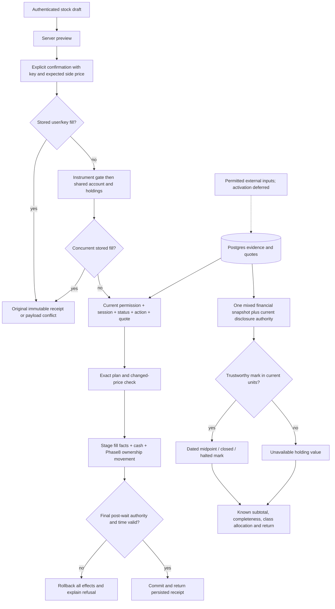

# Phase 9: Whole-Share Trading and Combined Portfolio — Research

**Researched:** 2026-11-11
**Domain:** Atomic simulated stock execution, ownership history, eligibility and mixed valuation
**Confidence:** HIGH for inspected local contracts; MEDIUM for public provider capabilities; live suitability UNVERIFIED

<user_constraints>
## User Constraints (from CONTEXT.md)

The following decisions, discretion and deferred scope are copied verbatim from
09-CONTEXT.md. [VERIFIED: local 09-CONTEXT.md]

### Locked Decisions

### Stock trade ticket

- **D-01:** Use an editable positive whole-share quantity input with Buy max and
  Sell all shortcuts. Shortcuts populate quantity only; preview and explicit
  confirmation remain required. No stock dollar-input or fractional quantities.
- **D-02:** Show both IEX bid and ask; highlight the execution side selected by
  Buy/Sell. Buy uses ask and sell uses bid, with zero stock commission and no
  simulated added spread. Preserve existing crypto spread/fee/input behavior.
- **D-03:** If the relevant executable price changes, show old → new price and
  the change in total in a renewed preview. Require another confirmation.
- **D-04:** After a fill, stay on a receipt showing the persisted result and
  updated cash/share balance. Offer Portfolio and Trade again actions.

### Combined portfolio

- **D-05:** Use one combined holdings list with explicit stock/crypto labels,
  one shared cash balance and one portfolio summary.
- **D-06:** Default to alphabetical ticker order, stable as prices refresh.
- **D-07:** Show quantity, average cost, cost basis, current value, gain/loss
  and allocation directly. Use a desktop table and stacked mobile cards.
- **D-08:** Allocation panel summarizes Cash / Stocks / Crypto. Individual
  holding percentages remain in the holdings list when valuation is complete.

### Closed or unavailable valuations and trade controls

- **D-09:** When any holding cannot be valued, headline reads
  “Known value: $X — incomplete” and shows the unvalued holding count. Known cash
  and individual known values remain visible. Overall gain/loss and allocation
  percentages are unavailable while the total is incomplete; never treat an
  unpriced holding as zero or present a subtotal as a complete portfolio total.
- **D-10:** For a verified trading halt without corporate-action uncertainty,
  retain the last verified price with its actual timestamp and a prominent
  “Halted” label. Orders remain blocked. This is a historical mark, not a fresh
  executable quote. Missing trustworthy marks remain unavailable; uncertain
  corporate actions override retained marks and make valuation unavailable.
- **D-11:** While a stock is closed or temporarily unavailable, allow editing
  whole-share quantity, disable confirmation and explain the reason. The input
  is only a draft; no order is queued. Require a fresh preview once trading is
  available. Unsafe quote-dependent estimates remain suppressed.
- **D-12:** If closure or a hold interrupts review, retain typed quantity but
  invalidate the preview. Require a fresh preview and explicit confirmation;
  nothing executes automatically when availability returns.

### Carry-forward requirements

- **D-13:** Keep visible IEX single-venue attribution and simulation disclosures
  on the stock journey, including omitted regulatory fees and immediately
  reusable virtual sale proceeds rather than real settlement restrictions.
- **D-14:** Regular sessions only, with authoritative holidays/early closes/DST;
  no fills on closed, halted, frozen, unknown or stale eligibility. Source quote
  age must be strictly below 120 seconds. Recheck after blocking database waits.
- **D-15:** Shared-cash concurrency must prevent overspending across assets.
  Preserve original starting cash; no second grant. Exact idempotent replay must
  return the original fill even after close, and changed payloads must conflict.
- **D-16:** Eligible stock marks use midpoint; closed marks retain actual dates.
  Corporate-action uncertainty makes values unavailable. Phase 10 dividend cash
  must enter portfolio cash once when enabled; Phase 9 does not publish payments.

### Agent's Discretion

No explicit “you decide” preferences were given. Research/planning should choose
technical details, exact copy, responsive breakpoints and safe quantity shortcut
calculations within these decisions and the existing design system. A retained
draft is not a pending order and does not weaken auth/cache isolation or preview
expiry. Do not add persistent drafts, new dependencies or unrelated features
merely to implement these preferences.

### Deferred Ideas

None — discussion stayed within phase scope. Existing future-phase boundaries
remain: dividend cash and public event History in Phase 10; exact mixed-asset
recovery and final acceptance in Phase 11. Live-data review/activation remains
explicitly deferred, not waived or passed.
</user_constraints>

## Summary

Existing crypto execution is deliberately crypto-only; stock discovery exposes
unknown status and permanently false execution, while Phase 8 provides durable
instrument-first ownership and action protection. This phase must connect those
pieces rather than removing the exclusions and routing stocks through crypto
math. The shared account is already the natural cross-asset serialization point.
[VERIFIED: backend/app/services/trading.py; backend/app/schemas/stocks.py;
backend/app/services/stock_ownership.py]

The two hardest gaps are independent timely trading-status authority and the
last awaited financial statement boundary. `append_stock_movement` locks all
instrument holdings, checks the complete journal and samples DB clocks after
multiple reads; a pre-helper eligibility check alone cannot authorize the fill.
The browser's stock hook currently hides every quote after 120 seconds, including
closed-session marks. Execution freshness and historical valuation therefore
need different projections with common permission/action/unit protection.
[VERIFIED: backend/app/services/stock_ownership.py:150;
frontend/src/hooks/useStocks.ts:projectStocks]

**Primary recommendation:** implement a distinct stock execution service with
immutable stock receipt facts, an independent deny-by-default status boundary,
instrument → account → holdings ordering, atomic Phase 8 movement integration and
a final guarded validity check that rolls back all staged effects on failure.
Extend the existing portfolio snapshot/math and authenticated query discipline.
Keep actual activation deferred; local fixtures prove mechanics only.
[RECOMMENDATION based on inspected contracts and D-01–D-16]

## Project Constraints (from AGENTS.md)

- Read CLAUDE.md and shared PROJECT/REQUIREMENTS/ROADMAP/STATE plus relevant
  phase context/plans/summaries; preserve existing history and continue the
  project. [VERIFIED: AGENTS.md]
- Use GSD research, UI contract, planning, plan checks, dependency ordering,
  checkpoints, reviews, verification and summaries with the Codex adapter.
  GSD flags never bypass actual authorization or push/merge rules.
  [VERIFIED: AGENTS.md; .codex/GSD-ADAPTER.md]
- UI work must read ui-ux-pro-max, use its local search and retain the existing
  design-system/birja/MASTER.md. Keep shared rules in CLAUDE.md and Codex setup
  separate; preserve Claude configuration. [VERIFIED: AGENTS.md]
- Decimal/NUMERIC, JSON money strings, explicit half-even rounding, UTC,
  one financial transaction, real isolated PostgreSQL tests, restricted verified
  TLS roles, immutable migrations and 80%/100% coverage remain mandatory.
  No source/runtime/provider/production/publication change is authorized by this
  research. [VERIFIED: CLAUDE.md; 09-CONTEXT.md]
- Phase 7 live evidence and Phase 8 activation remain deferred; do not inspect
  the old measurement process, rewrite its hashes, relaunch it or infer results.
  [VERIFIED: .planning/STATE.md Session Continuity; 07/08-ACTIVATION.md]

## Architectural Responsibility Map

Proposed ownership follows existing router/service/model boundaries.
[RECOMMENDATION; VERIFIED: CLAUDE.md Project structure/API]

| Capability | Primary tier | Secondary tier | Rationale |
| --- | --- | --- | --- |
| Parse stock order, authenticate, CSRF | API/backend | Browser feedback | Client cannot authorize money |
| Whole-share math, max quantity, preview | Backend pure services | Browser draft | Exact Decimal authoritative |
| Session/status/action/permission decision | Backend | Durable database evidence | Independent facts, fresh final reads |
| Cash, fill, movement, basis | Database transaction via service | — | Atomic cross-asset accounting |
| Status ingestion and reconnect safety | Single scheduler lane | Database | No per-worker collector or implicit healthy restart |
| Historical mark selection, completeness | Backend statement snapshot | Browser deadline projection | No client accounting or guessed totals |
| Ticket, receipt, combined table/cards | Browser | Typed API | Reuse design system and auth/query lifecycle |
| Schema, grants, exact recovery dispatch | Migration/ops | Isolated test tooling | Successor consumers need compatible contracts first |

<phase_requirements>
## Phase Requirements

Requirement wording below is from REQUIREMENTS.md; support describes the proposed
local implementation and does not assert real provider readiness.
[VERIFIED: .planning/REQUIREMENTS.md]

| ID | Required behavior | Research support |
| --- | --- | --- |
| MKT-02 | Clear closed/halted/frozen/unknown/stale refusal; post-wait rechecks; independent crypto | Independent status/session/action predicates; final execution barrier |
| STKTR-01 | Positive whole-share stock quantity; preserve crypto fractional/USD orders | Separate schemas/math/service, DB stock-specific invariant |
| STKTR-02 | Eligible IEX ask buys/bid sells; zero commission/spread; disclosures | Exact side-price plan, persisted bid/ask/source facts |
| STKTR-03 | Itemized server preview, persisted fill, changed-price reconfirmation | Expected execution side price; refreshed quote; immutable receipt |
| STKTR-04 | Same original cash, no grant, no cross-asset overspend | Shared Account row lock and actual mixed races |
| STKTR-05 | Exact original replay after closure; changed payload conflict | Global user/key lookup before availability and after serialization |
| STKTR-06 | Immediately reusable stock-sale cash with settlement disclosure | Same-transaction credit, no settlement bucket |
| PORT-06 | Combined holdings/allocation/return; midpoint; dividend cash once | One Account.cash snapshot, class aggregation, no entitlement-as-cash |
| PORT-07 | Dated closed marks; unavailable uncertain values; incomplete totals | Permission/action/unit-aware mark projection, known subtotal/count |
</phase_requirements>

## Standard Stack

Use the committed stack as-is, not latest upstream resolution. Versions below
are local locked identities, not new registry authenticity claims. No package
installation or dependency update is recommended; no registry lookup or slopcheck
installation is needed to reuse them. [VERIFIED: backend/pyproject.toml,
backend/uv.lock; frontend/package.json, frontend/package-lock.json]

| Existing component | Locked version | Phase use |
| --- | --- | --- |
| Python project interpreter | 3.14.9 observed; requires >=3.14,<3.15 | Decimal, async services |
| FastAPI / Pydantic | 0.162.0 / 2.14.1 | Existing authenticated typed routes |
| SQLAlchemy / asyncpg / Alembic | 2.0.55 / 0.32.0 / 1.20.1 | READ COMMITTED, locks, migrations |
| httpx / respx | 0.28.1 / 0.23.1 | Existing bounded transport/offline HTTP tests |
| exchange-calendars | 4.13.2 | Existing reviewed calendar evaluator, no replacement |
| React / TanStack Query | 19.3.1 / 5.105.0 | Existing state and guarded queries |
| TypeScript / Vitest / Playwright | 6.0.3 / 5.0.5 / 1.64.1 | Typed parsers, unit/browser proof |
| pytest / pytest-asyncio | 9.1.1 / 1.4.1 | Real isolated database tests |

**Package Legitimacy Audit:** no new external packages. Existing calendar-package
provenance limitations remain exactly those approved in Phase 7; reuse is not a
new clean provenance certification. Any later new status transport dependency
requires separate research/provenance and the project's install gate; do not
silently download an SDK or websocket client. [VERIFIED: 07-ACTIVATION.md;
09-CONTEXT.md Agent's Discretion]

## Architecture Patterns

### System flow

This is the recommended execution/valuation separation, not an assertion that
new components already exist. [RECOMMENDATION]



### Concrete component map

Existing paths and behavior were inspected; new names are recommended plan
boundaries. [VERIFIED: named existing files; RECOMMENDATION: proposed files]

| Capability | Existing anchor | Recommended phase change |
| --- | --- | --- |
| Crypto order transaction | services/trading.py:execute | Keep crypto math/lock path; shared asset-agnostic key conflict helper only |
| Stock transaction | services/stock_ownership.py:acquire_stock_gate, append_stock_movement | New services/stock_trading.py calling these functions |
| Exact arithmetic | services/trade_math.py:cost_basis_after | New services/stock_trade_math.py using existing basis policy |
| Admission/session/action projection | services/stocks.py:list_stocks; stock_admission.py; stock_sessions.py; stock_action_rules.py | Shared typed eligibility projection, no HTTP discovery reuse in financial mutation |
| Status | schemas/stocks.py:StockStatus unknown only | New persisted status/collector contract and rules; default unknown |
| Receipt | models/trade.py:Trade | Add immutable stock facts, share/identity guards and restricted grants via successor migration |
| API | api/v1/trades.py; schemas/trades.py | Separate stock schemas/routes; do not accept stock through legacy crypto endpoint |
| Mixed values | services/portfolio.py:get_portfolio; portfolio_math.py:calculate_portfolio | Extend one snapshot, known subtotal/count/class totals and authority deadlines |
| Client | api/trades.ts; hooks/useStocks.ts; pages/TradePage.tsx | Separate stock parser/hook/ticket; reuse primitives, preserve uncertain-outcome key |
| Portfolio | api/portfolio.ts; hooks/usePortfolio.ts; pages/PortfolioPage.tsx; components/PortfolioHoldings.tsx, PortfolioAllocation.tsx | Mixed types, direct basis column, stable ticker sort, three class bars, protected historical marks |
| Recovery/roles | deploy/backup-snapshot.py; verify-restore.py; db/bootstrap-roles.sql; tests/ops-fixtures.py | Revision-dispatched exact schema/financial manifests and real consumers |

### 1. Transaction ordering and post-wait authority

`acquire_stock_gate(db, coin_id)` enforces one instrument per READ COMMITTED
transaction and sets local 5s lock, 10s statement and 30s idle timeouts. It uses
the exact stable `birja.stock.instrument:` advisory namespace. The append helper
already locks the account for fills and all instrument holdings in `(user_id,id)`
order, verifies same-transaction causal Trade, reconstructs the full journal and
updates the holding/basis itself. Do not update holdings once before calling it
and again inside it. [VERIFIED: services/stock_ownership.py:86,150,374]

Recommended order for a NEW stock fill:

1. Read-only, user-scoped replay fast path; no stock/status availability required.
2. Resolve stable stock identity, acquire its instrument gate.
3. Lock the same Account row used by crypto; repeat global key lookup now.
4. Acquire required holdings in the helper's established order; read current
   permission, calendar, independent status, action holds and source quote.
5. Exact plan; compare ask for buy / bid for sell. A changed opposite side alone
   is not a relevant-price change. Changed relevant side returns renewed preview.
6. Stage Trade and immutable stock facts, flush cause, append movement with signed
   quantity and proportional fee-free basis. Credit/debit Account.cash once.
7. After all helper/write/refresh awaits, perform a final committed-authority
   read and DB-wall-clock check for quote age/session/deadlines/generations/epochs.
   Require the staged execution facts still match the allowed authority snapshot;
   refuse/repreview on relevant change. Roll back staged cash/fill/movement/basis
   together on failure. Commit only after this check.
   [RECOMMENDATION based on local helper and D-14/D-15]

A final guard should have no further unguarded business read/write waits before
commit. Prefer a final guarded SQL statement or narrowly audited constraint
function as the authorization linearization point; document that commits after
its statement snapshot cannot be predicted. Do not claim perfect simultaneity
between all external events and transaction commit. PostgreSQL READ COMMITTED
uses statement snapshots; `clock_timestamp()` advances during the transaction,
unlike transaction-start `now()`. [CITED: https://www.postgresql.org/docs/18/transaction-iso.html;
https://www.postgresql.org/docs/18/functions-datetime.html]

Crypto stays account → its crypto holding. Stock stays instrument → account →
stock holdings. Different-asset transactions share only account; split/action
operations use the stock instrument gate and stock holdings. Never take account
first and subsequently acquire a stock gate, including replay fallback: that
would create a reverse edge against action/fill paths. Use distinct AsyncSessions
for concurrent tasks. [RECOMMENDATION based on services/trading.py,
stock_ownership.py and corporate_actions.py;
CITED: https://www.postgresql.org/docs/18/explicit-locking.html;
https://docs.sqlalchemy.org/en/20/orm/extensions/asyncio.html]

### 2. Exact receipt and cross-asset idempotency

The current UNIQUE(user_id,idempotency_key) spans all trades, but `_find_trade`
filters crypto. A stock key collision would not be resolved correctly by simply
copying that helper. Existing Fill also lacks persisted held-after and full IEX
bid/ask/permission/unit facts; current receipt reconstruction joins current coin
symbol. [VERIFIED: models/trade.py; services/trading.py:_find_trade,_fill]

Add a small asset-agnostic stored-key lookup used by both execution lanes, then
dispatch to the matching immutable receipt or a typed conflict. Keep existing
crypto receipt fields/fees/status behavior unchanged. Persist stock symbol and
stable instrument identity, quantity/side/input, both quote sides, used execution
price/mid, event/collection/execution times, source/feed, relevant authority
generations, unit epoch, cash-after and held-after. A replay must not reconstruct
held-after from today's holding (which could have split or sold out), nor check
today's calendar, provider mapping, permission, status or action availability.
Authenticated stored financial receipts remain separate from live raw quote
disclosure. Durable derived receipt rights are an activation prerequisite.
[RECOMMENDATION; VERIFIED: D-04/D-15; 08-ACTIVATION.md]

Payload identity should include asset/instrument, side, quantity/input kind and
input value; preserve existing crypto treatment of expected quote price as a
confirmation guard, not a different economic order payload. Retries retain the
same key/body until outcome is known. A new deliberate trade gets a new key.
Return 201 for new fill, 200 exact stored response for replay, 409 for conflict.
[RECOMMENDATION; VERIFIED: services/trading.py:_replay; api/v1/trades.py]

### 3. Schema integrity and recovery before runtime consumers

Current Trade constraints allow both input kinds, fractional quantity and
nonnegative fees; none identifies a stock fill. Existing Coin asset class and
StockInstrument identity are durable, while stock exclusions are implemented in
crypto service queries. The inspected 0009 schema does not contain a magic
crypto-only fill trigger to remove. [VERIFIED: models/trade.py;
models/price.py; models/stock.py; alembic/versions/0009_stock_discovery_schema.py;
services/trading.py]

Recommend an additive immutable stock-fill-facts table keyed by Trade identity
and linked to StockInstrument, retaining all receipt facts above. Pair it with
database stock-specific guards enforcing quantity-only whole shares, zero fee,
correct side price, consistent cash/notional, and facts/cause identity. Cross-row
rules need a real trigger/constraint mechanism or suitable composite FK design;
PostgreSQL CHECK cannot safely enforce another table's classification. If a
deferred constraint trigger binds Trade ↔ facts ↔ movement, audit exact function
body, search_path, grants and dump/restore ordering; do not grant new broad
UPDATE or SECURITY DEFINER authority merely for convenience. Planner must pick
and specify the concrete schema, not leave alternatives to execution.
[RECOMMENDATION; CITED: https://www.postgresql.org/docs/18/ddl-constraints.html]

Existing stock quantity/basis and ownership invariants must survive actual
restricted app/scheduler calls. Add explicit failed direct-insert tests for
fractional stock, missing facts, mismatched trade/user/instrument, nonzero fee
and orphan movement; preserve historical crypto rows byte-for-byte. Add
successor-only migration(s), bounded rollback refusal once financial state
exists, exact manifest dispatch, schema/function authority checks, role grants,
identity sequences and corruption cases BEFORE new runtime consumers. Extend
bootstrap and populated-upgrade paths consistently; never repair grants only
inside the fixture. [RECOMMENDATION; VERIFIED: migrations0011/0012;
deploy/db/bootstrap-roles.sql; deploy/verify-restore.py; deploy/tests/ops-fixtures.py]

### 4. Independent status: local contract now, real suitability later

`StockStatus` currently permits only unknown and `StockItem.execution_enabled`
is literal false. Product admission already distinguishes `status` from quotes,
calendar and actions. A healthy action monitor does not enable execution.
[VERIFIED: schemas/stocks.py; services/stock_admission.py:FIELDS;
services/stock_action_rules.py:ActionDecision]

Public Alpaca documentation describes trading-status messages with symbol,
status/reason, source timestamp and tape, conditional on subscription. Its
latest quote endpoint supplies bid/ask; snapshot documentation lists price/bar
components. These inspected sources do not establish this account's status
entitlement, complete initial state or replay after disconnect. No conclusion
that IEX status is either universally free or universally unavailable is justified.
[CITED: https://docs.alpaca.markets/us/docs/real-time-stock-pricing-data;
https://docs.alpaca.markets/us/reference/stocklatestquotes-1;
https://docs.alpaca.markets/us/reference/stocksnapshots-1]

Implement a small typed status boundary and persisted evidence with mapping,
source-event/observed timestamps, permission generation, session identity,
continuity/generation and explicit validity. Normalize verified normal, halt,
freeze and unknown; unrecognized codes or missing bootstrap remain unknown.
Out-of-order normal cannot clear a newer halt. Reconnect must invalidate normal
authority until an authoritative baseline/continuity proof exists. Network
heartbeat or absence of status messages must not mint a normal status. Exchange
status events need not be periodic: do not impose the 120-second quote threshold
on event time as though it established source continuity. Choose bounded local
lease ceilings as conservative implementation limits, not provider guarantees.
[RECOMMENDATION based on MKT-02 and public status schema]

For local execution, use HTTP-boundary or finite transport replay fixtures with
explicit initial state and losses. Keep any live transport/config disabled
until permitted bootstrap, completeness, reconnect, halt/resume coverage and
latency are verified. If the selected permitted provider cannot establish these
facts, real stock execution remains disabled while crypto and isolated work
continue. Do not add an imaginary REST status endpoint, scrape an exchange page
as a production oracle or place a private provider request in a user trade.
[RECOMMENDATION; VERIFIED: 08-ACTIVATION.md status prerequisite]

### 5. Whole-share math and Buy max

Use Decimal local precision sufficient for products/division, not float; accepted
quantity is finite, positive, integral and inside NUMERIC/ownership limits.
Raw booleans, NaN/Infinity, excess digits and dollar input must fail before
financial mutation. Calculate `notional = q2(quantity * side_price)`, fee zero,
cash delta signed notional, basis using existing `cost_basis_after`. Reject
unrepresentable or zero-cash buy effects rather than create free shares. Do not
copy crypto's configured minimum fee or fee-inclusive dollar mode into stocks.
[RECOMMENDATION; VERIFIED: trade_math.py; stock_ownership.py:_validate;
CITED: https://docs.python.org/3.14/library/decimal.html]

Recommend the conservative shortcut `floor(cash / ask)` capped by account,
holding, quantity and NUMERIC result limits, followed by the exact same server
plan predicate. This is a safe quantity draft, not a promise to maximize the
last possible half-cent rounding tie. Have the server return the integer string
for Buy max; Sell all uses verified whole-share held quantity. Both still preview
and confirm. Avoid JS Number division of monetary strings. [RECOMMENDATION D-01]

Example: cash100.00, ask33.335 → Buy max2; buy2 costs66.67, balance33.33.
A manual buy3 costs100.00 after half-even cent rounding and can be accepted if
all other limits allow. State this conservative shortcut policy in tests so a
future change cannot silently add an extra share or oscillate on ties.
[DERIVED: exact Decimal arithmetic under recommended policy; not provider data]

### 6. Honest mixed valuation and historical marks

Current portfolio uses one scalar SELECT for account and holdings, crypto-only
Price join, sort_order ordering, nullable total/P&L/allocation for missing marks.
It returns positive stock holdings unpriced already. Pure math sums unrounded
values and rounds response boundaries. PortfolioHoldings currently omits a
standalone cost-basis figure; allocation currently has one bar per holding.
[VERIFIED: services/portfolio.py; portfolio_math.py;
frontend/src/components/PortfolioHoldings.tsx,PortfolioAllocation.tsx]

Extend this single financial snapshot with asset class, stock quote and
same-snapshot unit/action/status facts. Do not fetch cash before a fill and
holdings after it in unrelated statements. Final current permission/expiry
validation may further suppress snapshot stock values; it must never combine
old units with a new post-split price. Bind mark unit epoch and action epoch,
read current authority after preparatory awaits, and conservatively suppress
on changed units/holds. Respect original quote admission generation and actual
retention deadline; renewing a permission row cannot launder old generation
data. [RECOMMENDATION based on services/stocks.py final evidence pattern;
stock_quotes.py unit authority; D-09/D-16]

Use distinct valuation/execution reasons: fresh executable, dated closed,
dated verified halt, unavailable permission, unavailable action/units, unknown
status/authority, missing or expired mark. A closed/halted historical mark can
outlive execution freshness only within permitted retention and current action
safety. `projectStocks` currently drops all quotes at120s; do not weaken that
execution defense to support Portfolio. Build a dedicated timed portfolio-mark
projection that retains only the approved historical mode and suppresses it
at authority/retention/unit deadlines. Opening the next session never makes the
previous-session quote executable. [RECOMMENDATION; VERIFIED: useStocks.ts;
stock_quote_rules.py:quote_eligibility; services/stocks.py retained_until]

Add server-calculated `known_value` (cash + all known unrounded holding values,
then rounded once), `unvalued_holding_count`, class allocations and explicit
asset/status/source/mark validity fields. Retain `total_value=null` while
incomplete, and all overall P/L and percentages null. Independently known
holding P/L remains inspectable; class bars cannot show percentages with an
unknown denominator. Zero total also means undefined allocation, not NaN.
Sort by ticker and unique ID as deterministic tie-breaker. Read cash once;
entitlements are not cash, and Phase10 credits must not be added separately to
the already-credited Account.cash. [RECOMMENDATION; VERIFIED: D-05–D-10/D-16;
portfolio_math.py; REQUIREMENTS.md dividend boundary]

### 7. Client lifecycle and UI obligations

Reuse stock hook protections: full-RTT conservative monotonic deadlines,
permission/action generations, raw response high-water rejection and auth
lifecycle isolation. Query cancellation is a useful primitive but not proof an
uncertain POST did not commit. Cache cancellation and identity guards must
discard late old-account results. No optimistic financial balances or locally
recomputed receipts. [VERIFIED: hooks/useStocks.ts; pages/TradePage.tsx;
CITED: https://tanstack.com/query/latest/docs/framework/react/guides/query-cancellation]

Recommended stock route `/trade/stocks/:symbol` is explicit and leaves legacy
`/trade/:symbol` crypto handling intact. Quantity draft is component memory only;
close/hold preserves draft while clearing preview and disabling confirmation.
Reopen never auto-submits or reuses expired preview; unknown outcome keeps
original key/payload and uses explicit retry. After fill, receipt shows immutable
cash/share-after, followed by fresh account queries; distinguish receipt balance
from a more recent live balance if another order has occurred. [RECOMMENDATION;
VERIFIED: D-01/D-04/D-11/D-12/D-15]

Use existing neutral Buy/Sell controls, light token palette/Inter, 44px targets,
field errors, focus movement and responsive table/cards. Retain visible IEX
attribution; update old “stock trading not enabled yet” copy only where actual
eligibility supports trading, with truthful disabled copy elsewhere. Local UX
search found essential safety text must wrap/be accessible, disabled controls
must be distinguishable, and submission needs loading/success/error feedback.
[VERIFIED: design-system/birja/MASTER.md;
schemas/stocks.py:StockAttribution; ui-ux-pro-max/scripts/search.py query
`financial trading form errors disabled actions`]

## Don't Hand-Roll

| Problem | Avoid | Use | Provenance |
| --- | --- | --- | --- |
| Calendar/DST | Weekday/hour checks | Existing reviewed stock_sessions evaluator | VERIFIED: services/stock_sessions.py |
| Ownership/dividend eligibility | Current holding as past ownership | Phase8 movement/reconstruction functions | VERIFIED: stock_ownership.py |
| Money precision | JS/Python float accounting | Decimal and existing cent/basis rules | VERIFIED: CLAUDE.md; trade_math.py |
| Cross-worker serialization | In-process lock/Redis ledger | Existing PostgreSQL row/advisory lock convention | VERIFIED: stock_ownership.py; trading.py |
| Client server data | useEffect fetch or localStorage drafts | Existing TanStack Query/guarded lifecycle | VERIFIED: CLAUDE.md; useStocks.ts |
| Replay receipts | New quote/current holding reconstruction | Immutable persisted fill/facts | RECOMMENDATION D-04/D-15 |
| Recovery | Generic pg_restore success-only smoke | Existing exact revision/schema/financial/sequence contract | VERIFIED: deploy/verify-restore.py |

## Runtime State Inventory

This phase introduces migrations and consumers, not a rename. Inventory is
restricted to repository declarations; no live state, secrets or process
inspection occurred. [VERIFIED: research tool scope]

| Category | Observed declaration | Required action |
| --- | --- | --- |
| Stored data | Existing accounts/crypto fills; schema0012 ownership/action journal | Add successor schema and preserve values; isolated populated upgrade and recovery proof |
| Live service config | Stock products independently disabled; scope/admissions validated | No live changes; later evidence/import/activation checkpoint |
| OS-registered state | Prior production backup/deploy units are outside research | No unit rename/change proposed; no live inspection needed |
| Secrets/env vars | Settings names declared in core/config.py; .env private | No secret read/new credentials; examples only if a status flag is needed |
| Build artifacts | Existing hardened runtime/test images; installed recovery tooling | Rebuild/test source-owned images during execution; no installed-tool replacement here |

[VERIFIED: models and settings source; 08-ACTIVATION.md;
docker-compose.test.yml; deploy recovery/tool contracts]

## Common Pitfalls

All avoidance strategies are recommendations grounded in named local behavior.

| Failure | Cause / warning sign | Prevention and adversarial proof |
| --- | --- | --- |
| Stocks accidentally use crypto fees | Removing crypto filters instead of new stock lane | Legacy endpoints still reject stocks; exact zero-fee stock ask/bid tests |
| Wrong replay after split/close | Today's holding or quote used | Change all live facts, assert byte-equal original stored response |
| Key collision yields500 | Asset-filtered lookup against global key unique | Both routes return typed conflict, concurrent stock/crypto same key |
| Deadlock/reverse ordering | Account lock before stock gate | Actual instrument/account wait interleavings plus cancellation cleanup |
| Fill passes stale guard | Check before append/helper or cached identity map | Expire/hold/revoke/change quote during each injected DB wait; final rollback assertions |
| False healthy status | Recent quote, HTTP200 or reconnect assumed normal | Unknown baseline and stream gaps deny; stale normal cannot clear halt |
| Pre-split historical mark | New holdings with old quote epoch | Full action/quote unit agreement, post-split quote guard |
| Honest subtotal called total | Client sums available values | Separate known_value and count; total/P&L/percent remain null |
| Cached price outlives rights | Background refetch failure leaves raw data visible | Monotonic permission/retention/action deadlines suppress without network |
| Lost ownership on first fill | Cash/Trade committed before journal | One transaction, failure injection and real concurrent action/fill cases |
| Duplicate dividend value | Entitlement added to cash separately | Only Account.cash; synthetic future credited cash counted once |

[VERIFIED: services/trading.py; stock_ownership.py; stocks.py; portfolio_math.py;
frontend hooks/useStocks.ts/usePortfolio.ts; D-01–D-16]

## Code Examples

Illustrative patterns are recommendations, not existing callable Phase9 APIs.

```python
# Decimal pattern: https://docs.python.org/3.14/library/decimal.html
from decimal import Decimal, ROUND_FLOOR, ROUND_HALF_EVEN, localcontext

def stock_notional(quantity: Decimal, price: Decimal) -> Decimal:
    # Callers first enforce finite, positive, integral quantity and bounds.
    with localcontext() as ctx:
        ctx.prec = 50
        return (quantity * price).quantize(Decimal('0.01'), rounding=ROUND_HALF_EVEN)

def conservative_buy_max(cash: Decimal, ask: Decimal) -> Decimal:
    with localcontext() as ctx:
        ctx.prec = 50
        return (cash / ask).to_integral_value(rounding=ROUND_FLOOR)
```

```python
# Existing helper contract: backend/app/services/stock_ownership.py
# A new stock service must stage cause before append, not commit first.
db.add(trade)
await db.flush()
movement = await append_stock_movement(db, StockMovementInput(
    user_id=user_id, coin_id=coin_id,
    quantity=quantity if side == 'buy' else -quantity,
    after_basis=planned_basis,
    causal_key=f'fill:{trade.id}', trade_id=trade.id,
))
# Then stage cash/facts, flush/refresh as needed, FINAL validity guard,
# build persisted receipt and commit. Any guard failure rolls EVERYTHING back.
```

```sql
-- Existing stable lock expression; do not invent a second namespace.
-- Source: stock_ownership.py:acquire_stock_gate
SELECT pg_advisory_xact_lock(hashtextextended(
  'birja.stock.instrument:' || CAST(:coin AS text), 0
));
-- Wall-clock observation after waits, not transaction-start now().
-- Source: https://www.postgresql.org/docs/18/functions-datetime.html
SELECT clock_timestamp();
```

## State of the Art

| Prior local boundary | Phase9 target | Why change |
| --- | --- | --- |
| Crypto-only trades; stocks read-only/unknown | Separate guarded stock lane | Roadmap9 now owns actual fills |
| Every client stock quote expires at120s | Fresh execution plus separately permitted dated marks | Closed/halted valuation policy D-10/D-16 |
| Crypto mid as preview comparison | Stock selected-side price | Ask/bid execution policy |
| Cash and per-holding allocation bars | Cash/Stocks/Crypto summary, per-holding list % | Owner D-08 |

[VERIFIED: inspected local services/client and 09-CONTEXT.md; target is RECOMMENDATION]

No library upgrade, broker order API, generic provider framework, queue or
settlement subsystem is required by these changes. [RECOMMENDATION within scope]

## Assumptions Log

No unverified external capability is used as a locked requirement or install
recommendation. Architectural recommendations above are derived proposals and
must be made concrete by the planner, not presented as completed implementation.
[VERIFIED: this research scope]

| Unknown fact | Status | Required handling |
| --- | --- | --- |
| Actual permitted timely status bootstrap/continuity/latency | UNVERIFIED | Fail closed; separate activation evidence |
| Actual Phase7 source coverage/freshness and Phase8 action rights/history | OWNER-DEFERRED | Preserve deferral; no new campaign inferred |
| New test runtime durations | UNMEASURED | Budgets below are targets, record actual execution |

## Open Questions and Resolutions

1. **Status product:** source docs establish message shape, not a complete
   real-time oracle or account grant. Resolve locally with a fail-closed typed
   persisted contract and finite replay fixtures; real activation waits for
   measured permitted bootstrap/continuity. This is not a request to re-approve
   previously attested quote rights. [CITED: Alpaca real-time docs;
   VERIFIED: 07/08-ACTIVATION.md]
2. **Historical retention horizon:** current quote admission validation bounds
   retention_seconds to86400, so weekends may exceed permitted retained marks.
   Show unavailable after actual retention expiry; do not silently extend rights
   to satisfy the visual preference. A later rights/model change requires its
   own review. [VERIFIED: stock_admission.py:evaluate_admission;
   stocks.py:retained_until]
3. **Exact schema:** planner must select concrete additive facts/guards and
   recovery/grant proof before scheduling runtime work. No live financial data
   backfill or rewrite is justified. [RECOMMENDATION; VERIFIED: CLAUDE.md migrations]
4. **Buy max tie behavior:** conservative floor policy is safe and satisfies a
   draft shortcut; if exact largest cent-rounded affordable quantity is selected
   instead, derive it with bounded integer/Decimal math and test half-even ties,
   numeric capacity and no overspend. Avoid a linear decrement loop.
   [RECOMMENDATION within D-01 discretion]

## Environment Availability

Only command/version/file probes were made; no service/process enumeration or
provider access. The default host Python is3.12.3 but project venv Python is
3.14.9. Use project uv/venv, not system Python for backend feature tests.
[VERIFIED: command/version output during this research]

| Dependency | Availability | Version/evidence | Execution prerequisite |
| --- | --- | --- | --- |
| uv / project Python | present | uv0.13.5; backend/.venv/bin/python3.14.9 | Locked reuse, no install now |
| Node / npm | present | 24.22.1 /11.19.1 | Existing frontend/node_modules |
| Vitest / Playwright executable | present | node_modules/.bin files; package versions above | Browser binaries not exercised here |
| Docker CLI | present |29.2.1 | Daemon availability/owned project checked at execution |
| PostgreSQL/Redis test declarations | present | pinned Compose tmpfs, localhost55432/56379 | Start only isolated docker-compose.test.yml |
| Context7 MCP / ctx7 CLI | unavailable in tool catalogue/PATH | no lookup transport | Official primary web docs used; no installation |
| Actual provider/status authority | not inspected/unverified | owner-deferred | No fallback from quote freshness; live blocked |
| Exact restore/TLS tooling | source present | deploy/tests/ops-fixtures.py | Isolated fixture prerequisites/tool integrity during execution |

Knowledge graph file was absent; direct source and phase artifacts were used.
[VERIFIED: .planning/graphs/graph.json existence check]

## Validation Architecture

Enabled by `.planning/config.json`; existing pytest9.1.1, pytest-asyncio1.4.1,
Vitest5.0.5 and Playwright1.64.1 are already configured. Backend tests guard
test-only URLs before importing app, migrate via Alembic and use real isolated
PostgreSQL. Existing concurrency tests cap parallel requests at15 for pool
capacity. [VERIFIED: config.json; backend/tests/conftest.py,guard.py,
test_trading_concurrency.py; frontend/package.json,playwright.config.ts]

### Commands and budgets

Commands assume cwd at repository root unless `cd` shown. New filenames are
proposed, not already-present tests. Time budgets are planning targets, not
measurements. [RECOMMENDATION]

| Gate | Command | Planned budget |
| --- | --- | --- |
| Start isolated DB/cache | `docker compose -f docker-compose.test.yml up -d --wait` | Once per test session; ownership guard first |
| Fast math/eligibility | `cd backend && uv run pytest tests/test_stock_trade_math.py tests/test_stock_trading_rules.py -q` | <30s |
| Transaction/replay slice | `cd backend && uv run pytest tests/test_stock_trading_service.py tests/test_stock_trading_concurrency.py -q` | Each bounded slice <30s; full lane may exceed |
| Portfolio slice | `cd backend && uv run pytest tests/test_portfolio_math.py tests/test_portfolio_snapshot.py tests/test_portfolio_service.py -q` | Target <30s; measure |
| UI unit slice | `cd frontend && npm run test -- src/api/stockTrades.test.ts src/pages/StockTradePage.test.tsx src/pages/PortfolioPage.test.tsx` | Target <30s; split if needed |
| Full backend | `cd backend && uv run pytest --cov=app --cov-fail-under=80` | Prior Phase8 baseline about1min; allow measured growth |
| Full frontend/static | `cd frontend && npm run test -- --coverage` plus lint/typecheck/format | Measured at wave/phase boundary |
| Exact schema/recovery unit | `python3 -m pytest deploy/tests/test-stock-recovery-contracts.py -q` | Record actual runtime |
| Actual recovery+roles+both TLS | `python3 deploy/tests/ops-fixtures.py --all` | Serial minutes; prior exact restore316s + roles160s + TLS~110s per lane |
| Browser | `cd frontend && npm run e2e -- e2e/stocks.spec.ts e2e/trade.spec.ts e2e/portfolio-history.spec.ts` | Extend with new phase stories; isolated fixture server only |

Prior timing figures are historical receipts, not new test results.
[VERIFIED: 08-LOCAL-PROOF.md final gate; current file listings]

### Phase requirement → test map

All proposed new test files require implementation; existing suites are
regression anchors. [RECOMMENDATION; VERIFIED: backend/tests and frontend/e2e listings]

| Requirement | Meaningful assertions | Layer / proposed file |
| --- | --- | --- |
| MKT-02 | Closed/holiday/earlyclose/DST, halt/freeze/unknown; exact120s; permission/health/quote change after gate/account/holding/helper waits; crypto still works | PostgreSQL/API: test_stock_trading_rules.py, test_stock_trading_concurrency.py; browser |
| STKTR-01 | Positive whole strings, reject fractional/USD/NaN/bool/overflow; legacy crypto tests unchanged | Pure/schema/API: test_stock_trade_math.py, test_stock_trades_api.py |
| STKTR-02 | Ask/bid exact cents, zero fee, opposite-side move does not wrongly reprice; IEX disclosures | Pure/API plus browser |
| STKTR-03 | Read-only preview, relevant-price409 with new preview, second explicit confirmation, receipt held/cash facts persist | Service/API/client/browser |
| STKTR-04 | Simultaneous crypto+stock/different-stock spends, sells, absent holding creation; nonnegative/once cash; no new grant; journal exact | Real independent sessions: test_stock_trading_concurrency.py |
| STKTR-05 | Lost response retry, parallel same key, changed payload/cross-asset conflict, replay after close/revoke/split/rename | Service/API plus frontend unknown-outcome retry |
| STKTR-06 | Stock sale then immediate crypto/stock buy equals credited cash, no extra grant | API/browser |
| PORT-06 | One mixed snapshot, unrounded midpoint, original starting_cash, direct basis, alphabetical order, class %, cash credited once | Math/service/snapshot/API/UI/browser |
| PORT-07 | Closed/halted dated mark, missing/action/epoch/permission expiry suppression, known subtotal/count, null aggregate/allocations, delayed response regression | Math/API/client/browser |

### Wave 0 gaps and critical gates

- New schema/stock facts/status rules/stock execution test files and fixture
  builders; fixture status normal must explicitly bind permitted scope,
  continuous session state and validity rather than assume a recent quote.
- Actual concurrent split versus first buy/sell, entitlement cutoff after fill,
  sold-out owners, exact split boundary and post-split quote races. Reuse Phase8
  fixture patterns, but call the actual Phase9 stock service/API for new fills.
- Restricted-role verified-TLS actual consumer must create a stock fill and
  movement, replay it, and refuse forbidden fact/history/admission modifications;
  prove populated0012→successor without grant repair and fresh-bootstrap parity.
- Same retained encrypted archive must restore new receipts/status/journal/schema
  functions/identity state exactly, detect corruption and preserve predecessor
  revision contracts. Local feature recovery is required now; Phase11 owns final
  full milestone/rollout acceptance, not postponing new schema safety.
- Add every new critical money/stock eligibility/execution/portfolio service to
  coverage command in CLAUDE.md and CI; retain80% overall and100% critical
  statements/branches, all existing image/audit/security gates. Run actual
  browser mobile/desktop/keyboard/200%zoom, changed-preview, unknown outcome,
  closed/hold draft, incomplete portfolio and account-switch cases.
  [RECOMMENDATION; VERIFIED: CLAUDE.md; 08-VERIFICATION.md; .github/workflows/ci.yml]

**Sampling:** task commits run relevant quick slices + lint/types; dependency wave
integration runs affected real DB/client suites; schema/recovery plan runs its
actual serial ops proof once its source settles. Full phase gate runs complete
backend/frontend/browser/ops/image/security lanes. Do not label shell smoke or
mocked DB tests as concurrency/TLS/recovery proof. [RECOMMENDATION]

## Security Domain

Security enforcement is enabled by absence of an explicit false setting.
ASVS official stable5.0.0 was inspected; do not reuse outdated numeric category
labels (in5.0 V2 is Validation/Business Logic, V7 Sessions and V8 Authorization).
[VERIFIED: config.json;
CITED: https://asvs.owasp.org/;
https://raw.githubusercontent.com/OWASP/ASVS/v5.0.0/5.0/en/0x11-V2-Validation-and-Business-Logic.md;
https://raw.githubusercontent.com/OWASP/ASVS/v5.0.0/5.0/en/0x16-V7-Session-Management.md;
https://raw.githubusercontent.com/OWASP/ASVS/v5.0.0/5.0/en/0x17-V8-Authorization.md]

| Applicable category | Phase controls to plan |
| --- | --- |
| V1 Encoding/Sanitization | Bound SQL parameters, escaped company/status copy, no dynamic SQL identifiers from users |
| V2 Validation/Business Logic | Whole finite quantities; shared cash locks; preview/reconfirmation; once-only immutable fill/movement; post-wait authority |
| V4 API/Web Service | Existing typed JSON, no-store private responses, explicit endpoint schemas and methods |
| V7 Session Management | Existing server-authenticated cookies, identity-scoped queries, late-response discard, draft/receipt clearing on auth change |
| V8 Authorization | User-scoped replay/holdings/portfolio; no caller-selected user; independent provider product rights; least-privilege DB grants |

V1 andV4 control descriptions were checked against official ASVS5 source.
[CITED: https://raw.githubusercontent.com/OWASP/ASVS/v5.0.0/5.0/en/0x10-V1-Encoding-and-Sanitization.md;
https://raw.githubusercontent.com/OWASP/ASVS/v5.0.0/5.0/en/0x13-V4-API-and-Web-Service.md]

| Threat / STRIDE | Concrete mitigation and proof |
| --- | --- |
| Spoofed user/replay disclosure | CurrentUserDep + CSRF; no user_id body; two-account key collision/replay tests |
| Cash/quantity tampering | Exact validated Decimal, DB constraints, real concurrent shared-account tests |
| Stale permit/status/action elevation | Separate evidence/generation/deadlines; current final guard; no inferred normal on HTTP200 |
| Replayed/double execution | Global key unique + stored economic payload comparison + exact persisted receipt |
| Repudiation/immutable fact corruption | Append-only financial facts/movements, constrained causal links, no UPDATE/DELETE grants, exact recovery |
| Disclosure via stale cache | no-store, auth lifecycle and monotonic authority deadline suppression even during refetch errors |
| Denial of service / deadlock | Bounded inputs/collector bytes/time, existing lock timeouts, one instrument per tx, cancellation rollback |
| Privilege escalation in new SQL guard | Fixed reviewed function/search_path/body, no unnecessary SECURITY DEFINER, actual42501 denial and function authority restore checks |
| External call/credential exposure | No private calls during planning; endpoints fixed; no provider payloads/keys in errors/logs; fixture-only tests |

Controls are recommendations for the plan threat model and execution review,
not claims they are implemented already. Existing security baseline comes from
CLAUDE.md and Phase8 security/verification records. [RECOMMENDATION;
VERIFIED: CLAUDE.md; 08-SECURITY.md/08-VERIFICATION.md]

## Recommended Bounded Plan Boundaries

Use dependency-ordered small plans with their own feature tests, not one giant
execution plan. Exact numbering belongs to the planner. [RECOMMENDATION]

1. Freeze stock API/receipt/status/valuation schemas and pure money/eligibility
   rules; explicit independent execution versus historical-mark semantics.
2. Add successor status/immutable stock-facts schema and stock-specific guards,
   narrow grants and migration tests; no application activation.
3. Extend exact revision-selected recovery and real restricted-role TLS consumers
   before runtime writers use the new schema.
4. Implement bounded offline-testable status normalization/persistence and
   continuity lease; deny-by-default ingestion and truthful discovery projection.
5. Implement stock preview/execute/global-key conflict handling and ownership
   journal integration; lock/wait/action/cross-asset concurrency regressions.
6. Expose thin authenticated stock endpoints, exact receipt projection and
   changed-price API/refusal contracts; preserve legacy crypto API behavior.
7. Extend mixed financial snapshot/math, dated marks and current authority
   projection, subtotal/count/class allocations; test atomic mixed snapshots.
8. Add guarded typed stock client state/ticket/receipt and memory-only drafts;
   approved UI contract, unit/browser journeys.
9. Extend combined portfolio presentation with stable table/cards and three
   allocation classes; deadline/auth/partial valuation browser cases.
10. Close actual critical coverage, static, images/audits, recovery/TLS,
    independent code/security/UI/goal review, owner UI acceptance and explicit
    external activation disposition. Preserve Phase7/8 deferrals; no live calls,
    push or production change inferred.

Potential independent work is pure math/contracts versus source-only UI
contract preparation; serialize shared schema/recovery/runtime consumers and
actual ops fixtures. Avoid parallel agents changing shared trading/portfolio
interfaces without an explicit frozen contract. [RECOMMENDATION]

## Sources and Confidence

### Local primary sources — HIGH

- CLAUDE.md; AGENTS.md; .codex/GSD-ADAPTER.md; PROJECT/REQUIREMENTS/ROADMAP/STATE;
  09-CONTEXT.md; archived04-CONTEXT.md: scope, policies, process and safety gates.
- 07-ACTIVATION.md;08-ACTIVATION.md;08-VERIFICATION.md;08-LOCAL-PROOF.md:
  actual local proof versus owner-deferred external rights/readiness.
- backend/app/services/{trading,trade_math,stock_ownership,stocks,
  stock_admission,stock_quote_rules,stock_quotes,stock_action_rules,
  stock_sessions,portfolio,portfolio_math,corporate_actions}.py and named
  models/schemas/API: actual extension seams and constraints.
- backend/tests/{conftest,guard,test_trading_concurrency,test_stock_ownership,
  test_portfolio_snapshot}.py; frontend hooks/API/components/pages;
  deploy/{backup-snapshot,verify-restore}.py, db/bootstrap-roles.sql,
  tests/ops-fixtures.py; .github/workflows/ci.yml: testing/ops patterns.
- design-system/birja/MASTER.md and ui-ux-pro-max local UX query: existing UI rules.

### Official public sources — HIGH for documented behavior, not account entitlement

- https://www.postgresql.org/docs/18/explicit-locking.html — consistent lock
  ordering and transaction-level advisory locks.
- https://www.postgresql.org/docs/18/transaction-iso.html — statement snapshots
  under READ COMMITTED.
- https://www.postgresql.org/docs/18/functions-datetime.html — advancing wall
  clock versus transaction time.
- https://www.postgresql.org/docs/18/ddl-constraints.html — CHECK scope and
  relational constraints.
- https://docs.sqlalchemy.org/en/20/orm/extensions/asyncio.html and
  https://docs.sqlalchemy.org/en/20/orm/queryguide/api.html#populate-existing —
  separate concurrent sessions and explicit refreshing.
- https://docs.python.org/3.14/library/decimal.html — exact decimal rounding.
- https://tanstack.com/query/latest/docs/framework/react/guides/query-cancellation —
  AbortSignal query cancellation primitive.
- https://docs.alpaca.markets/us/docs/real-time-stock-pricing-data — feed/quote/
  status wire fields; subscription-dependent status; page says updated6monthsago.
- https://docs.alpaca.markets/us/reference/stocklatestquotes-1 and
  https://docs.alpaca.markets/us/reference/stocksnapshots-1 — inspected REST
  capabilities, not status completeness.
- https://asvs.owasp.org/ and tagged OWASP/ASVSv5.0.0 source links above —
  stable5.0.0 category/control mapping, published30May2025.

All public sources were opened in this research on2026-11-11. Context7 was
unavailable; official documentation was the fallback. No secondary or tertiary
source is relied on for an implementation claim. [VERIFIED: research tool calls]

| Area | Confidence | Limit |
| --- | --- | --- |
| Existing stack/extension seams | HIGH | Inspected lockfiles/source; no new installs |
| Atomic accounting/replay patterns | HIGH | Existing functions and official PostgreSQL behavior |
| Proposed new schema/final guard | MEDIUM | Needs concrete plan, regression proof and independent review |
| Provider status operational suitability | UNVERIFIED | Public schema is not actual access/bootstrap/continuity |
| UI/valuation policy | HIGH | Explicit saved D-01–D-16; new implementation still required |

**Valid until:** recheck source interfaces when planning/execution changes them;
recheck public status/product documentation within7days and before any activation.
No validity estimate renews actual permissions. [RECOMMENDATION]
