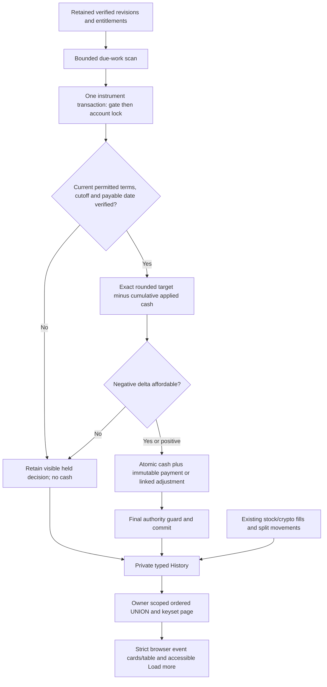

# Phase 10: Dividend Cash and Event History — Research

**Researched:** 2026-11-12  
**Domain:** Exact dividend cash, correction lineage and private mixed-event History  
**Confidence:** HIGH for local architecture; live provider activation remains unverified.

## User Constraints

No Phase10 CONTEXT.md exists. The owner authorized research, a UI contract based on approved requirements/existing design, and checked plans. The following are existing requirements, not invented discussion decisions. [VERIFIED: owner planning reply; `.planning/REQUIREMENTS.md`]

- Ordinary verified gross USD dividends credit the original shared cash on or after payable date; no tax withholding or reinvestment. Preserve historical eligibility and previous entitlements. [VERIFIED: DIV-02/03]
- No duplicated payment across concurrency, retries, revisions or recovery; History and cash publish atomically. [VERIFIED: DIV-04]
- Preserve original payments; corrections are separate linked adjustments. Uncertain or unaffordable negative adjustments remain visibly held rather than making cash negative. [VERIFIED: DIV-05]
- Private newest-first keyset History includes existing crypto fills, stock fills, Dividend credits, forward splits and corrections. Dividend cash enters portfolio once through Account.cash. [VERIFIED: HIST-03; PORT-06; `09-CONTRACTS.md`]
- No new provider access, credential read, activation, paid plan, deployment or publication is authorized by planning. Live Phase7/8 deferrals remain. [VERIFIED: `.planning/STATE.md`, `.planning/PROJECT.md`]

## Summary

Phase8 already retains immutable economic event identities, revisions and per-owner entitlement versions, and Phase9 already serializes stock financial actions with the same shared USD account used by crypto. Reuse these sources; do not derive dividends from current Holding rows or provider brokerage account activities. `latest_verified_entitlements` intentionally refuses an old eligible snapshot when a newer held revision exists. [VERIFIED: `backend/app/services/corporate_actions.py`, `stock_ownership.py`, `stock_trading.py`]

The main new boundary is authority to change cash from the scheduler. Existing scheduler grants deliberately do not permit account cash updates. Define a narrow reviewed SQL payment entry point and immutable accounting records before adding periodic consumers; prove migration, grants and retained recovery compatibility first. History currently reads Trade only, so add a discriminated mixed-event endpoint while preserving the legacy `/trades` contract and cursor. [VERIFIED: `0011_stock_action_accounting.py`, `0013_stock_execution.py`, `services/history.py`, `api/v1/history.py`; DESIGN RECOMMENDATION]

**Primary recommendation:** immutable per-event/owner payment anchor plus append-only target revisions/adjustments, one instrument gate → account lock → current-authority check → atomic cash/accounting publication; query mixed History through a deterministic owner-scoped UNION with a versioned composite cursor. [VERIFIED: existing contracts above; DESIGN RECOMMENDATION]

## Architectural Responsibility Map

| Capability | Primary tier | Secondary tier | Rationale/source |
|---|---|---|---|
| Historical entitlement | Backend + PostgreSQL | Existing action scheduler | Existing immutable entitlement/journal reconstructs cutoff, not current ownership. [VERIFIED: corporate_actions.py] |
| Payment/correction once-only effect | PostgreSQL | Backend service | Constraints, narrow function and account lock authorize atomic cash and records. [VERIFIED: DIV-04, existing restricted grants; DESIGN RECOMMENDATION] |
| Bounded due-work discovery | Dedicated scheduler | PostgreSQL durable work | Existing single scheduler owns periodic work; no per-web-worker jobs. [VERIFIED: CLAUDE.md, tasks/stock_actions.py] |
| History paging/privacy | Backend SQL + authenticated API | Browser | Owner restriction occurs in every query branch before pagination. [VERIFIED: services/history.py; DESIGN RECOMMENDATION] |
| Display/exact wire validation | Browser | Pydantic API | Decimal strings, event discriminators, auth-isolated Query cache, no client cash arithmetic. [VERIFIED: CLAUDE.md, api/history.ts] |
| Recovery authority | Retained tooling + migration | Restricted role bootstrap | Revision-specific exact data/schema/identity/function ACL proof precedes consumers. [VERIFIED: deploy/backup-snapshot.py, verify-restore.py] |

<phase_requirements>
## Phase Requirements

| ID | Description | Research support |
|---|---|---|
| DIV-03 | Gross ordinary USD cash and detailed Dividend event on/after payable date | Frozen historical entitlement + retained exact rate/dates; advancing DB clock; cent HALF_EVEN local convention |
| DIV-04 | Atomic once-only cash/History including retry, revision and recovery | Stable event/owner anchor, unique target/adjustment lineage, transaction + account lock, exact recovery state |
| DIV-05 | Linked immutable corrections and visible holds | Rounded cumulative target minus already applied cumulative cash; held attempt has zero applied delta; original unchanged |
| HIST-03 | Private deterministic mixed-event History preserving fills | Typed UNION projection, full three-part seek tuple, legacy endpoint preserved, strict browser parser and owner epoch |

All descriptions are summarized from `.planning/REQUIREMENTS.md`; architecture entries below are research recommendations, not additional owner requirements. [VERIFIED: requirements]
</phase_requirements>

## Project Constraints (from AGENTS.md)

- Read complete CLAUDE.md and current PROJECT/REQUIREMENTS/ROADMAP/STATE, relevant context/plans/summaries before implementation; retain GSD research, validation, review and human checkpoints. [VERIFIED: AGENTS.md]
- Preserve shared planning history and Claude configuration; use `.codex/GSD-ADAPTER.md` mappings and installed SDK; no invented tools or automatic phase advancement. [VERIFIED: AGENTS.md, adapter]
- Use established design-system/birja and ui-ux-pro-max skill for actual interface work. [VERIFIED: AGENTS.md]
- Decimal/NUMERIC, JSON money strings, UTC timestamps, single DB financial transactions, schema-enforced invariants and keyset lists. All schema changes use reviewed additive Alembic migrations; old versions immutable. [VERIFIED: CLAUDE.md]
- Tests accompany financial changes; full backend coverage ≥80%, critical financial/auth modules 100% statements/branches; preserve frontend, lint/type, dependency/image and actual restricted TLS/recovery gates. [VERIFIED: CLAUDE.md, `.github/workflows/ci.yml`]
- Isolated test stack only; no secrets in source/logs; no unapproved dependency installation, push/merge/deploy or credentials/provider access. Publication remains owner-deferred. [VERIFIED: CLAUDE.md, STATE.md]
- You are sharing the worktree; scope edits and commits, preserve others' changes and untracked `.claude/`. [VERIFIED: orchestrator assignment]

## Standard Stack

| Existing component | Locked version/source | Use |
|---|---|---|
| Python | Project `>=3.14,<3.15`; venv 3.14.9 | Decimal rules, scheduler/services [VERIFIED: pyproject.toml; local version probe] |
| FastAPI / Pydantic | 0.162.0 / 2.14.1 | Authenticated typed event API [VERIFIED: uv.lock] |
| SQLAlchemy / asyncpg / Alembic | 2.0.55 / 0.32.0 / 1.20.1 | Transactions, UNION/keyset and migration [VERIFIED: uv.lock, pyproject.toml] |
| PostgreSQL | Existing reviewed 18.7 container pin | Locks, NUMERIC, constraints/functions [VERIFIED: docker-compose.test.yml; 09-14-SUMMARY.md] |
| React / TanStack Query | 19.3.1 / 5.105.0 | Existing authenticated infinite History [VERIFIED: frontend/package.json] |
| pytest / Vitest / Playwright | 9.1.1 / 5.0.5 / 1.64.1 | Pure, SQL, component and real browser tests [VERIFIED: lockfiles] |

**Installation: none.** Preserve both lockfiles and reviewed images. These are installed project versions, not claims of newest registry releases; no package addition or upgrade is recommended. Official SQLAlchemy2.0 docs currently describe2.0.57, while the project deliberately remains2.0.55. [VERIFIED: uv.lock; https://docs.sqlalchemy.org/en/20/orm/extensions/asyncio.html]

## Package Legitimacy Audit

Not applicable: zero external packages are introduced or installed by this phase recommendation. Do not install slopcheck or alter the environment just for a no-install audit. Existing provenance limitations and locked dependencies remain unchanged; any later addition requires its own registry/provenance review and gate. [VERIFIED: current pyproject/package files; DESIGN RECOMMENDATION]

## Architecture Patterns



Diagram is a proposed local flow derived from the existing action gate, entitlement and History contracts. Provider collection stays outside financial locks and does not directly authorize cash. [VERIFIED: corporate_actions.py; stock_ownership.py; DESIGN RECOMMENDATION]

### 1. Freeze the payment target and immutable lineage

Use one stable `(economic_event_id,user_id)` payment anchor, never `(provider_id,rate)` as payment identity. Snapshot exact original entitlement ID/fingerprint, revision ID/fingerprint, instrument identity/name/symbol, cutoff/date/rate/units, rounded cash, posted time and cash-after into immutable records. Composite FKs bind every entitlement/revision/user/event reference; unique constraints prevent two originals and duplicate revision applications. [VERIFIED: `StockActionEvent`, `StockDividendEntitlement` models; DIV-04; DESIGN RECOMMENDATION]

A correction targets the verified *total owed*, not the prior rate difference multiplied by today's holding. Compute target = HALF_EVEN(eligible_quantity × current verified rate, $0.01), applied = original + all applied linked deltas, delta = target − applied. This avoids repeated rounding drift and supports A→B→A revisions. Persist the target lineage even when rounded delta is zero; zero creates no false cash credit. An unaffordable negative delta creates an immutable held decision with applied delta zero; retrying it may apply once only when current authority and locked cash allow. Do not reserve a uniqueness key in a way that permanently prevents a held decision from later receiving a separate successful application. [VERIFIED: DIV-05, CLAUDE rounding rules; DESIGN RECOMMENDATION]

Do not edit original payment or entitlement rows. Record separate decision/application rows or a strictly append-only transition chain for held→applied/superseded. Link correction to the original payment and exact prior target. Cancelled/uncertain revisions do not imply an automatic reversal. Only an independently verified supported financial target can generate a debit. [VERIFIED: DIV-05; immutable entitlement pattern in corporate_actions.py; DESIGN RECOMMENDATION]

### 2. Current authority after every wait, historical eligibility from original cutoff

Acquire the existing fixed instrument transaction advisory gate before Account FOR UPDATE; within a multi-owner action use sorted account IDs or one account per bounded transaction. Do not acquire account first then instrument, mix multiple instrument gates, share an AsyncSession across concurrent tasks, or hold locks during external calls. PostgreSQL READ COMMITTED refreshes snapshots per statement; row locking waits and returns the updated row. [VERIFIED: stock_ownership.acquire_stock_gate; stock_trading.execute; CITED: https://www.postgresql.org/docs/18/transaction-iso.html; https://docs.sqlalchemy.org/en/20/orm/extensions/asyncio.html]

Reload current event/revision and latest entitlement **after** gate/account waits, with `populate_existing`/explicit scalars. Verify retained exact admission row hashes/generations for actions/calendar/durable accounting/backup rights, monitoring currentness/completeness, no persistent uncertainty hold, correct entitlement version/units and payable date. Recheck an advancing DB `clock_timestamp()` in the final SQL boundary rather than transaction-start `now()`. Do not require open market, fresh trading quote or normal trading status merely to pay a verified due dividend; those are fill requirements, whereas relevant corporate-action certainty still gates payments. [VERIFIED: corporate_actions._authority/_guard; 09-CONTRACTS.md; CITED: https://www.postgresql.org/docs/18/functions-datetime.html; DESIGN RECOMMENDATION]

Retained entitlements predating Phase10 must be included by durable scans, even if the owner sold the stock or the scheduler previously ran. `latest_verified_entitlements` currently returns only the latest eligible snapshot tied to current revision; do not fall back to older eligible rows when current is held. Corrections that change cutoff must reconstruct against the immutable ownership journal through existing verified helpers. [VERIFIED: corporate_actions.latest_verified_entitlements/derive_dividend_entitlements; stock_ownership.reconstruct_stock_quantity]

### 3. Deliberate narrow scheduler cash authority

Existing scheduler can append entitlements/movements and update holding quantity, but cannot update Account.cash. Granting unrestricted cash UPDATE would erase this boundary. Recommended local design: a narrowly scoped `SECURITY DEFINER` payout function owned by the existing migration owner, with fixed `search_path=pg_catalog,public,pg_temp`, schema-qualified static SQL, PUBLIC EXECUTE revoked in the creating transaction, scheduler EXECUTE only and no app/public write access to payout tables. It accepts stable work IDs/expected fingerprints, never caller amount, rate, cash, payable time or arbitrary JSON authority, and derives and verifies every value against current retained state. It acquires the same gate/account locks and performs the complete final payment operation internally. [VERIFIED:0011 grants; CITED: https://www.postgresql.org/docs/18/sql-createfunction.html; DESIGN RECOMMENDATION]

This is a **new security boundary**, not an existing pattern to copy blindly. Pin its owner, exact normalized definition, argument signature, volatility, fixed path and ACL in recovery contracts; test temporary-object shadowing, caller-owned objects, forged IDs/fingerprints, direct scheduler cash writes, function replacement and PUBLIC access. Do not add a login, role membership, CREATEROLE, generic money helper, external dblink/network capability or dynamic SQL. App reads owner-filtered immutable results, and scheduler keeps direct cash UPDATE denied. The existing migration owner can create the function without new role provisioning; a dedicated owner role is unnecessary scope. [VERIFIED: migration/bootstrap ownership, PostgreSQL function docs; DESIGN RECOMMENDATION]

Within the function ensure constraint/trigger waits happen before the last advancing authority check; no later business query or await follows the final guard before commit. Account.cash, cash effect record, original/correction lineage and History-visible event are one transaction. Replays return original immutable records even if current authority is later unavailable, without new cash effects. [VERIFIED:09-CONTRACTS.md final guard pattern; DESIGN RECOMMENDATION]

### 4. Bounded durable scheduling without paid/live activation

Add an independent bounded dividend loop/cycle in the existing single scheduler. Select due retained work using a stable keyset, per-cycle owner/event/time ceilings and no unbounded catch-up query; failure/hold of one instrument must not stop crypto collection or another eligible instrument. Pending work is discoverable from durable records, not only Redis/last-run timestamps. Redis leases prevent wasted duplication but unique SQL identity/locks guarantee correctness. No generic queue/Celery is needed. [VERIFIED: CLAUDE.md; tasks/stock_scheduler.py, tasks/stock_actions.py; DESIGN RECOMMENDATION]

Payable date has day precision. Local convention: compare advancing DB time converted to America/New_York date against retained payable date, so payment never begins on the prior exchange-local day. This is a simulator convention satisfying “on or after,” not a guarantee of DTC arrival time. Real brokerage dividends can post after pay date; do not wait for or inspect Alpaca account activities for Birja's simulated cash. [CITED: https://docs.alpaca.markets/us/docs/daily-processes-and-reconcilations; VERIFIED:DIV-03; DESIGN RECOMMENDATION]

### 5. Deterministic mixed History, preserving old contract

Add `GET /api/v1/history` with a discriminated union (`trade`, `dividend`, `split`, `dividend_correction` plus explicit held state), and retain existing GET `/trades` output/v1 cursor for compatibility. Use a SQL UNION ALL over real immutable financial sources, with user restriction inside every branch. For splits, use the per-user StockOwnershipMovement joined to its StockSplitApplication, **not** a global split row visible to every user. Stock trades use persisted StockFillFacts metadata, not current catalog. Crypto projection preserves original immutable fills and current established labels. [VERIFIED:services/history.py; models/corporate_action.py; models/stock_execution.py; DESIGN RECOMMENDATION]

Mixed cursor v2 contains `(recorded_at,kind_rank,source_id)` (all order columns DESC), with a fixed documented kind rank and unique `kind:source_id` public identity. Seek the whole tuple; timestamps and IDs collide across source tables. Sort publication/recorded time, and separately show economic/cutoff/payable dates: a late correction appears when recorded instead of being silently inserted into an old financial chronology. Held decision transitions remain separate truthful records or a clearly bounded current-state linked projection; no cash amount may imply an applied credit/debit. Keep the current cursor strict canonical-base64/duplicate-key/type/size checks. Cursors never confer authorization. [VERIFIED:history.decode_cursor; CITED:https://www.postgresql.org/docs/18/queries-order.html; DESIGN RECOMMENDATION]

No global event table/backfill is required for this small app: UNION existing immutable sources and new payout records. Create indexes only for actual `(user_id,recorded_at,id)` branches and FK queries. New inserts after a paged request may require refresh to appear, as ordinary keyset pagination does; no claim of a cross-request frozen snapshot. Test identical timestamps, source IDs colliding, page boundaries, newly committed records, empty/zero-sized-invalid pages and forged cross-owner cursor attempts. [VERIFIED:CLAUDE pagination/index rules; DESIGN RECOMMENDATION]

### 6. Protected browser and portfolio integration

Use a new exact discriminated event parser, bounded plain decimal/bigint strings and date-only validation. Preserve existing money formatters and accessible table/mobile cards; add event-specific fields without blank irrelevant buy/sell columns. History distinguishes gross Dividend, signed applied correction, split quantity/basis change and held adjustment with “No cash changed.” Keep signed applied amount and original link separate from target amount. [VERIFIED:HIST-03,DIV-03/05; frontend/api/history.ts, pages/HistoryPage.tsx; DESIGN RECOMMENDATION]

Existing `useHistory` key is only `['history']`; new mixed financial state must explicitly key by authenticated owner/session generation and abort/drop late old-session results, reusing Phase9 stock/portfolio isolation. Refresh/invalidate History and Portfolio after observed dividend results; never optimistically increment cash or sum dividend rows onto Account.cash. Preserve loaded pages on append error, focus and live announcement behavior. New UI needs actual synthetic browser journey and explicit owner acceptance/native200% check if automated native zoom is unsupported. [VERIFIED:useHistory.ts;09-CONTRACTS.md;09-15-PLAN.md; DESIGN RECOMMENDATION]

## Don't Hand-Roll

| Problem | Use instead | Reason/source |
|---|---|---|
| New dividend eligibility calculator | Existing verified cutoff/journal/entitlement helpers | Current holdings lose sold-after-cutoff entitlement. [VERIFIED:DIV-02,corporate_actions.py] |
| Duplicate prevention using Redis flag | PostgreSQL unique identities + transaction/account lock | Redis is rebuildable and tasks can repeat. [VERIFIED:CLAUDE.md] |
| New provider SDK or brokerage DIV endpoint | Existing normalized action revision adapter | Birja owns simulated cash, not Alpaca brokerage positions. [VERIFIED:PROJECT.md; Alpaca daily-process docs] |
| Floating point or PostgreSQL default tie rounding | Python Decimal HALF_EVEN with matching verified SQL implementation | PostgreSQL numeric round ties differ from explicit project rounding; test exact half-cent cases. [VERIFIED:CLAUDE.md; CITED:https://www.postgresql.org/docs/18/datatype-numeric.html] |
| Financial client fetch/effect store | TanStack infinite query + existing owner epoch pattern | Existing project stack and no browser financial authority. [VERIFIED:CLAUDE.md; frontend hooks] |

## Runtime State Inventory

| Category | Found | Required action/source |
|---|---|---|
| Stored data | Branch schema0013; original cash/fills, action versions, entitlement lineage, journal/splits and identity sequences | Add successor schema0014; no manual update/reset; preserve old records; exact revision dispatch. [VERIFIED:alembic versions; backup-snapshot.py] |
| Live service config | Production release remains v0.4.0/schema0008 according to saved evidence; not inspected live | No live change; activation/rollout later. [VERIFIED:STATE.md] |
| OS registrations | Existing nightly backup/timer in retained documented operations; not inspected live | No registration/timer change. Update retained tooling source only if schema requires. [VERIFIED:deploy/systemd,STATE.md] |
| Secrets/env vars | Existing private stock/provider/DB configuration deliberately not read | No new credential needed; no .env access; disabled/default-safe local scheduling. [VERIFIED:assignment; existing settings code] |
| Artifacts | Recovery manifest/SQL/function fingerprints, app/test runtime and CI strict image gates | Rebuild owned local artifacts and exact archive after source changes; installed production tools untouched. [VERIFIED:09-14-SUMMARY.md; deploy/recovery-bundle.sh] |

## Common Pitfalls

1. **Revision ID as new-payment identity:** a changed rate accidentally pays a second full dividend. Anchor to economic event/user and compute target-minus-applied. [VERIFIED:DIV-04/05; DESIGN RECOMMENDATION]
2. **Held negative delta marked paid:** retry never applies, or the UI shows a debit without cash. Separate immutable decision from successful application, with atomic matching cash. [VERIFIED:DIV-05; DESIGN RECOMMENDATION]
3. **Obsolete eligibility after a revision:** newer held row exists but older eligible snapshot is paid. Consume only current verified entitlement, pin lineage and revalidate after waits. [VERIFIED:latest_verified_entitlements]
4. **Account lock inversion:** payout locks cash before instrument while trades lock instrument first. Reuse stock gate→account ordering and bounded one-instrument transactions. [VERIFIED:stock_trading.py]
5. **Blanket scheduler grants or trusted delta parameter:** periodic worker can mint arbitrary cash. Use narrow reviewed DB-owned payout boundary and prove denials. [VERIFIED:0011 grants; DESIGN RECOMMENDATION]
6. **Wrong History tie-break:** IDs1 exist in multiple tables and events vanish/duplicate on pagination. Unique kind/id identity plus complete ordered tuple. [VERIFIED:current distinct tables; DESIGN RECOMMENDATION]
7. **Deferring all recovery to Phase11:** current tools reject unknown revisions and omit new financial state. Extend exact data/schema/identity/function/ACL dispatch before0014 consumers. [VERIFIED:backup-snapshot.py,verify-restore.py]
8. **Zero-dollar rounded target:** do not drop the durable checked target and repeatedly rescan forever, or invent visible income. Preserve a checked zero outcome with no cash effect. [VERIFIED:NUMERIC/ROUND_HALF_EVEN constraints; DESIGN RECOMMENDATION]
9. **Assuming calendar day equals UTC:** paying at UTC midnight may be previous New York day. Compare date in an explicit zone and use advancing clock, including DST. [CITED:PostgreSQL datetime docs; DESIGN RECOMMENDATION]

## Code Examples

```python
# Existing project convention + Python3.14 decimal docs; proposed pure helper.
from decimal import Decimal, ROUND_HALF_EVEN, localcontext

def target_cash(eligible: Decimal, rate: Decimal) -> Decimal:
    # Call only after strict finite, ordinary-USD, whole-quantity/range validation.
    with localcontext() as ctx:
        ctx.prec = 60
        return (eligible * rate).quantize(Decimal('0.01'), rounding=ROUND_HALF_EVEN)

delta = target_cash(eligible, current_rate) - cumulative_applied_cash
```

Code is a proposed local application of approved rounding, not installed production behavior. SQL implementation must match the pure helper on positive/negative half-cent and large-boundary vectors; plain `round(numeric,2)` is not a sufficient HALF_EVEN implementation. [VERIFIED:CLAUDE.md; CITED:https://docs.python.org/3.14/library/decimal.html; https://www.postgresql.org/docs/18/datatype-numeric.html]

```sql
-- Proposed owner-scoped mixed keyset. Each UNION branch must independently
-- contain WHERE source.user_id = :current_user_id.
SELECT * FROM mixed_events
WHERE (recorded_at, kind_rank, source_id) < (:time, :kind, :id)
ORDER BY recorded_at DESC, kind_rank DESC, source_id DESC
LIMIT :limit_plus_one;
```

Derived from existing tuple seek and explicit PostgreSQL ordering; query bound values remain parameters, never interpolated client strings. [VERIFIED:services/history.py; CITED:https://www.postgresql.org/docs/18/queries-order.html]

## State of the Art

| Existing boundary | Phase10 transition | Impact/source |
|---|---|---|
| Entitlements with no cash publication | Immutable payout target + exact applied correction lineage | Preserve Phase8 snapshots and once-only semantics. [VERIFIED:08-06-SUMMARY.md] |
| Trade-only History | Typed mixed-event read endpoint; legacy endpoint preserved | Keep crypto API/history compatibility. [VERIFIED:history schemas/service] |
| Scheduler cannot debit/credit accounts | Narrow reviewed function execution boundary | Must prove real-role denials and exact restored authority. [VERIFIED:0011 grants; DESIGN RECOMMENDATION] |

No package churn or provider migration is justified; newer documentation versions do not authorize lock updates. [VERIFIED:existing locked stack; DESIGN RECOMMENDATION]

## Assumptions Log

No unverified factual claim is promoted to a locked decision. Proposed field names, successor0014, endpoint path, cursor order, cent target and New York payable-day convention are **local design recommendations** derived from approved requirements, to be frozen explicitly in the first plan contract. Live provider suitability remains unknown rather than assumed true. [VERIFIED:requirements and current implementation; DESIGN RECOMMENDATION]

## Open Questions (RESOLVED for local planning; live activation deferred)

| Question | Local resolution for planning | Remaining live uncertainty |
|---|---|---|
| When on payable date? | Exchange-local date on/after payable; advancing DB clock, no claim of exact DTC time. | Provider latency and delayed/corrected source terms remain unverified. |
| Which eligibility? | Latest verified revision-linked entitlement; reconstruct revised cutoff through existing immutable journal; older held replacement blocks payout. | Historical source completeness remains activation prerequisite. |
| Corrections and cancellation? | Apply only verified supported target; append delta vs cumulative applied; held uncertainty/insufficient cash applies zero. No guessed cancellation reversal. | Verified reconciliation evidence may be required. |
| How can scheduler change cash? | Narrow DB-derived function; scheduler direct cash writes still denied; exact security/recovery proof precedes use. | No production installation authorized. |
| Legacy History compatibility? | Add mixed endpoint/cursorv2; preserve trade endpoint/v1; new UI uses mixed endpoint. | No external product dependency. |
| No live data yet? | Synthetic retained revisions/real SQL and browser services prove local behavior; production feature remains disabled without valid admissions. | Rights/access/quotas/latency/continuity remain owner-deferred, not passed. |

All local resolutions are recommendations supported by inspected code/contracts and approved scope; none requires provider calls, new packages or another product decision to write plans. [VERIFIED:code and requirements above; DESIGN RECOMMENDATION]

## Environment Availability

| Dependency | Probe result | Use/fallback |
|---|---|---|
| Project Python | backend/.venv/bin/python3.14.9; host python3 is3.12.3 | Use project uv/venv or hardened builder; never host Python for app tests. [VERIFIED:version probes] |
| uv |0.13.5 available | Existing locked environment, no install. [VERIFIED:probe] |
| Node |24.22.1; frontend node_modules Vitest present | Existing npm scripts. [VERIFIED:probe] |
| Docker |29.2.1 CLI present | Owned disposable stacks; daemon access/runtime image availability must be checked at execution; no live stack inspection. [VERIFIED:probe] |
| restic |0.19.1 available | Existing local encrypted-repository recovery proof; no B2/private calls. [VERIFIED:probe] |
| Context7 |No MCP tools or ctx7 CLI found | Official primary documentation was fetched instead; no tool installation. [VERIFIED:tool discovery/command probe] |
| GSD SDK |installed /usr/local/bin/gsd-sdk; phase-op10 succeeds | Current repository adapter. [VERIFIED:probe] |
| Provider |Not probed; no credentials read | Finite synthetic fixtures; live activation deferred. [VERIFIED:authorized boundary] |

No new package/tool requirement blocks local planning. Docker execution permission and artifact checks are runtime prerequisites, not claimed tested by a CLI version probe. [VERIFIED:scope/probe limits]

## Validation Architecture

Nyquist is enabled. Use existing pytest9.1.1/pytest-asyncio, Vitest5.0.5 and real Playwright driver; config is backend/pyproject.toml plus frontend/vitest and Playwright configs. [VERIFIED:.planning/config.json; lockfiles]

| Req | Meaningful behavior | Type | Proposed quick command | Exists? |
|---|---|---|---|---|
| DIV-03 | Due date, exact cents, retained historic eligibility incl sold-after | Pure + real PostgreSQL | `cd backend && uv run pytest tests/test_dividend_rules.py -q -x` | Wave0 new file |
| DIV-04 | Two real connections, crash/rollback, duplicate/revision/recovery replay | PostgreSQL financial | `cd backend && uv run pytest tests/test_dividend_payments.py -q -x` | Wave0 new file |
| DIV-05 | Target A→B→A, zero delta, unaffordable/uncertain holds and later once-only resolution | Pure/SQL | `cd backend && uv run pytest tests/test_dividend_corrections.py -q -x` | Wave0 new file |
| HIST-03 | Mixed ties/full tuple/owner privacy/current catalog changes/old fills | SQL + API | `cd backend && uv run pytest tests/test_event_history.py -q -x` | Wave0 new file |
| HIST-03 | Strict parser, auth switch late response, append errors/keyboard | Browser unit | `cd frontend && npm run test -- src/api/eventHistory.test.ts src/hooks/useEventHistory.test.tsx` | Wave0 new files |
| Integration | Paid dividend used for stock/crypto; held negative leaves cash; mixed History | Actual browser+SQL | `python3 deploy/tests/run-stock-browser.py` | Existing driver; extend suite |
| Schema/authority | Exact0014 recovery/grants/function identity and actual TLS | Isolated operations | `bash deploy/tests/test-db-operations.sh --all` | Existing; extend revision/state |

New quick-file commands target <30s each after the owned test stack is ready; actual duration must be measured, not assumed. Separate long operations/browser gates run serially at wave/phase boundaries. [VERIFIED:existing Phase9 timing evidence; DESIGN RECOMMENDATION]

**Sampling:** per task run meaningful focused tests and affected lint/types; per financial wave run full backend `uv run pytest --cov=app --cov-fail-under=80` plus configured critical report; per UI wave frontend full coverage/static checks; final gate actual browser, dependency audits, five strict image scans including unfixed HIGH/CRITICAL, retained encrypted restore/TLS/rollback and code/security/UI review. Extend the **actual** critical coverage module list and its regression contract with every dividend/history financial/authorization module; never exclude new code to retain100%. [VERIFIED:CLAUDE.md; test_critical_coverage_config.py; ci.yml;09-14-SUMMARY.md]

**Wave0 gaps:** successor0014 migration+models/invariants, pure payout contract/helpers, SQL concurrency/authority cases, exact recovery columns/sequences/function proof, mixed History API/parser/hook/components, actual financial browser fixtures. Existing frameworks suffice; tests must exercise real financial service/SQL rather than mock successful cash effects. [VERIFIED:current files; DESIGN RECOMMENDATION]

## Security Domain

ASVS applicability follows the project's existing category nomenclature; this is scoped verification, not a blanket certification. [VERIFIED:08/09 security artifacts]

| Category | Applies | Controls |
|---|---|---|
| V2 Authentication / V3 Session | Yes | Existing OTP/JWT cookies; owner/session-epoch cache isolation; abort/drop late responses |
| V4 Access control | Yes | CurrentUser API; owner predicate in each UNION branch; scheduler EXECUTE only; no direct cash update; protected immutable rows |
| V5 Validation | Yes | Strict IDs/discriminators/Decimal strings/date-only/cursor bounds; finite money and matching FKs/unique/checks |
| V6 Crypto | Existing infrastructure | Existing TLS/restic only; no new crypto implementation |
| Business logic | Yes | Current verified entitlement, once-only target lineage, account locks, no negative cash, held does not mean applied |

Table controls are existing project patterns or explicitly proposed applications to Phase10. [VERIFIED:CLAUDE.md; current routers/models; DESIGN RECOMMENDATION]

| Threat | STRIDE | Required proof |
|---|---|---|
| Duplicate/reordered worker/revision | Tampering | Unique anchor/target/application, actual concurrent connections and restored replay |
| Malicious function caller or object shadowing | Elevation | Fixed trusted path/schema qualification; no caller cash; exact owner/signature/ACL; direct-write denials |
| Forged cursor, cross-owner linked event | Information disclosure | Predicate before seek for every branch; linked originals owner-bound; forged cursor never changes user |
| Rewritten original payment or silent held debit | Repudiation | Append-only origin, linked immutable deltas, cash-after and no-change hold details |
| Lost monitor/changed rights during cash wait | Tampering | Final advancing guard binds full admission hashes and current revision/entitlement after waits |
| Unbounded due scan/backlog | Denial of service | Fixed cycle/row/time budgets; durable keysets; independent crypto loop; no external I/O in locks |

Threats are derived from approved once-only/private cash behavior and current authority patterns; every mitigation belongs in plan tasks/tests. [VERIFIED:DIV/HIST requirements; DESIGN RECOMMENDATION]

## Sources

Primary sources fetched2026-11-12 (Context7 unavailable; official documentation fallback):

- https://docs.alpaca.markets/us/reference/corporateactions-1 — current cash-dividend fields, dates and unknown/empty currency caveat. Preserve explicit USD and ordinary classification; docs do not grant permission.
- https://docs.alpaca.markets/us/docs/daily-processes-and-reconcilations — actual broker dividends may post later than pay date; sandbox differs. Simulator gross/no-tax policy is the approved Birja policy, not provider behavior.
- https://www.investor.gov/introduction-investing/investing-basics/glossary/ex-dividend-dates-when-are-you-entitled-stock-and — ordinary cutoff distinction and special-distribution exceptions; existing conservative classifier remains.
- https://www.postgresql.org/docs/18/transaction-iso.html — statement snapshots and READ COMMITTED after row-lock waits.
- https://www.postgresql.org/docs/18/explicit-locking.html — consistent lock order, transaction advisory locks.
- https://www.postgresql.org/docs/18/sql-createfunction.html — invoker/definer distinction, safe search_path and transactional PUBLIC revocation.
- https://www.postgresql.org/docs/18/functions-datetime.html — advancing clock vs transaction timestamps and explicit timezone conversion.
- https://www.postgresql.org/docs/18/queries-order.html — explicit deterministic tie-break ordering.
- https://www.postgresql.org/docs/18/datatype-numeric.html — fetched and verified numeric ties round away from zero; explicit HALF_EVEN implementation and cross-language test vectors are required.
- https://docs.python.org/3.14/library/decimal.html — exact Decimal arithmetic, precision and explicit quantize/HALF_EVEN.
- https://docs.sqlalchemy.org/en/20/orm/extensions/asyncio.html — AsyncSession per concurrent task, transaction ownership;2.0 documentation branch.
- https://tanstack.com/query/latest/docs/framework/react/guides/infinite-queries — one infinite-query cache, sequential refetch and page parameters; use existing lockedv5.

Local primary evidence: AGENTS.md, CLAUDE.md, adapter, PROJECT/REQUIREMENTS/ROADMAP/STATE/config; Phase8 research/06summary; Phase9 CONTRACTS/04summary; inspected services/models/migrations/history UI/lockfiles and retained recovery producer/consumer/bootstrap listed above. No secondary sources are necessary to support the recommendations. [VERIFIED:session file reads]

## Metadata

**Confidence:** stack HIGH (committed locks); architecture HIGH (real existing services/SQL plus official concurrency docs); pitfalls HIGH (actual authority/entitlement gaps); live provider rights/access/continuity LOW/unverified and explicitly deferred. Local design recommendations require plan contract review, not another unverified market-data assumption. [VERIFIED:evidence above]

**Valid until:** 2026-12-12 for stable architecture; recheck provider contracts and any changed runtime/SQL security docs before activation. No implementation, installation or test execution was performed by this research. [DESIGN RECOMMENDATION; VERIFIED:research scope]
