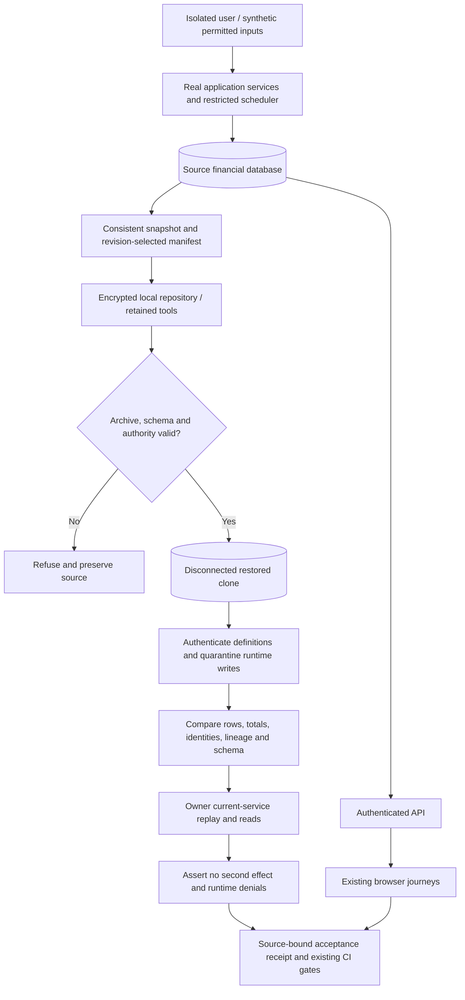

# Phase 11: Mixed-Asset Recovery and Acceptance — Research

**Researched:** 2026-11-13  
**Domain:** Exact encrypted mixed-asset recovery, integrated financial/browser acceptance and CI evidence  
**Confidence:** HIGH for inspected implementation and recorded local evidence; current execution remains to be established by the phase's bounded final gates.

## User Constraints

No Phase11 CONTEXT.md exists. The owner chose approved requirements with research, a UI verification contract derived from existing accepted screens, then planning/checking. These are existing requirements and session instructions, not invented discussion decisions. [VERIFIED: parent task; `gsd-sdk query init.phase-op 11`; `.planning/REQUIREMENTS.md`]

- Own SAFE-02 and SAFE-03; preserve SAFE-01's Phase7 primary ownership and pending status. No Phase7 live campaign is silently closed. [VERIFIED: `.planning/REQUIREMENTS.md:108`; `.planning/ROADMAP.md:366`]
- Recover holdings/cash, announcements/revisions, entitlements/payments/corrections, action state and event History exactly, including duplicate-prevention and compatible retained tools/schema/grants. Prove accounting/concurrency and browser journeys without weakening applicable coverage/security gates. [VERIFIED: SAFE-02/03; ROADMAP Phase11 success criteria]
- Preserve approved whole-share/shared-USD/IEX/ordinary-dividend/forward-split policy and accepted existing design. No new product feature, generic infrastructure, replacement visual system, provider SDK or queue is implied. [VERIFIED: `.planning/PROJECT.md`; ROADMAP activation/UI boundaries; `CLAUDE.md` MVP rules]
- Phase7/8/status live activation, rights/access/freshness evidence, production/B2/installed tools/timers, publication and deployment remain deferred and separately authorized. W01–W08 remain accepted follow-up debt. [VERIFIED: `.planning/STATE.md`; ROADMAP boundaries/follow-up debt]
- Research authorization is read-only source/public documentation inspection and writing this file: no source edits, installs, Docker tests, private environment/credentials, provider/production access, commits or pushes. [VERIFIED: parent task]

<phase_requirements>
## Phase Requirements

| ID | Approved description | Research support |
|---|---|---|
| SAFE-02 | Operator can recover mixed stock/crypto holdings, dividend entitlements/payments, action revisions and event history from an exact encrypted backup with consistent totals and duplicate-prevention state; schema, grant and retained recovery-tool compatibility are proven before rollout. | Existing revision0007–0014 producer/consumer, exact identities/authority, retained installed launchers, immutable replay and corruption/quarantine controls; final evidence attribution. |
| SAFE-03 | User stock journeys are verified through real isolated PostgreSQL accounting/concurrency tests and browser flows for open/closed sessions, dividends, splits, stale data and crypto coexistence; applicable CI coverage/security gates remain enforced. | Existing real-Postgres contention/wait/entitlement/correction suites; actual financial browser paths; full existing backend/frontend/image/e2e/ops/ci-pass gates. |

Descriptions copied from `.planning/REQUIREMENTS.md:56–57`; this is a mapping, not completion evidence. [VERIFIED: that file]
</phase_requirements>

## Summary

Phase11 is predominantly final integration acceptance. Phase10 completed18plans/36tasks at9ed75a6; its verification records2557backend tests,697frontend tests,49browser passes plus one expected deployed-CSP skip,47critical modules at100% statements/branches and five strict image scans with zero HIGH/CRITICAL. Both owner UI/native200% outcomes bind accepted source48d970c. Reuse this work; add code/tests only for concrete uncovered requirements or observed defects. [VERIFIED: `10-18-SUMMARY.md`, `10-VERIFICATION.md`, `.planning/PROJECT.md`; recommendation derived from `CLAUDE.md` MVP rules]

Current0014 recovery is already substantial: real encrypted retained restore, exact ledger/schema/identity/authority comparison, current stock receipt and dividend original/applied/no-change replay, held/reconciled lineage and History/Portfolio reads, with runtime financial quarantine. The six-stage1391.017second same-archive proof ran at7196d5f; later dev/UI/CI changes received affected checks and preserved retained/financial bytes. That historical measurement is not a new full run at48d970c/current source. Selected cutover/recreate/old-app rollback is proven at0008, not0014. [VERIFIED: `10-16-SUMMARY.md`, `10-17-SUMMARY.md`, `10-VERIFICATION.md`; `deploy/tests/test-rollback-db-security.sh:342`]

**Primary recommendation:** build a requirement-to-evidence acceptance ledger, close demonstrated integration gaps in existing fixtures, then run one required final source-bound gate campaign and review its exact scope. Include the current0014 retained deployment-tool compatibility assessment below; do not equate recovery success with rollout readiness or repeat completed owner checks merely to rename their phase. [Recommendation derived from VERIFIED: ROADMAP Phase11; STATE instructions against unnecessary reruns]

### Concrete current0014 rollout-compatibility gap

The selected-cutover fixture deliberately replaces its private clone's `backend/app` and `backend/alembic` with immutable v0.4.0 bytes, then asserts revision0008. Thus it cannot establish what the existing selected-start/deploy/rollback tools do with a populated0014 database. `deploy/deploy.sh` admits a protected restored revision and checks actual selected revision equality, but its supported refs remain `main`, `v0.3.1` and the retained bundle's tested source; rollback accepts the old SHA or tested-source SHA and expressly does not undo migrations. A string-valued0014 revision passing these generic checks is not evidence that the selected candidate, restricted runtime grants or old application actually work there. [VERIFIED: `deploy/tests/selected-cutover.py:121–129,737–765`; `deploy/deploy.sh:75–78,122–160,230–245,464–505`]

**Required bounded planning treatment:** inspect/test the existing tools against an isolated populated0014 candidate and define the permitted rollback target before making a rollout-compatibility claim. Reuse the selected fixture/tool paths without production access or a new deployment product. At minimum prove truthful fail-closed refusal for an unsupported old-runtime/schema pair and preservation of the full ledger; if a supported current0014 selected-start/cutover path is claimed, exercise it with actual restricted services and exact pre/post state, retained archive and source/image identities. Never force old-runtime compatibility by broadening grants or downgrading/rewriting financial state. [Recommendation derived from VERIFIED: cited tool paths; SAFE-02 compatibility-before-rollout]

If that isolated proof or a supported rollback strategy is not established within the approved acceptance scope, record **current0014 selected deployment/rollback compatibility unproven — rollout blocked**. SAFE-02's exact recovery capability can be evidenced independently, but the unproven compatibility clause must not be marked passed by relabelling0008 evidence; final requirement disposition must explicitly account for this blocker. This is a concrete missing evidence dimension, not a finding that the current tool necessarily fails. [Recommendation derived from VERIFIED: SAFE-02; ROADMAP rollout boundary; source limits above]

## Architectural Responsibility Map

| Capability | Primary tier | Secondary tier | Rationale |
|---|---|---|---|
| Durable exact state and duplicate prevention | PostgreSQL/storage | Backend services | Account/holdings, immutable fills, entitlement versions and linked events are database facts. |
| Snapshot/export/encryption/retrieval | Retained operator tooling | PostgreSQL/restic | Existing installed tools package and verify the database contract. |
| Restore authority and quarantine | Operator tooling/migration owner | Restricted role bootstrap | Runtime principals cannot authorize their own restored financial writes. |
| Replay and integrated accounting | Backend services | PostgreSQL | Existing services consume restored identities and return original effects. |
| Browser journeys and availability disclosure | Browser | Authenticated API | UI displays server truth; it does not calculate authoritative cash or grant eligibility. |
| Acceptance receipts and CI enforcement | CI/test orchestration | All isolated tiers | Existing jobs own full suites, dependency/image checks and serial ops gates. |

Assignments are recommendations grounded in inspected `deploy/verify-restore.py`, `deploy/tests/ops-fixtures.py`, backend services, frontend e2e and `.github/workflows/ci.yml`. [VERIFIED: those paths]

## Project Constraints (from AGENTS.md)

- Read full shared CLAUDE rules and current PROJECT/REQUIREMENTS/ROADMAP/STATE plus relevant phase artifacts; continue existing history. [VERIFIED: `AGENTS.md`]
- Use GSD skills/adapter; preserve research, dependency order, checkpoints, review, verification and summaries. Follow current delegation authorization; inline sequential roles remain possible. [VERIFIED: `AGENTS.md`, `.codex/GSD-ADAPTER.md`]
- Preserve `.planning/`, Claude configuration and unrelated work. Setup maintenance uses `scripts/sync-codex-skills.py --check` when applicable, not a Phase11 setup migration. [VERIFIED: `AGENTS.md`]
- UI work reads `.agents/skills/ui-ux-pro-max/SKILL.md`, uses its local searches and `design-system/`; preserve accepted tokens/components. [VERIFIED: `AGENTS.md`; skill and MASTER inspected; focused `focus not obscured` UX search]
- Retain explicit approval before push/merge; yolo/autonomous/commit_docs do not override project/runtime authorization. This research makes no commit per its explicit scope. [VERIFIED: `AGENTS.md`, `CLAUDE.md`, parent task]
- Keep Decimal/NUMERIC, monetary JSON strings, explicit half-even final rounding, aware UTC times, constrained schema, service-owned transactions and thin routers. Postgres owns durable truth; one dedicated scheduler; no speculative infrastructure. [VERIFIED: `CLAUDE.md`]
- Schema changes require reviewed Alembic migrations; merged migrations are immutable; backfills/schema changes remain separate. No migration is presently justified by the acceptance scope. [VERIFIED: `CLAUDE.md`; recommendation]
- Use uv/locked Python dependencies and npm/committed lock, never project pip installation. Isolated real PostgreSQL for meaningful accounting, external HTTP-boundary mocks, full applicable CI,80%overall/100%critical coverage, no auth/CSRF/TLS or scanner bypasses. [VERIFIED: `CLAUDE.md`]
- Retain server authorization/owner isolation, safe query binding, private secrets/logging, restricted verified-TLS roles, pinned/nonroot images and audited dependencies. Existing recovery SQL authority pins are reviewed exceptional operator contracts, not permission for arbitrary runtime SQL building. [VERIFIED: `CLAUDE.md`; `deploy/backup-snapshot.py`]

## Standard Stack

Use existing installed/locked dependencies; no package installation or upgrade is recommended. Versions below are repository pins, not latest-registry or new legitimacy claims; publication dates were not queried because no dependency selection/install is part of this phase. [VERIFIED: `backend/pyproject.toml`, `frontend/package.json`; recommendation]

| Component | Existing version | Responsibility |
|---|---|---|
| Python / pytest / pytest-asyncio / pytest-cov | >=3.14,<3.15 /9.1.1 /1.4.1 /7.1.0 | Existing accounting/service tests and branch coverage |
| FastAPI / Pydantic |0.162.0 /2.14.1 | Existing authenticated wire contracts |
| SQLAlchemy / asyncpg / Alembic |>=2.0.55,<2.1 /0.32.0 /1.20.1 | Existing transaction/migration/replay behavior |
| React / TanStack Query / TypeScript |19.3.1 /5.105.0 /6.0.3 | Existing accepted UI/query ownership |
| Vitest / Playwright |5.0.5 /1.64.1 | Existing frontend and browser suites |
| restic / PostgreSQL recovery image |0.19.1 /18.7 pinned artifact | Exact encrypted recovery; binary/image checks enforced by tooling |

Package rows: [VERIFIED: manifests above]. Recovery versions: [VERIFIED: `deploy/verify-restore.py:28–36`; `10-RECOVERY-REVIEW.md`]. No `npm install`, `uv add`, registry refresh, slopcheck install or package legitimacy audit is required for this no-new-dependency phase. Any later proposed new package must receive the full gate before inclusion. [Recommendation; VERIFIED: parent install prohibition]

## Architecture Patterns

### System Architecture Diagram



Diagram describes the existing isolated test flow; synthetic market/admission inputs do not establish real permission. [VERIFIED: `ops-fixtures.py:816`, `stock-runtime-fixture.py`, `dividend-execution-fixture.py`, `run-stock-browser.py`]

### Component Responsibilities / Recommended Structure

| Existing path | Reuse / bounded change |
|---|---|
| `deploy/backup-snapshot.py`, `backup-manifest.sql`, `verify-restore.py` | Keep exact reviewed producer/consumer and predecessor compatibility; change only for reproduced contract defects. |
| `deploy/tests/ops-fixtures.py` | Reuse roundtrip(explicit archive), roles, populated/fresh TLS, image transition, negative controls and current-service callbacks. |
| `deploy/tests/{stock-runtime,dividend-execution}-fixture.py` | Reuse actual financial source/replay assertions; add narrowly missing acceptance assertions here if demonstrated. |
| `deploy/tests/test-stock-recovery-contracts.py` | Reuse offline dispatch and real PostgreSQL authority/identity/corruption tests. |
| `backend/tests/test_stock_*`, `test_dividend_*`, `test_event_history*` | Existing source of exact accounting, race, wait, privacy and pagination evidence. |
| `frontend/e2e/{stocks,stock-actions,stock-trades,dividends-history,portfolio-history}.spec.ts` | Existing discovery/state and actual financial UI paths; preserve read-only presentation-fixture attribution. |
| `.github/workflows/ci.yml`, `deploy/tests/test-ci-ops.py` | Preserve current mandatory jobs and same-archive orchestration. |
| `.planning/phases/11-mixed-asset-recovery-and-acceptance/` | New acceptance matrix, source-bound proof, review/validation/verification artifacts. |

All paths verified by source inspection. New acceptance artifacts are recommendations, not files claimed to exist. [VERIFIED: repository paths above]

### Pattern 1: Authenticate before authority reconstruction

`restored()` rejects unsafe existing migrator flags before database creation, revokes PUBLIC connection, restores with `--no-owner --no-acl --role=birja_migrator --exit-on-error --single-transaction`, then authenticates0014 function/schema/trigger/owner/role structure before fixed quarantine grants. The role-free pregrant query replaces exactly one trusted resolution fragment; full canonical verification follows reconstruction. Preserve this order. [VERIFIED: `deploy/verify-restore.py:931–1046`]

### Pattern 2: Exact snapshot facts, then effect-free replay

Row hashes/counts and exact money totals are necessary together with schema constraints/indexes, authority definitions and identity state. Archived sequence values are parsed from allowlisted dump SET output because sequences are not MVCC;0011–0014 compare exact dumped identity state and also prove the next generated ID exceeds stored maximum. Never substitute `max(id)` or sample rows for the archived contract. [VERIFIED: `deploy/backup-snapshot.py:380–408`, `522–570`; `deploy/verify-restore.py:780–853`]

Source fixtures create actual stock/crypto fills/splits and actual original/correction/held payments. Restored current-service calls return persisted stock receipts and original/applied/no-change dividend outcomes with unchanged counts/cash/fingerprints. Runtime app/scheduler calls still fail42501; owner replay is not runtime payout activation. Preserve the distinction between source financial effects and clone replay/read proof. [VERIFIED: `stock-runtime-fixture.py:145–190`, `dividend-execution-fixture.py:345–385`]

### Anti-Patterns to Avoid

- Treating the same archive checksum as a fresh run at a new application/image identity; record source/file/image identities and affected-check rationale separately. [VERIFIED: `10-17-SUMMARY.md`]
- Granting financial EXEC or broad table access to make clone replay pass; retain owner replay and actual runtime quarantine denials. [VERIFIED: `verify-restore.py:951–983`; fixture verify paths]
- Calling route fulfillment, seeded external evidence, browser clock overrides or synthetic calendars real provider acceptance. [VERIFIED: frontend stock fixtures; runtime fixture admission/calendar setup]
- Rebuilding the financial engine or performing production0014 cutover to obtain local acceptance. Resolve the isolated tool compatibility gap above or explicitly retain the rollout blocker; planning is not deployment permission. [VERIFIED: ROADMAP Phase11/boundaries; recommendation]

## Don't Hand-Roll

| Problem | Don't build | Use instead | Basis |
|---|---|---|---|
| Backup encryption/retrieval | New encryption/archive protocol | Existing pinned restic/retained launcher flow | `ops-fixtures.py:816`; official restic restore docs |
| Duplicate protection | Replay-specific side ledger/cache | Existing immutable receipts, payment anchors/decisions, split applications and UNIQUE constraints | Existing services/migrations and real replay fixtures |
| Snapshot equality | Sample cash/row checks | Revision manifest, full hashes/schema/identity/authority comparison | `backup-snapshot.py`, `verify-restore.py` |
| Browser integration | New test runner or copied UI | Existing owned disposable runner and Playwright specs | `run-stock-browser.py`; accepted UI contracts |
| CI acceptance | New parallel financial gate framework | Existing serial ops campaign and required `ci-pass` | `.github/workflows/ci.yml:300–360` |

Every row is a recommendation grounded in the listed inspected source. [VERIFIED: listed paths] Restic supports snapshot-target restore; PostgreSQL documents transactional restore and `--no-acl` omission of privileges, which explains the separate authority validation boundary. [CITED: https://restic.readthedocs.io/en/stable/050_restore.html; https://www.postgresql.org/docs/18/app-pgrestore.html]

## Runtime State Inventory

No rename or data/schema migration is recommended. Inventory retained because this phase validates recovery across historical schema migrations; live systems were deliberately not accessed. [VERIFIED: parent scope; ROADMAP Phase11]

| Category | Items found / verification limit | Action required |
|---|---|---|
| Stored data | Source/clone fixtures cover0007–0014, original USD accounts, crypto/stock fills, revisions/ownership/entitlements/splits/payments/decisions/status/admission state and sequences. Production data uninspected. | Use existing isolated fixture/restore gates; no live data migration. [VERIFIED: producer contract columns; successor roundtrips] |
| Live service config | Provider activation and production remain deferred; no remote config inspected. | Preserve deferred ledger, no service UI/API patch. [VERIFIED: STATE; parent task] |
| OS-registered state | Backup systemd units are retained bundle inputs; installed timers not inspected. | Byte-check bundled units only; do not register/restart production timers. [VERIFIED: `verify-restore.py:50`; scope] |
| Secrets/env vars | Test runner generates synthetic settings and refuses inherited private configuration; private files not read. | Keep isolated fake prices/console email and scoped temporary config. No key/env rename. [VERIFIED: `run-stock-browser.py`; ops synthetic ENV] |
| Build artifacts / installed packages | Pinned recovery image/restic/CORE/units and source-built test images have distinct provenance. | Compare approved archive bytes and current images; do not replace installed production tools. [VERIFIED: `verify-restore.py` bundle paths; CI ops] |

## Common Pitfalls

1. **False current-source green:** historical1391.017s at7196d5f is presented as rerun at48d970c/current HEAD. Keep original execution receipt, later immutable-byte qualification and any new final campaign separate. [VERIFIED: `10-16/17-SUMMARY.md`]
2. **Misstated rollback boundary:** the actual selected lane asserts0008. A current0014 encrypted clone replay does not establish0014 selected cutover or old-runtime compatibility. Do not add either claim. [VERIFIED: `test-rollback-db-security.sh:342–383`; `10-VERIFICATION.md`]
3. **Role repair hides corruption:** existing unsafe migrator/runtime flags must fail, not be silently ALTERed into acceptance; function self-hashes cannot authenticate attacker-selected bodies. Verify rejection before grants/creation. [VERIFIED: `test-stock-recovery-contracts.py` fresh/unsafe/body tests; producer authority validators]
4. **Totals hide lineage loss:** matching cash with missing revisions, held decisions, cursors, application keys or identities is insufficient. Exact full rows and authority/sequence checks remain mandatory. [VERIFIED: manifest/verify functions and accounting negative controls]
5. **Mocked success masquerades as financial evidence:** routed stale/unknown/error/tied-page UI fixtures are valuable presentation tests. Real financial success must use actual services/SQL/API and literal expected amounts. [VERIFIED: `stock-actions.spec.ts`, `stock-trades.spec.ts`, `dividends-history.spec.ts`; Phase10 verification limitations]
6. **Unnecessary owner gate repetition:** source48d970c UI and actual native200% were accepted. Carry acceptance forward only when source-bound unchanged; new material UI behavior needs an explicit affected review, not fabricated fresh acceptance. [VERIFIED: `10-HUMAN-UAT.md`, `10-VERIFICATION.md`; recommendation]

## Code Examples

Existing project patterns; these snippets are source-inspected examples, not commands executed by this research. [VERIFIED: `.github/workflows/ci.yml`; fixture paths]

```python
# Source: .github/workflows/ci.yml, serial ops stage
ops.image_transition()
unchanged()
ops.roundtrip(archive)
unchanged()
ops.roles()
unchanged()
assert ops.tls() == ops.tls(fresh_bootstrap=True)
unchanged()
# Existing selected rollback receives this SAME checksum-pinned archive.
```

`unchanged()` checks archive SHA, current CORE/unit hashes and exact tar member bytes. Keep the existing gate callable rather than inventing a new recovery framework. [VERIFIED: `.github/workflows/ci.yml:309–333`]

```python
# Source: deploy/tests/dividend-execution-fixture.py, verify(owner)
before = await fingerprint(owner)
assert before == DIVIDEND_EXPECTED
# Existing service_work(..., role=None) replays persisted original/applied/nochange.
await current_reads(owner)
# Existing app/scheduler connections separately assert denied financial calls.
assert await fingerprint(owner) == before
```

PostgreSQL's official lock documentation supports observing actual locks and consistent acquisition order; keep existing independent-session wait tests instead of asserting concurrency with sleep-only mocks. [CITED: https://www.postgresql.org/docs/18/explicit-locking.html] Playwright recommends isolated user-visible tests and web-first assertions; existing owned browser contexts/role locators already fit that approach. [CITED: https://playwright.dev/docs/best-practices]

## State of the Art

| Earlier project state | Current inspected state | Planning impact |
|---|---|---|
| Production/selected old-app rollback0008 | Local recovery supports0007–0014; selected rollback still0008 | Keep compatibility dimensions explicit. |
| Phase8 entitlement-only ledger | Phase10 original payments, corrections/holds and mixed History | Recovery acceptance must cover both original and successor records. |
| Historical six-stage same-archive run | Later dev/UI fixes plus qualified unchanged retained/financial bytes | Attribute evidence by source; one bounded final phase campaign where required. |

All rows describe project evolution, not new industry version claims. [VERIFIED: PROJECT; Phases8–10 summaries; current recovery sources]

## Recommended Bounded Plan Structure

These are planning recommendations, not locked discussion decisions. Each plan should retain two coherent tasks where practical and avoid adding unrelated features. [Recommendation derived from VERIFIED: ROADMAP scope; established prior plans]

1. **Acceptance inventory and targeted integration closure:** freeze SAFE-02/03 behavior→existing test/evidence mapping and exact source/retained/image identities; add only missing behavioral assertions or a permanent wrapper if an actual repeatability gap is demonstrated. Do not duplicate existing service suites.
2. **Final exact recovery and tool compatibility acceptance:** assess the current0014 selected-tool/rollback gap above using bounded existing isolated fixtures, or record an explicit unresolved rollout blocker; exercise the existing current-source same-archive serial path once as a required phase gate, using retained0007–0014/current-service replay, restricted roles, both verify-full TLS lanes/authority parity, image transition and separately labelled0008 selected rollback. Preserve full negative controls and cleanup receipts. Reuse unchanged accepted assets; rebuilding/repeating thereafter requires a source change, failure or explicit final-gate need.
3. **Integrated journey and CI acceptance:** existing actual financial browser/DB tests and full applicable CI/security gates, source-bound accepted UI mapping and concise evidence packet; add only specific missing journey links. Arrange expensive gates after changes settle to avoid repeated campaigns.
4. **Review and close local acceptance:** distinct code/security/UI/goal verification roles, fix actual findings then affected rechecks, record validation and owner acceptance continuity/material-change checkpoints. Mark SAFE-02/03 only after criteria actually pass; retain SAFE-01/live activation/rollout and W-debt boundaries.

Exact allocation can be compressed if the acceptance inventory proves no source changes. Do not create eighteen new implementation plans for an already built system. [Recommendation]

## Hard Acceptance and Deferred Boundaries

| Must pass for local Phase11 | Remains explicitly deferred |
|---|---|
| Full exact encrypted mixed-asset restore and current-service effect-free replay; schema, authority, grants, identity and retained-tool compatibility | Provider rights/access/quotas/freshness campaign and Phase7 whole-requirement completion |
| Real isolated PostgreSQL concurrency/expiry/closed replay/cutoff/revision/split/uncertainty assertions | Live quote/action/status activation; synthetic evidence is not live approval |
| Existing complete browser journeys, applicable CI coverage/security and no hidden new skips | Production0014 migration/cutover/deployment, off-server/B2 restoration or installed-tool/timer replacement |
| Honest source/image/archive provenance; distinct0008 selected rollback scope; required review and cleanup | Publication/push/PR/merge without the applicable separate approval; W01–W08 remediation |

Boundary derives from approved ROADMAP/requirements and current STATE, not waived criteria. A failed required local truth blocks closeout; record a genuinely deferred external action separately. [VERIFIED: those artifacts]

## Environment Availability

Read-only CLI probes only; no daemon/service start, private config read, package install or Docker test was performed. No knowledge graph file was found by the scoped path listing. Context7 tools and `ctx7` CLI were unavailable; official public docs were used. [VERIFIED: tool discovery and `command -v`/version probes during research]

| Dependency | Available / version | Fallback or execution prerequisite |
|---|---|---|
| Host Python |3.12.3 | Scripts only; backend requires existing `.venv` Python3.14.9. |
| Backend venv |Python3.14.9 | Existing locked env, no install proposed. |
| Node/npm |24.22.1 /11.19.1 | Node24 meets project family; accepted hardened toolchain image/version remains separately checked. |
| uv |0.13.5 | Existing locked environment. |
| Docker CLI / Compose |29.2.1 /5.0.0 | Local Compose differs from CI's pinned5.7.0; execution must verify exact required platform capability before gate, not silently upgrade host. |
| PostgreSQL/Redis daemon, restic binary, accepted images/archive paths |Not probed by execution or private access in this research | Existing isolated harness/retained artifacts and recorded Phase10 receipts; validate availability in authorized execution preflight. |
| GSD SDK |`/usr/local/bin/gsd-sdk`; phase11 init succeeds | Adapter maps tool behavior. |

Versions are observed environment values, not a statement that required services are running. Missing/blocked execution dependencies cannot be classified conclusively without the authorized preflight; keep them explicit instead of assuming availability or reaching production. [VERIFIED: probes; parent scope]

## Validation Architecture

Enabled by `.planning/config.json` (`workflow.nyquist_validation=true`). No tests executed by this research. [VERIFIED: config; scope]

### Test Framework

| Property | Existing value |
|---|---|
| Backend |pytest9.1.1/pytest-asyncio1.4.1; `backend/pyproject.toml`; actual isolated PostgreSQL/Redis via `docker-compose.test.yml` |
| Frontend |Vitest5.0.5/Playwright1.64.1; `frontend/package.json`, `frontend/playwright.config.ts` |
| Quick offline |`python3 deploy/tests/test-stock-recovery-contracts.py RevisionContracts` and `python3 deploy/tests/test-ci-ops.py` |
| Full backend |`cd backend && uv run pytest --cov=app --cov-branch --cov-fail-under=80`, then exact existing47-module coverage command from CLAUDE/CI |
| Full frontend/browser |`cd frontend && npm run test -- --coverage`; `python3 deploy/tests/run-stock-browser.py` |
| Full ops |Existing `.github/workflows/ci.yml` serial same-archive Python block; explicit archive roundtrip + roles + both TLS lanes + image transition + selected rollback |

Frameworks/commands verified in manifests/CLAUDE/CI. Quick commands are intended small offline samples; runtime not measured here. Database/browser/ops tests are long integration gates, not falsely advertised as <30seconds. [VERIFIED: those paths; `10-16/17-SUMMARY.md` timings]

### Phase Requirements → Test Map

Commands below assume the already-owned isolated test stack and existing locked environment; run only under phase execution authorization. All listed files exist. [VERIFIED: repository source inspection]

| Req | Behavior / independent oracle | Existing test/fixture | Automated command or final gate |
|---|---|---|---|
| SAFE-02 | Unknown revision refusal, predecessor bytes, exact declarations/identities | `deploy/tests/test-stock-recovery-contracts.py:46` | `python3 deploy/tests/test-stock-recovery-contracts.py RevisionContracts` |
| SAFE-02 | Fresh clone authority before grants; unsafe role/body/schema refusal; exact dumped sequences | `PostgreSQLContracts` in same file | `python3 deploy/tests/test-stock-recovery-contracts.py --postgres` (long) |
| SAFE-02 | Real encrypted installed-tool retrieval, full0007–0014 rows/totals/schema/identities, source unchanged | `ops-fixtures.py:816` / successor roundtrips | Final serial `roundtrip(archive)` |
| SAFE-02 | Checksum/manifest/truncated dump/unavailable repository/row/FK/index/sequence/authority corruption refused | Same roundtrip + `negative_controls`, `accounting_negative_controls`, authority controls | Same gate; assert actual negative markers and cleanup, not only exit0 |
| SAFE-02 | Original receipt, dividend original/applied/nochange return same IDs; unchanged cash/fingerprint; runtime42501 | `stock-runtime-fixture.py`; `dividend-execution-fixture.py:366` | Current0014 callbacks inside same retained roundtrip |
| SAFE-02 | No second split/decision effect | `ops-fixtures.py` RECOVERY_REPLAY_SCENARIO; `backend/tests/test_stock_ownership.py` | Retained replay + `cd backend && uv run pytest tests/test_stock_ownership.py -q` |
| SAFE-02 | Actual restricted services and fresh/upgraded verify-full TLS authority parity | `ops-fixtures.py` roles/tls; ordinary-dev gate | Same serial gates + `python3 deploy/tests/test-dev-bootstrap.py --image birja-backend-test:phase05-07` |
| SAFE-02 | Current0014 selected-tool compatibility and supported rollback boundary | Existing selected fixture covers0008 only; current0014 lane is a Wave0 evidence gap | Bounded isolated extension/probe of existing tools with populated0014 and unsupported-pair refusal; no current passing command claimed. If unresolved, retain explicit rollout blocker and unproven compatibility clause. |
| SAFE-03 | Cross-asset same cash/keys; no overspend; literal count/cash/holding oracles | `backend/tests/test_stock_trading_concurrency.py` | `cd backend && uv run pytest tests/test_stock_trading_concurrency.py -q` |
| SAFE-03 | Actual wait, post-lock expiry, exclusive first-fill cutoff/action gate | `backend/tests/test_stock_trading_waits.py` | `cd backend && uv run pytest tests/test_stock_trading_waits.py -q` |
| SAFE-03 | Closed-market replay retains original fill, no new execution | `backend/tests/test_stock_trading_service.py`; `frontend/e2e/stock-trades.spec.ts:182` | Backend focused file + owned browser runner |
| SAFE-03 | Dividend cutoff/sold-out ownership, revisions, concurrency, affordability/uncertainty, response loss | `test_stock_ownership.py`, `test_dividend_{payments,corrections,concurrency,waits}.py` | `cd backend && uv run pytest tests/test_dividend_payments.py tests/test_dividend_corrections.py tests/test_dividend_concurrency.py tests/test_dividend_waits.py -q` |
| SAFE-03 | Split ordering/basis/once-only and uncertain-action suspension | `test_stock_ownership.py`, `test_stock_action_resolutions.py`, `test_stock_action_monitoring.py` | Existing backend files; `stock-actions.spec.ts` UI states; actual stock runtime fixture |
| SAFE-03 | Private mixed History, tied keyset pages, offpage originals, held cash0, portfolio once-only | `test_event_history*.py`; `frontend/e2e/dividends-history.spec.ts` | Backend History files + complete owned browser runner |
| SAFE-03 | Discovery→preview/reprice→confirm→receipt→Portfolio/History, open/closed/stale/unknown plus crypto | `stocks.spec.ts`, `stock-trades.spec.ts`, `dividends-history.spec.ts`, `portfolio-history.spec.ts` | `python3 deploy/tests/run-stock-browser.py` |
| SAFE-03 | Full coverage/security gates remain mandatory | `test_critical_coverage_config.py`, `test-ci-ops.py`, CI jobs | Existing full backend/frontend/image/e2e/ops → `ci-pass`; dependency audits and five strict scans |

### Sampling Rate and Wave 0 Gaps

- Per changed task: relevant small offline/targeted behavioral test; meaningful financial changes require real isolated DB proof. Per wave: affected suites; final phase gate: full applicable existing CI and source-bound same-archive recovery acceptance after source settles. [Recommendation grounded in VERIFIED: CLAUDE test culture; STATE rerun constraints]
- No missing framework/config install. Gaps are the Phase11 consolidated acceptance/evidence ledger, final source attribution and the current0014 selected deployment-tool/rollback compatibility dimension identified above. Add bounded assertions to existing fixtures; do not manufacture a passing0014 lane from0008 evidence. [VERIFIED: existing configs/tests/selected fixture; recommendation]
- Reuse accepted Phase10 owner UI/native200% evidence when relevant bytes/behavior remain unchanged. If Phase11 changes material presentation, record new source-bound affected UI/native200% outcome rather than assuming an old answer applies. [VERIFIED: `10-HUMAN-UAT.md`; recommendation]
- Native200% is human verification when newly required; existing supplementary reflow/browser support checks are not proof of native menu zoom. Deployed authenticated CSP remains the explicitly accepted W07 skip, not a new blanket skip permission. [VERIFIED: `10-VERIFICATION.md`; `stock-trades.spec.ts:387`; ROADMAP W-debt]

## Security Domain

Security enforcement is not explicitly disabled, so include scoped threat review. ASVS5.0.0 is the current official stable release (published2025-05-30); its chapter numbers differ from the legacy template. Use current categories below, not legacy V2=Authentication/V3=Sessions. This is scoped engineering verification, not blanket ASVS certification. [VERIFIED: `.planning/config.json`; CITED: https://asvs.owasp.org/; https://github.com/OWASP/ASVS/tree/v5.0.0/5.0/en]

| Applicable ASVS5 category | Application / standard control |
|---|---|
| V2 Validation and Business Logic | Exact money, strict whole shares, current authority and immutable replay; real DB concurrency/expiry/duplicate tests. |
| V3 Web Frontend Security / V4 API and Web Service | Existing safe rendering, CSRF and authenticated schema/owner contracts; no weakened security headers/gates. |
| V6 Authentication / V7 Session Management / V8 Authorization | Existing OTP/session/owner isolation; no restore bypass, broad role membership or clone runtime financial authority. |
| V11 Cryptography / V12 Secure Communication | Existing restic encryption and verified-TLS role lanes including bad CA/hostname/plaintext rejection; no custom cryptography. |
| V13 Configuration / V14 Data Protection | Pinned tools/images, deny private config inheritance, source preservation, restricted logs/evidence and disposable resource cleanup. |
| V15 Secure Coding and Architecture / V16 Security Logging and Error Handling | Explicit capability boundaries, fail-closed validation, bounded processes and sanitized public receipts. |

Category names verified against official5.0.0 tree; controls verified as applicable project patterns from CLAUDE, CI, restore and fixture sources; table is a recommended review mapping. [VERIFIED: listed project paths; CITED: official ASVS tree above]

| Threat pattern | STRIDE | Existing mitigation / required acceptance assertion |
|---|---|---|
| Forged manifest/function self-hash or ACL repair | Tampering/Elevation | Independently pinned function bodies/schema/triggers/role flags; reject before reconstruction. |
| Second financial effect after restore/retry | Tampering/Repudiation | Saved IDs/receipts, immutable original/successor lineage, unique constraints and exact pre/post cash/count/fingerprint. |
| Cross-owner financial/history disclosure | Information disclosure | Authenticated owner predicates, owner/epoch browser caches, late-result isolation and private original joins. |
| Stale authority after a real lock wait | Tampering | Existing final server clock/authority rereads and independent-session wait tests. |
| Restored clone unexpectedly becomes live | Elevation/Information disclosure | Disconnected clone, revoked PUBLIC CONNECT, quarantined payout EXEC and actual42501 runtime denials. |
| Unbounded/flaky test resources or leaked credentials | Denial of service/Disclosure | Existing bounded owned harness, synthetic config/fake prices/console email and exact owned cleanup receipts. |

Threat mapping is recommended from inspected boundaries; no new security product is needed. [VERIFIED: `verify-restore.py`, financial wait/concurrency suites, browser runner; recommendation]

## Assumptions Log

No unverified external requirement, package choice, retention policy or new performance target is promoted to a locked decision. Recommendations are explicitly marked as recommendations, and runtime availability/live evidence gaps are explicitly unknown. No `[ASSUMED]` factual dependency is needed for this bounded reuse plan. [VERIFIED: research scope and source inventory]

## Planning Question Dispositions

1. **[RESOLVED — PLANNING; EXECUTION PENDING] Final acceptance campaign identity:** Plan11-03 freezes final source/images/fixtures, packages one fresh explicit archive and runs the source-bound serial campaign after executable changes settle. Historical7196d5f proof and later deltas remain historical. This resolves the planned method, not a passing campaign result. [Sources: Phase10 summaries/verification;11-03-PLAN.md]
2. **[RESOLVED — PLANNING; COMPATIBILITY PROOF PENDING] Current0014 selected deployment-tool compatibility:** Plans11-01/03 specify tested-source-only admission at0014, actual restricted current candidate startup/cutover, unsupported old-runtime refusal before mutation and actual failed-attempt rollback to the last good retained tested0014 source. Preserve separate legacy0008 actual old-application rollback. This bounded supported recovery boundary is selected for proof, not already proven; a failing or unexecuted required compatibility clause leaves SAFE-02 unresolved and rollout blocked. [Sources: selected fixture/deploy inspection above;11-01/03-PLAN.md]
3. **[RESOLVED — PLANNING; READINESS UNKNOWN] Execution environment capability:** Plan11-03 execution preflight must establish existing locked tools/images, Docker/Compose capability and isolated resource readiness before gates; no silent install/upgrade. The observed Compose5.0.0 versus CI5.7.0 difference is not waived and no daemon/image/restic readiness pass is asserted. [Sources: read-only probes;CI:223–246;11-03-PLAN.md]
4. **[DEFERRED — EXTERNAL ACTIVATION; NOT A REQUIRED LOCAL ACTION] Provider/live rollout:** External rights/access/freshness and Phase7 SAFE-01/live acceptance remain pending under approved scope. Local SAFE-02/03 proof neither performs nor substitutes for those separately authorized actions; it cannot establish full live milestone release. This exclusion does not defer any required local0014 compatibility proof. [Sources: REQUIREMENTS/ROADMAP/STATE;11-04-PLAN.md]

## Sources

### Primary — HIGH confidence

- Repository rules/context: `AGENTS.md`, full `CLAUDE.md`, `.codex/GSD-ADAPTER.md`, `.codex/agents/gsd-phase-researcher.md`, mandatory research references, `.planning/{PROJECT,REQUIREMENTS,ROADMAP,STATE}.md`, config and phase11 init. [VERIFIED: source reads]
- Recovery: `deploy/{backup-snapshot.py,backup-manifest.sql,verify-restore.py}`, `deploy/tests/{ops-fixtures.py,test-stock-recovery-contracts.py,stock-runtime-fixture.py,dividend-execution-fixture.py,test-rollback-db-security.sh}`. [VERIFIED: source reads]
- Acceptance provenance: Phase7–10 research/summary/verification artifacts; particularly `10-RECOVERY-CONTRACT-REVIEW.md`, `10-RECOVERY-REVIEW.md`, `10-{16,17,18}-SUMMARY.md`, `10-VERIFICATION.md`, `10-HUMAN-UAT.md`; accepted UI contracts/master. [VERIFIED: source reads; historical execution attributed to artifacts, not rerun]
- Tests/CI: backend files in the matrix, frontend e2e specs/runner, manifests and `.github/workflows/ci.yml`. [VERIFIED: source reads]
- [PostgreSQL18 pg_restore](https://www.postgresql.org/docs/18/app-pgrestore.html): transactional restoration and privilege omission; current18 documentation retrieved2026-11-13. [CITED: official docs]
- [PostgreSQL18 explicit locking](https://www.postgresql.org/docs/18/explicit-locking.html): real lock observation/order; retrieved2026-11-13. [CITED: official docs]
- [restic0.19.1 restoration](https://restic.readthedocs.io/en/stable/050_restore.html): explicit snapshot/target and in-place behavior; retrieved2026-11-13. [CITED: official docs]
- [Playwright best practices](https://playwright.dev/docs/best-practices): isolated user-visible assertions; retrieved2026-11-13. [CITED: official docs]
- [ASVS official overview](https://asvs.owasp.org/) and [5.0.0 chapter tree](https://github.com/OWASP/ASVS/tree/v5.0.0/5.0/en): current release/date/category mapping. [CITED: official sources]

### Secondary / Tertiary

None required. Context7/ctx7 unavailable; no search-only package discovery or unsupported provider entitlement claim used. [VERIFIED: tool/CLI discovery; research source inventory]

## Metadata

| Area | Confidence | Reason |
|---|---|---|
| Standard stack | HIGH | Existing locked manifests and pinned retained tools; no new dependency recommendation. |
| Architecture | HIGH | Actual producer/restore/service/CI call chains inspected. |
| Pitfalls | HIGH | Historical real authority/dev/focus defects and exact rollback/source scopes explicitly recorded. |
| Remaining work sizing | MEDIUM | Source review supports bounded acceptance reuse; final campaign can expose concrete integration failures. |
| Live entitlement/deployment readiness | UNRESOLVED | Deliberately deferred and unprobed; not required to fabricate local acceptance. |

**Research date:**2026-11-13. **Valid until:**2026-11-20 for source/security/environment evidence, or immediately invalidated by relevant authority/schema/tool/service/UI/CI changes. Recheck by affected scope rather than blanket historical reruns. [Recommendation]

**Research execution boundary:** only source/public-doc reads, version probes, SDK init, focused local UX search and this file write; no source tests, installs, Docker workloads, private credentials, external account actions, production changes or commits. [VERIFIED: research tool calls]
