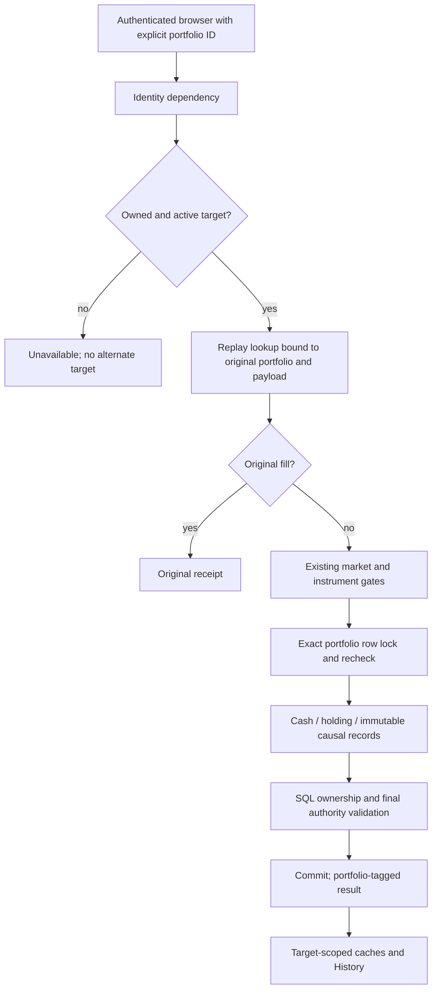

# Phase 12: Preserve Existing Investing Under Portfolio Ownership — Research

**Researched:** 2026-11-14
**Domain:** Financial ownership migration, authorization, immutable accounting, browser state and exact recovery
**Confidence:** HIGH for inspected source; MEDIUM for proposed transition until isolated PostgreSQL proofs pass.

<user_constraints>
## User Constraints (from CONTEXT.md)

## Decisions

- Use the approved requirements and existing Birja design system; research
  technical approaches, create and verify the required UI contract, then write
  and check executable plans. The owner approved this sequence explicitly.
- Keep actual existing balances, stored starting cash, quantities/basis, fills,
  ownership/event lineage and retry identities intact in the first portfolio.
  Its initial label is “My portfolio.” Migration grants no new money.
- Bind every financial request and UI action to an explicit owned active
  portfolio. Show its name on the existing trading/confirmation/receipt,
  holdings and History surfaces; do not silently select an alternative target.
- Preserve existing crypto and stock execution, fees, freshness, eligibility,
  valuation/incomplete-value and private event-history behavior. Stock
  collection/execution admissions stay gated by the existing prerequisites.
- Authentication/session identity must work with zero, one or many financial
  portfolios in isolated fixtures; ordinary reads or sign-in cannot regrant
  money or recreate an intentionally empty portfolio set.
- Preserve restricted PostgreSQL roles, verified TLS, SQL ownership constraints,
  immutable economic evidence and exact-money rules. Do not broaden ordinary
  mutation privileges to make the transition pass.
- Qualify grants, revision-specific exact recovery and supported rollback or
  explicit refusal with each runnable schema transition; Phase 15 is not a
  reason to postpone those safety proofs.
- Future v1.2 lifecycle is already fixed: ten active portfolios, independent
  once-only $10,000 grants, terminal deletion including holdings or last
  portfolio, and freezing cash/holdings/financial History at deletion with no
  later dividends/splits/corrections (including earned unpaid effects), fake
  liquidation or transfers. The foundation must accommodate it coherently.
- Names/rename, creation/overview and optional descriptions (which may be empty)
  are Phase 13 user features. Delete/empty-state management is Phase 14. Do not
  expose unfinished management features in Phase 12; use isolated fixtures to
  prove future ownership/lifecycle states.
- Keep planning local on feature/milestone-v1.2. No push, merge, provider call,
  live verification, production inspection/change, dependency installation or
  implementation is authorized by this planning workflow.

## Agent Discretion

- Research the smallest coherent portfolio-root and immutable-association design
  against actual code; the milestone account-root recommendation is not a
  substitute for verifying every financial consumer and migration invariant.
- Select explicit API/route, cursor, retry and browser-state compatibility
  contracts that preserve the locked outcomes without guessing a portfolio.
- Design phased migration, lock ordering, SQL authority and exact recovery
  revisions using existing packages and isolated test infrastructure.
- Reuse accepted components, tokens, layouts and state patterns for portfolio
  identity labels and unavailable-target handling. Record all concrete UI
  choices in UI-SPEC.md rather than inventing a new visual design.
- Split executable plans into bounded tasks with concrete files, dependencies,
  verification, threat mitigations and human UI review; preserve the coordinated
  final delivery boundary and keep future management activation disabled.

## Deferred Ideas and External Gates

- Phase 7 STOCK-01/02/03, DATA-01, MKT-01 and SAFE-01 remain separately deferred
  and unverified. Do not rewrite their records, generate a false Plan 07-14
  completion summary or invoke its approved bounded manual campaign here.
- Historical charts, transfers, resets, cloning, configurable capital, shared
  portfolios, trash/restore UI and additional asset/provider features are outside
  this phase. Optional descriptions remain in Phase 13, not forgotten.
- Do not introduce new dependencies, activate live stock data, publish changes
  or deploy production under plan-phase authority.

</user_constraints>

The copied constraints above are sourced verbatim from 12-CONTEXT.md. All recommendations below are engineering proposals under Agent Discretion, not additional owner decisions. No implementation or runtime verification was performed for this research. [VERIFIED: .planning/phases/12-preserve-existing-investing-under-portfolio-ownership/12-CONTEXT.md]

## Project Constraints (from AGENTS.md)

- Read CLAUDE.md in full and current PROJECT/REQUIREMENTS/ROADMAP/STATE plus relevant phase artifacts; continue shared project history rather than reinitialize it. [VERIFIED: AGENTS.md]
- Use the applicable GSD workflow and adapter, preserve research/checks/dependencies/checkpoints/reviews/verification/summaries, and follow session delegation constraints. Yolo/autonomous/commit_docs never bypass project approvals or permissions. [VERIFIED: AGENTS.md]
- Use ui-ux-pro-max local scripts and existing design-system documents for UI work; preserve established components and tokens. Preserve Claude configuration and validate skill discovery when maintaining that setup. [VERIFIED: AGENTS.md]
- Keep money Decimal/NUMERIC and JSON strings; migrations are immutable once merged, schema/data migrations separate, large backfills batched, existing-table indexes concurrent, no startup create_all. Preserve exact auth, restricted roles, TLS and isolated real-DB tests; external HTTP providers are mocked. Existing overall coverage is 80%, critical paths 100%. Breaking API changes need a new URL version. [VERIFIED: CLAUDE.md]
- This child owns only this research file; no commit, push, production/provider operation, dependency installation, secret inspection or service/test execution. [VERIFIED: .planning/phases/12-preserve-existing-investing-under-portfolio-ownership/12-CONTEXT.md]

<phase_requirements>
## Phase Requirements

The descriptions below are copied from the active requirements. [VERIFIED: .planning/REQUIREMENTS.md]

| ID | Description | Research support |
|---|---|---|
| PFUND-03 | Existing users receive their first named portfolio with their actual prior cash, original starting-cash baseline, holdings, basis, immutable fills, event History and retry identities preserved; migration grants no new money and resets nothing. | Association/backfill, unchanged-payload and no-grant proofs |
| PFIN-02 | User can preview and execute existing crypto and stock orders in an explicitly targeted active portfolio with unchanged fee, quantity, quote freshness, eligibility and stock-activation rules; no unspecified or unavailable target silently selects another portfolio. | Explicit owner/active resolver, all execution readers/writers |
| PFIN-03 | User retries an uncertain order only against its original portfolio and payload without duplicate execution or another portfolio's receipt; an original active-portfolio fill remains replayable under existing safe-retry rules. | User-global retry uniqueness plus original portfolio equality |
| PCTX-01 | User sees the target portfolio's name on trade tickets, confirmations, receipts, holding details and History so each action's strategy is clear. | Resource metadata and first-portfolio browser paths |
| PVIEW-03 | User sees only the chosen active portfolio's private, deterministically paginated crypto/stock/dividend/split/correction History and original-event details; cursors and references cannot cross portfolios. | Per-portfolio source union, original-reference checks and cursor scope |
| PSAFE-02 | User identity, OTP sign-in, session refresh and sign-out work independently of having zero, one or many portfolios; legacy financial requests cannot choose an ambiguous portfolio or bypass explicit targeting. | Identity-only auth, no read-time root creation, explicit legacy refusal |
| PSAFE-03 | Fresh and migrated portfolio services retain restricted PostgreSQL roles, verified TLS, immutable financial evidence and matching ownership constraints; migration preserves existing financial payloads and does not broaden ordinary mutation privileges. | Composite ownership, restricted roles, finite association protocol and exact revision proofs |
</phase_requirements>

## Summary

Use existing accounts.id as the stable financial portfolio ID, retaining users.id for identity. Account already owns cash and stored starting_cash; holdings/trades/actions currently associate through user_id, and accounts.user_id is unique. This supports preservation without inventing a second wallet, but changing only Account uniqueness would expose every user-filtered financial reader/writer to sibling portfolios. [VERIFIED: backend/app/models/user.py; backend/app/models/trade.py; backend/app/services/trading.py; backend/app/services/stock_trading.py]

**Primary recommendation:** deliver one coordinated runnable boundary: explicit portfolio authorization and per-portfolio accounting everywhere, finite metadata-only immutable-row association, qualified final schema/recovery/grants, and first-portfolio UI. Keep new management endpoints/UI absent. Require isolated multiple/closed-portfolio fixtures before lifting the database single-account assumption. This is a design inference from the inspected consumers and locked phase boundary. [VERIFIED: .planning/phases/12-preserve-existing-investing-under-portfolio-ownership/12-CONTEXT.md; backend/app/services/stock_ownership.py; backend/app/services/corporate_actions.py]

The largest hazards are SQL definer cash selection by user, immutable-trigger backfill rejection, global instrument journals aggregated by user, auth /me joining exactly one account, and browser caches keyed only by user/symbol. Treat these as one compatibility change, not a database-only precursor. [VERIFIED: backend/alembic/versions/0014_dividend_accounting.py; backend/alembic/versions/0013_stock_execution.py; backend/app/services/accounts.py; frontend/src/hooks/usePortfolio.ts; frontend/src/hooks/useStockTrade.ts]

## Architectural Responsibility Map

| Capability | Primary tier | Secondary tier | Required boundary |
|---|---|---|---|
| Identity/session | API | User/session storage | No account join or grant during ordinary identity reads |
| Target authorization | API | Composite database constraints | Authenticated owner + explicit ID + active lifecycle |
| Cash, retries, economic effects | Database transaction | Domain services | Lock and mutate exact root; preserve original retry identity |
| Instrument evidence/sequence | Database + scheduler | API eligibility | Global evidence stays global; financial owners become portfolios |
| Immutable association | Alembic migration | Restricted owner role | One finite metadata-only transition |
| Labels and pending state | Browser | API metadata | Target identity captured before preview; cache/late-response isolation |
| Recovery/role qualification | Retained deploy tools | Exact schema manifests | Supported final revisions only; explicit intermediate refusal |

Tier assignments are design recommendations grounded in existing service/database/browser boundaries. [VERIFIED: backend/app/core/deps.py; backend/app/services/stock_trading.py; deploy/backup-snapshot.py; frontend/src/hooks/useStockTrade.ts]

## Standard Stack

Use existing locked dependencies unchanged. Versions below describe repository locks, not registry currency or a new installation recommendation. [VERIFIED: backend/uv.lock; frontend/package-lock.json]

| Existing component | Repository version / contract | Phase use |
|---|---|---|
| Python / FastAPI | Python >=3.14,<3.15; FastAPI 0.162.0 | Versioned identity/resource routes |
| SQLAlchemy / asyncpg | SQLAlchemy 2.0.55; existing asyncpg lock | Explicit compound predicates and real transactions |
| Alembic | 1.20.1 | New expansion, data-association and finalization revisions |
| PostgreSQL | Existing supported image and role/TLS contracts | NUMERIC, composite FKs, row/advisory locks, immutable triggers |
| React / TanStack Query | Existing frontend lock | Portfolio-bound routes/query state |
| pytest | 9.1.1 plus existing async/cov tooling | Real isolated PostgreSQL regressions |
| Vitest / Playwright | Existing frontend lock | Hook isolation and browser preservation journey |

Source attribution for the table: backend/pyproject.toml, backend/uv.lock, frontend/package-lock.json and deploy/db/bootstrap-roles.sql. [VERIFIED: backend/pyproject.toml; backend/uv.lock; frontend/package-lock.json; deploy/db/bootstrap-roles.sql]

### Package Legitimacy Audit

Not applicable: this phase needs no new package or upgrade. Do not install ctx7, slopcheck or other research helpers. Existing lockfile inspection does not claim fresh registry/provenance verification. Official documentation was consulted directly. [VERIFIED: .planning/phases/12-preserve-existing-investing-under-portfolio-ownership/12-CONTEXT.md]

## Architecture Patterns

### Data flow



The proposed flow retains current safe replay ordering after ownership/lifecycle authorization; original active-portfolio fills must not become unreplayable merely because live market conditions changed. [VERIFIED: backend/app/services/trade_idempotency.py; backend/app/services/stock_trading.py]

### 1. Financial root and relational ownership

Keep table accounts and its existing IDs. Add name initialized to “My portfolio” for legacy roots, an active/closed lifecycle marker, and unique (id,user_id) for compound references. Do not reset cash/starting_cash or insert migration funding. Optional description is Phase 13; leave its UI and validation out of this phase. [VERIFIED: backend/app/models/user.py; .planning/REQUIREMENTS.md]

Add portfolio_id to holdings, trades, stock fill facts, ownership movements, dividend entitlements/payments/decisions. Keep user_id as the owner identity but constrain each financial row through (portfolio_id,user_id) to accounts; extend causal FK tuples so a valid trade/event from a sibling portfolio cannot satisfy lineage. SQLAlchemy requires ForeignKeyConstraint for a composite FK; two independent FKs do not enforce paired values. [VERIFIED: backend/app/models/trade.py; backend/app/models/stock_execution.py; backend/app/models/corporate_action.py; backend/app/models/dividend.py] [CITED: https://docs.sqlalchemy.org/en/20/core/constraints.html#defining-foreign-keys]

Change holding uniqueness to (portfolio_id,coin_id), split application owner uniqueness to (application_id,portfolio_id), and dividend payment uniqueness to (economic_event_id,portfolio_id). Keep instrument-global (coin_id,sequence), action revisions, status evidence, calendars and unit epochs global. Retain user-global (user_id,idempotency_key) uniqueness for existing trades and compare portfolio_id in the same-order check: reusing an old key in a sibling portfolio must conflict, not create another fill. These are proposed replacements for the existing inspected unique contracts. [VERIFIED: backend/app/models/trade.py; backend/app/models/corporate_action.py; backend/app/models/dividend.py; backend/app/services/trade_idempotency.py]

Before every financial lookup or replay resolve the explicit owned active root; missing/malformed target is invalid, foreign/unknown/closed is unavailable with a non-enumerating response, ambiguous legacy calls are refused. Do not derive it from first(), one(), last selected session state or an instrument row. [VERIFIED: .planning/REQUIREMENTS.md; backend/app/core/deps.py] [CITED: https://api-security.owasp.org/editions/2023/en/0xa1-broken-object-level-authorization/]

### 2. Concrete immutable-association migration protocol

**Proposed next revisions: 0015 expansion, 0016 data association, 0017 final authority.** These identifiers are planning targets, not existing files. Do not edit merged 0014 or earlier. Separate schema/data work and use bounded backfills as required by project rules. [VERIFIED: CLAUDE.md; backend/alembic/versions/0014_dividend_accounting.py]

| Revision/state | Operations to plan | Runtime / grants / recovery contract |
|---|---|---|
| Existing 0007–0014 | Preserve original contracts | Keep each existing supported lane exact; no wildcard “newer is safe” |
| Proposed 0015 | Nullable pid and account metadata, required pairing indexes, narrowly finite association guards; retain unique user root | **Migration-only.** Explicit runtime readiness/deploy/bootstrap/backup/restore refusal; no service operation at this stage |
| Proposed 0016 | Backfill each legacy row to its unique original Account.id; validate zero orphan/ambiguous/mismatched associations and unchanged payloads | **Migration-only.** Same explicit refusals; interruption resumes migration or qualified rollback, not application startup |
| Proposed 0017 | NOT NULL/validated compound FKs and causes; final immutable/authority SQL; exact final roles; remove temporary metadata path; only now relax one-root uniqueness | **Only new runnable target.** Full exact backup/restore/grants/TLS/replay and populated/fresh migration proofs mandatory |

The stage contract is a recommendation based on existing explicit revision admission in recovery, role bootstrap and deploy scripts; it does not authorize host rollout. Intermediate-schema refusal must be tested, not inferred from a missing allowlist entry. Maintain a migration runner path capable of reaching final target without running ordinary bootstrap or readiness on the intermediate revision. [VERIFIED: deploy/backup-snapshot.py; deploy/db/bootstrap-roles.sql; deploy/deploy.sh; deploy/configure-db.sh]

Current immutable triggers reject UPDATE even when only portfolio_id changes. Replace them in expansion with an audited exception whose **only** allowed transition is NULL → correct original account ID by the actual migration owner, with every other row field unchanged. Recommended predicate: verify current_user is the migration identity, OLD.portfolio_id IS NULL, correct owner/root match under the still-enforced unique account mapping, and (to_jsonb(OLD)-'portfolio_id') = (to_jsonb(NEW)-'portfolio_id'). Do not rely on a user-settable GUC or SECURITY DEFINER identity alone to authenticate the caller. No DISABLE TRIGGER, session_replication_role or broad UPDATE grant. Remove the exception/helper in 0017 and restore unconditional mutation rejection. [VERIFIED: backend/alembic/versions/0013_stock_execution.py; backend/alembic/versions/0014_dividend_accounting.py; deploy/db/bootstrap-roles.sql]

Qualify that exception under real migrator/app/scheduler connections: ordinary roles cannot set/change pid; migrator cannot alter money, time, key, JSON authority or any preexisting field; reassignment and second updates fail; mixed metadata+economic changes fail; incomplete association cannot reach final revision. Persist a before/after ordered inventory of original economic columns and identities, not a recomputed summary that could mask changed payloads. [VERIFIED: deploy/backup-snapshot.py; deploy/backup-manifest.sql; backend/tests/test_dividend_schema.py]

Keep original stock authority JSON, revision/fingerprint material, digest bytes, event references, IDs and sequence positions intact. Current split owner digests contain user-based ownership tuples; introduce an explicit digest interpretation version for new portfolio-based split evidence, retaining legacy verification for old rows. This is a required implementation proof: old bytes stay equal while two same-user portfolios split independently. Do not “repair” old digests by rewriting evidence. [VERIFIED: backend/app/services/corporate_actions.py; backend/app/services/stock_ownership.py; backend/app/models/corporate_action.py]

Downgrades must either preserve associations/payloads and prove old semantics or refuse with a precise reason once multiple/closed roots or new effects exist. In particular, old runtime must not operate a multi-root final schema merely because a deploy rollback retains the upgraded database. Test no-write refusal instead of promising a downgrade that loses ownership. [VERIFIED: CLAUDE.md; deploy/deploy.sh; backend/alembic/versions/0014_dividend_accounting.py]

### 3. All financial writers use the exact root

Replace user-only account and holding filters in crypto quotes/execution, stock financial context/execution, valuation, History hydration and workers. For executing writers lock the exact account row and recheck owner/active state after waiting. A compound ownership constraint backs application predicates, not replaces them. [VERIFIED: backend/app/services/trading.py; backend/app/services/stock_trading.py; backend/app/services/portfolio.py; backend/app/services/event_history.py] [CITED: https://www.postgresql.org/docs/18/ddl-constraints.html]

Preserve stock instrument advisory-lock ordering before portfolio row and holdings. Corporate-action writers must acquire/recheck affected portfolio rows in deterministic order before mutating holdings; crypto uses portfolio→holding. Future lifecycle closure uses user/root serialization without later taking the instrument lock in reverse order. Exercise waits and deadlock-sensitive paths with two real connections. PostgreSQL recommends consistent lock ordering; a row selected FOR UPDATE can change while a transaction waits, requiring state-aware rechecks. [VERIFIED: backend/app/services/stock_trading.py; backend/app/services/corporate_actions.py; backend/tests/test_stock_trading_waits.py; backend/tests/test_dividend_waits.py] [CITED: https://www.postgresql.org/docs/18/explicit-locking.html]

Replace dividend SQL user-only account selection/update with a portfolio derived from the validated entitlement cause. Extend narrow definer signatures/contracts or derive pid entirely from entitlement; do not trust a separately supplied user/pid pair. Preserve final authority validation as the last business statement, transaction ownership, search_path, exact function hashes and EXECUTE restrictions. PostgreSQL definer functions need protected search_path and controlled grants; changed argument signatures require explicit old/new routine management. [VERIFIED: backend/alembic/versions/0014_dividend_accounting.py; backend/app/services/dividends.py; deploy/db/bootstrap-roles.sql] [CITED: https://www.postgresql.org/docs/18/sql-createfunction.html]

Do not broaden app account mutation to edit new ownership/lifecycle fields. Existing app table-level UPDATE(accounts) must be revoked and replaced with necessary column grants such as cash, plus separately controlled lifecycle authority when introduced. Preserve scheduler holding quantity-only access and narrow definer cash updates. [VERIFIED: deploy/db/bootstrap-roles.sql; backend/app/db/dev_bootstrap.py]

### 4. Global journal, per-portfolio owner, terminal closure

Change ownership reconstruction and consistency maps from user_id to portfolio_id while retaining global instrument causal ordering and epoch checks. Dividend entitlement candidate sets and “latest” deduplication become per portfolio; previous application/correction/supersession must share the same root. [VERIFIED: backend/app/services/stock_ownership.py; backend/app/services/corporate_actions.py; backend/app/models/corporate_action.py; backend/app/models/dividend.py]

Design closure as an explicit terminal boundary for each root. A closed portfolio keeps cash, holdings, History and historical journal intact and receives no later split movement, entitlement credit or correction, including already-earned unpaid effects. Reconstruct its terminal state at its closure epoch/boundary rather than requiring later instrument epoch movements; excluding it only from a holdings query is insufficient because current global consistency code validates movements and unit epochs together. No public deletion operation is needed now; create closed states only in isolated fixtures and prove every current worker/writer honors them. [VERIFIED: .planning/REQUIREMENTS.md; backend/app/services/stock_ownership.py; backend/app/services/corporate_actions.py; backend/app/services/dividends.py]

### 5. API and original-replay compatibility

Current /api/v1/me and OTP verify return email plus cash_usd; get_me joins exactly one Account, but authenticated session lookup itself is user-based. Changing that response into pooled/null cash is a breaking identity contract. Recommend identity-only /api/v2/me and /api/v2/auth/verify-code, reusing OTP/session/cookie machinery; do not reimplement refresh, CSRF or sign-out. Keep new account funding only on genuinely new user insertion; returning login and zero-root reads never create roots. [VERIFIED: backend/app/services/accounts.py; backend/app/services/auth.py; backend/app/schemas/auth.py; backend/app/api/v1/auth.py; backend/app/core/deps.py; CLAUDE.md]

Recommend a small owned-active metadata discovery endpoint /api/v2/portfolios returning IDs/names and explicit /api/v2/portfolios/{portfolio_id}/... financial endpoints. No create/rename/description/delete APIs or strategy comparison metrics are required here. Use string IDs in browser contracts. Legacy unscoped financial endpoints must return a defined portfolio_required conflict on final schema; retain existing nonfinancial endpoints. Retire legacy cash-bearing identity/verify routes with a clear version-required response on final runtime rather than .one() failures or invented cash. Test refusal occurs before OTP consumption; new v2 verification remains the supported login journey. These are compatibility recommendations under Agent Discretion, grounded in the existing breaking-change rule and cash-bearing schemas. [VERIFIED: CLAUDE.md; backend/app/schemas/auth.py; backend/app/api/v1/auth.py; frontend/src/api/auth.ts; .planning/phases/12-preserve-existing-investing-under-portfolio-ownership/12-CONTEXT.md]

In new requests capture root ID in the immutable attempt alongside original key and order payload; require_same_order compares it as well as existing fields. Resolve active ownership before returning original fill. Never change the original trade key, amount, fingerprint, receipt or timestamp during migration. A mismatched root/key is conflict, not another trade or another portfolio's receipt. [VERIFIED: backend/app/services/trade_idempotency.py; backend/app/services/stock_trading.py; frontend/src/hooks/useStockTrade.ts; .planning/REQUIREMENTS.md]

Bind History queries, original-event resolution and continuation cursors to the requested root. Current trade cursor v1 and mixed cursor v2 contain ordering fields but no portfolio; use explicitly versioned new payloads with portfolio ID and reject cross-root cursors. Preserve deterministic order/tie-breakers and limit+1 pagination, applying root predicates to every union arm and hydrated original. Cursor encoding is not authorization. [VERIFIED: backend/app/services/history.py; backend/app/services/event_history.py]

### 6. Browser identity partitioning

Add explicit portfolio ID to route identity, cash/holding/preview/receipt/history data, query keys, pending attempt owner guard, projection guard and late-response checks. Existing usePortfolio guard is per email, useHolding/useQuote keys are symbol-based, and stock pending attempts bind email/symbol; these must become user+portfolio scoped. Shared market evidence may remain shared. TanStack Query requires dependent variables in query keys. [VERIFIED: frontend/src/hooks/usePortfolio.ts; frontend/src/hooks/useHolding.ts; frontend/src/hooks/useQuote.ts; frontend/src/hooks/useStockTrade.ts; frontend/src/hooks/useEventHistory.ts] [CITED: https://tanstack.com/query/latest/docs/framework/react/guides/query-keys]

Use stable target resource metadata for labels on existing ticket/confirmation/receipt/holding/History surfaces. The preservation entry may discover its sole owned active root then navigate to an explicit URL; all financial APIs still require its ID. With zero or ambiguous fixture roots show unavailable/selection-required preservation handling, never choose a sibling. Once an attempt exists, disappearing target never retargets it. First-portfolio labels/recovery only are in this phase; actual chooser/management UI follows Phase 13/14. [VERIFIED: .planning/phases/12-preserve-existing-investing-under-portfolio-ownership/12-CONTEXT.md; frontend/src/App.tsx]

### Bounded component integration map

| Work boundary | Actual integration files | Required result |
|---|---|---|
| Root and financial associations | backend/app/models/user.py, trade.py, stock_execution.py, corporate_action.py, dividend.py; new Alembic revisions | Root lifecycle, tuple ownership, immutable association |
| Identity and route contracts | backend/app/services/accounts.py, auth.py; core/deps.py; schemas/auth.py; api/v1/auth.py; new versioned routes | Identity independent of finance, explicit target/refusal |
| Crypto/stock retries and execution | services/trading.py, stock_trading.py, trade_idempotency.py; relevant schemas/API routers | Targeted locks, original safe replay, SQL proof |
| Action/dividend consistency | services/stock_ownership.py, corporate_actions.py, dividends.py; models + SQL authorities | Per-root reconstruction, no cross-root cause, terminal boundary |
| Reads/History | services/portfolio.py, history.py, event_history.py; API/schemas | Exact selected values and private cursor/original scope |
| Frontend | src/App.tsx; src/api/auth.ts and financial API clients; hooks/useMe.ts, useHolding.ts, useQuote.ts, usePortfolio.ts, useStockTrade.ts, useEventHistory.ts; existing screens | Identity-only session; explicit paths, labels, cache/attempt isolation |
| Roles/recovery | deploy/db/bootstrap-roles.sql; backend/app/db/dev_bootstrap.py; deploy/backup-snapshot.py, backup-manifest.sql, verify-restore.py, configure-db.sh, deploy.sh | Final exact schema contracts and intermediate refusal |
| Proofs | backend/tests, frontend adjacent tests/e2e, deploy/tests | Populated migrations, authorities, concurrency, UI and exact restore |

Paths and responsibilities in this integration map were inspected; proposed new revisions/route/test files do not exist yet. It is a bounded impact map, not permission to change every file or a replacement for executable task plans. [VERIFIED: backend/app; frontend/src; deploy]

## Don't Hand-Roll

| Problem | Use existing mechanism | Avoid |
|---|---|---|
| Money and return math | Existing Decimal/NUMERIC, existing crypto/stock/valuation functions | Float or duplicate price/fee engines |
| Ownership | Parameterized predicates + compound FKs + narrow SQL authorities | Browser filtering or per-request ad hoc wallet selection |
| Retries | Existing unique trade identity + original-payload matcher | New key per retry or cross-root replay |
| Backfill | Reviewed new Alembic schema/data revisions | Trigger disabling/manual repair/rewriting old migrations |
| Cursor order | Existing strict cursor parser and total order, extended with root | Unbounded offset or client filtering |
| Recovery | Existing explicit revision inventories, authority hashes and real restore proof | Wildcard revision admission or aggregate-only equality |

Existing mechanisms are established in the listed services/migrations/recovery producer and project rules; this table recommends extension rather than a replacement framework. [VERIFIED: CLAUDE.md; backend/app/services/trade_math.py; backend/app/services/trade_idempotency.py; backend/app/services/event_history.py; deploy/backup-snapshot.py]

## Runtime State Inventory

Inventory is **source-derived**. No live production, service metadata, secrets or installed image state was inspected; therefore “unchanged” below is a design intent, not a claim about the host.

| Category | Source-visible state | Required action |
|---|---|---|
| Stored data | Account root; user-bound holdings/trades/journals/dividend causes and global evidence | SQL association migration plus all reader/writer edits; exact payload/sequence inventories; leave global market evidence global |
| Live service configuration | Compose/runtime DB role/TLS and stock admission configuration | Isolated role/TLS qualification; no provider config or activation change; live external config uninspected |
| OS-registered state | Repository backup/timer/deploy tooling conventions | No unit rename required; future installed bundle promotion is a separately authorized operation; host registrations uninspected |
| Secrets/env vars | Existing DB roles, verified TLS, backup credentials referenced by deployment | No new secret/key/env rename required by proposed design; no private files read; isolated fixtures use test-only credentials |
| Build artifacts / installed packages | App/container builds and retained recovery archive carry code/schema contracts | Future rebuild exact unchanged locks; regenerate/test new supported recovery bundle; old artifacts retain old revision scope; host images uninspected |

Source inventory basis: models, deploy scripts, compose files and shared constraints. [VERIFIED: backend/app/models; deploy/backup-snapshot.py; deploy/deploy.sh; docker-compose.test.yml; CLAUDE.md]

## Common Pitfalls

1. **Changing accounts uniqueness first.** Existing .one() reads and user-only UPDATE can fail or touch every sibling. Finalize all authorities/readers before admitting multiple roots. [VERIFIED: backend/app/services/accounts.py; backend/alembic/versions/0014_dividend_accounting.py]
2. **Associating immutable records with ordinary UPDATE.** Existing stock/dividend triggers reject it; blanket disabling destroys the evidence boundary. Use finite owner-only metadata association and restore unconditional guards. [VERIFIED: backend/alembic/versions/0013_stock_execution.py; backend/alembic/versions/0014_dividend_accounting.py]
3. **Changing unique keys but leaving causal FKs user-based.** A sibling event/trade can satisfy the old tuple. Extend both uniqueness and every supersedes/previous/original reference. [VERIFIED: backend/app/models/corporate_action.py; backend/app/models/dividend.py]
4. **Closed roots silently evolve.** Global unit epochs and worker scans can invalidate frozen holdings even without an HTTP delete endpoint. Require terminal-boundary reconstruction and worker fixtures now. [VERIFIED: backend/app/services/stock_ownership.py; backend/app/services/corporate_actions.py; .planning/REQUIREMENTS.md]
5. **Resetting browser state but reusing projection caches.** Existing WeakMap/query state can carry sibling values after a switch; test late responses, pending unknown receipts and original retry target. [VERIFIED: frontend/src/hooks/usePortfolio.ts; frontend/src/hooks/useStockTrade.ts]
6. **Adding revision numbers without exact recovery.** Producer/grant/function-body allowlists deliberately encode exact schemas. Unknown and migration-only revisions must refuse; final version needs explicit new inventories and restore assertions. [VERIFIED: deploy/backup-snapshot.py; deploy/db/bootstrap-roles.sql; deploy/verify-restore.py]
7. **Reinterpreting old evidence.** Preserve source authority JSON and legacy digests while adding versioned interpretation for new portfolio facts; byte equality plus replay proof is stronger than equal totals. [VERIFIED: backend/app/models/stock_execution.py; backend/app/services/corporate_actions.py]

## Code Examples

These are **illustrative proposed patterns**, not existing implemented APIs or tested code.

```python
# Existing SQLAlchemy pattern extended with explicit root predicates.
# Repository basis: backend/app/services/trading.py
account = await db.scalar(
    select(Account)
    .where(
        Account.id == portfolio_id,
        Account.user_id == authenticated_user_id,
        Account.closed_at.is_(None),
    )
    .with_for_update()
)
if account is None:
    raise PortfolioUnavailable()
# Check immutable retry root/payload before any new mutation.
```

Use a single composite constraint, not independent references, for owner/root pairing. This mechanism is documented by SQLAlchemy and PostgreSQL. [CITED: https://docs.sqlalchemy.org/en/20/core/constraints.html#defining-foreign-keys] [CITED: https://www.postgresql.org/docs/18/ddl-constraints.html]

```python
ForeignKeyConstraint(
    ["portfolio_id", "user_id"],
    ["accounts.id", "accounts.user_id"],
)
# The referenced pair must have an appropriate unique constraint.
```

For populated schema changes, stage nullable columns and validate constraints before enforcing final invariants; concurrent-index and Alembic transaction details need explicit migration review. PostgreSQL supports adding eligible constraints NOT VALID then VALIDATE; that does not permit leaving financial runtime partially qualified. [CITED: https://www.postgresql.org/docs/18/sql-altertable.html] [CITED: https://alembic.sqlalchemy.org/en/latest/cookbook.html#data-migrations-general-techniques] [VERIFIED: CLAUDE.md]

## State of the Art

The relevant change is local architecture: replace one-account-per-user financial authority with explicit per-root ownership while leaving user/session identity and global market evidence intact. There is no dependency/platform upgrade in scope. [VERIFIED: backend/app/models/user.py; backend/app/core/deps.py; .planning/REQUIREMENTS.md]

## Environment Availability

Only harmless local version probes were performed; no Docker daemon, database or provider was contacted.

| Dependency | Probe result | Execution implication |
|---|---|---|
| uv | 0.13.5 | Use existing managed lock/environment; no new packages |
| Node | v24.22.1 | Existing frontend tooling available; versioned runtime/image gates still required |
| Docker CLI | 29.2.1 | CLI exists; isolated daemon/stack availability not established here |
| restic | 0.19.1 | Tool exists; no backup/status/provider operation authorized here |
| Context7 CLI | Not found | Official documentation used directly; no installation |
| Isolated PostgreSQL/Redis | Not probed | Execution must establish owned test stack, never reuse production/dev data |

Version results are researcher command outputs for this session; build/runtime availability beyond those probes remains unverified. Repository test isolation requirements are explicit. [VERIFIED: CLAUDE.md; backend/tests/conftest.py; docker-compose.test.yml]

## Validation Architecture

Nyquist is enabled in config. Existing frameworks and commands below are repository evidence; **none were run by this research**. New test filenames are recommended Wave 0 additions, not claimed coverage. [VERIFIED: .planning/config.json; backend/pyproject.toml; frontend/package.json]

### Existing framework and commands

- Backend: pytest 9.1.1 with existing async/cov support and real isolated PostgreSQL/Redis guard. Focused command: cd backend && uv run pytest tests/test_accounts.py tests/test_stock_trading_service.py tests/test_event_history.py -q. Runtime duration is not established; do not promise under 30 seconds. [VERIFIED: backend/uv.lock; backend/tests/conftest.py; backend/tests/test_accounts.py; backend/tests/test_stock_trading_service.py; backend/tests/test_event_history.py]
- Full backend: cd backend && uv run pytest --cov=app --cov-branch --cov-fail-under=80, followed by the exact current critical-path 100% command in CLAUDE.md with new critical ownership modules added when necessary. [VERIFIED: CLAUDE.md]
- Frontend: cd frontend && npm run test -- --coverage; npm run typecheck; npm run lint. Select adjacent hook/API tests per task, then existing Playwright harness including stock-trades and dividends-history. [VERIFIED: frontend/package.json; frontend/e2e/stock-trades.spec.ts; frontend/e2e/dividends-history.spec.ts]
- Recovery source contracts: python3 deploy/tests/test-stock-recovery-contracts.py; actual PostgreSQL mode adds --postgres under its guarded harness. Also python3 deploy/tests/test-ci-ops.py and existing DB operations/rollback lanes. [VERIFIED: deploy/tests/test-stock-recovery-contracts.py; deploy/tests/test-ci-ops.py; deploy/tests/test-db-operations.sh; deploy/tests/test-rollback-db-security.sh]

### Requirement → planned proof map

| Requirement | Required behavior | Existing starting points | Wave 0 addition / focused command |
|---|---|---|---|
| PFUND-03 | Populated 0014→final preserves actual cash/baseline, all original bytes/keys/causes, no grant | test_accounts.py, test_dividend_schema.py, migration tests | MISSING test_portfolio_migrations.py; uv run pytest tests/test_portfolio_migrations.py -q |
| PFIN-02 | Same-user sibling isolation; missing/foreign/closed fail; fees/quantity/freshness unchanged; waiting closure recheck | test_stock_trading_service.py, test_stock_trading_waits.py, crypto tests | MISSING test_portfolio_ownership.py; uv run pytest tests/test_portfolio_ownership.py -q |
| PFIN-03 | Old key replay original active root, cross-root conflict, concurrent one-fill, unknown retry original ID | test_stock_trading_concurrency.py, trade idempotency tests | Extend those plus MISSING portfolio test; real concurrent DB sessions |
| PCTX-01 | All existing financial surfaces label same explicit root; cached/late data never crosses | Existing hook/API/browser tests | MISSING frontend/e2e/portfolio-ownership.spec.ts plus adjacent hook tests |
| PVIEW-03 | Mixed kinds and originals/cursors isolated, tie ordering stable | test_event_history.py, test_event_history_cursor.py, test_history_api.py | MISSING test_portfolio_scoped_history.py; uv run pytest tests/test_portfolio_scoped_history.py -q |
| PSAFE-02 | OTP/me/refresh/signout for zero/one/many, no grants/recreation, legacy refusal before OTP consume | test_auth_verify.py, test_auth_session.py, test_accounts.py | Extend auth tests and new scoped API tests |
| PSAFE-03 | Exact role columns/definers/FKs/triggers, TLS, migration-only refusal, final restore/replay and downgrade refusal | test_stock_execution_migrations.py, test_dividend_authority.py; deploy contract/restore tools | MISSING test_portfolio_authority.py and deploy/tests/test-portfolio-recovery-contracts.py |

All filenames in “existing starting points” are inspected repository tests; commands naming MISSING files are future Wave 0 checks and cannot pass until implemented. Run backend commands from backend/. [VERIFIED: backend/tests; frontend/e2e; deploy/tests]

### Mandatory fixture matrix and sampling

Use one owner with two active roots owning the **same instrument**, a second user, zero-root user, and a closed root holding stock+crypto with unpaid entitlements and correction lineage. Include unequal/non-$10k actual cash, unequal original baselines, old filled retry keys, same timestamps, legacy split digests, original fill JSON and closed-before/after-cutoff cases. These are recommended fixtures targeting the actual user-keyed joins and terminal-safety obligations. [VERIFIED: backend/app/services/stock_ownership.py; backend/app/services/corporate_actions.py; backend/app/services/trade_idempotency.py; .planning/REQUIREMENTS.md]

Per bounded task run affected tests; per integrated wave run its complete financial/auth/browser domains. Final gate includes fresh final schema, populated0014→final and retained supported-origin migration/recovery lanes, exact ordered rows/sequences/authority state, privileges under real runtime roles, verified TLS and strict security/image gates. Test explicit 0015/0016 runtime/bootstrap/backup/restore refusal separately. Do not replace old 0008 recovery lane with only a fresh-head proof. [VERIFIED: deploy/tests/test-stock-recovery-contracts.py; deploy/tests/test-rollback-db-security.sh; CLAUDE.md]

Wave 0 gaps: new migration/ownership/authority/history fixtures; stable identity-only auth fixture responses; explicit target browser harness; intermediate refusal tests; final schema manifest/grant/hash fixtures; closed-root epoch/digest proof. Genuine UI acceptance and native 200% zoom follow the separate UI-SPEC contract, not this research's unrun assertions. [VERIFIED: .planning/phases/12-preserve-existing-investing-under-portfolio-ownership/12-CONTEXT.md]

## Security Domain

Security enforcement is not disabled in configuration. This is primarily authorization, accounting integrity and lifecycle isolation. Categories below use **ASVS 5.0** naming, rather than obsolete ASVS 4 numbering. [VERIFIED: .planning/config.json] [CITED: https://github.com/OWASP/ASVS/tree/v5.0.0/5.0/en]

| Applicable ASVS 5 category | Phase mechanism |
|---|---|
| V2 Validation and Business Logic | Explicit target, immutable retry payload, unchanged money/eligibility |
| V3 Web Frontend Security / V4 API and Web Service | Existing cookies/CSRF, explicit version contract, no browser authority |
| V6 Authentication / V7 Session Management | Existing OTP/session rotation, identity independent of portfolios |
| V8 Authorization | Every financial row/reference root+owner checked, no fallback |
| V11 Cryptography / V12 Secure Communication | Existing encrypted recovery and verified DB TLS; no new crypto |
| V13 Configuration / V14 Data Protection | Narrow roles, exact revision inventory, private History |
| V15 Secure Coding and Architecture / V16 Security Logging and Error Handling | Deterministic transactions, sanitized errors, no secrets/financial payload logging |

ASVS source establishes category names only; this mapping is recommended verification scope, **not a claim of complete ASVS compliance**. Existing controls come from shared rules and role/auth/recovery source. [CITED: https://github.com/OWASP/ASVS/tree/v5.0.0/5.0/en] [VERIFIED: CLAUDE.md; deploy/db/bootstrap-roles.sql; backend/app/core/security.py]

| Threat pattern | STRIDE | Mandatory mitigation/proof |
|---|---|---|
| Sibling/foreign portfolio ID or original reference | Information disclosure, tampering | Owner+active resolver plus tuple FK; every query and union arm scoped |
| Retry key replay in another root | Tampering | Preserve user-global key; compare original pid and payload; original active receipt only |
| Caller bypasses immutable association | Tampering, elevation | Finite actual migration identity, economic equality, no ordinary grants/GUC bypass |
| Worker changes frozen root | Tampering | Locked/rechecked lifecycle and terminal ownership boundary |
| Late browser response/cache bleed | Information disclosure | User+pid keys, captured attempts, abort/epoch guards |
| /me creates money or account ambiguity | Spoofing, tampering | Identity-only response; only genuinely new signup creates first root |
| Wrong schema restored or old app writes upgraded roots | Tampering, availability | Exact final contract, intermediate/unsafe rollback refusal, no weakened gate |

Threats derive from inspected paths and OWASP object authorization guidance; mitigations remain tests to implement. [VERIFIED: backend/app/services/accounts.py; backend/app/services/trade_idempotency.py; backend/app/services/corporate_actions.py; frontend/src/hooks/usePortfolio.ts; deploy/backup-snapshot.py] [CITED: https://api-security.owasp.org/editions/2023/en/0xa1-broken-object-level-authorization/]

## RESOLVED Design Questions

These are selected engineering contracts, owned by the listed plans. They are not executed proof. Original user constraints above remain verbatim.

### R1 — Migration objects and finite authority (RESOLVED;02–07/16–17)

Use revisions0015_portfolio_expansion →0016_portfolio_association →0017_portfolio_ownership, with immutable SQL companions backend/alembic/sql/0017_stock_portfolio.sql and0017_dividend_portfolio.sql. Root is existing accounts.id; add accounts.name (nonempty plain text, legacy/default My portfolio), accounts.closed_at timestamptz nullable and unique(id,user_id). Financial tables holdings,trades,stock_fill_facts,stock_split_applications,stock_ownership_movements,stock_dividend_entitlements,stock_dividend_payments,stock_dividend_decisions gain portfolio_id. Every owner/cause FK pairs portfolio_id with existing owner/event/coin/revision keys; no independent root FK substitutes for that tuple. portfolio_stock_closures is the exact new table: identity bigint id,portfolio_id,user_id,coin_id,closed_at,closing_sequence,unit_epoch, unique(portfolio_id,coin_id), owned-root composite FK and nonnegative sequence/epoch checks; immutable terminal record, no runtime INSERT/UPDATE/DELETE.

0015 installs public.associate_legacy_portfolio_only() RETURNS trigger, owned by birja_migrator, protected search_path pg_catalog,public,pg_temp, no PUBLIC EXECUTE. Its sole metadata exception requires session_user='birja_migrator' AND OLD.portfolio_id IS NULL AND NEW.portfolio_id equals the unique accounts.id with accounts.user_id=OLD.user_id AND to_jsonb(NEW)-'portfolio_id'=to_jsonb(OLD)-'portfolio_id'. Actual authenticated migration connection identity is mandatory; SET ROLE/current_user, caller GUCs and replication settings cannot authorize it. INSERT/DELETE and all other mutations retain old guards.0016 binds immutable rows in causal order/bounded batches, refuses absent/ambiguous root and checkpoints committed key ranges for resume without economic recalculation.0017 replaces this temporary guard with unconditional reject behavior and drops associate_legacy_portfolio_only; exact inventory forbids any remaining exception or EXECUTE grant. Earlier02/03 checks are metadata-only;07-01 owns actual SQL negatives after Alembic0017.05/06 asset checks are static until07-01; no duplicated test DDL.

Retain public.check_stock_fill_integrity() RETURNS trigger and public.assert_stock_execution_current(p_trade bigint,p_user bigint,p_expected jsonb) RETURNS void signatures; derive root from immutable trade and validate expected.portfolio_id plus Account owner/active state and every fact/movement tuple. Retain public.stock_dividend_authority(p_event bigint,p_entitlement bigint,p_revision text,p_fingerprint text,p_verified boolean,p_expected jsonb) RETURNS jsonb SECURITY INVOKER and apply_stock_dividend(p_event bigint,p_entitlement bigint,p_revision text,p_fingerprint text), record_stock_dividend_hold(p_payment bigint,p_revision text), both RETURNS TABLE(payment_id bigint,decision_id bigint,outcome text); their entitlement/payment arguments determine portfolio, not a second caller root. Keep stock integrity validator SECURITY INVOKER; only existing dividend apply/hold are SECURITY DEFINER. No new overload. Definers are birja_migrator owned, pinned search_path, PUBLIC revoked, only existing justified app/scheduler EXECUTE and accounts.cash UPDATE; no name/closed_at/baseline mutation grant.05/06 define new bodies as immutable0017 assets;07 loads and inventories;16/17 authenticate exact generated bodies and ACLs. Bodies/hashes are execution outputs pinned from those reviewed assets, not runtime-generated expectations.

### R2 — Digest/terminal interpretation (RESOLVED;03/12–13)

Legacy split digest payloads without owner_digest_version retain version1 user-based canonical bytes and old interpretation. Newly appended split application evidence uses owner_digest_version=2 in its immutable JSON payload and canonical sorted portfolio-owner tuples (portfolio_id,user_id,coin_id,quantity,basis,sequence,unit_epoch) with Decimal string values. Do not add a required version field to old JSON or rewrite stored digests. For closed roots reconstruct through portfolio_stock_closures.closing_sequence at its unit_epoch; validate terminal cash/holding journal equality while active siblings advance global epochs. Missing, future or contradictory terminal boundary fails closed. Instrument gate precedes ascending portfolio root locks; crypto root then holding ordering remains. Entitlement supersession/payment/correction derive the same owned root and exclude closed effects even when earned earlier.

### R3 — Exact HTTP/browser contracts (RESOLVED;08–15/19–25)

IdentityOut={email:string}, no cash member. PortfolioSummary={id:positive bigint serialized as decimal string,name:string}; GET/api/v2/portfolios returns an ordered array of active summaries by id (empty array means zero, multiple remains metadata only). GET/api/v2/me and POST/api/v2/auth/verify-code return IdentityOut. Existing request-code/CSRF/refresh/logout paths, cookies and security checks remain. OwnedActivePortfolio is frozen dataclass(portfolio_id:int,user_id:int) produced only by resolve_owned_active_portfolio(db:AsyncSession,user:User,portfolio_id:int); services take this verified value explicitly and recheck lifecycle under locks. Metadata is not financial authority.

Financial paths and methods are the exact v2 routes in10/11/15. Unknown/foreign/closed root404 body {"detail":{"code":"portfolio_unavailable"}}; unscoped v1 finance409 body {"detail":{"code":"portfolio_required"}}; retired v1 cash-bearing me/verify409 body {"detail":{"code":"api_version_required"}} before OTP consume/cookie mutation. Malformed/nonpositive/out-of-bigint-range IDs422 use the existing FastAPI validation body. Unauthenticated401 and CSRF403 retain existing bodies. Cross-root/original-payload retry409 uses existing order conflict domain code, with no foreign receipt/name. All private success/refusal/validation/unknown-error responses retain no-store and Vary Cookie,Authorization. Discovery ambiguity is a browser state, never an API error or first-item fallback. UI strings/states remain exact12-UI-SPEC.

Trade cursor uses version2, mixed-event cursor version3; each canonical encoded object includes portfolio_id as decimal string plus unchanged existing total seek tuple. Decode takes expected portfolio_id and rejects unsupported version, wrong root, malformed/duplicate fields before query. Every query/union/hydration/original filters owner and root independently of cursor contents. All scoped quote/context/receipt/valuation transport includes portfolio_id string without rewriting legacy saved payloads.09/10/11 tests mount actual declared routers in isolated FastAPI composition;15-02 proves production create_app registration and reruns API requests there.

### R4 — Retained source/schema/image/proof matrix (RESOLVED;17–18/26–27)

All source pins below were read from local immutable Git objects during revision. No images were built/inspected and no runtime compatibility proof is claimed.

| Schema/lane | Application and Alembic source | Proof program/entrypoint | Image/config binding before use |
|---|---|---|---|
| Current0017 | Exact frozen campaign commit/tree; schema_contract requires0017 | current portfolio-execution-fixture.py program(mode=create/projection/verify/compare,database,expected), same current services | Current image content ID + Config/RootFS + source commit/tree and build-context digest recorded before stage1 |
| Retained0007–0012 exact recovery/roles/TLS | v0.5.0 c2c7af17e2cb225fe196c5dbf843a65022a69e37 complete source pinned; schema-specific old lanes only | Same pinned ops fixture schema programs; stock-execution-fixture.py program(seed,database) where existing lane calls it | Separate image built from authenticated full retained commit Dockerfile/lock/context; immutable ID/config proof in campaign manifest |
| Retained0013 stock financial same-archive lane | Same v0.5.0 commit; backend/app tree f5dd6a5a20dbf07a884d9ec688f621b16f922868; Alembic tree a60941416ac7d38471930306ea4a05bc87141fdc | stock-execution-fixture.py blob e8af377c6cf391a42638c54e875450977cdd6b79 and stock-runtime-fixture.py blob18e5feaff7872a4c6e9244a5a7af6e33800a74e6; program(seed:bool,database=None,expected=None) | Same authenticated retained image; backend/Dockerfile blob91aeb06cd6e78ab1e7837eb5ce2e61bf2142d9cd; uv.lock blob6bb8ae67951fddd3db5c31c1a2ee5db36724e371 |
| Retained0014 dividend/mixed same-archive lane | Same pinned v0.5.0 source/model/Alembic, never current portfolio consumers | Above plus dividend-execution-fixture.py blob74c3fda06e53b141cfcecfa92b082419d208fd95 program(mode:str,database=None,expected=None) | Retained image identity; both stock and dividend source blobs checked before import |
| Distinct selected0008/old-app rollback | v0.4.0 46d24c8591de2207cf219429aac0768962bed4c3 app tree33a4596c4ce8f4e4f5e8847c5eabaecbd19bce00/Alembic treea07a134fcc6ec08073aafa377f98ca1e9f202fea; old source v0.3.1 0107706617b8bbf9c1a069f3e3ccc9c53b9ab2f7 | Existing selected-cutover legacy0008 isolated journey and original rollback proof retained, separate from0013/14 financial proofs | Private complete immutable source checkouts/images; expected commits and Config/RootFS identities authenticated before checkout/start/write; no source-overlay rewriting or synthetic commits |

18-02 creates portfolio-retained-sources.json with these immutable expected Git IDs and program/config paths. Complete sources/programs and exact lock/config identities are included in the ONE source-frozen recovery archive as separately pinned payloads; never import retained programs from current checkout. The executor builds images only from authenticated exact contexts, records image IDs/config digests before first use in the immutable campaign manifest, then uses IDs rather than mutable tags. Actual image digests cannot be known before authorized execution; no value is invented. All stage entrypoints check expected schema,commit/tree,program blob,image ID/config and archive hash before import or write. Refuse current0017 consumers on retained schemas, retained consumers on0017, any implicit upgrade, missing source, substituted program,image/config mismatch or rebuilt archive. A version pin is not permission to weaken existing strict scans; a retained image failure blocks that lane and gets reported. Exact rows, sequences, financial byte snapshots, restricted roles/verified TLS, same archive binding and rollback/refusal proofs remain mandatory.

## Pending Execution Validation Obligations

No research design question remains open. The following proofs remain unrun: finite actual-role transition and interruption/resume negatives (04/07/16), exact legacy digest/terminal epoch reconstruction (12–13), actual API security/status and production mount (08–15), reviewed final SQL body/hash/ACL inventories and malformed restore (05–07/16–17), real fixture modes/mutated-oracle negatives and isolated smoke (18), full serial same-archive current/retained cold restore/roles/TLS/rollback and strict audits/scans (26–27), owner changed-UI and genuine native200% acceptance (28). Validation.md records the exact planned commands. None is marked passed by design resolution.

## Assumptions Log

No additional product assumptions are introduced. Live host state, current provider entitlement and Phase 7 source freshness were not inspected or inferred. Proposed revisions/routes/test files are explicitly designs, not claims of implemented behavior. [VERIFIED: .planning/phases/12-preserve-existing-investing-under-portfolio-ownership/12-CONTEXT.md; .planning/DEFERRED.md]

## Sources

Primary repository evidence: CLAUDE.md, AGENTS.md, current phase CONTEXT and requirements; Account/trade/stock/action/dividend models; accounts/auth/trading/stock_trading/trade_idempotency/stock_ownership/corporate_actions/dividends/history/event_history/portfolio services; exact SQL in 0013/0014; role/bootstrap/recovery/deploy tools; inspected frontend API/hooks/routes and existing tests. [VERIFIED: CLAUDE.md; AGENTS.md; backend/app; backend/alembic/versions; deploy; frontend/src]

Official documentation consulted:
- PostgreSQL constraints: https://www.postgresql.org/docs/18/ddl-constraints.html
- PostgreSQL ALTER TABLE: https://www.postgresql.org/docs/18/sql-altertable.html
- PostgreSQL definer/functions: https://www.postgresql.org/docs/18/sql-createfunction.html
- PostgreSQL locking: https://www.postgresql.org/docs/18/explicit-locking.html
- SQLAlchemy compound FKs: https://docs.sqlalchemy.org/en/20/core/constraints.html#defining-foreign-keys
- Alembic data migrations: https://alembic.sqlalchemy.org/en/latest/cookbook.html#data-migrations-general-techniques
- TanStack Query keys: https://tanstack.com/query/latest/docs/framework/react/guides/query-keys
- OWASP BOLA: https://api-security.owasp.org/editions/2023/en/0xa1-broken-object-level-authorization/
- OWASP ASVS 5.0 categories: https://github.com/OWASP/ASVS/tree/v5.0.0/5.0/en

The official sources above were fetched in this research session; repository code remains authoritative for currently installed versions and existing contracts. No secondary/community package advice was used.

## Metadata

**Confidence:** source inventory HIGH; proposed architecture MEDIUM pending isolated proofs; external mechanisms HIGH from official docs. **Research date:** 2026-11-14. **Refresh:** after any migration/authority/API contract change; otherwise before execution if source has moved. This report authorizes no implementation or host changes.

