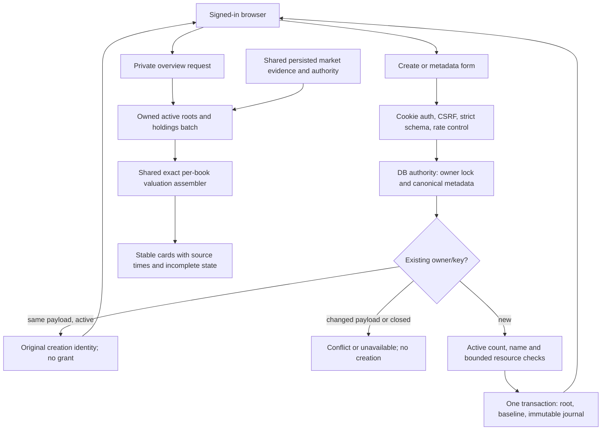

# Phase 13: Create and Compare Independent Strategies — Research

**Researched:** 2026-11-18
**Domain:** Durable PostgreSQL portfolio creation/funding; metadata; exact bounded comparison; browser target isolation
**Confidence:** HIGH for existing integration contracts; MEDIUM for new authority until real restricted-role proofs

<user_constraints>
## User Constraints (from CONTEXT.md)

The following decisions, discretion and deferred scope are copied verbatim. [VERIFIED: 13-CONTEXT.md]

## Implementation Decisions

### Portfolio creation and metadata
- D-01: Up to ten active private portfolios per user. Ten is an active count, not a lifetime limit. New identities may use slots/names freed by retained closed fixtures; public deletion UI/API stays Phase14.
- D-02: Users can set and rename names, trimmed nonblank 1–60 characters with no control characters. Active names must be unique for that owner under a documented case-insensitive normalization rule; other owners may reuse a name. Renaming never changes money/history.
- D-03: Optional plain-text descriptions can be added, viewed, edited or cleared; empty is valid. Existing/initial portfolios begin empty. Descriptions change no finances/history.
- D-04: Each genuinely new identity receives exactly $10,000 cash and its own stored starting baseline once. A brand-new user's initial portfolio remains “My portfolio” with the same single grant; existing finances/baselines are never reset or supplemented.
- D-05: Unknown-result creation retries cannot create a second strategy/repeat a grant. Retry identity/payload stays bound even after the original portfolio closes; an old key cannot recreate it. Sign-in, reads, rename, refresh or metadata edits never grant cash. An intentionally empty set remains empty until explicit creation.

### Independent investing, switching and comparison
- D-06: Multiple same-owner portfolios may own/trade the same crypto or stock with independent cash, quantities and basis; crypto/stocks share cash only within a portfolio. Preserve all Phase12 execution/retry/privacy rules.
- D-07: Active portfolio dividends/corrections derive from its own historical ownership, apply once and remain attributable. Active split effects must work correctly across independent books now; do not postpone active accounting to Phase14.
- D-08: Overview lists all active strategies in stable order, showing name, cash, exact total or known value and dollar/percentage return against each stored baseline. No pooled cross-portfolio wealth total or misleading strategy ranking.
- D-09: Overview and detail share exact valuation/time/completeness semantics. An unvalued holding makes only that strategy incomplete with unavailable overall return; other portfolios remain usable.
- D-10: Opening/switching uses explicit stable portfolio identities. Cached pages/cursors, previews, pending original attempts and late responses remain isolated. A switch cannot retarget an old order or display another book's finances. Existing unavailable-target/privacy refusal remains; public deletion journeys stay Phase14.

### Safety, bounds and delivery
- D-11: Requests/jobs remain bounded; creation reuses appropriate rate/resource controls, count cannot exceed ten under concurrency, shared price polling does not multiply, and existing stock activation/backup-capacity guards remain. Grant/event exactness and owner/active-state authorization are server enforced.
- D-12: Each supported schema/state transition must ship restricted grants/TLS, immutable financial/retry evidence, exact encrypted recovery and supported rollback or explicit refusal. Phase15 is no reason to postpone current-revision safety.
- D-13: Use the existing Birja React/Tailwind/shadcn/TanStack Query design system; retain the accepted existing financial surfaces and define new management/overview UI in a checked UI contract. New UI/native browser zoom acceptance follows actual implementation, not planning.
- D-14: Keep work local on feature/milestone-v1.2. No implementation, new packages/installations, push/merge, live provider campaign, production inspection or deployment is authorized by planning.

### Agent Discretion
- Choose concrete metadata/resource boundaries, idempotency transport and durable journal/grant contracts, consistent lock order, migration sequence and retained source fingerprints after inspecting actual Phase12 code.
- Select a documented technical normalization and plain-text description length bound consistent across API, DB, UI and retry canonicalization; preserve approved name length/empty-description outcomes. Do not treat an implementation choice as a new owner decision.
- Choose overview order, form placement, switcher presentation, retry/error/limit feedback and accessible responsive layout using existing tokens and components; define exact choices in UI-SPEC.
- Use the existing packages. Plan bounded tasks and meaningful isolated concurrency, ownership, once-only funding/event, browser, critical coverage/security/image and recovery tests.

### Deferred Ideas (OUT OF SCOPE)

## Deferred and Accepted Follow-up
- Public terminal deletion, its confirmation/freeze/stale-tab/last-portfolio journey: Phase14. Use retained closed fixtures here to prove creation-slot/name/key semantics.
- Complete create/name/description/compare/switch/delete acceptance and lifecycle recovery: Phase15; current runnable revision proofs still mandatory now.
- Phase7 STOCK-01/02/03, DATA-01, MKT-01 and SAFE-01 remain separate and unverified. November16 campaign is consumed; no repeat/provider calls or activation implied.
- Picomatch advisory remains unresolved owner-accepted risk in issue35 through2026-12-17UTC. Existing exact artifact/source/expiry policies remain; no unrelated HIGH/critical waiver, unsafe fork or unapproved package change.
- Transfers, resets, configurable deposits, cloning, historical charts, sharing/leaderboard/pooled wealth remain outside approved scope.
</user_constraints>

## Summary

Phase12 is complete, rather than a foundation to rebuild: 31 plans, seven assigned requirements and the actual complete security/recovery qualifications are recorded at source4b4320b. Current source uses schema0017, explicit v2 portfolio routes, owner/active resolvers, root-specific stock/dividend lineage, immutable retries, exact valuation and guarded browser targets. [VERIFIED: 12-VERIFICATION.md; 12-31-SUMMARY.md; backend/app/api/v2; backend/app/services/portfolios.py]

The delta is durable create/grant authority, metadata editing, one bounded comparison read, management/navigation surfaces and end-to-end evidence using genuinely newly created portfolios. Existing sibling stock split/dividend/crypto fixtures already exercise substantial independence; retain them and extend through public creation rather than copying accounting engines. New-revision authority, encrypted recovery and compatibility qualification belong here. [VERIFIED: backend/tests/test_portfolio_{crypto,splits,dividends,identity}.py; 13-CONTEXT.md]

**Primary recommendation:** Keep accounts as financial roots; add a narrow migration-owned creation authority and immutable journal, database-authoritative Unicode metadata, and a shared batched valuation assembler. This is the recommended exercise of Agent Discretion, not a new owner-locked decision. [VERIFIED: CONTEXT Agent Discretion; existing models/user.py and services/portfolio.py]

## Architectural Responsibility Map

| Capability | Primary Tier | Secondary Tier | Rationale / evidence |
|---|---|---|---|
| Count/name races, fixed once-only grant, creation replay | Database / Storage | API / Backend | Atomic root+journal, owner serialization and constraints; authenticated ID from server [VERIFIED: accounts.py; portfolio_bootstrap.py] |
| Metadata input and HTTP privacy | API / Backend | Database / Storage | Strict schemas; authoritative canonicalization/ownership recheck in DB [VERIFIED: core/deps.py; api/v2/portfolios.py] |
| Exact comparison and completeness | API / Backend | Database / Storage | Reuse Decimal valuation and shared market evidence [VERIFIED: portfolio.py; portfolio_math.py; stock_valuation.py] |
| Active splits/dividend corrections | Database / Storage | Existing backend scheduler | Existing instrument gate → ordered roots → holdings; no new per-portfolio polling [VERIFIED: corporate_actions.py; stock_ownership.py; tasks/dividends.py] |
| Switch/late-response/unknown-create UX | Browser / Client | API / Backend | Explicit IDs, owner/session epoch, original immutable attempts [VERIFIED: usePortfolioTarget.ts; useTrade.ts; useStockTrade.ts] |
| Encrypted restore/rollback admission | Existing deploy tooling | Database / Storage | Source-pinned versioned authority/manifests [VERIFIED: backup-snapshot.py; verify-restore.py] |

## Project Constraints (from AGENTS.md)

- Read CLAUDE.md in full and the current PROJECT/REQUIREMENTS/ROADMAP/STATE plus relevant phase artifacts; continue shared .planning history. These inputs were read; stale historical milestone research is not current source evidence. [VERIFIED: AGENTS.md]
- Use relevant GSD workflow, adapter and required research/check/verification stages; preserve checkpoints and dependency ordering. Follow session delegation authority; do not infer deployment/push/merge authority from yolo or commit_docs. [VERIFIED: AGENTS.md; .codex/GSD-ADAPTER.md]
- UI work uses .agents/skills/ui-ux-pro-max/SKILL.md, its local searches and design-system/birja/MASTER.md; retain existing design language. The UI researcher owns the detailed contract; this research does not replace it. [VERIFIED: AGENTS.md; read skill]
- CLAUDE.md requires router → service → model separation, Decimal/NUMERIC and string JSON, explicit rounding and UTC, schema constraints, atomic locked transactions, immutable prior migrations, reviewed new Alembic revisions, async I/O, bounded lists/Redis TTLs, cookie authentication/CSRF and private server authorization. [VERIFIED: CLAUDE.md]
- Every new endpoint needs API tests; meaningful real isolated PostgreSQL tests, provider HTTP mocks, frontend units/browser flows; overall coverage80% and critical money/auth/authorization100%; full CI security/image gates. Never run tests against dev state. Even nominal pure backend pytest loads guarded autouse migration fixtures. [VERIFIED: CLAUDE.md; backend/tests/conftest.py]
- Keep branch local feature/milestone-v1.2. This assignment owns only this research file; no installs, source edits, test/runtime/DB operations or commits were performed. [VERIFIED: task authorization; 13-CONTEXT D-14]

<phase_requirements>
## Phase Requirements

Descriptions copied from REQUIREMENTS.md; support refers to the concrete contracts below. [VERIFIED: .planning/REQUIREMENTS.md]

| ID | Description | Research Support |
|---|---|---|
| PMGT-01 | User can create a named private portfolio while fewer than ten owned portfolios are active; deleted portfolios free a slot, and a replacement has a new permanent identity. | Owner-row serialization, active partial uniqueness, new IDs, closed fixtures |
| PMGT-02 | User can name and rename an active portfolio using a trimmed nonblank name of 1–60 characters without control characters; active names are unique for that owner under a documented case-insensitive normalization rule, and renaming changes no money or history. | One SQL normalizer, partial unique key and narrow metadata authority |
| PMGT-06 | User can add, view, edit and clear an optional plain-text description for an active owned portfolio; an empty description is valid, existing/initial portfolios start with an empty description, and description changes do not change finances or History. | Empty default, strict PATCH and1000-codepoint bound |
| PFUND-01 | Each genuinely new portfolio receives exactly $10,000 virtual cash and its own stored starting-cash baseline once; a brand-new user's initial portfolio is named “My portfolio” and receives that same single grant. | Atomic grant journal plus explicit onboarding latch |
| PFUND-02 | Retrying an uncertain creation cannot create another portfolio or repeat its starting grant, including after the originally created portfolio has been deleted; opening, renaming, refreshing or signing in grants no additional funds. | Permanent owner/key/payload binding, replay before cap/name checks |
| PFIN-01 | User has independent cash, holdings, quantities and cost basis in each portfolio, including when several portfolios own the same asset; crypto and stocks share cash only within their portfolio. | Existing scoped writers, new creation-to-invest lifecycle tests |
| PFIN-04 | Each active portfolio's dividend eligibility, credits and corrections use its own historical ownership and cash, apply once, and remain attributable to that portfolio when the same user holds the stock in other portfolios. | Existing authority and worker tests plus newly funded sibling flows |
| PCTX-02 | Switching portfolios or deleting one invalidates its actionable previews and isolates cached pages, cursors, late responses and pending attempts; an old tab or unresolved request never becomes an order or financial display for the newly selected portfolio. | Existing captured-target hooks plus creator/rename/cross-tab coherence |
| PVIEW-01 | User sees every active portfolio's name, cash, total or known value, and dollar/percentage return against its own stored starting cash in a stable overview order; deleted portfolios are excluded and no pooled cross-portfolio wealth total is introduced. | Stable ID order, bounded batch response |
| PVIEW-02 | Portfolio detail and overview use the same exact valuation rules, source times and completeness semantics; missing or uncertain prices produce explicit incomplete values and unavailable overall returns for that portfolio without making other portfolios unavailable. | Shared assembler/marks/time, per-book completeness |
| PSAFE-07 | Portfolio requests and financial jobs remain bounded, portfolio creation reuses appropriate rate/resource controls, and portfolio count does not multiply shared market-data polling or bypass existing backup-capacity and stock-activation safeguards. | Request quotas, no failed-key journal growth, constant-query overview, existing schedulers/backup guards |
</phase_requirements>

## Standard Stack

Use installed/locked project dependencies; no installation is needed. These versions are repository facts, not claims about the newest registry release; publish dates were not fetched because upgrades/new packages are outside authorization. [VERIFIED: backend/pyproject.toml; backend/uv.lock; frontend/package.json; frontend/package-lock.json]

| Existing component | Version | Use |
|---|---|---|
| SQLAlchemy / asyncpg | 2.0.55 locked /0.32.0 | Async queries, bound function calls and transactions |
| FastAPI / Pydantic | 0.162.0 /2.14.1 | Strict create/patch/overview schemas |
| Alembic | 1.20.1 | New immutable0018+ revisions |
| PostgreSQL | Pinned18.7 image | Unicode casefold, partial indexes, serialization |
| React / TanStack Query | 19.3.1 /5.105.0 | Existing target/mutation/query architecture |
| Vitest / Playwright / pytest | 5.0.5 /1.64.1 /9.1.1 | Existing verification stack |

Version evidence: manifests/lock above; PostgreSQL18.7 asserted in deploy/tests/ops-fixtures.py and selected-cutover.py against the pinned digest in Compose. Python runtime remains approved Docker3.14.10_git20261111-r0; host python3 is3.12.3, so do not use it to run backend app tests. [VERIFIED: named files; read-only CLI version probes]

## Package Legitimacy Audit

Not applicable: no external package install or dependency change is recommended. Do not install slopcheck/ctx7 or refresh lockfiles. Context7 tools and ctx7 CLI were unavailable; official documentation was read via browser fallback. Preserve the exact accepted picomatch issue35 scope, current hashes and2026-12-17 expiry; a manifest change is not covered automatically. [VERIFIED: task authorization; tool discovery; command -v ctx7; 12-ACCEPTED-RISK.md; 12-VERIFICATION.md]

## Architecture Patterns

### System Architecture Diagram



This describes the proposed integration, derived from existing account/valuation/route responsibilities. [VERIFIED: services/accounts.py; services/portfolio.py; api/v2/portfolios.py]

### Component Responsibilities and locked integration contracts

| Existing file/call chain | Required delta / preserved contract |
|---|---|
| models/user.py: Account; services/accounts.py:get_or_create_user → services/auth.py:verify_code | Keep unique-email winner transaction; replace direct Account insertion with a narrowly authorized initial-create operation. Returning login never invokes grant logic. |
| services/portfolios.py; schemas/portfolios.py; api/v2/portfolios.py | Add strict create/patch services and metadata schemas; resolver remains explicit owner+active404. |
| new migration0018+ and new SQL assets | Add metadata/normalization, creation journal, onboarding provenance/latch and immutable authority. Do not rewrite0015–0017 Python/SQL. |
| db/{schema_contract,portfolio_migrate,portfolio_bootstrap,dev_bootstrap}.py; deploy/db/bootstrap-roles.sql | Separate old/new revision profiles, finite source hashes, exact table/function/column grants and genuine migrator identity. |
| services/portfolio.py:get_portfolio → portfolio_math.calculate_portfolio + stock_valuation.value_stock | Extract a common batch loader/assembler used by detail and overview; retain stock generation proof and current-authority safety. |
| api/portfolios.ts; hooks/usePortfolioTarget.ts; PortfolioTargetBoundary.tsx; App.tsx | Preserve string bigint IDs, owner/session guard and verified target before mounting financial pages; add management/overview navigation. |
| useTrade/useStockTrade/useQuote/usePortfolio/useEventHistory/useHistory | Preserve original attempt target and payload, scoped keys/cursors, abort/epoch checks; invalidate overview after completed financial changes. |
| deploy/{backup-snapshot.py,verify-restore.py,recovery-bundle.sh}; tests/portfolio-sources.py; run-portfolio-validation.py; CI | New explicit revision/payload/manifest profile and same-source security/recovery graph, retaining0017 and earlier profiles. |

All current-file observations in this table were inspected in this session; new-file actions are recommendations under Agent Discretion. [VERIFIED: named source files; CONTEXT]

### Concrete metadata rule

Use PostgreSQL18 UTF8 as the normalization authority, with a source-owned immutable helper shared by create, rename and retry canonicalization. Display name = NFC after stripping only the explicit Unicode White_Space set at both ends: U+0009–000D,0020,0085,00A0,1680,2000–200A,2028,2029,202F,205F,3000. Reject C0/C1 controls anywhere in the raw name before trimming, thus tab/newline cannot be hidden at edges; then require1–60 Unicode scalar characters. Surrogates/NUL reject at API boundary. Key = NFC(casefold(display_name COLLATE pg_catalog."PG_UNICODE_FAST")); use byte/deterministic C collation on stored key uniqueness. This includes ß/ss and sigma folding while retaining accent distinctions; do not equate casefold to lower(). [CITED: https://www.postgresql.org/docs/18/functions-string.html; https://www.postgresql.org/docs/18/collation.html] The exact trim set and length validation policy are recommended discretion, not additional locked product requirements. [VERIFIED: CONTEXT Agent Discretion]

Store description TEXT NOT NULL DEFAULT ''; allow0–1000 Unicode scalar characters, preserve whitespace, normalize CRLF/CR to LF, allow TAB/LF, reject other C0/C1/NUL/surrogates. No Markdown/HTML interpretation, links or sanitization package. UI counters use [...value].length rather than UTF16 .length; API and SQL enforce the same normalized scalar count. API null is invalid; omitted create description becomes ''; PATCH absent means unchanged and '' clears. Reject unknown fields and empty PATCH. These are recommended bounded implementation choices. [VERIFIED: CONTEXT Agent Discretion; existing api/portfolios.ts scalar counting]

Avoid a Python-versus-PostgreSQL Unicode-version disagreement: Python may validate gross shape/size, but persisted display/key and immutable retry canonical payload come from the same SQL helper, not independently implemented Python casefold. Browser sends raw validated strings; authoritative API results supply normalized values. Test the documented Unicode corpus across API/DB/browser. [CITED: PostgreSQL18 string/collation docs above; VERIFIED: frontend/src/api/portfolios.ts]

Add a partial unique index (user_id,name_key) WHERE closed_at IS NULL, with checks that display/key/description match the source-owned normalization and lengths. Preflight existing0017 metadata and refuse inconsistent/duplicate active names without silently renaming. Existing initial names/descriptions are preserved/defaulted; no financial update is permitted. Separate expansion/backfill/final enforcement revisions if needed, with no runtime admission of an intermediate unsafe state. [VERIFIED: existing model Account; immutable-migration rules in CLAUDE.md; CONTEXT D-02/D-03/D-12]

### Durable creation and initial funding

Recommended journal portfolio_creations: bigint identity, user_id, permanent creation_key, canonical payload/version, portfolio_id, origin(initial/explicit), amount NUMERIC(20,8) fixed10000, created_at UTC; unique(user_id,creation_key), unique(portfolio_id), composite owner FK. Do not store an ephemeral Redis-only retry key, expire a successful key or cascade-delete retained bindings. Keep financial amount/baseline immutable. Legacy provenance is represented explicitly without fabricating a new10000 grant. [VERIFIED: CONTEXT D-04/D-05; existing accounts.py and models/user.py]

A narrow SECURITY DEFINER entry point owned by birja_migrator locks the authenticated user's users row, canonicalizes payload, checks the permanent owner/key journal BEFORE current name/cap/quota tests, and either replays original identity, refuses conflicting payload, or refuses a closed target. Only a genuinely new key then checks active count<10, partial-name uniqueness and quotas; inserts account with cash=starting_cash=10000 and journal atomically. Same-key concurrent calls serialize; different keys competing for slot10 cannot both win. Successful retry after rename compares original canonical creation payload, not current account metadata; response can expose current active metadata plus original creation ID, without inventing original financial state. Preserve original result binding after closure and after name reuse. [VERIFIED: CONTEXT D-01/D-04/D-05; CITED: https://www.postgresql.org/docs/18/explicit-locking.html]

Initial onboarding needs its own durable once-only latch: add a per-user initialization/provenance record backfilled for EVERY existing user, including zero-active/zero-account fixtures, without funding. Only the new-user unique-email INSERT winner calls initial authority in the same transaction; authority requires absent latch, creates "My portfolio"/empty description/fixed grant and marks it once. Existing users' latch prevents regrant even after closure or an empty set. Explicit creation never repairs missing initial accounts. Unique marker plus root/journal commit rolls back with signup failure. Do not merely expose an initial=true switch on public create. [VERIFIED: services/accounts.py; tests/test_portfolio_identity.py; CONTEXT D-04/D-05]

Revoke ordinary accounts INSERT once both initial and explicit paths use authority; do not solve this with broad accounts UPDATE or users UPDATE grants. Existing users SELECT/INSERT cannot independently perform SELECT FOR UPDATE safely; the definer locks without broadening ordinary role rights. Leave ordinary cash/holding execution grants intact. Metadata authority locks owner then target and updates name/key/description only after owner/active validation; baseline, closure, identity and grant evidence remain inaccessible. Account INSERT/metadata constraints and journal append-only enforcement must resist direct restricted-role SQL. Definers must not trust caller-set GUCs, SET ROLE, request-supplied owners or arbitrary SQL. [VERIFIED: portfolio_bootstrap.GRANTS_SQL; 0017 root guard; CITED: https://www.postgresql.org/docs/18/sql-createfunction.html]

No stock gate is needed for creation/rename. Never acquire owner lock after holding account locks; management order is user → target, financial order remains instrument gate → ordered account roots → holdings. New management routines must not acquire an instrument gate while holding user/account locks. Use existing local lock timeout discipline and redact SQL internals on lock/error paths. [VERIFIED: stock_ownership.acquire_stock_gate; corporate_actions.apply_due_actions; 0017 lock_stock_portfolio_roots]

### API, transport and errors

Recommended additive v2 contract: keep GET /api/v2/portfolios identity metadata shape unchanged (its browser parser rejects anything except exactly id/name); add GET /api/v2/portfolios/overview BEFORE dynamic /{portfolio_id}; POST /api/v2/portfolios with name/description and required canonical lowercase UUIDv4 Idempotency-Key; PATCH /api/v2/portfolios/{portfolio_id} for name/description. Return metadata through explicit schemas with string bigint IDs; attach description to new management/detail responses intentionally and update strict parsers in the same task if changed. No generic lifecycle/delete endpoint. [VERIFIED: api/v2/portfolios.py; api/portfolios.ts; CONTEXT D-14]

Use CurrentUserDep, CsrfDep and private no-store/Vary on all success/error responses. Current PrivateRoute catches unknown errors with an order-specific message; introduce a management-specific private route wrapper/message rather than calling creation an order or claiming a failed response means no creation. Reject unsupported content/type/shape; no floats or client cash/baseline/owner fields. Recommend201 first success,200 active replay,409 name_taken/portfolio_limit/creation_key_conflict,404 portfolio_unavailable for closed/foreign targets,422 invalid input and429 Retry-After quota refusal. Unknown post-commit response remains unresolved and retried with the ORIGINAL key and canonical payload. These transport choices are Agent Discretion. [VERIFIED: api/v1/stock_trades.PrivateRoute; core/deps.py; existing ratelimit.py; CONTEXT]

### Bounded exact overview

Use stable accounts.id ascending (same order as metadata), at most10 roots; enforce over-cap corrupted data refusal, never silently hide an11th root. Batch owned active roots+holdings+shared price/quote evidence and stock authority once per request, then group by portfolio ID. Reuse common position/mark construction and calculate_portfolio; keep original stock fill-generation proof portfolio scoped. Current get_portfolio issues a second execution_snapshot_query for stocks; looping it is N+1 and gives books different evidence/time. Refactor both detail/overview through a common batch service, with one shared original snapshot and one bounded shared current-authority recheck where safety requires it. Do not use the same AsyncSession concurrently. [VERIFIED: services/portfolio.py; portfolio_math.py; CITED: https://docs.sqlalchemy.org/en/20/orm/extensions/asyncio.html]

Financial holdings/cash must be read in one consistent statement/snapshot; metadata and overview cannot stitch cash from one moment to holdings from another. Capture one valued_at after the awaited batch and apply the existing authority freshness recheck to all books; preserve conservative hold on authority transition. For identical fixture state/time, overview and detail must have exactly equal fields. Expose cash, starting_cash, total_value/null, known_value, total_pl/null, total_pl_percent/null, valuation_complete, unvalued_holding_count, valued_at, prices_as_of and applicable freshness/mark reasons. Never sum rounded holding values or calculate returns in JS. Do not fabricate a zero percentage for a zero baseline; preserve existing undefined-return semantics. [VERIFIED: portfolio.py; portfolio_math.calculate_portfolio; schemas/portfolio.py]

Reuse existing Redis rate primitives and settings pattern: recommend create attempts20/60s per user and60/60s per normalized IP, plus100 genuinely successful new explicit identities per user per UTC day under the serialized DB authority. Replays do not consume a new-identity quota. These are renewable resource bounds, not a lifetime portfolio limit. Reject malformed/failed keys without permanent journal rows; retain successful identities forever for replay safety, indexed by owner/key and owner/created_at. Rate-limit storage has TTL and bounded non-key-derived buckets. Keep the existing backup-capacity guard authoritative as retained evidence grows; no new cleanup/compaction/job or provider polling per book. Values are recommended configurable discretion and must be tested at boundaries. [VERIFIED: ratelimit.py; CONTEXT D-01/D-11; backup-snapshot.py capacity checks]

### Browser state and cross-tab metadata

Keep stable explicit routes and existing target boundary. Create mutation owns an immutable owner/session/key/payload attempt until definitive result; preserve it on transport/500/unknown response and across navigation/reload using bounded owner-scoped sessionStorage containing only non-secret creation attempt metadata. No tokens or financial balances in storage. Clear on definitive completion/logout/owner change, not just route switch; do not create a new key on Retry. Parse stored data strictly and allow only a bounded outstanding attempt. [VERIFIED: existing auth security rules and original-attempt hook patterns; CONTEXT D-05/D-10; recommended Agent Discretion]

Existing usePortfolioTarget.isCurrent also compares selected.name. Renaming can invalidate captured previews; refresh metadata and revoke actionability safely, but keep unresolved original trade attempts under their original ID/payload and original captured label. Never mutate an old attempt into the replacement target. After create/rename/description success invalidate owner metadata+overview and relevant detail keys; use owner/session guards before applying late mutation results. Cross-tabs use a same-origin BroadcastChannel carrying only metadata-change invalidation signals (no financial payload/credentials), with focus refetch fallback and cleanup on logout. Existing metadata staleTime10s/focus refetch is not immediate cross-tab rename coherence. [VERIFIED: usePortfolioTarget.ts; useTrade.ts; useStockTrade.ts; recommended Agent Discretion]

## Don't Hand-Roll

| Problem | Use instead | Why / source |
|---|---|---|
| Money/return math | Existing calculate_portfolio and stock marks | Preserves exact/incomplete semantics [VERIFIED: portfolio_math.py; stock_valuation.py] |
| Client fetching/cancellation | Existing TanStack Query hooks and consumed AbortSignal | Cancellation alone does not prove original financial mutation was canceled [CITED: https://tanstack.com/query/v5/docs/framework/react/guides/query-cancellation] |
| Unicode caseless key | PostgreSQL18 normalization/casefold helper | Avoid mismatched browser/Python lower rules [CITED: PostgreSQL18 string docs] |
| New jobs/cache wallet | Existing scheduler and PostgreSQL account | No per-portfolio provider loops or second financial store [VERIFIED: tasks/scheduler.py; CLAUDE.md] |
| Grant recovery packaging | Existing versioned encrypted manifest machinery | Exact source/ACL/sequence proof already exists [VERIFIED: backup-snapshot.py; verify-restore.py] |

## Runtime State Inventory

This is an additive schema/authority refactor, not a production runtime inspection. All categories are answered; uninspected external state is not claimed absent. [VERIFIED: task authorization]

| Category | Items found | Required action |
|---|---|---|
| Stored data | Existing accounts, cash/baselines, holdings/history and closed fixtures; no creation journal/description in0017 source | New migration defaults/provenance/backfill; never regrant/recalculate legacy money; exact restore includes new rows and sequences |
| Live service config | Source-owned grants, revision admission, backup manifests, capacity/stock admission policies; deployed private configuration not inspected | Update supported source profiles and qualify disposable fresh/upgraded TLS; no live config operation |
| OS-registered state | Retained recovery CORE/unit inventories in verify-restore.py; no new scheduled job needed | Preserve units and parity; do not rename/re-register runtime tasks |
| Secrets/env vars | Existing settings/role/TLS plumbing; private env/secrets not read | No secret/key rename; new quota settings follow existing non-secret config conventions |
| Build artifacts | Existing source-bound images, recovery archives and PORTFOLIO_PAYLOAD_V1 | New rebuilt-source evidence and explicitly versioned successor payload; preserve prior archive/profile/fingerprints |

[VERIFIED: models/user.py; schema_contract.py; portfolio_migrate.py; deploy/verify-restore.py; backup-snapshot.py; CONTEXT]

### Exact current and retained authority inventory

The checked-in0017 recovery fixture has10 public routine signatures; five have no non-owner EXECUTE ACL: check_portfolio_financial_write(), check_stock_fill_integrity(), check_stock_split_digest_version(), reject_stock_dividend_mutation(), stock_dividend_authority(bigint,bigint,text,text,boolean,jsonb). Other executors are app-only assert_stock_execution_current(bigint,bigint,jsonb); scheduler-only apply_stock_dividend(bigint,bigint,text,text), record_stock_dividend_hold(bigint,text), lock_stock_portfolio_roots(bigint); operator-only apply_stock_action_resolution(bigint,bigint,bigint,bigint,bigint,text,text,text,jsonb,text). Do not replace this named inventory with an approximate helper count or expose private validators. [VERIFIED: deploy/tests/fixtures/portfolio-recovery-0017.json parsed this session; portfolio_bootstrap.py]

Existing final preflight pins body hashes, owners, ACLs, search_path, args/results, trigger coverage, schema CREATE denials and exact0017 revision; backup-snapshot.py independently pins schema/authority/quarantine/no-ACL hashes. New metadata/journal/functions necessarily change these inventories. Add an explicit new profile, retain0017 constants/fixture unchanged, and regenerate independently reviewed new expected fingerprints from approved source and actual restricted-role proof, not by accepting database-produced self-description. [VERIFIED: portfolio_bootstrap.py; backup-snapshot.py lines705–850]

Add a successor recovery payload version for new migrations/SQL/bootstrap/fixtures/runner bytes; do not redefine PORTFOLIO_PAYLOAD_V1 or reinterpret old absence semantics. Extend producer, consumer, restore quarantine/regrant, sequences, exact canonical metadata/journal/provenance hashes and mutation negatives together. Retained0017 source must remain authenticated through portfolio-retained-sources.json/portfolio-sources.py. Current app should admit only its complete new schema; old source0017 must refuse a new schema before writes. Downgrade must explicitly refuse populated new creation evidence unless a separately proved lossless path exists; no dropping successful keys/grants/description to force compatibility. Qualify0017→new and earlier supported retained→0017→new, fresh new, cold encrypted new restore, retained0017 replay and safe older-app refusal. [VERIFIED: schema_contract.py; portfolio_migrate.SOURCE; verify-restore.PORTFOLIO_PAYLOAD_V1; portfolio-sources.py; CONTEXT D-12]

## Common Pitfalls

| Failure | Avoidance / early evidence |
|---|---|
| Ordinary app owner-row lock fails under restricted role | Definer owner serialization; test actual TLS app, not only test admin [VERIFIED: current users SELECT/INSERT grants] |
| Rename/closure makes retry appear new | Journal lookup before mutable name/count/quota, retained FK/key, compare original canonical payload [VERIFIED: D-05] |
| Initial helper funds an intentionally empty existing user | Backfill initialization latch for all users; full returning OTP/refresh/read tests [VERIFIED: accounts.py; identity tests] |
| Successful name validation races | Partial unique DB key plus owner serialization, catch named constraint failure [VERIFIED: CLAUDE.md] |
| Request fail persists unbounded keys | Only successful durable journal entries; bounded key format and rate buckets [VERIFIED: D-11; ratelimit.py] |
| Rename erases unknown old trade / late response paints sibling | Preserve original attempt identity; session/epoch checks and scoped invalidation [VERIFIED: target/trade hooks] |
| Overview reads every book separately / totals look complete | Batch loader/shared evidence and existing incomplete math; assert query bound [VERIFIED: portfolio.py; portfolio_math.py] |
| Tests repeat old sibling fixtures but bypass public grant path | Add actual API-create → same-symbol buys/sells → splits/dividends/correction → overview/history → retry flows [VERIFIED: existing fixture-driven tests; D-04/D-06/D-07] |
| New manifest passes but old archive no longer works | Version profiles/payload; exact old0017 fixture/hash assertions and retained-source lanes [VERIFIED: current recovery implementation] |

## Code Examples

Existing patterns and planned adaptations; illustrative snippets do not replace tested SQL authority. [VERIFIED: named sources]

```python
# Existing get_or_create_user pattern: unique email chooses the sole new-user path.
# Source: backend/app/services/accounts.py
stmt = pg_insert(User).values(email=email).on_conflict_do_nothing(
    index_elements=["email"]
).returning(User.id)
new_id = (await db.execute(stmt)).scalar_one_or_none()
# New implementation calls narrow initial authority only on the insert winner.
```

```sql
-- Proposed key expression; official PostgreSQL18 Unicode APIs:
-- https://www.postgresql.org/docs/18/functions-string.html
normalize(casefold(canonical_name COLLATE pg_catalog."PG_UNICODE_FAST"), NFC)
-- Persist source-owned canonical display/key and index (user_id,name_key)
-- only WHERE closed_at IS NULL. Never trust client-supplied name_key.
```

```typescript
// Existing cancellation pattern; preserve owner/session guards as well.
// Source: frontend/src/hooks/usePortfolioTarget.ts
queryFn: async ({ signal }) => {
  const body = await fetchPortfolios(signal);
  signal.throwIfAborted();
  // Existing hook additionally checks owner, session, serial and query identity.
  return body;
}
```

## State of the Art

| Relevant shift | Planning impact |
|---|---|
| PostgreSQL18 has casefold with documented collation behavior; pinned project18.7 | Use explicit PG_UNICODE_FAST instead of treating lower() as Unicode caseless matching [CITED: PostgreSQL18 string docs; VERIFIED: selected-cutover/ops fixtures] |
| Project already uses SQLAlchemy2.0 async and TanStack Query5 | Keep locked versions; no upgrade is needed for this phase [VERIFIED: lockfiles] |
| ASVS5.0.0 is published30May2025 | Use current category names rather than silently labeling ASVS4 categories as current [CITED: https://asvs.owasp.org/] |

## Environment Availability

| Dependency | Available | Version/evidence | Fallback |
|---|---|---|---|
| gsd-sdk | Yes | Installed command; init.phase-op13 succeeded | — |
| Node | Yes | v24.22.1 read-only probe | — |
| Host Python | Yes | 3.12.3 | Docker/locked uv Python3.14 for backend |
| Docker CLI | Yes |29.2.1; daemon/test stacks not probed | Execution owner provisions isolated stack |
| PostgreSQL/Redis isolated services | Not exercised | Pinned Compose definitions; PG18.7 source assertions | Explicit test-stack start at execution time |
| Context7 MCP/ctx7 | Unavailable | No matching tool/CLI | Official primary docs browsed |
| New packages/providers | Not needed | Existing lockfiles and fake-price fixtures | No install/provider activation |

Availability is read-only tooling/source evidence, not proof that tests or services ran. No environment modification occurred. [VERIFIED: tool probes and scope]

## Validation Architecture

### Test Framework

| Property | Value |
|---|---|
| Framework | pytest9.1.1 + pytest-asyncio1.4.1, Vitest5.0.5, Playwright1.64.1 [VERIFIED: pyproject/package.json] |
| Config | backend/pyproject.toml; frontend/vite.config.ts; frontend/playwright.config.ts [VERIFIED: repository files] |
| Quick command | cd backend && uv run pytest tests/test_portfolio_identity.py -x; run only with owned isolated test stack |
| Full command | Existing CLAUDE.md backend coverage/critical100, frontend coverage, full browser and serial ops qualification |
| DB rule | Serial backend/DB-bearing ops suites; conftest autouse provision_test_migration_owner runs even nominally pure pytest [VERIFIED: conftest.py] |

Proposed new filenames below are Wave0 work, not existing tests or past passes. Individual DB integration groups may exceed30seconds: split by meaningful -k/test node after timing; never claim a whole money/concurrency suite is sub30seconds without measurement. [VERIFIED: existing qualification durations; recommended validation discipline]

### Phase Requirements → Test Map

| Req | Existing evidence/test | New tests to add | Execution command |
|---|---|---|---|
| PMGT-01 | test_portfolio_identity.py; test_portfolio_authority.py | test_portfolio_creation.py: concurrent slot9/10/11, owner separation, closed slot/name reuse | cd backend && uv run pytest tests/test_portfolio_creation.py -x |
| PMGT-02 | frontend/api/portfolios.test.ts parser; ownership authority tests | test_portfolio_metadata.py: Unicode corpus, trimmed bounds, concurrent rename/create, no finance change | cd backend && uv run pytest tests/test_portfolio_metadata.py -x |
| PMGT-06 | No description lifecycle yet | same metadata tests plus clear/empty/omitted/null/control/length and browser edit | same command; cd frontend && npm run test -- src/hooks/usePortfolioManagement.test.tsx |
| PFUND-01 | test_portfolio_identity.py actual OTP/unique-email/rollback | test_portfolio_funding.py: new initial and explicit fixed grant+journal, legacy/zero latch no grant, failure rollback | cd backend && uv run pytest tests/test_portfolio_funding.py tests/test_portfolio_identity.py -x |
| PFUND-02 | Trade retry/identity tests | test_portfolio_creation.py: lost response, same-key race, rename/cap/closed replay, canonical conflict, new key after closure | creation command above |
| PFIN-01 | test_portfolio_crypto.py; test_portfolio_stock_trading.py | test_portfolio_strategy_lifecycle.py: API-created same-asset books, independent buy/sell/basis, cross-asset cash race | cd backend && uv run pytest tests/test_portfolio_strategy_lifecycle.py -x |
| PFIN-04 | test_portfolio_dividends.py; test_portfolio_entitlements.py; test_portfolio_splits.py | lifecycle tests through created books, genuine scheduler duplicate/dividend correction/active split, immutable originals | lifecycle command plus existing dividend/split files serially |
| PCTX-02 | portfolioCrypto/Stock/History/Valuation.test.tsx; usePortfolioTarget.test.tsx | management hooks and portfolio-strategies.spec.ts: switch pending preview/unknown/create, late results, logout/login, cross-tab rename | cd frontend && npm run test -- src/hooks/usePortfolioManagement.test.tsx src/hooks/usePortfolioTarget.test.tsx |
| PVIEW-01 | test_portfolio_valuation.py; test_portfolio_snapshot.py | test_portfolio_overview.py:0/1/10, stable order, custom baseline, no pooled sum, owner/closed | cd backend && uv run pytest tests/test_portfolio_overview.py -x |
| PVIEW-02 | test_portfolio_math.py; stock valuation tests | same overview file: exact same-input detail parity, mixed units/authority, missing one book only, shared time and query count | overview command above |
| PSAFE-07 | test_portfolio_splits.py actual scheduler; deploy capacity/activation tests | creation quota/key/body bounds and overview constant query tests; no multiplied polling; backup capacity regression | creation/overview groups plus existing isolated deploy contracts |

Existing test behaviors named here were read from source, not rerun. Preserve Phase12 proof counts as historical evidence only. [VERIFIED: named test files]

### Wave0 and required gate additions

- Create meaningful creation/metadata/funding/overview/lifecycle test files and strict frontend parser/hook/browser tests alongside each feature; avoid parallel owners editing shared fixture infrastructure without dependency ordering. [VERIFIED: CLAUDE.md; proposed test map]
- Add fresh/upgraded real restricted-role SQL negative tests: forged baseline/amount, direct accounts INSERT, metadata/closed/baseline edits, journal update/delete, private function execute, role/schema/object drift and replay from retained profiles. [VERIFIED: current authority contract; D-12]
- Extend recovery fixture generator/producers/consumer/profile commands, grants roundtrip and same-archive source graph BEFORE final proof; retain prior0017 fixture untouched. [VERIFIED: current deploy recovery files]
- Critical coverage100 must explicitly include new grant/normalization/creation/metadata authorization/overview shared calculation modules and endpoints, not just the existing hard-coded60 modules; keep overall80. [VERIFIED: CLAUDE.md; 12-31-SUMMARY]
- Final execution needs actual complete shared all-security command with raw audits and all five image scans, then a fresh complete seven-stage same-archive recovery graph at one frozen source, serial isolated DB operations and cleanup. Update graph edges/current stage names deliberately; don't reuse old run receipts as current evidence. [VERIFIED: run-portfolio-validation.py; CI; 12-31-SUMMARY]
- New UI requires actual implemented browser journey and owner UI/native200% acceptance per checked UI-SPEC; existing Phase12 acceptance remains evidence only for unchanged surfaces. Full public delete/lifecycle acceptance stays Phase14/15. [VERIFIED: CONTEXT; CLAUDE.md]

**Sampling:** per task use its smallest meaningful isolated backend/frontend group; per wave run affected integration plus migration/grant/profile checks; phase gate requires full source-bound security/recovery and owner checks. Research performed no tests or runtime operations. [VERIFIED: task scope; recommended plan sequencing]

## Security Domain

Security enforcement is enabled by default (not false in config). Current ASVS5 categories relevant here are V1 Encoding/Sanitization, V2 Validation/Business Logic, V3 Web Frontend, V4 API/Web Service, V6 Authentication, V7 Session Management, V8 Authorization, V11 Cryptography, V12 Secure Communication and V14 Data Protection. Do not reuse old ASVS4 V2/V3/V4 category labels as current numbering. [VERIFIED: .planning/config.json; CITED: https://asvs.owasp.org/; https://github.com/OWASP/ASVS/tree/v5.0.0/5.0/en]

| Area | Standard control / threat |
|---|---|
| V2/V4 input and business logic | Strict field/key/body bounds, database canonicalization, count/name uniqueness, quotas and exact once-only grant; mitigates tampering/resource exhaustion |
| V6/V7 authentication/session | Existing OTP/cookie JWT/refresh behavior, CSRF on POST/PATCH and valid zero-root identity; no new login mechanism |
| V8 authorization | Owner from CurrentUser, explicit active root and source-owned restricted SQL entrypoints; mitigates spoofing/elevation/IDOR |
| V1/V3 display | React escaped plain text, no HTML/Markdown rendering; no stored financial state or session tokens in JS storage |
| V11/V12/V14 recovery/transport/privacy | Existing encrypted bundles, verified datastore TLS, no-store on errors and successes, redacted diagnostics and private exact manifests |
| Repudiation/economic tampering | Retained immutable creation payload/grant identity, baseline, original fill/event provenance and closed-key refusal |

Applicability derives from the inspected browser/API/database/recovery surfaces; it is not a claim of formal ASVS certification. [VERIFIED: named source contracts above]

## Assumptions Log

No training-only factual or package claims are used. Proposed normalization,1000-character description, UUIDv4 key transport, rate/quota values, storage/cross-tab strategy and new table/profile names are explicit recommendations within recorded Agent Discretion; they are not falsely attributed owner decisions. Their correctness remains subject to planned real DB/browser/recovery proofs. [VERIFIED: CONTEXT Agent Discretion; this research scope]

## Open Questions

1. **Execution-time proof of new DB function/profile exactness.** Source confirms the existing boundary, but the new routine bodies, generated fingerprints and actual role denials do not exist yet. Plan precise implementation and fresh/upgraded TLS tests; no human product decision is required. [VERIFIED: current0017 source; task planning-only scope]
2. **Timing/query budgets.** Enforce constant bounded overview queries, ten-book max and quota boundaries in tests; measure individual selectors before promising sub30second runtime. Existing complete security/recovery runs took1479.850s/2694.692s, so plan honest final timeout/resource ownership. [VERIFIED: 12-31-SUMMARY]
3. **Initial provenance backfill.** Existing schema has no durable creation journal/initial latch; add legacy provenance for every existing identity without inventing a historical grant or selecting a replacement account. Fixtures must include zero books and custom baselines. [VERIFIED: Account/User models; accounts.py; D-04/D-05]

## Sources

### Primary — HIGH confidence
- Current repository files explicitly named per section; 12-VERIFICATION.md and12-31-SUMMARY.md — actual completed foundation and qualified limitations.
- https://www.postgresql.org/docs/18/functions-string.html — normalize/casefold/length and UTF8 behavior.
- https://www.postgresql.org/docs/18/collation.html — explicit collation/provider effects.
- https://www.postgresql.org/docs/18/sql-createfunction.html — definer authority/search_path/ACL requirements.
- https://www.postgresql.org/docs/18/explicit-locking.html — row locks/ordering.
- https://docs.sqlalchemy.org/en/20/orm/queryguide/dml.html — existing2.0 upsert/RETURNING pattern.
- https://tanstack.com/query/v5/docs/framework/react/guides/query-cancellation — consumed signal cancellation.
- https://asvs.owasp.org/ — current ASVS5.0.0 publication and standard link.

Official current docs were checked2026-11-18; PostgreSQL documentation reports release18.7 on2026-11-12; SQLAlchemy docs show2.0.58 release2026-11-16, whereas project lock remains2.0.55 deliberately. This research recommends no upgrade. [VERIFIED: browsed primary docs; project lock]

### Secondary / Tertiary
None used; no provider endpoints, private environment or production sources accessed. [VERIFIED: research tool calls]

## Metadata

**Confidence breakdown:** existing architecture/contracts HIGH (actual source and prior qualification); proposed DB authority and recovery MEDIUM (requires new actual restricted-role proofs); valuation/browser pitfalls HIGH (inspected code and tests).
**Research date:** 2026-11-18.
**Valid until:** 2026-11-25 for stack-sensitive API details; recheck if schema/source changes. Accepted advisory expires2026-12-17 regardless of this research window.
**Output/commit:** This research file only; no commit per delegated scope.

