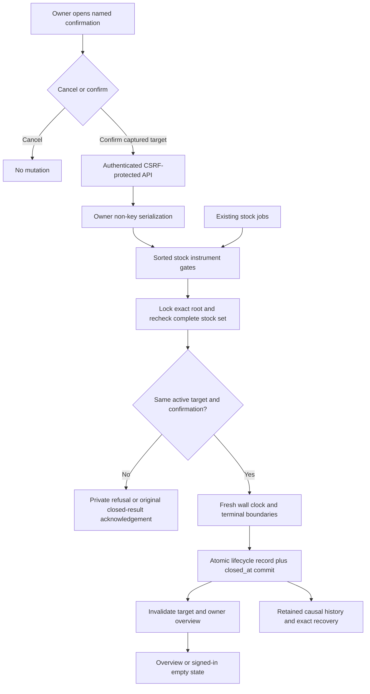

# Phase 14: End Strategies Safely — Research

**Researched:** 2026-11-19  
**Domain:** Terminal portfolio lifecycle, financial concurrency, private browser authority and exact recovery  
**Confidence:** HIGH for inspected existing contracts; MEDIUM for the proposed new closure authority until real PostgreSQL proofs

<user_constraints>
## User Constraints

No Phase14 CONTEXT.md exists. The following are the approved requirement descriptions, copied verbatim; they are the locked product decisions, not a new interview or UI approval. [VERIFIED: .planning/REQUIREMENTS.md:24–27,38–39,45,56]

- **PMGT-03**: User can delete any owned portfolio, including one with holdings, only after a confirmation identifies the portfolio and explains the effect; cancellation changes nothing and repeated deletion cannot affect another portfolio.
- **PMGT-04**: Deletion freezes that portfolio's committed cash, holdings and financial History, stops future dividend/split/correction effects on it, and preserves its financial records outside normal screens without creating liquidation trades or moving funds elsewhere.
- **PMGT-05**: User can delete their last portfolio and remain signed in with an empty overview and Create portfolio action; subsequent reads, refreshes and sign-ins do not silently create or fund another portfolio.
- **PFIN-05**: Each active portfolio receives only its own verified split effects with preserved total basis and unchanged historical fills; frozen deleted portfolios remain consistent at closure and cannot disrupt another portfolio's later stock accounting.
- **PFIN-06**: Concurrent creation, deletion, trades and financial jobs cannot exceed ten active portfolios, duplicate grants/events, overspend a portfolio, mutate a portfolio after its deletion boundary or move an operation into a different strategy.
- **PCTX-03**: User can open an active portfolio from the overview and navigate its holdings, trading and History through stable portfolio-specific links; a stale/deleted link explains unavailability and offers the overview without exposing retained financial records.
- **PSAFE-01**: Every portfolio operation and financial object lookup enforces owner and active-state authorization on the server, including guessed IDs, old references, cursors and direct trade/retry requests; other owners' and deleted portfolios' finances remain unavailable through normal APIs.

Additional approved interpretation, copied verbatim: [VERIFIED: .planning/REQUIREMENTS.md:75–91]

> Confirmed deletion is terminal in the normal app: no restore/trash UI. A fill
> or financial job committed before closure remains in the frozen state; later
> effects, including previously earned but unpaid dividends and later negative
> corrections, do not change the closed experiment. Preserve their causal
> records and lifecycle disposition without redirecting value to an active book.
>
> Read access to deleted financial records remains blocked even for a prior
> retry or original-reference URL. An old request cannot recreate the strategy
> or spend a replacement portfolio's starting cash. Internal retained evidence
> still supports exact recovery and integrity checks.
>
> Shared market evidence can continue updating globally; the deleted portfolio's
> cash, quantities, basis and financial History do not advance. Lifecycle-aware
> reconstruction must distinguish its closure state from active stock unit epochs.

**Agent discretion:** Concrete SQL/interface/migration boundaries, confirmation presentation, retry transport, internal audit representation and test decomposition are technical recommendations below. No new business choice or owner acceptance is inferred. [VERIFIED: planning task; .planning/ROADMAP.md:302–329]

**Deferred / excluded:** Transfers, reset, liquidation, physical purge, undo/trash/restore/export UI, pooled money, new dependencies/providers, live activation and production operations. Phase15 owns integrated lifecycle acceptance, but current-revision financial safety and recoverability belong to Phase14 now. Phase7's six live requirements remain separately unverified; issue35 retains its exact accepted scope and 2026-12-17T00:00:00Z expiry. Keep work local; planning authorizes no implementation, publication or deployment. [VERIFIED: REQUIREMENTS.md:94–135; ROADMAP.md:315–329; phases/13-create-and-compare-independent-strategies/13-CONTEXT.md Deferred]
</user_constraints>

## Summary

Reuse the actual terminal foundations. `accounts.closed_at`, immutable account/owned-row guards, `PortfolioStockClosure`, complete instrument-history reconstruction, active-only split/dividend selectors, explicit private routes and browser target epochs already exist. Public closure authority and deletion UI do not. A privileged fixture that sets `closed_at` is not a production lifecycle implementation. [VERIFIED: backend/app/models/user.py:59; backend/app/models/corporate_action.py:477; backend/alembic/versions/0017_portfolio_ownership.py:79–144; backend/tests/test_portfolio_stock_ownership.py:142–161; backend/app/api/v2/portfolios.py]

The difficult delta is a single durable closure across several stock instruments without reversing instrument→root locks, fabricating movements, or damaging future global sequence/unit validation. Historical stock participation matters even after the quantity becomes zero. New authority must preserve frozen financial evidence while allowing active siblings and globally retained announcements to continue. [VERIFIED: backend/app/services/stock_ownership.py:385–505,536–697; backend/app/services/corporate_actions.py:557–712]

**Primary recommendation:** Add a narrowly granted, versioned terminal-closure authority and immutable lifecycle record; retain the existing per-stock terminal boundaries. Publish deletion only after SQL/API/private-read/job/browser and successor-recovery contracts pass together. Use the existing stack and a new Alembic revision; preserve qualified0015–0020 bytes and retained profiles. These are implementation recommendations derived from the constraints, not newly locked owner decisions. [VERIFIED: ROADMAP.md:315–329; backend/app/db/portfolio_bootstrap.py:189–341; phases/13-create-and-compare-independent-strategies/13-RECOVERY-PROOF.md]

## Architectural Responsibility Map

| Capability | Primary tier | Secondary tier | Rationale / provenance |
|---|---|---|---|
| Atomic close, count/name release, permanent retry identity | Database | API service | Owner serialization, root write fence and immutable causal evidence belong in the existing authority boundary. [VERIFIED: 0020_portfolio_management.sql:16–38,96–107; 0017_portfolio_ownership.py:79–144] |
| Stock terminal boundaries and continued sibling events | Database + existing financial services | Scheduler | Complete instrument history, gates and unit/digest checks already span all roots. [VERIFIED: stock_ownership.py:385–697; corporate_actions.py:557–712] |
| Authenticated DELETE and private refusals | API | Database | Server identity/CSRF and bounded strict input; SQL repeats owner/lifecycle checks. [VERIFIED: api/v2/portfolios.py:104–153; portfolio_management.py:28–137] |
| Named confirmation, cancellation, unknown result, stale callbacks | Browser | API | Browser owns presentation and captured action lifetime, never financial authorization. [VERIFIED: usePortfolioManagement.ts; usePortfolioTarget.ts; PortfolioTargetBoundary.tsx] |
| Exact restore, admission and rollback/refusal | Existing deploy tooling | Database | Existing source, catalogue, ACL, sequence, image and archive guards must gain a successor profile. [VERIFIED: backup-snapshot.py; verify-restore.py; deploy/tests/portfolio-sources.py] |

## Project Constraints (from AGENTS.md)

- Read full CLAUDE.md and current PROJECT/REQUIREMENTS/ROADMAP/STATE, then relevant context/plans/summaries; preserve shared planning history and resolve stale pointers from actual evidence. [VERIFIED: AGENTS.md Shared project rules]
- Use GSD and adapter mappings; retain research, dependency ordering, checkpoints, review, validation and verification. Follow session delegation rules; do not bypass gates using yolo/commit_docs. Push and merge require their explicit CLAUDE.md approvals. [VERIFIED: AGENTS.md Get Shit Done; .codex/GSD-ADAPTER.md]
- UI work reads ui-ux-pro-max, uses local targeted searches and existing design-system documents. Preserve the established design system. The UI researcher owns the detailed UI-SPEC; this document does not substitute for it. [VERIFIED: AGENTS.md UI work; .agents/skills/ui-ux-pro-max/SKILL.md; design-system/birja/MASTER.md]
- Keep router→service→model layering, async I/O, Decimal/NUMERIC monetary state and string JSON, UTC, explicit rounding, atomic locked mutations, DB invariants, deterministic bounded pagination and immutable migrations. No financial state solely in Redis, float money, hand-built unsafe SQL, schema creation at startup or speculative architecture. [VERIFIED: CLAUDE.md]
- Preserve OTP/cookie sessions, CSRF on DELETE, server owner/active authorization, no-store private responses, escaped plain text, restricted roles and verified TLS, pinned images/locks and strict scans. Test all new endpoints against isolated real PostgreSQL; mock provider HTTP only. Overall80% and critical100% remain. [VERIFIED: CLAUDE.md Security/Test culture]
- Codex setup maintenance preserves Claude config and validates discovery with the sync script when changed; this phase needs no assistant-configuration change. Preserve unrelated `.claude/`. [VERIFIED: AGENTS.md Setup maintenance; assigned scope]

<phase_requirements>
## Phase Requirements

| ID | Locked behavior | Research support / required proof |
|---|---|---|
| PMGT-03 | Named confirmed deletion; cancellation no-op; any owned book; repeat safe | Captured owner/ID/name confirmation, SQL closure authority, lost-response/repeated-DELETE and cancel tests |
| PMGT-04 | Terminal freeze without liquidation or transfer | Account lock boundary, immutable closure policy/evidence, unchanged canonical financial snapshots before/after later jobs |
| PMGT-05 | Delete last; retain identity; explicit replacement only | Existing initialization latch and zero-state UI; OTP/refresh/read/replay tests after actual public deletion |
| PFIN-05 | Active splits independent of frozen historical units | Existing `_check_closures`/`_check_units`, all historically participating instruments, sibling successive-split/reconstruction tests |
| PFIN-06 | Safe management/trade/job races | User non-key serialization, sorted instrument gates before root, inventory recheck, blocked-writer and duplicate campaign tests |
| PCTX-03 | Stable links and private unavailable state | Existing boundary + lifecycle invalidation; old routes/cursors/reference/receipt tests without fallback |
| PSAFE-01 | Server owner/active authorization everywhere | Complete route/object inventory, actual restricted app/scheduler negatives, final read-fence review and privacy headers |

Descriptions above summarize the exact copied constraints; no additional requirement IDs are claimed complete. [VERIFIED: REQUIREMENTS.md Traceability; ROADMAP.md:306]
</phase_requirements>

## Standard Stack

Use installed locked packages. Versions below are repository pins, not registry-current recommendations. No dependency installation, registry execution or upgrade is needed. [VERIFIED: backend/pyproject.toml; backend/uv.lock; frontend/package.json; frontend/package-lock.json]

| Component | Locked version | Use |
|---|---|---|
| Python / FastAPI / Pydantic | Python3.14; FastAPI0.162.0; Pydantic2.14.1 | Existing private async API and strict deletion input |
| SQLAlchemy / asyncpg / Alembic | 2.0.55 / 0.32.0 / 1.20.1 | Transactions, exact PostgreSQL state and new reviewed migration |
| PostgreSQL | Existing immutable pinned image | Existing advisory/root locks, triggers, finite source-owned SQL authority |
| React / TanStack Query / React Router | 19.3.1 / 5.105.0 / 8.5.1 | Existing target-bound management and routed unavailable states |
| Vitest / Playwright / pytest | 5.0.5 / 1.64.1 / 9.1.1 | Existing unit/browser/real-DB infrastructure |

All table version claims: [VERIFIED: backend/uv.lock; backend/pyproject.toml; frontend/package.json; docker-compose.test.yml].

**Package Legitimacy Audit:** Not applicable: zero new external packages recommended or installed. Existing lockfiles/images remain fixed. Context7 MCP and `ctx7` were unavailable; official documentation was fetched directly. No best-effort package installation was attempted because this assignment explicitly prohibits it. [VERIFIED: tool discovery/read-only command lookup; delegated scope]

## Architecture Patterns

### Data flow and authority



The diagram describes proposed flow; existing gate/root ordering and privacy boundaries substantiate the design. [VERIFIED: stock_ownership.py:93–126; corporate_actions.py:565–585; api/v2/portfolios.py; REQUIREMENTS.md acceptance interpretations]

### 1. Treat `closed_at` as a terminal write fence, not row deletion

The accounts trigger rejects any changed closed row and owned insert/holding triggers lock/recheck the root. Existing financial records have immutable ownership and append-only guards. App presently has column UPDATE(cash), not authority to set closed_at; scheduler cannot directly close. Preserve those restrictions and add one named app-executable definer for closure, with no general lifecycle UPDATE/DELETE privilege. Closed owners must not acquire read access through this helper. [VERIFIED: 0017_portfolio_ownership.py:79–177; tests/test_portfolio_management_grants.py:161; 0020_portfolio_management.sql:111–126]

**Recommended new durable evidence:** one immutable portfolio lifecycle record keyed uniquely to `(portfolio_id,user_id)` and the exact `closed_at`, with versioned end-experiment policy and captured confirmation identity/name. Link it to existing stock boundaries, not copies of rewritten fills or fictitious balance movements. Enforce composite ownership/FKs, immutable triggers, finite reasons/policy versions, identity/index rules and app/scheduler mutation denials. An empty or crypto-only book still needs lifecycle provenance even though it needs no stock boundary. New table/SQL names and exact columns are planner discretion. [VERIFIED: existing PortfolioStockClosure cannot cover non-stock roots, corporate_action.py:477–499; required causal lifecycle evidence, REQUIREMENTS.md:77–91; proposed architecture]

Do not insert a normal trade/dividend/split/correction History item at deletion or later just to record lifecycle. Ordinary History freezes; separate internal lifecycle evidence plus retained global revisions and closure policy can deterministically explain `not_applied_portfolio_closed`. Prefer this finite closure policy over an unbounded new job that writes a skip row for every future announcement and every closed book. Preserve known unpaid entitlement/payment/correction anchors; never cancel by overwriting them or move the effect to a replacement. Internal reconciliation/recovery must derive and test disposition from original references, event revisions and lifecycle boundary; if an explicit per-event audit is selected, it must be a distinct nonfinancial immutable ledger, bounded/idempotent and absent from financial History. [VERIFIED: REQUIREMENTS.md:77–91; tasks/dividends.py:29–72 already excludes closed roots; services/event_history.py:180–209 enumerates financial sources; recommended minimal interpretation]

### 2. Multi-instrument closure requires a dedicated lock protocol

Existing order is stock instrument advisory gate→account→holdings; management uses User `FOR NO KEY UPDATE`→account. The previous User FOR UPDATE choice caused a real dividend FK KEY SHARE deadlock, repaired in Phase13. PostgreSQL documents non-key row locks as compatible with KEY SHARE and recommends consistent acquisition ordering. Retain the repaired mode; no stock job should start acquiring User NO KEY UPDATE behind a root. [VERIFIED: 0020_portfolio_management.sql:16,63,96; stock_ownership.py:167–185; corporate_actions.py:565–585; 13-REVIEW.md CR-02; CITED: https://www.postgresql.org/docs/18/explicit-locking.html]

Do **not** call `acquire_stock_gate` in a loop: it explicitly rejects a second different instrument per transaction via `db.info['stock_gate']`. `assert_ownership_consistent` calls that same helper, so looping through it is equally invalid. Keep that financial guard. Add a dedicated finite closure authority that takes the SAME advisory namespace for a sorted set, without reusing or clearing the single-instrument session marker. [VERIFIED: stock_ownership.py:93–126,385–399]

Recommended protocol:

1. Authenticate owner and serialize management on User FOR NO KEY UPDATE. Discover the target's distinct stock participation from **all ownership movements plus stock holdings**, not only positive current positions. Include sold-out and zero-quantity history. [VERIFIED: stock_ownership.py:536–555 checks every historic movement; `_check_units`:594–609]
2. Take those instrument advisory gates in deterministic coin-ID order, **before** taking the target root lock. Then lock the owned account FOR UPDATE, re-read its active state and the complete participation set. If a concurrent first stock buy introduced an omitted instrument, rollback and retry from discovery with a strict bound; never take the missing instrument while holding the root. Existing financial rows are append-only, so the recheck must account for additions. [VERIFIED: append_stock_movement:167–185,385–416; 0017_portfolio_ownership.py trigger; proposed race-safe protocol]
3. After all gates/root locks, check confirmation/name freshness, derive authoritative tail and epoch for each instrument, sample one fresh wall clock, atomically insert lifecycle/per-stock terminal evidence and set closed_at. Every failure rolls back all of it. Use READ COMMITTED and bounded local lock/statement/idle timeouts, matching existing financial expectations. [VERIFIED: stock_ownership.py:93–113,536–574; 0017_dividend_portfolio.sql:289–302; 0020 management lock_timeout]
4. On bounded contention/inventory retry exhaustion return private503 with Retry-After, no success acknowledgement or partial closure. Do not silently widen a failed attempt to another portfolio. [VERIFIED: services/portfolios.py:55–78 existing management error map; proposed closure behavior]

An alternative is locking the whole curated stock universe before one root. It simplifies first-buy discovery but unnecessarily serializes unrelated owners/instruments; use the targeted discover→gate→root→recheck protocol unless deterministic real-DB tests reveal a flaw. The latter's atomicity/lock behavior is a design recommendation awaiting execution proof, not a claim already tested. [VERIFIED: current per-instrument architecture; proposed tradeoff]

### 3. Terminal stock evidence must match the existing verifier exactly

`PortfolioStockClosure` stores portfolio/user/coin, one closed_at, **global** closing_sequence and unit_epoch. `_check_closures` requires closure time equal Account.closed_at, global tail equal max(sequence where recorded_at<=closed_at), epoch equal count(processed applications<=closed_at), no future time and no movement for that portfolio beyond its boundary. A closed root with historic movements but no closure is corruption even if current holding is zero. Do not use the root's own last sequence in place of the global tail, rely solely on `state.sequence` (a scheduler checkpoint), or omit sold stock. [VERIFIED: corporate_action.py:477–499; stock_ownership.py:385–416,480–505,536–574]

`_check_units` excludes a root only from split epochs beyond its own closure epoch, preserves legacy NULL digest interpretation, and validates portfolio-aware version2 digests. `reconstruct_stock_quantity` accepts historical cutoffs/epochs up to closure and refuses later ones. Keep frozen holdings in global consistency comparisons, but exclude them from future application owner/digest sets; active siblings must still receive exact movements with conserved basis and immutable fills. Exercise several successive splits and later dividend reconstruction, not only one split immediately after close. [VERIFIED: stock_ownership.py:577–697,701–773; corporate_actions.py:565–712; tests/test_portfolio_stock_ownership.py:142–229; tests/test_portfolio_splits.py]

### 4. Clock ordering is part of the closure contract

Current `_clock` uses `clock_timestamp`, stock append samples/refreshes it after locks and consistency checks, and persists `recorded_at=now`. Split application `processed_at` is explicitly sampled after instrument/root locks; neither inspected writer uses a transaction-start default for those fields. Thus no existing pre-wait backdating defect was demonstrated. [VERIFIED: stock_ownership.py:129–130,233–277,296,329,350; corporate_actions.py:84–85,565–587,686; corporate_action.py:285,379]

The **new** closure must sample its clock only after complete gates/root locks. PostgreSQL now()/transaction_timestamp is transaction-start time, while statement_timestamp is statement-start time and clock_timestamp advances within a statement. Do not capture either earlier timestamp for closure or reuse request time after waiting. [CITED: https://www.postgresql.org/docs/18/functions-datetime.html]

The existing verifier compares later **global sibling** movements/application timestamps to closed_at; delayed writers, equal microseconds and a backward wall-clock adjustment need explicit regression coverage. Recommended guard: under each existing instrument gate, refuse/retry a new movement/application timestamp that would fall at or before an existing terminal boundary; never forge a later timestamp, rewrite prior evidence or weaken `_check_closures`. New SQL/financial implementation must decide exactly where that check belongs, preserving fill/movement atomic equality and actual clock provenance. This is a remaining design/proof obligation, not an observed corruption of current stored data. [VERIFIED: stock_ownership.py:457–458,564–570; append_stock_movement:277–350; corporate_actions.py:686; proposed ordering guard]

### 5. Closed event policy must survive discovery, execution and retries

Current `latest_verified_entitlements`, new entitlement candidates, dividend VERIFIED/ANCHORS scans and SQL payout/hold authority all filter active accounts. Split selection rechecks active holders after root locks. Retain these safeguards and test queued work selected before closure; a selector predicate alone cannot fence already selected work. Closed original payments and held/negative corrections remain frozen, even when a future correction would credit or debit cash. Global monitoring may proceed. [VERIFIED: corporate_actions.py:836–866,926–961; tasks/dividends.py:29–72; 0017_dividend_portfolio.sql:90,299–302,403; services/dividends.py:50–76]

Do not require fresh provider admission, live market status, current quotes or payment eligibility just to delete a strategy. Closure concerns retained consistency, not new trading permission; a closed market or uncertain corporate action is not permission to keep the strategy economically alive. Corrupt retained lineage must refuse atomically with a clear operational error, rather than manufacturing missing boundaries. [VERIFIED: PMGT-03/04 any-owned scope; existing stock activation gates are financial authority, not lifecycle authority; proposed boundary]

### 6. DELETE transport and confirmation bind to the original target

Add an additive endpoint under existing `/api/v2/portfolios/{portfolio_id}` with CurrentUserDep, CsrfDep, bounded canonical string ID, private ManagementRoute and a service-owned transaction. Do not use OwnedActivePortfolioDep alone for an idempotent closed-result acknowledgement: that resolver intentionally cannot distinguish an owned closed root. A narrow closure service may acknowledge an **owned already-closed** original ID without returning metadata, finances, original receipts or permitting writes; foreign/missing remain the same private unavailable response. Choose and document a stable minimal200/204 result. [VERIFIED: api/v2/portfolios.py:90–153; core/deps.py; services/portfolios.py:27–41; recommended transport]

Recommend a strict small JSON confirmation intent containing the reviewed exact canonical name, bound to captured portfolio ID/owner/session; reject unknown/duplicate fields, invalid content type/oversized body. Under the root lock compare the current name to the captured name and return a refresh/review-required409 if it changed. This avoids silently confirming a newly renamed experiment; names are context, never authorization. Lost result retries retain original ID/intent; a replacement with the same display name has a different permanent ID and can never receive that retry. Unknown500/503/network/aborted responses do not prove rollback. [VERIFIED: portfolio_management.py:107–137 bounded parser pattern; portfolioManagement.ts:53–102 outcome model; 0020_portfolio_management.sql:22–30 permanent key semantics; proposed confirmation protocol]

Avoid reusing `read_management_body(patch=...)` by pretending deletion is metadata PATCH. Extend bounded parsing cleanly or add a dedicated small strict schema/parser; keep error redaction and private headers on validation/refusal/success. No free-form financial payload or client-provided closed_at, owner, balance, epoch or sequence enters authority. [VERIFIED: portfolio_management.py; schemas/portfolios.py; CLAUDE.md thin route/input/security rules]

### 7. Invalidate browser authority; never retarget or optimistically resurrect

Reuse target scopes and epochs, strict management API parsing, captured callbacks and advisory metadata BroadcastChannel/focus refetch. Closure notification carries only identity/invalidation metadata; it is never proof that an action is allowed. On submitted/unknown closure make the original target non-actionable, cancel/mask its reads and invalidate discovery/overview; definitive refusal may restore only after fresh active-state validation. On success navigate to Portfolios, without automatically choosing a sibling. Any retained unresolved original trade notice must stay boolean-only in the unavailable boundary, with no receipt/value/retry action. [VERIFIED: usePortfolioTarget.ts:30–145; usePortfolioManagement.ts; portfolioMetadataEvents.ts; PortfolioTargetBoundary.tsx:24–60; recommended lifecycle integration]

Retain pending original order ID/key/payload separately from current route/label. A late create, metadata, delete, preview, fill, History page or original-detail callback must pass original owner/session/root/operation guards before changing UI. Other-tab deletion requires the same immediate authority invalidation plus authoritative re-fetch and focus fallback. Window navigation, logout, A→B→A and delete/recreate-same-name must not restore old financial caches. [VERIFIED: existing hook session/lease machinery; phases/13-create-and-compare-independent-strategies/13-REVIEW.md CR-01; PCTX-03/PSAFE-01]

Use a named danger confirmation in the existing portfolio detail management surface, with explicit Cancel and Delete portfolio, effect copy, last-portfolio warning/empty destination, pending and uncertain-result states. Inline disclosure is compatible with existing create/metadata forms and avoids adding a dialog dependency; precise presentation/focus belongs to UI-SPEC. Preserve escaped long names/descriptions, destructive token,44px controls/8px gaps, keyboard focus, reduced motion and native200% reflow. Do not regenerate MASTER. [VERIFIED: PortfolioMetadataForm.tsx; PortfolioCreateForm.tsx; design-system/birja/MASTER.md; local ui-ux-pro-max search `destructive action confirmation`, Interaction/Confirmation Dialogs; proposed presentation]

### 8. Review every normal read and final response fence

Use a route→service→query inventory, including identity/discovery/overview, metadata, detail/holding/crypto-stock previews, execution/replay, History pages/cursors and embedded original details. Current history services validate owner/active before and after hydration, while valuation's final statement obtains root FOR SHARE locks through response lifetime. Test closure between initial resolution and final hydration for every surface; where a read needs serialization at its final check, reuse the established shared-root fence rather than assert an early lookup suffices. A request legitimately serialized before closure differs from a fresh post-closure request; document the linearization point and never claim the server can revoke bytes already delivered to a browser. [VERIFIED: services/history.py:105–162; event_history.py:165–360; portfolio.py:175–195; CITED: https://cheatsheetseries.owasp.org/cheatsheets/Authorization_Cheat_Sheet.html]

### 9. Version current authority and recovery; freeze qualified history

Phase13's actual qualified source is `9527e358bc6953cec7580043703324db194ba396` (schema0020), not the later planning-only HEAD. Its independently verified current inventory is29tables/22identity sequences; complete0017 and older sources are separate authenticated lanes. Treat qualified0015–0020 migrations/SQL/contracts as immutable even while this feature branch remains local. Add a successor revision and source profile, retain complete qualified0020 at that exact commit and complete0017 at4b4320b, and preserve0007–0014 profiles. Do not relabel a new HEAD tree as retained0020 or edit historical hashes to bless a change. [VERIFIED: 13-VERIFICATION.md source_commit; 13-RECOVERY-PROOF.md Exact state/Source identities; deploy/tests/portfolio-sources.py:32–85; assigned compatibility constraint]

Plan the full inventory edge: new model/migration/SQL, portfolio bootstrap catalogue/ACL/source pins and schema admission, migration runner/dev startup, producer supported revisions/tables/columns/sequence/canonical lifecycle digests, independent consumer verifier/no-ACL quarantine/regrant, retained-source matrix and exact complete archive members, cold fixtures, role/TLS/rollback and compatibility scripts, runner/CI/critical coverage. File families are `backend/app/db/{portfolio_bootstrap,portfolio_migrate,schema_contract,dev_bootstrap}.py`, `deploy/{backup-snapshot,verify-restore}.py`, `deploy/tests/{portfolio-sources,portfolio-smoke,portfolio-management-recovery-fixture,run-portfolio-validation}.py`, `portfolio-retained-sources.json`, fixture JSON and related contracts. New payload/profile version must not redefine V1/V2 absence semantics or broaden old admission. [VERIFIED: named modules; backup-snapshot.py:83–124,428–501,931–986; verify-restore.py:1178–1195]

Prove fresh and populated0020→successor restricted verified-TLS authority parity; original financial rows unchanged by migration; exact successor cold restore after source destruction and an immutable independent pre-backup oracle; true frozen portfolios and closed creation-key replay survive. Ordinary app cannot directly update closure/baseline/history/journal and scheduler cannot reopen or close. Old source must refuse successor schema before writes; downgrade must refuse before loss of terminal evidence unless a genuinely lossless supported path is proven. Keep quarantine until exact authorization/source checks pass. Phase15 does not defer these obligations. [VERIFIED: ROADMAP.md:324–329; schema_contract.py; portfolio_bootstrap.py; 13-RECOVERY-PROOF.md]

## Don't Hand-Roll

| Problem | Use instead | Reason / provenance |
|---|---|---|
| Frozen stock historical accounting | Existing PortfolioStockClosure / `_check_closures` / `_check_units` | Already distinguishes global epoch from terminal root units. [VERIFIED: stock_ownership.py:536–773] |
| Write fence / transactions | Existing SQL triggers, advisory namespace, root locks and reviewed narrow definer | Application prechecks cannot serialize a later financial write. [VERIFIED: 0017 guards; stock_ownership.py] |
| Market/cash/split calculations | Existing financial services | Closure performs no liquidation or repricing. [VERIFIED: PMGT-04] |
| Auth, CSRF, request fetching and session epochs | Existing dependencies/TanStack Query/target boundary | Preserve cookies, cancellation and explicit authority; cancellation is not proof of mutation outcome. [VERIFIED: core/deps.py; target hooks; CITED: https://tanstack.com/query/v5/docs/framework/react/guides/query-cancellation] |
| Recovery archiver or alternate lifecycle datastore | Existing versioned manifest/restic machinery | Keep one exact PostgreSQL causal source and independently authenticated recovery. [VERIFIED: backup-snapshot.py; verify-restore.py] |

## Runtime State Inventory

This is an additive lifecycle/schema change. Source inspection is not a live VDS inspection; uninspected state is explicitly unknown. [VERIFIED: assigned read-only research scope]

| Category | Items found | Required action |
|---|---|---|
| Stored data | Account closed_at, stock boundaries, financial/creation/initialization evidence already retained | New lifecycle migration/profile; no regrant, financial rewrite or purge; handle pre-existing qualified closed fixtures explicitly. [VERIFIED: user.py; corporate_action.py;0015–0020 migrations] |
| Live service config | Source-owned schema/ACL/admission/recovery bindings; private deployed configuration uninspected | Update/qualify disposable source-owned successor; no live configuration operation. [VERIFIED: portfolio_bootstrap.py; schema_contract.py; deploy source] |
| OS-registered state | Source-owned recovery CORE/systemd inventory; actual OS registrations uninspected | Preserve inventory; no new timer/job required for deleting portfolios. [VERIFIED: verify-restore.py CORE/unit contract; proposed finite closure policy] |
| Secrets/env | Existing role/TLS/config plumbing; private `.env` and credentials uninspected | No key/env rename or new secret; planning must not read them. [VERIFIED: research authorization; existing core/config.py] |
| Build artifacts | Existing authenticated0020/0017/older complete sources, private image binding records and Phase13 archive | Preserve prior evidence; create new-source current artifact plus fixed qualified0020 lane; no OCI identity equivalence fallback. [VERIFIED:13-RECOVERY-PROOF; portfolio-smoke.py; portfolio-sources.py] |

## Common Pitfalls

| Failure | Prevention and early test |
|---|---|
| Only positive/current stock holdings get closure rows | Include sold-out historic movements; validate global consistency after a later split. [VERIFIED: `_check_closures`:547–555] |
| Account→instrument deadlock or weakening one-instrument guard | Dedicated sorted gate authority; recheck inventory after root lock and rollback/retry if incomplete. [VERIFIED: acquire_stock_gate; proposed protocol] |
| User FOR UPDATE recreated FK deadlock | Keep FOR NO KEY UPDATE, actual FK overlap/PID-blocking tests. [VERIFIED:13-REVIEW CR-02] |
| Request-start closure timestamp backdates the fence | Post-all-lock clock_timestamp; queued writer and equal/backward clock tests. [VERIFIED: `_check_closures`; official PostgreSQL datetime docs] |
| Closing sold/held stock poisons instrument-wide epoch/digest | Preserve versioned closure exclusions and complete history; multiple later splits/dividends/corrections across siblings. [VERIFIED: `_check_units`; corporate_actions.py] |
| Freeze appends skip/held decisions into financial History | Separate internal lifecycle provenance; canonical financial rows/digests remain byte-equal after closure. [VERIFIED: event_history.py financial sources; approved freeze interpretation] |
| Lost DELETE response retries a newly named replacement | Capture permanent original ID/intent; idempotent minimal closed acknowledgement and no retarget. [VERIFIED: permanent creation identity; proposed DELETE contract] |
| Old tab shows/replays retained receipts or callback navigates sibling | Target revocation, strict owner/session/operation guards, direct old-link/cursor/reference tests. [VERIFIED: target/hook patterns; PSAFE-01] |
| Deleting last triggers onboarding | Existing initialization latch and zero-root identity path, actual public deletion→login/read tests. [VERIFIED:0020 initialize_portfolio:64–86; PMGT-05] |
| Old authority fixture silently repinned / downgrade drops terminal evidence | New version/profile; fixed qualified0020/0017 positives and substitution negatives, explicit before-loss refusal. [VERIFIED: finite recovery/source machinery] |

## Code Examples

Existing verified boundaries, not a complete untested implementation: [VERIFIED: cited paths below]

```sql
-- Existing owner serialization,0020_portfolio_management.sql:16.
PERFORM u.id FROM public.users u WHERE u.id=p_user FOR NO KEY UPDATE;
-- Existing instrument namespace,stock_ownership.py:114–116.
SELECT pg_advisory_xact_lock(hashtextextended(
  'birja.stock.instrument:' || CAST(:coin AS text),0));
-- New closure MUST take all sorted gates before its root lock.
-- After the root lock, recheck the complete stock set and read clock_timestamp().
```

```python
# Existing immutable boundary model, models/corporate_action.py:477–499.
# New closure supplies one common DB timestamp and instrument-global tail/epoch.
PortfolioStockClosure(
    portfolio_id=root.id, user_id=root.user_id, coin_id=coin_id,
    closed_at=closed_at, closing_sequence=global_tail, unit_epoch=global_epoch,
)
# This construction alone grants no runtime permission or atomicity.
```

```typescript
// Existing metadata notifications are advisory only.
// Source: frontend/src/lib/portfolioMetadataEvents.ts.
broadcastMetadataChange(originalPortfolioId);
// New lifecycle mutation must additionally revoke the captured target, suppress
// stale callbacks and authenticate the next metadata/overview response.
// Do not treat AbortController.abort() as a database rollback receipt.
```

## State of the Art

| Current project practice | Planning implication |
|---|---|
| Qualified explicit-root schema0020 and repaired management locks | Extend it; do not restart ownership migration or copy user-global accounting. [VERIFIED:13-VERIFICATION;0020 SQL] |
| Authenticated campaign-specific immutable image IDs | Preserve exact IDs/config/RootFS, reuse records; equal filesystem is not equal identity. [VERIFIED:13-REVIEW CR-04; portfolio-smoke.py:29–100] |
| ASVS5.0 published standard structure | Use current V6Authentication/V7Session/V8Authorization labels, not old ASVS4 numbering. [CITED: https://github.com/OWASP/ASVS/tree/v5.0.0/5.0/en] |

## Environment Availability

| Dependency | Research-time evidence | Execution requirement / fallback |
|---|---|---|
| Node | Existing v24.22.1, `/usr/local/bin/node` | Keep installed Node24; no upgrade. [VERIFIED: read-only probe] |
| uv | Existing0.13.5, `/root/.local/bin/uv` | Locked/offline project environment; no install during planning. [VERIFIED: read-only probe] |
| restic | Existing0.19.1, `/usr/local/bin/restic` | Execution verifies retained provenance, no cloud call. [VERIFIED: read-only probe] |
| nginx | Existing `/usr/sbin/nginx` | Exact stripped child PATH must include/usr/sbin; preflight actual test config before expensive run. [VERIFIED: command lookup;13-LOCAL-VERIFICATION prior-attempt section] |
| PostgreSQL/Redis/Docker | Source Compose and prior completed receipts inspected; no daemon/service probe performed | Execution owns/authenticates disposable test resources, preflights engine/tool access and disk. Prior receipts are not current availability proof. [VERIFIED: assigned scope;13-RECOVERY-PROOF] |
| Context7 | No matching MCP orctx7 CLI | Official primary documentation fetched directly. [VERIFIED: tool/CLI discovery] |

No missing newly required dependency was identified. Runtime capacity/image/tool availability remains an execution preflight, not a planning blocker. [VERIFIED: no new packages proposed; scoped environment inspection]

## Validation Architecture

### Framework and execution discipline

pytest9.1.1/pytest-asyncio1.4.1 and real isolated PostgreSQL; Vitest5.0.5/RTL; Playwright1.64.1. Configs are backend/pyproject.toml, frontend/vite.config.ts and frontend/playwright.config.ts. Even nominal pure backend pytest files use autouse DB migration fixtures: **all backend pytest, DB operations and browser runners share one serial exclusive disposable lane**. Do not parallelize them or use dev/prod state. Frontend pure unit groups and offline Python contracts may run separately when they own no shared resources. [VERIFIED: manifests; backend/tests/conftest.py; CLAUDE.md;13-LOCAL-VERIFICATION]

The following files/test names are **proposed**, not existing passing evidence. Each owner means the implementation plan responsible for creating the tests with the feature, not a request to spawn an extra agent. Aim at bounded single-case/node selectors for routine feedback; DB fixture setup and real races may exceed30seconds. Measure and report those exceptions rather than invent sub30s guarantees or replace real transactions with mocks. [VERIFIED:13-LOCAL-VERIFICATION backend2202s/browser714s; recommended validation discipline]

### Requirements → meaningful tests and creation owners

| Requirement | Proposed new test owner/file | Small focused command after creation | Essential assertions |
|---|---|---|---|
| PMGT-03 | Closure authority/API plan: `backend/tests/test_portfolio_closure_api.py` | `cd backend && uv run pytest tests/test_portfolio_closure_api.py -k 'repeat or confirmation' -x` | Named intent, cancel issues no mutation, malformed/foreign/renamed refusal, holdings allowed, lost response same-ID replay |
| PMGT-04 | Financial boundary plan: `backend/tests/test_portfolio_closure_events.py` | `cd backend && uv run pytest tests/test_portfolio_closure_events.py -k 'unpaid or negative' -x` | Exact frozen canonical snapshot after unpaid credit, later correction/hold/split; retained lifecycle disposition; no History append/transfer/liquidation |
| PMGT-05 | Zero/replacement plan: `backend/tests/test_portfolio_closure_identity.py` | `cd backend && uv run pytest tests/test_portfolio_closure_identity.py -k 'last or replacement' -x` | Real DELETE→OTP/refresh/read remains empty; explicit new ID/one grant; old creation key cannot resurrect; name/slot reused safely |
| PFIN-05 | Stock continuity plan: `backend/tests/test_portfolio_closure_stocks.py` | `cd backend && uv run pytest tests/test_portfolio_closure_stocks.py -k 'sold_out or successive' -x` | Several instruments, sold-out history, successive splits/units/digests, conserved basis/immutable fills; active sibling dividend reconstruction |
| PFIN-06 | Race plan: `backend/tests/test_portfolio_closure_races.py` | `cd backend && uv run pytest tests/test_portfolio_closure_races.py -k 'first_buy or management' -x` | Instrument-first order; actual blocked PID barriers; new-coin retry; cap10/create/name race; before/after fill/payment commit; duplicate closers; queued clock ordering |
| PCTX-03 | Browser integration plan: `frontend/e2e/portfolio-deletion.spec.ts` | `python3 deploy/tests/run-stock-browser.py` after runner adds spec; full-browser long gate | Stale direct route, last-book empty/Create, two tabs, original unknown trade, delete/recreate same name, no fallback/retarget or retained figures |
| PSAFE-01 | Privacy/restricted-role plan: `backend/tests/test_portfolio_closure_privacy.py` | `cd backend && uv run pytest tests/test_portfolio_closure_privacy.py -k 'cursor or original' -x` | Owner/active on every normal lookup/replay, final-read overlap, closed/foreign errors no finances, CSRF/auth/no-store; restricted TLS mutation negatives |

All seven IDs also need affected retained regression coverage in existing test_portfolio_{crypto,stock_trading,dividends,entitlements,splits,stock_ownership,scoped_history,overview,management_authority,management_grants}.py and identity/routes tests. These files exist; the table's new files do not yet. Keep public API-created strategies and actual new DELETE in integrated fixtures; privileged closure fixtures remain narrow corruption/historical tests, not substitutes for lifecycle acceptance. [VERIFIED: repository file inventory;13-VERIFICATION artifact map]

### Wave0 dependencies and fixture ownership

1. **Lifecycle schema/authority owner** first adds independent before/after financial oracles and target/stock/clock fixtures, new SQL migration/ACL refusal tests. Specify closure/stock inventory interfaces before API/jobs/UI depend on them. Use separate explicit historical databases for historical revisions, never blindly `upgrade head` in0014/0017/0020 fixtures or downgrade the shared current database. [VERIFIED: test_portfolio_stock_ownership.py helper;13-17-FIXTURE-REVIEW; proposed sequencing]
2. **API/private-read owner** creates endpoint/confirmation/error parser, idempotent replay and all-route authorization inventory tests. Declare the confirmation schema/minimal result before browser client tests. Existing frontend error parser's accepted409 codes must gain a narrowly named confirmation-conflict code; arbitrary details remain redacted. [VERIFIED: portfolioManagement.ts:71–102; portfolio_management.py; proposed dependency]
3. **Stock/job owner** creates multi-stock/first-buy/sold-out/queued job and clock overlap cases, using observable blocking barriers instead of sleeps. Cover original root, active sibling, another owner and zero-position root. Existing one-instrument guard must stay tested unchanged. [VERIFIED: test_portfolio_splits.py; test_portfolio_strategy_events.py; acquire_stock_gate]
4. **Browser owner** adds strict API and deletion-hook tests, extends usePortfolioTarget/management/session/cross-tab tests, new confirmation component and PortfoliosPage/PortfolioTargetBoundary integration tests. Suggested unit command: `cd frontend && npm run test -- src/hooks/usePortfolioDeletion.test.tsx src/components/PortfolioDeleteForm.test.tsx`. Both suggested new files require creation. Test stale rendered handlers, logout/login, unknown/aborted operation, rename while confirming, late success and same-name replacement. [VERIFIED: existing frontend test architecture; proposed additions]
5. **Recovery/tooling owner** adds successor fixtures/manifests/quarantine/source and immutable qualified0020 lane **before** final runs, plus offline contracts. Existing bounded diagnostics: `python3 deploy/tests/test-portfolio-recovery-contracts.py` and `python3 deploy/tests/test-portfolio-validation-contracts.py`; inspect/time actual cases before claiming a fast path. Add new closure authority/service/API modules to critical100% include while retaining all61 qualified critical modules. [VERIFIED: run-portfolio-validation.py; backend/tests/test_critical_coverage_config.py;13-VERIFICATION]
6. **Final qualification owner** freezes final source and reviewed render inputs after repairs, runs complete gates and captures durable receipts; no source edit may occur while a campaign is qualifying. UI acceptance/native200% require the actual new implementation and owner response; previous Phase13 approval is not new deletion acceptance. [VERIFIED: CLAUDE.md;13-LOCAL-VERIFICATION; approved planning boundary]

### Final source-bound qualification and practical duration

Use the actual complete entrypoints, updated deliberately for the successor schema/stage while preserving all older lanes: [VERIFIED: deploy/tests/run-portfolio-validation.py:21,239–249]

```bash
python3 deploy/tests/run-portfolio-validation.py --suite all-security
python3 deploy/tests/run-portfolio-validation.py --suite recovery
```

These are **long final-gate exceptions**, not task-level quick checks. Prior actual whole security took3373s and recovery2792s at one frozen9527e35; new scope may take longer. Run all-security successfully first, then a fresh same-source same-archive complete recovery with every source/CORE/unit/archive/image guard before/after all seven stage families: image transition, retained roundtrip (now including fixed qualified0020 and0017), successor current cold, roles, upgraded TLS, fresh TLS with exact authority parity, selected rollback/refusal. Do not assemble partial historical diagnostics into a final pass. [VERIFIED:13-LOCAL-VERIFICATION;13-RECOVERY-PROOF; runner]

Before either expensive command, preflight the **exact stripped child environment**: PATH incl/usr/sbin, existing Node24/uv/Python/restic/nginx/config, owned resource identities/capacity, no competing DB/browser campaigns, explicit current/historical schema targets, preserved prior archives and fresh canonical directory. Borrowed configuration stacks must authenticate exact labels/images/ports/health and never acquire cleanup ownership. [VERIFIED:13-17-SUMMARY prior PATH failure;13-REVIEW Borrowed Configuration Stack; deploy/tests/test-db-config.sh]

Use durable one-shot PID/start identity/log/status/exit receipts so user status questions do not orphan or restart expensive suites. Reuse authenticated private campaign image IDs/aliases; missing/changed ID refuses without rebuild or tag/RootFS-equivalence fallback. Preserve older proof archives and qualify one new canonical archive under a Phase14-specific exclusive path; do not overwrite the qualified `/tmp/birja-phase13-proof/recovery.tar.gz`. Cleanup only owned containers/networks/volumes. A source/runtime/test change after failure requires a fresh final complete qualification, while focused repair runs remain diagnostics. [VERIFIED:13-LOCAL-VERIFICATION;13-RECOVERY-PROOF;13-REVIEW CR-04; portfolio-smoke.py; proposed Phase14 path isolation]

## Security Domain

Security and Nyquist validation are enabled (neither explicitlyfalse). Current ASVS5 categories below apply to the actual stack; this is a scope map, not certification. [VERIFIED: .planning/config.json; CITED: https://github.com/OWASP/ASVS/tree/v5.0.0/5.0/en]

| Category / threat | Required control |
|---|---|
| V2 Validation/business logic — tampering, replay | Strict original closure intent, DB lifecycle constraints, bounded retries/timeouts and once-only causal identity. [VERIFIED: established management pattern; approved PFIN-06] |
| V4 API / V6 Authentication / V7 Session — spoofing/CSRF | CurrentUser server identity, CSRF DELETE, unchanged cookie/session/zero-book behavior. [VERIFIED: core/deps.py; CLAUDE.md] |
| V8 Authorization — IDOR/elevation | Exact owned root, active normal reads, closed-only minimal acknowledgement, no global mutable table/closure grants. [VERIFIED: current ownership service; OWASP authorization cheat sheet] |
| V1 Encoding / V3 Frontend — XSS/stale display | Escaped plain names, existing tokens, revocable scopes, no leaked retained receipts or financial browser persistence. [VERIFIED: React management components; target boundary] |
| V11 Cryptography / V12 Secure communication / V14 Data protection | Existing restic encryption, verified DB TLS, private no-store responses, redacted logs and exact authenticated archive/quarantine. [VERIFIED: existing deploy/management tooling; CITED: https://www.postgresql.org/docs/18/libpq-ssl.html] |
| Repudiation / economic integrity | Immutable closure/policy, original movements/entitlements/payments/keys and explicit skipped lifecycle interpretation; exact restore. [VERIFIED: requirement acceptance; existing append-only contracts] |

SQL definer creation must use fixed safe search_path, trusted object ownership and revocation of default PUBLIC EXECUTE before narrowly granting the required signature. Independently measure fresh/upgraded catalogue/ACL parity; DB roles remain service identities, not arbitrary client-provided owner identities. [VERIFIED:0020_portfolio_management.sql:1–9,111–126; CITED: https://www.postgresql.org/docs/18/sql-createfunction.html]

## Assumptions Log

No training-only package/capability facts are used. New schema/function/interface names, targeted multi-instrument protocol, exact confirmation transport and minimal lifecycle-ledger interpretation are explicitly recommendations requiring implementation/review/testing, not owner-locked facts or completed proof. No permission, provider access, live service availability, new UI acceptance or current test pass is assumed. [VERIFIED: provenance throughout; research-only task]

## Open Questions

1. **Exact closure authority decomposition:** Choose a single definer that locks/checks/persists, or private lock/preparation plus final definer; preserve immutable helper inventory and no client-authorized lock/closure forgery. The proposed sorted-gate/recheck algorithm needs real first-buy/deadlock proof. This is technical planning work, not a missing product decision. [VERIFIED: one-instrument helper and current grant model]
2. **Clock fence placement:** Establish successor application/movement guard sites and deterministic queued/equal/backward-clock tests before locking final SQL fingerprints. Existing post-lock wall-clock sampling is verified; strict across-closure ordering is not yet proven. [VERIFIED: clock trace above]
3. **Lifecycle audit representation:** Prefer one immutable policy-bearing closure record and deterministic retained-event disposition; decide whether known pending effects require additional bounded causal references. No public closed ledger/read endpoint or financial History append is authorized. [VERIFIED: approved acceptance interpretation; proposed minimal design]
4. **Confirmation/retry status details:** Lock strict name intent, rename-conflict409 and minimal same-owner closed acknowledgement in API/UI-SPEC before parallel consumers. No further owner product choice is necessary unless planning would alter terminal-freeze policy. [VERIFIED: constraints; recommended transport]
5. **Pre-existing closed fixtures:** Specify migration interpretation/provenance for qualified0020 retained closed roots; never invent historical user confirmation. Add fixed source positives and incompatible/tampered closure negatives. [VERIFIED: qualified fixtures and recovery inventories]

## Sources

### Primary — repository evidence

- Full `AGENTS.md`, `CLAUDE.md`, adapter and current `.planning/{PROJECT,REQUIREMENTS,ROADMAP,STATE,config}`; Phase13 CONTEXT/RESEARCH/VERIFICATION/17-SUMMARY/LOCAL-VERIFICATION/RECOVERY-PROOF/REVIEW. These establish policy, prior proof and exact historical source, not a fresh Phase14 test result. [VERIFIED: read inputs]
- `backend/app/models/{user,corporate_action}.py`, `services/{portfolios,stock_ownership,corporate_actions,dividends,portfolio,history,event_history,trading,stock_trading}.py`, `tasks/dividends.py`, v2 management/portfolio/history routes,0015–0020 migrations/SQL, DB bootstrap/migrate/admission. [VERIFIED: inspected source]
- `frontend/src/{api/portfolioManagement,hooks/usePortfolioManagement,hooks/usePortfolioTarget,lib/portfolioMetadataEvents,components/PortfolioTargetBoundary,pages/PortfoliosPage}` and existing tests, MASTER/UI skill/local search. [VERIFIED: inspected source]
- Backup/restore producer/consumer and `deploy/tests/{portfolio-sources,portfolio-smoke,run-portfolio-validation}` plus qualified Phase13 evidence. [VERIFIED: inspected source/receipts recorded in prior phase]

### Primary — current official documentation fetched 2026-11-19

- https://www.postgresql.org/docs/18/explicit-locking.html — row-lock conflicts, non-key/KEY SHARE compatibility, advisory locks and lock ordering.
- https://www.postgresql.org/docs/18/transaction-iso.html — READ COMMITTED statement snapshots and rechecks after waits.
- https://www.postgresql.org/docs/18/functions-datetime.html — transaction/statement versus wall-clock semantics.
- https://www.postgresql.org/docs/18/sql-createfunction.html — safe SECURITY DEFINER/search_path/default EXECUTE privileges.
- https://www.postgresql.org/docs/18/libpq-ssl.html — certificate/hostname verification; actual asyncpg runtime controls remain project-specific verified fixtures.
- https://cheatsheetseries.owasp.org/cheatsheets/Authorization_Cheat_Sheet.html — deny-by-default and authorization on every request/object.
- https://github.com/OWASP/ASVS/tree/v5.0.0/5.0/en — current standard category structure.
- https://tanstack.com/query/v5/docs/framework/react/guides/query-cancellation — cancellation/AbortSignal lifecycle.

All official URLs above are [CITED] sources fetched in this research; no secondary search result is used as factual authority.

## Metadata

**Confidence:** stack HIGH (existing pins); current architecture HIGH (direct code and independently qualified Phase13 evidence); new closure lock/clock/audit implementation MEDIUM (prescriptive design awaiting deterministic real-DB tests); pitfalls HIGH (direct verifier contracts and actual prior qualification failures). [VERIFIED: cited evidence]

**Validity:** Recheck source interfaces/profiles whenever implementation changes; official stable PostgreSQL18 facts are version-specific, not assumptions about future releases. Existing advisory expiry remains2026-12-17 regardless of research validity. [VERIFIED: source-bound qualification rules;13-CONTEXT deferred risk]

**Scope:** Research only; no application/test/migration edits, installations, test suites, Docker/DB/provider/production operations or commits performed. Output ownership is this file alone. [VERIFIED: task/tool actions]
